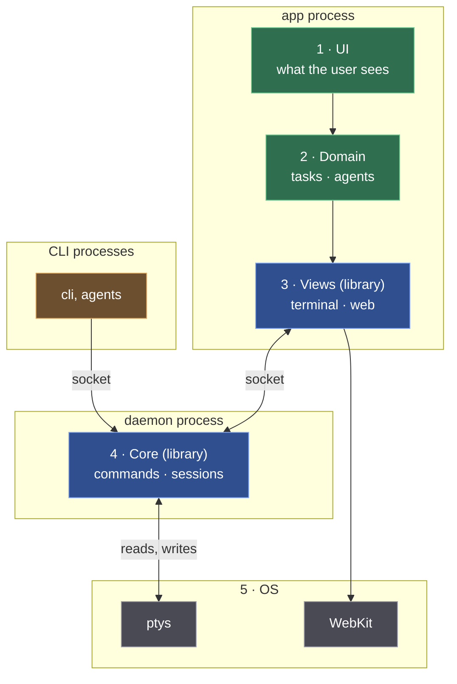

# Layer diagrams

A layer diagram answers three questions at a glance: **what sits on what**, **which process each piece runs in**, and **who owns the code**. Draw it so all three are readable without the prose.

## The rules

1. **Top to bottom, UI on top.** Like the OSI model: each layer uses the ones below it. Number the layers (`1 · UI`, `2 · …`), top first. The operating system and other outside things (ptys, WebKit, devices) go at the bottom.
2. **Processes are boxes; layers are bars inside them.** One process box per process, stacked in layer order. Each layer is a *single* node (a wide bar) whose label lists what's in it. Don't nest a layer box inside a process box: many renderers drop the inner titles and collapse side-by-side rows into tall columns.
3. **Clients aren't layers.** CLIs, agents and other callers sit on top, as peers of the UI, and point *down* into the layer they call. Never draw a client below the thing it calls, even to dodge a line crossing a box title.
4. **Colour by owner, with a key.** One colour per owner (our code, a library we use, a third party, the OS, clients). Add a one-line key under the first diagram. Use mid-tone fills with white text so the diagram reads in both light and dark mode.
5. **Only real connections, labelled with how.** Label each line with its mechanism: `socket`, `reads, writes`, `creates`. Where a layer is skipped (the daemon writes the pty itself, a view reads pixels straight from a device), draw that line. Don't let one arrow down the stack imply everything passes through every layer.
6. **Put each thing where it actually lives.** For each box ask: which process runs it?
7. **Compare stacks with the same numbers.** When two systems share layers, keep the numbering and leave gaps for missing layers (kmux: 1, 3, 4, 6; Kanna: 1–6). Follow with a table: layer | system A | system B | process.

## Template (Mermaid)

Layout tips:
- Put explicit ` ` breaks in labels (about 24 characters a line) so the renderer doesn't wrap them at odd places.
- Declaration order and edge direction decide placement: a node declared as an edge's *target* lands below its source. To keep a client on top, declare it before the server and point the edge down.
- Lines entering a box from above can cross its title. Accept that over putting something in the wrong place.

## Before showing it

1. **Render it and look at it.** Render to an image (`mmdc`, or the viewer's own renderer) and read the picture, not the source. Check for: missing titles, rows collapsed into columns, wrapped labels, lines through titles, boxes in the wrong process.
2. **Review it against the rules.** For each box: right layer? right process? right colour? For each line: real? labelled? Is any client below what it calls? Does anything imply a path that doesn't exist?
3. **Keep the prose and tables in step.** When a box moves, update the glossary, the tables and any sequence diagrams that still use the old name.
