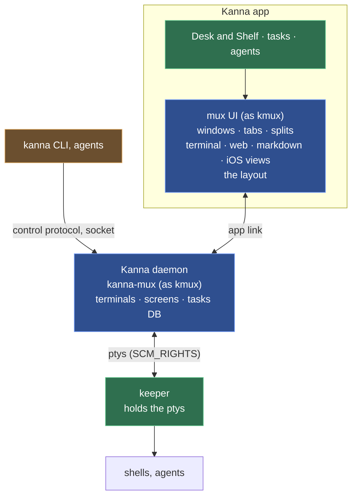

# kanna — Specification

> **Status:** Draft v0.9 · **Last updated:** 2026-10-15
>
> This page is the index: what Kanna is, its goals and its shape. Everything else is in a short spec of its own under [specs/](specs/). Items marked **[Assumption]** are guesses to confirm.
>
> **Related:** [kmux spec](https://github.com/tampopogk/kmux/blob/main/docs/kmux-spec.md) (the separate, public kmux repo), the reference Kanna follows · [roadmap](roadmap.md) · [the build plan](plans/mux-build.md)

## What Kanna is

`kanna` is a command-line tool that controls a **mux**, an app that shows several things side by side. A single command can open a terminal, show a web app or launch an iOS app in the simulator. Its commands work the same way with **kmux**, **tmux** or **cmux**; each mux supports whatever pane types it can show ([backends](specs/backends.md)).

**Kanna ships its own mux, Kanna.app**, kanna's default backend: its terminals live in a background daemon, so they survive the app quitting. It does what [kmux](https://github.com/tampopogk/kmux) does ([kmux is the reference](specs/kmux-reference.md)), keeps its files and sockets in its own folder in Application Support ([instances](specs/instances.md)), and gives its terminals `KANNA_SOCKET`, `KANNA_PANE` and `KANNA_INSTANCE`, so it never meets a kmux the user runs. On top of the mux, Kanna runs coding agents as **tasks**, one per worktree, on a **Desk** ([Desk](specs/desk.md), [tasks](specs/tasks.md)).

## Goals

| # | Goal |
|---|---|
| G1 | The same commands work with every supported mux. |
| G2 | Make sizing panes simple by default, with more control available when you ask for it. |
| G3 | Make it easy to script: predictable output, JSON output and clear exit codes. |
| G4 | Open a whole dev setup (server, web preview, iOS app) with one command. |

**Non-goals (for now):** showing panes itself (that is the mux's job); pixel-exact sizing (sizes are fractions of the space). Kanna on other machines is planned in [fleet](specs/fleet.md).

## Architecture

Apps draw; the headless daemon keeps tasks, their content and workspaces; the keeper holds the ptys, so quitting the app or restarting the daemon loses nothing. Layers in detail: [architecture](specs/architecture.md).

## Specs

**The mux**

| Spec | What it covers |
|---|---|
| [Architecture](specs/architecture.md) | The layers and processes; what the daemon keeps and what the apps keep; languages and platforms |
| [Presentation layers](specs/presentation-layers.md) | Work, logical and physical presentation: what lives in the headless daemon and what in each app, and the IDs |
| [kmux is the reference](specs/kmux-reference.md) · [kmux subtree](specs/kmux-subtree.md) | kmux as the model Kanna is checked against; its source in `references/kmux` |
| [The keeper](keeper.md) · [upgrading it](specs/keeper-upgrade.md) | The process that creates and holds the ptys |
| [The app link](specs/app-link.md) | The app's connection to the daemon: messages, snapshots, the app starting the daemon |
| [Daemon build](specs/daemon-build.md) | A relaunched app of another build replaces the daemon |
| [Fleet](specs/fleet.md) · [identity and pairing](specs/fleet-identity.md) · [tasks across machines](specs/fleet-tasks.md) · [build Macs](specs/build-macs.md) · [agent sign-in](specs/agent-sign-in.md) | Kanna across machines, free on the LAN, Cloud for about $5 a month; xcodebuild redirected to a pool of Macs |
| [Restarting the daemon](specs/daemon-restart.md) | Terminals on disk, adopting the keeper's ptys |
| [Pane sizes](specs/pane-sizes.md) | A program sees its view's size across a relaunch and a restart, and on the Shelf and in the backlog |
| [The layout](specs/layout.md) | One layout model in the app; layout steps; saving, restoring; working with the app closed |
| [Windows, tabs and splits](specs/windows.md) · [menus](specs/menus.md) · [zoom](specs/zoom.md) · [docked pane](specs/docked-pane.md) | The windows, their actions and debug commands |
| [Web, markdown and iOS panes](specs/app-panes.md) · [markdown keys](specs/markdown-keys.md) · [markdown diff](specs/markdown-diff.md) | The app's panes, lent to the daemon |
| [Code viewer](specs/code-viewer.md) · [code tour](specs/code-tour.md) | A highlighted code pane; the agent commenting on code |
| [Diff viewer](specs/diff-viewer.md) | `git diff` in a native pane beside the agent, following the worktree |
| [Doc markup](specs/doc-markup.md) | Commenting on a doc with the agent beside it |
| [Terminal behaviour](specs/terminal.md) · [terminal links](specs/terminal-links.md) | What a terminal does, who answers the program; which links open |
| [The shell a command runs in](specs/command-shell.md) | Commands start in an interactive login shell |

**The CLI**

| Spec | What it covers |
|---|---|
| [The kanna CLI](specs/cli.md) | A port of kmux's CLI; where it differs; reaching Kanna; errors and exit codes |
| [Commands](specs/commands.md) | Every command and option; `send-key` |
| [kanna send](specs/kanna-send.md) | Return pressed on its own, after a bracketed paste, so agents submit |
| [Sizing and arranging panes](specs/arranging-panes.md) | Fractions, the layout expression, `kanna.yaml` |
| [Mux backends](specs/backends.md) | kmux, tmux, cmux; choosing one; the adapter interface; open questions |
| [Instances](specs/instances.md) · [build channels](specs/build-channels.md) · [stopping an instance](specs/instance-stop.md) | Separate Kannas for developing Kanna, and quitting one |
| [Tab completion](specs/tab-completion.md) · [screenshot](specs/screenshot.md) | Completing commands in zsh and bash; a PNG of a pane or window |

**Tasks and agents**

| Spec | What it covers |
|---|---|
| [Desk](specs/desk.md) · [new Desk](specs/new-desk.md) · [planning terminal](specs/planning-agent.md) | A window showing one task, with the Shelf |
| [Tasks](specs/tasks.md) · [backlog runners](specs/backlog-runners.md) · [backlog search](specs/backlog-search.md) · [blocked tasks](specs/task-dependencies.md) · [task IDs](specs/task-ids.md) · [task scripts](specs/task-scripts.md) · [agent messaging](specs/agent-messaging.md) | One agent in one worktree; the backlog |
| [Agent status](specs/agent-status.md) | Working, needs you, idle, exited |
| [Toasts](specs/toasts.md) | Notices the daemon raises in the app, such as messages that wait |
| [Agent setup](specs/agent-setup.md) | Kanna's skills where agents find them |
| [Codex's app-server](specs/codex-app-server.md) | Every Codex runs attached to a server of its own, Kanna's door for messages |
| [Quiz](specs/quiz.md) | Questions on what landed on main |
| [The database](specs/database.md) | Tasks and their history in `kanna.db` |
| [Settings](specs/settings.md) | Kanna's own settings |

**Building Kanna**

| Spec | What it covers |
|---|---|
| [Deployment target](specs/deployment-target.md) | Everything built for the app's macOS |
| [Build speed](specs/build-speed.md) · [build architectures](specs/build-architectures.md) · [build targets](specs/build-targets.md) | Fast worktree builds; arm64 and x86_64; worktree builds on another volume |
| [Release](specs/release.md) | Signed, notarized DMGs published on GitHub |
| [Fleet provisioning](specs/fleet-provisioning.md) | Ubuntu on a Dell R720 through its iDRAC alone |
