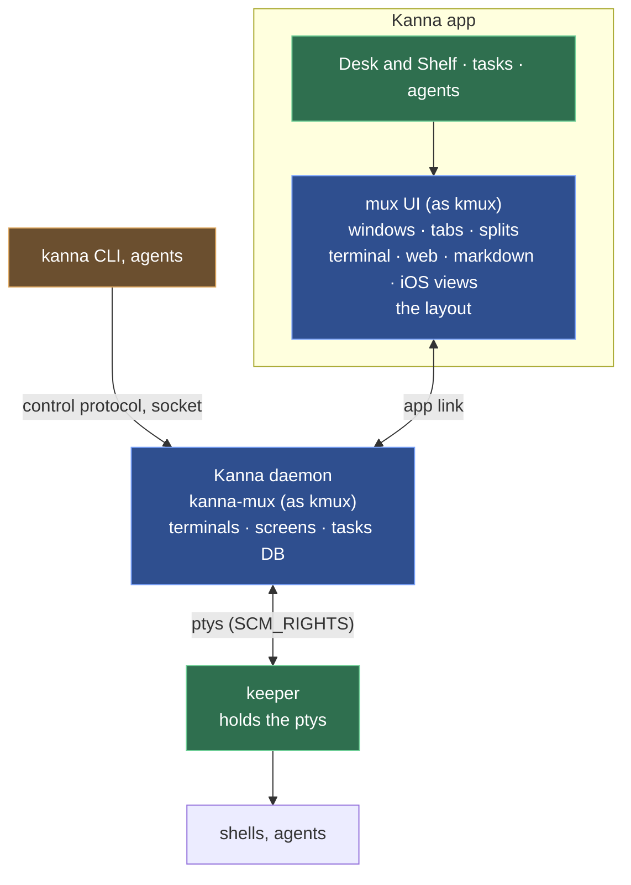

# kanna — Specification

> **Status:** Draft v0.9 · **Last updated:** 2026-10-15
>
> This page is the index: what Kanna is, its goals and its shape. Everything else is in a short spec of its own under [specs/](specs/). Items marked **[Assumption]** are guesses to confirm.
>
> **Related:** [kmux spec](https://github.com/tampopogk/kmux/blob/main/docs/kmux-spec.md) (the separate, public kmux repo), the reference Kanna follows · [roadmap](roadmap.md) · [the build plan](plans/mux-build.md)

## What Kanna is

`kanna` is a command-line tool that controls a **mux**, an app that shows several things side by side. A single command can open a terminal, show a web app or launch an iOS app in the simulator. Its commands work the same way with **kmux**, **tmux** or **cmux**; each mux supports whatever pane types it can show ([backends](specs/backends.md)).

**Kanna ships its own mux, Kanna.app**, kanna's default backend: its terminals live in a background daemon, so they survive the app quitting. It does what [kmux](https://github.com/tampopogk/kmux) does ([kmux is the reference](specs/kmux-reference.md)), keeps its files and sockets in its own folder in Application Support ([instances](specs/instances.md)), and gives its terminals `KANNA_SOCKET`, `KANNA_PANE` and `KANNA_INSTANCE`, so it never meets a kmux the user runs. On top of the mux, Kanna runs coding agents as **tasks**, one per worktree, on a **Desk** ([Desk](specs/desk.md), [tasks](specs/tasks.md)).

## Goals

| # | Goal |
|---|---|
| G1 | The same commands work with every supported mux. |
| G2 | Make sizing panes simple by default, with more control available when you ask for it. |
| G3 | Make it easy to script: predictable output, JSON output and clear exit codes. |
| G4 | Open a whole dev setup (server, web preview, iOS app) with one command. |

**Non-goals (for now):** showing panes itself (that is the mux's job); pixel-exact sizing (sizes are fractions of the space). Kanna on other machines is planned in [your machines](specs/machines.md).

## Architecture

Apps draw; the headless daemon keeps tasks, their content and workspaces; the keeper holds the ptys, so quitting the app or restarting the daemon loses nothing. Layers in detail: [architecture](specs/architecture.md).

## Specs

**The mux**

| Spec | What it covers |
|---|---|
| [Architecture](specs/architecture.md) | The layers and processes; what the daemon keeps and what the apps keep; languages and platforms |
| [Presentation layers](specs/presentation-layers.md) | Work, logical and physical presentation: what lives in the headless daemon and what in each app, and the IDs |
| [kmux is the reference](specs/kmux-reference.md) · [kmux subtree](specs/kmux-subtree.md) | kmux as the model Kanna is checked against; its source in `references/kmux` |
| [The keeper](keeper.md) · [upgrading it](specs/keeper-upgrade.md) | The process that creates and holds the ptys |
| [The app link](specs/app-link.md) | The app's connection to the daemon: messages, snapshots, the app starting the daemon |
| [Daemon build](specs/daemon-build.md) | A relaunched app of another build replaces the daemon |
| [Your machines](specs/machines.md) · [identity and pairing](specs/machine-identity.md) · [tasks across machines](specs/machine-tasks.md) · [agent sign-in](specs/agent-sign-in.md) | The machines your daemons trust, paired by code, sharing a backlog: free, LAN first |
| [Kanna Cloud](specs/kanna-cloud.md) · [build Macs](specs/build-macs.md) | A service that hands you machines: Kanna-run VMs, enrollment by token, its directory and relays, build Macs; open source, so anyone can run one |
| [Restarting the daemon](specs/daemon-restart.md) | Terminals on disk, adopting the keeper's ptys |
| [Pane sizes](specs/pane-sizes.md) | A program sees its view's size across a relaunch and a restart, and on the Shelf and in the backlog |
| [The daemon's socket](specs/daemon-socket.md) | The app keeps `kanna.sock`'s listener, so it answers through a daemon restart |
| [The daemon's runtime](specs/daemon-runtime.md) | The main loop on tokio: handlers await, nothing blocks it |
| [The layout](specs/layout.md) | One layout model in the app; layout steps; saving, restoring; working with the app closed |
| [Windows, tabs and splits](specs/windows.md) · [menus](specs/menus.md) · [zoom](specs/zoom.md) · [docked pane](specs/docked-pane.md) | The windows, their actions and debug commands |
| [Web, markdown and iOS panes](specs/app-panes.md) · [markdown keys](specs/markdown-keys.md) · [markdown diff](specs/markdown-diff.md) · [scroll anchor](specs/scroll-anchor.md) | The app's panes, lent to the daemon |
| [Code viewer](specs/code-viewer.md) · [code tour](specs/code-tour.md) | A highlighted code pane; the agent commenting on code |
| [Diff viewer](specs/diff-viewer.md) | `git diff` in a native pane beside the agent, following the worktree |
| [Commit graph](specs/commit-graph.md) | `git log` as a graph in a native pane, with task branches labelled and long merges folded |
| [File panes](specs/file-panes.md) | the daemon reads and watches a markdown or code pane's file; the app only draws |
| [Files and threads](specs/files-and-threads.md) | images, links, comment threads, a doc's diff base and screenshots go through the daemon, so a remote task's panes work |
| [Serial monitor](specs/serial-monitor.md) | A pane on a serial port the daemon owns, shared with `kanna serial` for agents |
| [Doc markup](specs/doc-markup.md) | Commenting on a doc with the agent beside it |
| [Terminal behaviour](specs/terminal.md) · [terminal links](specs/terminal-links.md) | What a terminal does, who answers the program; which links open |
| [The shell a command runs in](specs/command-shell.md) | Commands start in an interactive login shell |

**The CLI**

| Spec | What it covers |
|---|---|
| [The kanna CLI](specs/cli.md) | A port of kmux's CLI; where it differs; reaching Kanna; errors and exit codes |
| [The CLI acts on its caller](specs/cli-caller.md) | A command with no target acts on the terminal it runs in, or is refused; never the front window |
| [The app owns the physical layout](specs/physical-layout.md) | The daemon keeps the logical layout and no key window; the app keeps which window is in front, the order and frames |
| [Commands](specs/commands.md) | Every command and option; `send-key` |
| [kanna send](specs/kanna-send.md) | Return pressed on its own, after a bracketed paste, so agents submit |
| [Sizing and arranging panes](specs/arranging-panes.md) | Fractions, the layout expression, `kanna.yaml` |
| [Mux backends](specs/backends.md) | kmux, tmux, cmux; choosing one; the adapter interface; open questions |
| [Instances](specs/instances.md) · [build channels](specs/build-channels.md) · [stopping an instance](specs/instance-stop.md) | Separate Kannas for developing Kanna, and quitting one |
| [Tab completion](specs/tab-completion.md) · [screenshot](specs/screenshot.md) | Completing commands in zsh and bash; a PNG of a pane or window |

**Tasks and agents**

| Spec | What it covers |
|---|---|
| [Desk](specs/desk.md) · [Desk view](specs/desk-view.md) · [drag to the Shelf](specs/desk-row-shelve.md) · [Shelf row status](specs/shelf-row-status.md) · [internal names](specs/internal-names.md) · [new Desk](specs/new-desk.md) · [a Desk's project](specs/desk-project.md) · [planning terminal](specs/planning-agent.md) · [planner resume](specs/planner-resume.md) | A window holding up to three tasks, one active; ⌘. shows the Desk view |
| [Project folder](specs/project-folder.md) | Every project lives in `~/.kanna-v4/repos/OWNER/NAME`; `kanna project import` copies one there |
| [Tasks](specs/tasks.md) · [Shelf runners](specs/shelf-runners.md) · [Shelf search](specs/shelf-search.md) · [blocked tasks](specs/task-dependencies.md) · [stacked tasks](specs/stacked-tasks.md) · [task IDs](specs/task-ids.md) · [task list](specs/task-list.md) · [task scripts](specs/task-scripts.md) · [durable panes](specs/durable-panes.md) · [agent messaging](specs/agent-messaging.md) · [Desk news for the planner](specs/desk-news.md) | One agent in one worktree; the Shelf |
| [Software factory](specs/software-factory.md) · [Kojo](specs/kojo.md) · [build order](specs/software-factory-build-order.md) | Any task's agent builds a change through a pipeline of stages (agents, commands, your approval, merges), driven by the daemon in workers whose terminals are the task's background terminals, with every run measured |
| [Agent status](specs/agent-status.md) | Working, needs you, idle, exited |
| [Toasts](specs/toasts.md) | Notices the daemon raises in the app, such as messages that wait |
| [Crashes](specs/crashes.md) | Crash records from the app, daemon and keeper; relaunching a crashed app; the banner, `kanna crashes`, and telling the planner |
| [Agent setup](specs/agent-setup.md) | Kanna's skills where agents find them |
| [Codex's app-server](specs/codex-app-server.md) | Every Codex runs attached to a server of its own, Kanna's door for messages |
| [Quiz](specs/quiz.md) | Questions on what landed on main |
| [Kanna on the phone](specs/mobile-app.md) | A native iPhone app: chat with the repo's planner, the Shelf, Stats, Machines, and a quiz map |
| [Stats](specs/stats.md) | The project's numbers over 30 days: quiz, main, tasks |
| [Schedules tab](specs/schedules-tab.md) | Every repo's schedules, their firings, and pause, run and remove |
| [The database](specs/database.md) · [terminal records](specs/terminal-records.md) | Tasks and their history, and each pty's pane, in `kanna.db` |
| [Settings](specs/settings.md) | Kanna's own settings |

**Building Kanna**

| Spec | What it covers |
|---|---|
| [Deployment target](specs/deployment-target.md) | Everything built for the app's macOS |
| [Build speed](specs/build-speed.md) · [build architectures](specs/build-architectures.md) · [build targets](specs/build-targets.md) · [build store](specs/build-store.md) | Fast worktree builds; arm64 and x86_64; worktree builds on another volume; shared pinned builds, one profile, eviction |
| [Release](specs/release.md) | Signed, notarized DMGs published on GitHub |
| [Privacy prompts](specs/privacy-prompts.md) | What macOS asks Kanna for, and dev builds signed so the answers last |
| [Kanna Cloud: installing a host](specs/cloud-provisioning.md) | Ubuntu on a Kanna Cloud R720 through its iDRAC alone |
