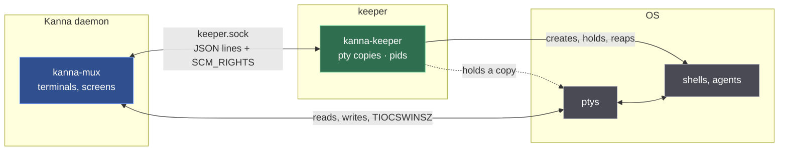
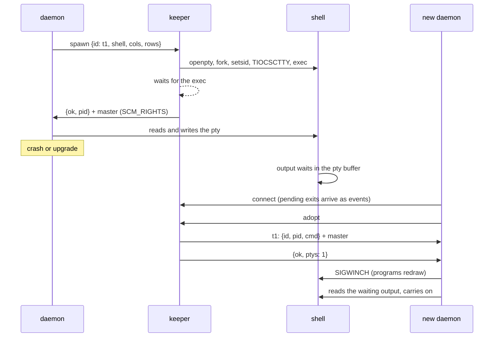
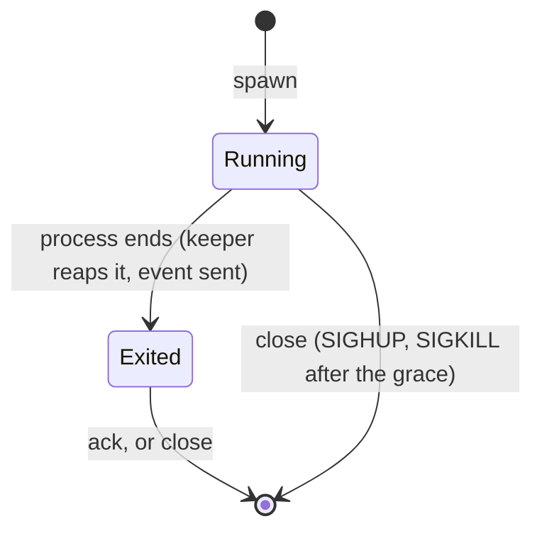

# kanna-keeper — Specification

> **Status:** built (`crates/kanna-keeper`), step 0.5 of [the build plan](plans/mux-build.md) · **Last updated:** 2026-10-15
>
> **Related:** [architecture](specs/architecture.md), [upgrading the keeper](specs/keeper-upgrade.md), [mux architecture §8 (restarting the daemon)](research/mux-architecture.md#8-restarting-the-daemon).

## Table of Contents

1. [Summary](#1-summary)
2. [Where It Sits](#2-where-it-sits)
3. [Protocol](#3-protocol)
4. [Spawn and Adopt](#4-spawn-and-adopt)
5. [What Runs, and Its Environment](#5-what-runs-and-its-environment)
6. [Exits and Close](#6-exits-and-close)
7. [Life of the Keeper](#7-life-of-the-keeper)
8. [The Client (for the Daemon)](#8-the-client-for-the-daemon)
9. [Security and Limits](#9-security-and-limits)
10. [Known Limitations](#10-known-limitations)
11. [Testing](#11-testing)
12. [Glossary](#12-glossary)

---

## 1. Summary

The keeper is layer 5 of Kanna.app: a tiny process that **creates the ptys and holds a copy of each**, so the shells and programs in them outlive a daemon crash or upgrade.

- It **spawns** a process on a new pty and hands the pty's master to the daemon over its socket (`SCM_RIGHTS`).
- It **hands them all back** (`adopt`) to a daemon that restarted.
- It's the processes' **parent**: it reaps them and reports their exit codes, the command's own (no `login(1)` in between).
- It is **never in the path of terminal bytes**: the daemon reads, writes and resizes the ptys itself.

It replaces the relay keeper of `feat/keeper` (a relay process per pane, the keeper copying bytes), which the daemon architecture made unnecessary.

## 2. Where It Sits

| Part | Holds | Lives |
|---|---|---|
| **Daemon** | its own copy of each master; screens | until it crashes or is upgraded |
| **Keeper** | a copy of each master, each process's pid, unacknowledged exits | while it has live processes or a client, then a minute more |
| **Processes** | their pty's slave side, as controlling terminal | until they exit or are closed |

Because the keeper holds a copy of every master, a pty stays open while the daemon is gone; output waits in the pty's kernel buffer until the next daemon adopts it.

## 3. Protocol

One connection per daemon on `$KANNA_STATE_DIR/keeper.sock`. Each message is one line of JSON. A reply that carries pty masters says `"fds": N`, and the N descriptors arrive as `SCM_RIGHTS` ancillary data on that line's first byte. A request may carry `"req"`, which its reply echoes.

| Request | Reply | Notes |
|---|---|---|
| `{"op":"hello"}` | `{"ok":true,"version":1,"pid":P,"build":B}` | protocol version, the keeper's pid, and `build`: the SHA-256 of the binary it runs (read at start; absent from keepers that predate upgrades) |
| `{"op":"spawn","id":ID,"command":CMD \| "shell":PATH,"cwd":DIR,"env":{K:V\|null},"cols":C,"rows":R}` | `{"ok":true,"id":ID,"pid":P,"cmd":[..],"fds":1}` + master | `command` and `shell` both optional, not both. Error if `ID` is in use. |
| `{"op":"adopt"}` | one `{"req":..,"pty":{"id","pid","cmd","cwd","exit"?},"fds":1}` + master per pty, then `{"ok":true,"ptys":N}` | `exit` is present for an exited pty not yet acknowledged |
| `{"op":"close","id":ID}` | `{"ok":true}` | ends the process group ([6](#6-exits-and-close)); the id is free at once |
| `{"op":"ack","id":ID}` | `{"ok":true}` | forgets an exited pty; an error if it's still running |
| `{"op":"stop"}` | `{"ok":true}` | closes every pty as `close` does, unlinks the socket, refuses spawns, and exits once every closed process is reaped (at most 5 s) ([stopping an instance](specs/instance-stop.md)) |
| `{"op":"upgrade","binary":PATH}` | `{"ok":true,"pid":P,"build":B,"from":OLD}`, sent by the new code | the keeper re-execs itself as `PATH` ([upgrading](specs/keeper-upgrade.md)); an error leaves the old code running |
| — (event) | `{"exited":ID,"pid":P,"code":N}` or `{..,"signal":S}` | sent to every connection when a process exits, and on connect for every exit not yet acknowledged |

Errors are `{"ok":false,"error":"…"}` and leave the connection usable. There is no `resize`: the daemon sets the size on its own copy with `TIOCSWINSZ`.

## 4. Spawn and Adopt

- The spawn reply comes only once the child has exec'd, so a `close` straight after always reaches it.
- **A slow spawn holds up nobody else.** The keeper never touches the file system for a spawn: the child changes directory and searches `PATH` itself (everything it needs is built before `fork`, so it allocates nothing), and the read end of its exec pipe joins the keeper's poll set. End of file there means the exec happened and the reply goes out; four bytes are the `errno` of a failed exec, and the reply is an error (`cannot run zsh: No such file or directory`). A child that hasn't exec'd within 5 s (`KANNA_KEEPER_SPAWN_TIMEOUT_MS`) is killed and the spawn fails, well inside the daemon's 10 s reply timeout. A process that exits before its spawn is answered is reported right after the reply.
- `adopt` sends a fresh copy of each master each time; the keeper keeps its own. It sends its own descriptor (`SCM_RIGHTS` makes the copy in the receiver), so adopting or spawning never needs a spare descriptor in the keeper and can't come back short. The client fails `adopt` if a pty arrives without its master or the count differs.

## 5. What Runs, and Its Environment

| Request | Runs | argv[0] |
|---|---|---|
| `command: CMD` | the user's login shell (as below) with `-l -i -c CMD`, zsh with `-l -i +m -c CMD`; with `rc: false`, `-l -c CMD` ([why](specs/command-shell.md)) | the shell's path |
| `shell: PATH` | `PATH`, interactive; a bare name is looked up in the absolute directories on `PATH` only, and not finding it is an error (never a file of that name in the cwd) | `-name` (login-shell convention) |
| neither | the user's login shell (passwd, else `$SHELL`, else `/bin/sh`) | `-name` |

- **Directly, never through `login(1)`**, which always exits 0 (`login -flp $USER /bin/sh -c 'exit 5'` exits 0). So `exit 3` is reported as 3.
- **Environment:** the keeper's own (inherited from the daemon that started it) minus what configures the daemon and keeper (`KANNA_STATE_DIR`, `KANNA_KEEPER`, `KANNA_KEEPER_*`), so a daemon run in a pane doesn't find this keeper; with HOME, USER, LOGNAME and SHELL filled from passwd if missing; then Ghostty's additions (`TERM=xterm-ghostty` and `TERMINFO` when Ghostty's resources are found, else `xterm-256color`; `COLORTERM`, `TERM_PROGRAM=ghostty`, `GHOSTTY_SHELL_FEATURES`, the keeper's folder on `PATH`); then the request's `env`, where `null` removes a variable; then Ghostty's shell integration (zsh `ZDOTDIR`, bash `ENV --posix`, fish/elvish/nushell `XDG_DATA_DIRS`). Ported from kanna-v3 via `feat/keeper` (`ghostty_env.rs`).
- **Where it differs from Ghostty** (`ghostty_env.rs` follows Ghostty's `Exec.zig`, `shell_integration.zig`, `locale.zig`, `resourcesdir.zig` and `embedded.zig`'s `defaultTermioEnv`): an inherited `GHOSTTY_SURFACE_ID` and `GHOSTTY_LOG` are dropped (a kept session outlives the surface that made it), as are Xcode's launch variables on macOS; without Ghostty's resources the client's `TERM` is kept, since it came from the Ghostty running the client; the folder appended to `PATH` is the keeper's, so `kanna` is reachable; shell integration runs after the request's `env`, so a requested `ZDOTDIR` or `ENV` is kept (the integration scripts restore it) instead of turning the integration off; Apple's `/bin/bash` (3.2 ignores `ENV`) gets no integration, nor does a bare `bash` that `PATH` resolves to it.
- **Ghostty's resources** come from `GHOSTTY_RESOURCES_DIR`, else `KANNA_KEEPER_RESOURCES_DIR`, else the first `share/` or `Contents/Resources/` with Ghostty's terminfo above the keeper's binary. They are looked up once, at start, with the passwd entry and the base environment.
- **cwd** is the request's if the child can change to it, else HOME, else `/`; `PWD` is set to the one it got. The child starts a new session with the pty as its controlling terminal. The keeper blocks every signal around `fork`, and the child's first act is to reset every disposition (1 to NSIG) to the default, ignored ones included, then empty its mask, so no keeper handler runs in it and nothing the keeper ignored stays ignored. From `fork` to `exec` the child makes only async-signal-safe calls.

## 6. Exits and Close

- **Exit:** reaped with `waitpid`; reported as `code` or `signal`. The keeper keeps the exited pty (and its master, so the last output can still be read) until it is acknowledged, and tells every new connection about it.
- **Close:** `SIGHUP` to every process group in the pty's session (the processes whose `getsid` is the spawned pid), `SIGKILL` to every one after the grace period (1 s), so a job-control shell's background jobs end too. A closed process's exit isn't reported.
- **No signal reaches a reused pid:** the keeper reaps only the pids it spawned (`waitpid(pid)`, never `-1`), and a closed process isn't reaped until its `SIGKILL` has gone, so until then its zombie holds the pid and the process group id. Groups are found by `getsid` at the moment of each signal, so only groups still in the closed process's session are signalled.

## 7. Life of the Keeper

| | |
|---|---|
| **Command line** | `kanna-keeper [--state-dir DIR] [--detach \| --upgrade]`; `--upgrade` asks the keeper of DIR to become this binary ([upgrading](specs/keeper-upgrade.md)). DIR defaults to `$KANNA_STATE_DIR`, else `~/Library/Application Support/kanna` (macOS) or `$XDG_DATA_HOME/kanna`. |
| **Starting** | The daemon runs `kanna-keeper --state-dir DIR --detach` (via the client's `connect_or_start`): it double-forks into its own session, changes to `/`, stdio on `/dev/null`, stderr appended to `keeper.log`, and returns once the socket listens (or it found another keeper listening). If the keeper fails before listening, `--detach` prints its error and exits 1; the keeper reports which over a pipe (`1` listening, `2` another keeper, `E` and the error). Without `--detach` it runs in the foreground. |
| **One per directory** | `flock` on `keeper.lock`; a second keeper returns at once, successfully (with `--detach`, reporting another keeper). The lock's owner may still be starting or already stopping, so `connect_or_start` keeps connecting, and starting a keeper again, with backoff for up to 5 s. |
| **Files** | `keeper.sock`, `keeper.lock`, `keeper.pid`, `keeper.log` in DIR. |
| **Client gone** | Nothing happens: the processes and the keeper's copies stay. |
| **Idle exit** | After 60 s with no live process, no client and nothing being closed. Unacknowledged exits don't keep it. It first unlinks the socket, so no one else can connect, then accepts whoever connected meanwhile; if anyone did, it listens again and carries on. |
| **Descriptors** | At start it raises its soft `RLIMIT_NOFILE` to the hard limit (10240 if the hard limit is unlimited), since a Finder-launched app gets 256; spawned processes get the original limit back. |
| **Signals** | It unblocks SIGCHLD, SIGTERM, SIGINT and SIGALRM at start: the daemon that starts it blocks the signals it waits for, and children inherit that. |
| **SIGTERM / SIGINT** | It exits without signalling anyone. Its copies close; a pty with no other copy hangs up, and its processes get SIGHUP from the kernel. The signal also sets `alarm(5)`: a keeper whose loop is stuck still ends 5 s later, on SIGALRM. |

## 8. The Client (for the Daemon)

`kanna_keeper::client`, blocking:

| Call | Does |
|---|---|
| `Client::connect(socket)` / `Client::connect_or_start(state_dir, keeper_bin)` | connects (checking the keeper runs as the same user), starting a detached keeper if none listens; retries for up to `START_TIMEOUT` (5 s), and fails with the keeper's own error if `--detach` does |
| `hello() -> (version, pid)`, `info() -> Hello { version, pid, build }` | the daemon compares `build` and `version` with its own keeper's, upgrading it if they differ ([upgrading](specs/keeper-upgrade.md)) |
| `upgrade(binary) -> Hello` | asks the keeper to re-exec as `binary`; the new code's `hello` |
| `spawn(&SpawnRequest) -> Pty` | `SpawnRequest::shell(id)` / `::command(id, cmd)`, then set `shell`, `cwd`, `env`, `cols`, `rows` |
| `adopt() -> Vec<Pty>` | every pty held; `Pty { id, pid, cmd, cwd, master: OwnedFd, exit }` |
| `close(id)`, `ack(id)` | |
| `poll_events()`, `wait_event(timeout)` -> `Exited { id, pid, status }` | `status` is `ExitStatus::Code(n)` or `Signal(s)`; `shell_status()` gives 128+s |
| `as_raw_fd()` | for the daemon's poll loop: readable means events; then `poll_events()` |
| `set_timeout(Some(t))` | a request with no reply within `t` fails with `TimedOut`, so a keeper that stops answering can't hang the daemon |

Received masters are close-on-exec and blocking; the daemon sets what it needs.

## 9. Security and Limits

- **State directory** 0700, owned by the user and a real directory: a symlink there is refused (it is opened `O_NOFOLLOW`, checked and tightened through that descriptor). **Socket** 0600.
- **Peer check:** every connection's uid (`getpeereid` on macOS, `SO_PEERCRED` on Linux) must be the keeper's; others are closed and logged. The client checks the keeper's uid the same way.
- **Masters** are close-on-exec: no spawned process inherits another's pty.
- **Inherited descriptors:** the keeper marks every descriptor above stderr it was started with close-on-exec, and `--detach` closes them, so no spawned process inherits, say, a socket of the daemon that started it. The daemon's own copy of the keeper connection (its watch thread's) is `F_DUPFD_CLOEXEC`.

| What | Limit | Setting |
|---|---|---|
| Idle exit | 60 s | `KANNA_KEEPER_IDLE_MS` |
| Grace before SIGKILL | 1 s | `KANNA_KEEPER_CLOSE_GRACE_MS` |
| From fork to exec | 5 s, then the child is killed and the spawn fails | `KANNA_KEEPER_SPAWN_TIMEOUT_MS` |
| Ptys held, counting closed processes not yet gone | 256 | `KANNA_KEEPER_MAX_PTYS` |
| Connections | 16 | — |
| Out of descriptors when accepting | stops polling the socket for 100 ms (Linux leaves the connection queued, so the socket stays readable; macOS drops it) | — |
| Request line | 1 MiB | — |
| Unsent replies per connection | 8 MiB, or 2 × the pty limit + 16 descriptors, then it's dropped | — |

## 10. Known Limitations

- **A keeper restart loses the processes' parent**, not the processes: if the keeper dies while a daemon holds the masters, the shells keep running but nobody reaps them or knows their exit code. An upgrade doesn't restart it ([upgrading](specs/keeper-upgrade.md)).
- **An upgrade pauses the keeper** for the probe (up to 5 s) and the flush (up to 2 s); spawns wait meanwhile, well inside the daemon's 10 s reply timeout.
- **A new keeper that crashes after accepting the state** loses the processes' parent, as any keeper crash would; the probe makes that unlikely, since it runs the same parsing first.
- **A keeper built before upgrades existed can't be upgraded**: it keeps its code until it stops (once, the first time).
- **On macOS a process can't finish exiting while its last output is unread** (closing the tty waits for output to drain). With no daemon connected, its exit is reported once a daemon adopts the pty and reads it.
- **A full pty buffer stops the program** while no daemon is reading, as with any terminal nobody reads.
- **Exits after an idle exit are lost**: unacknowledged exits don't keep the keeper alive.
- **macOS `recvmsg` has no `MSG_CMSG_CLOEXEC`**: a received master is made close-on-exec just after `recvmsg` returns, so a process the client's program forks from another thread in that instant could inherit it. On Linux the flag closes the window.
- **Linux** builds (`cargo check --target x86_64-unknown-linux-gnu`) but the tests have only run on macOS.

## 11. Testing

`cargo test -p kanna-keeper`: unit tests of the Ghostty environment, and integration tests that each run a private keeper in a private state directory (stopped by PID):

- spawn, then read and write through the received fd; the window size;
- the login-shell convention, `env` (including `null`), cwd;
- exit codes and signals (`exit 3` → 3, `kill -9` → signal 9, missing command → 127, a shell's `exit 4` → 4);
- adopt after the client goes: same pid, output written meanwhile is readable, input works;
- exits while nobody is connected: sent on connect, in `adopt` with the last output, again until acknowledged;
- close: SIGHUP, SIGKILL for what ignores it, children in the group, closing right after spawning;
- errors as replies; private files; one keeper per directory; the peer check (a debug-only `KANNA_KEEPER_TEST_PEER_UID`);
- a slow spawn (a debug-only `KANNA_KEEPER_TEST_SPAWN_DELAY_MS` before exec) doesn't hold up another client, and one past the spawn timeout fails; a shell not on `PATH` is an error even with a file of that name in the cwd;
- descriptors: nothing inherited reaches a spawned process (foreground or `--detach`), adopt near the descriptor limit, a client queueing too many is dropped, `accept` out of descriptors doesn't spin;
- signals: dispositions the keeper inherited as ignored are default in its children; a closed process stays a zombie until its SIGKILL;
- races: concurrent `connect_or_start`, connecting while the keeper goes idle; `--detach` failing when the keeper can't listen; the keeper's own settings stay out of spawned environments.
- idle exit only with no process and no client; `connect_or_start` with a detached keeper.
- upgrade: see [upgrading the keeper](specs/keeper-upgrade.md#8-testing).

## 12. Glossary

| Term | Meaning |
|---|---|
| **pty** | Pseudo-terminal: a master side (the terminal, here the daemon) and a slave side (the program's terminal). |
| **Master copy** | Another descriptor for the same pty master. The pty stays open while any copy is open. |
| **SCM_RIGHTS** | Sending open file descriptors to another process over a Unix socket. |
| **Adopt** | A daemon taking over the ptys the keeper holds, after a restart. |
| **Acknowledge (ack)** | The daemon telling the keeper it has recorded an exit, so the keeper can forget the pty. |
| **Process group** | A process and the children it started, signalled together; each spawned process leads its own. |
| **Login-shell convention** | Starting a shell with argv[0] beginning with `-` (`-zsh`), so it reads its login files. |
| **login(1)** | macOS's program for starting a user's session; Ghostty runs commands through it, and it always exits 0. |
| **Idle exit** | The keeper exiting by itself when it has nothing to keep. |
