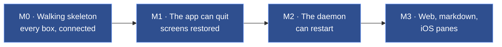
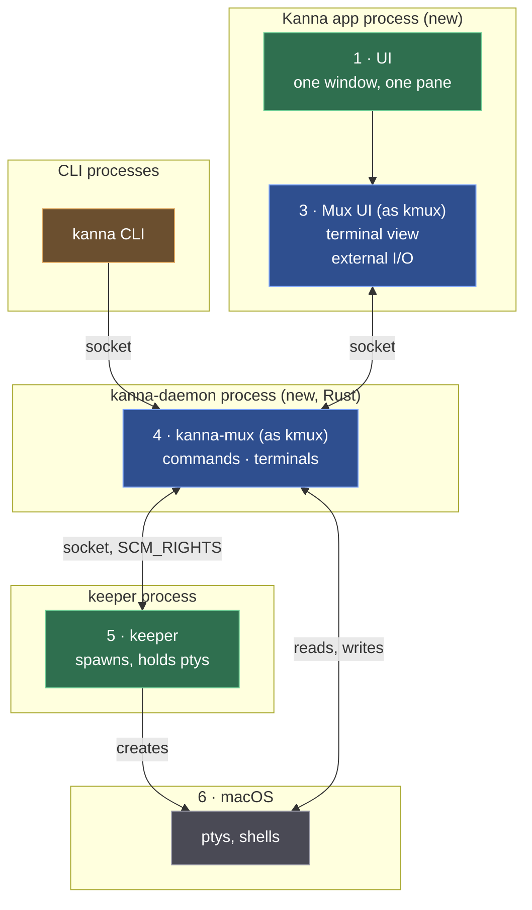

# Building Kanna's mux: plan

> 2026-10-09. Plan for building [the mux architecture](../research/mux-architecture.md). kmux stays as it is: it's the **reference model** for Kanna's mux and its CLI, and everything here is built in kanna-v4. Integration first: every box and every line in the architecture exists and works end to end in milestone 0, mostly as stubs; later milestones make the boxes real, one behaviour at a time, across all of them at once.

## Contents

1. [In short](#1-in-short)
2. [The reference: what "done" looks like](#2-the-reference-what-done-looks-like)
3. [Milestones](#3-milestones)
4. [M0 · Walking skeleton](#4-m0--walking-skeleton)
5. [M1 · The app can quit](#5-m1--the-app-can-quit)
6. [M2 · The daemon can restart](#6-m2--the-daemon-can-restart)
7. [M3 · Web, markdown and iOS panes](#7-m3--web-markdown-and-ios-panes)
8. [Clean-up](#8-clean-up)
9. [Decisions](#9-decisions)
10. [How we work](#10-how-we-work)
11. [Glossary](#11-glossary)

---

## 1. In short

| Milestone | You can… | Repos |
|---|---|---|
| **M0 · Walking skeleton** | open Kanna.app (its own app now, not branded kmux), type into a terminal that the daemon runs on a pty from the keeper, and drive it with the `kanna` CLI | kanna-v4 (+ Ghostty fork) |
| **M1 · The app can quit** | quit or crash Kanna.app, reopen it, and find every terminal still running with its screen exactly as it was | kanna-v4 (+ Ghostty fork) |
| **M2 · The daemon can restart** | kill or upgrade the daemon and lose nothing | kanna-v4 |
| **M3 · Web, markdown, iOS** | use every pane kmux has, with `kanna` commands passed to the app | kanna-v4 |
| **M4 · kmux parity** | use Kanna.app every day in place of kmux: every window, tab, split, menu, shortcut, mouse gesture, terminal behaviour and CLI command kmux has | kanna-v4 (+ Ghostty fork) |

After M4 Kanna's own layers (Desk and Shelf, tasks, agents) are built on top; they're not in this plan.

---

## 2. The reference: what "done" looks like

The reference has two parts:

- **kmux itself**, unchanged: how the mux and its CLI behave. `kanna-mux` runs kmux's own protocol cases (`references/kmux/tests/kmux-protocol/cases`, from the kmux subtree); where Kanna and kmux differ, Kanna is wrong unless we decided otherwise.
- **Scenarios** for what kmux doesn't do (terminals that outlive the app), written first as a script (`scripts/e2e-kanna.sh`) that fails, and kept passing from then on. Each one runs against a private Kanna instance in the background, never your own.

Scenarios are named for their behaviour, never numbered: tasks running in parallel would pick the same next number. Each is a function in the script with `scenario NAME MILESTONE` on the line above it; `scripts/e2e-kanna.sh NAME…` runs some by name, and `--through M` the ones due by that milestone.

How a run stops everything it started, and sweeps up after runs that were killed: [e2e cleanup](../specs/e2e-cleanup.md).

| Scenario | Checks | Passes in |
|---|---|---|
| `cli_terminal` | `kanna open term`, type `echo hi`, `kanna read` shows `hi` | M0 |
| `app_typing` | typing in the app's terminal reaches the shell, its output is drawn | M0 |
| `without_app` | `kanna list` and `kanna read` work with the app closed | M1 |
| `survives_relaunch` | run `top`; quit the app; relaunch: the same `top`, same PID, screen identical (compared as text) | M1 |
| `layout_restored` | the layout (splits, which pane where) comes back after a relaunch | M1 |
| `daemon_restart` | kill the daemon; it comes back; shells have the same PIDs; output written meanwhile isn't lost; the app attaches again and its layout is unchanged | M2 |
| `exit_code` | `exit 3` in a terminal; `kanna list` shows exit code 3 | M2 |
| `web_md_ios_panes` | web, markdown and iOS panes open, are restored after a relaunch, and answer `navigate` and kmux's `debug.web`, `debug.md`, `debug.ios` (kmux has no `web.*`) | M3 |
| `cli_starts_app` | with the app closed, `kanna open --split right` starts the app and the split lands; with `KANNA_SOCKET` set it exits 6 and starts nothing | M1 |
| `app_starts_daemon` | with no daemon running, launching the app starts one from its bundle and opens a terminal; killing that daemon gets a new one, and quitting the app leaves it running | M3 |
| `windows_tabs_ui` | windows, tabs and panes through the UI: menus and shortcuts (`debug.menu`, `debug.key`) split, tab, zoom and cycle; clicks select and rename tabs and focus panes; every window is drawn with its tab bar and dividers (`debug.snapshot`) | M4 |
| `resize_arrange` | resizing and arranging: a divider dragged snaps; `auto` follows the pane's shape; Ghostty's font size; window frames come back after a relaunch; closing the last pane closes its window, and the app stays | M4 |
| `drag_panes_tabs` | moving: a pane dragged to an edge, the middle of another pane, a tab, + and outside every window; a tab dragged within and out of its bar | M4 |
| `cli_commands` | every `kanna` command against the real app prints and exits as kmux's CLI: open (term, web, md), list, focus, zoom, resize, move, arrange, tabs, windows, send (with `--`), read, restart, navigate with history, capabilities, raw, errors | M4 |
| `cli_without_app` | with the app closed, terminals work through the CLI and every command that needs the app exits 6 (with `KANNA_SOCKET`); the app places the terminals when it opens | M4 |
| `instances` | `kanna --instance NAME` with nothing running starts its own Kanna.app and daemon in `kanna-dev-NAME`; `instances` lists it; its terminals know their instance | M4 |

---

## 3. Milestones

Each step below is one commit (or a few), with its tests, and leaves everything working.

---

## 4. M0 · Walking skeleton

Every box of the architecture, connected; the daemon and the app start as stubs and get real in the steps below.

| Step | Repo | What | Done when |
|---|---|---|---|
| **0.1** ✓ | kanna-v4 | `scripts/e2e-kanna.sh` with scenarios `cli_terminal`, `app_typing`, `without_app`, `survives_relaunch`, `layout_restored`, `daemon_restart`, `exit_code`, `web_md_ios_panes`, all failing; `--through M0` runs only what's due | it runs and reports |
| **0.2** ✓ | kanna-v4 | **`kanna-mux`**, Kanna's mux core in Rust, ported from kmux's KmuxCore: protocol, commands, panes, layout model with a `LayoutHost` seam, state file, socket server. Passes all 31 of kmux's protocol cases; builds for Linux. Still to port: kmux's other core tests (state file, core). | kmux's cases pass |
| **0.3** ✓ | kanna-v4 | **Kanna.app as its own app.** `apps/kanna`: a SwiftPM app. Its terminal view and `GhosttyRuntime` start from kmux's (copied at `kmux.rev`), with a `TerminalBackend` seam (from kmux's external-I/O spike). Built against GhosttyKit from the Ghostty fork, which kanna-v4 builds itself. One window, one terminal pane, a stub backend that echoes. Built by `scripts/build-kanna-app.sh` into `target/Kanna.app` (bundle ID `dev.kanna.app.dev`); checked by `scripts/check-kanna-app.sh`. `build-kanna.sh` keeps building the branded-kmux Kanna.app you use until the new one can replace it (end of M1). | Kanna.app opens and echoes typing |
| **0.4** ✓ | kanna-v4 | **kanna-daemon** (Rust) on `kanna-mux`, on Kanna's socket. Stub: it spawns the pty itself. The app's external-I/O backend attaches to it. The CLI gains `kanna read PANE` (the screen as text); the daemon passes the app's `debug.*` commands (`debug.app`, `debug.type`, `debug.text`, `debug.snapshot`) through to it. Built: `crates/kanna-daemon` (ptys behind a `Spawner`, a small vte text screen behind `Screen`, [the app link](../specs/app-link.md)); Kanna.app's `DaemonLink` mirroring the daemon's first tab; `read` in kanna-mux and the CLI. | `cli_terminal`, `app_typing` pass |
| **0.5** ✓ | kanna-v4 | **The keeper.** Trim `feat/keeper` to what the architecture needs: spawn a shell on a pty, keep a copy, hand the pty over (`SCM_RIGHTS`), report exits. The daemon asks it for ptys. Built: `crates/kanna-keeper` ([spec](../keeper.md)); the daemon's `Spawner` is the keeper (`crates/kanna-daemon/src/keeper.rs`): spawn, close, exit codes acknowledged, a lost keeper stops the daemon; until 2.2 a starting daemon closed what an earlier one left in the keeper. Panes list their `pid`. The CLI never starts an app when `KANNA_SOCKET` is set (exit 3). | `cli_terminal`, `app_typing` pass through the keeper |

**M0 is complete:** every box and line of the architecture exists and works end to end; `cli_terminal` and `app_typing` pass through the keeper.

---

## 5. M1 · The app can quit

| Step | Repo | What | Done when |
|---|---|---|---|
| **1.1** ✓ | kanna-v4 | The daemon keeps a libghostty-vt screen per terminal (its C API, from Rust), fed from the pty. `kanna read` answers from it. Built: `kanna-vt` screens in the daemon (10,000 lines, 10 MB), replacing the vte one; the daemon answers queries (now including DA and size reports) and the app's surfaces drop theirs. | `without_app` passes |
| **1.2** ✓ | kanna-v4 | On attach the daemon sends the screen as a snapshot; the app loads it (`load_snapshot` in the Ghostty fork), then live output. Built: `snapshot` then `grid` on the app link ([the app link](../specs/app-link.md)), taken in step with the outbox; a snapshot that fails mid-sequence is retried after more output; the replay buffer is gone. | `survives_relaunch` passes |
| **1.3** ✓ | kanna-v4 | The app saves its layout (`kanna-mux`'s state file format, in Kanna's folder), panes pointing at terminals by ID; reopens it on launch. Built ([layout](../specs/layout.md)): the app owns the layout through `kanna-mux`'s one model, linked as `crates/kanna-layout`; the daemon's core reaches it through an async `LayoutLink`, each step a `layout` request on the app link; with no app, terminals open unplaced and layout commands fail with `no_app`; the app saves `layout.json` (kmux's rules) and on attach drops gone panes and places new ones. kmux's cases pass in-process, through `LayoutOwner`, and through the daemon and app link. | `layout_restored` passes |
| **1.4** ✓ | kanna-v4 | The CLI starts the app when a layout command needs it, or fails clearly. Built: on `no_app` the CLI starts `$KANNA_APP` (or `dev.kanna.app.dev`, never the branded kmux) and retries; with `KANNA_SOCKET` set it exits 6; `--mux kanna-dev` reaches the daemon without it. | `kanna open --split` with the app closed works (`cli_starts_app`) |

**M1 is complete:** `without_app`, `survives_relaunch` and `layout_restored` pass (with `cli_terminal`, `exit_code` and `cli_starts_app`), three runs in a row.

---

## 6. M2 · The daemon can restart

| Step | Repo | What | Done when |
|---|---|---|---|
| **2.1** ✓ | kanna-v4 | The daemon writes terminals and screen snapshots to disk as they change. Built ([restarting the daemon](../specs/daemon-restart.md)): `$KANNA_STATE_DIR/terminals/`: `terminals.json` (each terminal's pane record and keeper id, the pane counter) on every change, and an exit before it's acknowledged; `<pane>.snap` (GHOSTSNP) by a saver thread at most once a second per changed screen; atomic, 0600, bounded (16 MiB a snapshot); a snapshot that can't be encoded keeps the last good one and is tried again. A clean stop stops reading the ptys and saves everything; it no longer closes the terminals. One daemon per folder (`daemon.lock`). | snapshots on disk match the screens |
| **2.2** ✓ | kanna-v4 | On start, the daemon adopts every live pty from the keeper, reloads screens, sends `SIGWINCH`. The app reconnects. Built: `adopt`, matched with `terminals.json` by keeper id: same IDs, names, pids; screens from the snapshots, sized to the pty; the output that waited in the buffer read into them; `SIGWINCH` to each pty's foreground group; the counter continues, so IDs don't repeat. A pty the disk doesn't know is taken back as an unnamed pane (not closed); a running record the keeper doesn't have is dropped, an exited one kept. The app reattaches by ID and its layout still matches. Replaces "close leftovers on start". | `daemon_restart` passes |
| **2.3** ✓ | kanna-v4 | Exit codes from the keeper (it's the parent), not through `login(1)`, which always reports 0. Since 0.5 the daemon already lists `exitCode: 3` for `exit 3`; `exit_code` reads `exitCode`, as the protocol (as kmux) calls it. Built: an exit while no daemon runs is applied after the restart with its own code (the keeper's unacknowledged exit, the last output read first), saved, then acknowledged; exited terminals keep their codes across restarts. | `exit_code` passes |

**M2 is complete:** `daemon_restart` and `exit_code` pass (with `cli_terminal`, `without_app`, `survives_relaunch`, `layout_restored` and `cli_starts_app`), three runs in a row; `crates/kanna-daemon/tests/restart.rs` covers a running shell, a full-screen redraw, exits during downtime, a crash, IDs and what only the keeper or only the disk knows.

---

## 7. M3 · Web, markdown and iOS panes

| Step | Repo | What | Done when |
|---|---|---|---|
| **3.1** ✓ | kanna-v4 | The app gets web, markdown and iOS views, ported from kmux's; their state (URL and history, file, device and app) is layout state. Built ([app panes](../specs/app-panes.md)): `WebPaneView`, `KannaMarkdown` and `KannaDiagram` (mermaid through merman, built from kmux's `crates/kmux-merman` by `scripts/build-merman.sh`), `IosPaneView` and `SimBridge`, copied from kmux without comments or its pane menu; `Contents` starts them as kmux's `ContentHost` does. The records (url, history on/off, path and zoom, app and device) are in the app's `layout.json`; after a relaunch pages reload, files reopen, iOS panes reattach without relaunching a running app. | they open and come back after a relaunch |
| **3.2** ✓ | kanna-v4 | The daemon passes non-terminal commands (`web.*`, `navigate`, iOS, pixel snapshots) to the app and returns the answer. Built: the app lends its panes to the daemon's core on hello (pane tables carry records), so `open`, `navigate`, `close`, `restart` and `list` run kmux's core unchanged; the daemon shows them with `start`/`stop`, the app reports with `update`; `debug.web`, `debug.md`, `debug.ios` (kmux's; kmux has no `web.*`) and `debug.snapshot` are passed to the app. With the app closed, `list` shows terminals only and the rest is `no_app`. kmux's 31 cases pass through the daemon. | `web_md_ios_panes` passes |
| **3.3** ✓ | kanna-v4 | The app starts its own daemon and opens a first terminal. Built ([the app link](../specs/app-link.md)): the daemon and keeper ship in `Kanna.app/Contents/Helpers`; the app starts the daemon when nothing answers at launch, or 2 s after losing one, detached so it outlives the app; an empty layout after the first attach gets a terminal; Shell menu: Split Right ⌘D, Split Down ⇧⌘D, Close Pane ⌘W. | `app_starts_daemon` passes |

**M3 is complete:** `web_md_ios_panes` passes (with `cli_terminal`, `without_app`, `survives_relaunch`, `layout_restored`, `daemon_restart`, `exit_code` and `cli_starts_app`), three runs in a row; kmux's 31 protocol cases pass in-process, through `LayoutOwner` and through the daemon and app link. `app_typing`'s pixel check needs an unlocked screen.

---

## 7a. M4 · kmux parity

kmux is the reference: anything you can do in kmux you can do in Kanna.app, the same way. M4 is three tracks, built side by side; each lists its steps here as it goes.

### Track A · Windows, tabs and splits (the app's UI)

The inventory is kmux's app (`apps/kmux/Sources/Kmux`: `AppController`, `WindowController`, `TabBar`, `PaneView`, `Dragging`, `Shortcuts`, `Snapshot`) and its spec (§3 windows, tabs and layout; §4.1 no chrome; §5 menus and shortcuts; §6 moving windows, tabs and panes). Each row is one behaviour kmux has; the design is [windows, tabs and splits](../specs/windows.md).

| Step | What | Checked by |
|---|---|---|
| **A.1** ✓ | The layout model answers the app's own calls: a `view` of every window (frame, tabs, active tab, focus, zoom, tree), `focused` (a click: focus without making the window key), `divider` (a dragged divider's two shares), `frame` (a window moved), `shapes` (which panes are wider than tall, for `auto` splits) | `kanna-mux` owner tests |
| **A.2** ✓ | Every window is drawn, one `WindowController` each: title `Tab 1 — w1`, the active tab's splits, 1 pt dividers; windows that leave the layout close, new ones open cascading from the front window | `windows_tabs_ui` |
| **A.3** ✓ | The key window follows the user (a window made key becomes the layout's key) and the layout's key window is brought forward (behind the user's app with `--bg`) | `windows_tabs_ui` |
| **A.4** ✓ | Window frames are saved in `layout.json` and restored when still on a screen | `resize_arrange` |
| **A.5** ✓ | The tab bar: titles, the active one underlined, × to close, + for a new tab; click selects (a 5 pt move starts a drag instead) | `windows_tabs_ui` |
| **A.6** ✓ | Double-click a tab to rename it: Enter or clicking away saves, Escape cancels | `windows_tabs_ui` |
| **A.7** ✓ | Drag a tab to a place in any window's tab bar, or out of every window into a new one where it was dropped; right-click a tab: Move Tab to New Window, Close Tab | `drag_panes_tabs` |
| **A.8** ✓ | Panes: no chrome; a focus outline only in the key window and with more than one pane; the exit code or failure shown inside the pane | `windows_tabs_ui` |
| **A.9** ✓ | Focus follows a click (terminal, web, markdown, iOS); keyboard input follows the focused pane, except while a tab is being renamed | `windows_tabs_ui` |
| **A.10** ✓ | Drag a divider: snaps to ¼ ⅓ ½ ⅔ ¾ within 1.5 %, never below 80 px, a tip shows both shares, resize cursor | `resize_arrange` |
| **A.11** ✓ | `auto` splits go sideways in a wide pane and down in a tall one | owner tests, `resize_arrange` (`kanna open` with no `--split` beside a wide and a tall pane) |
| **A.12** ✓ | The ⋯ grip at the top of a pane (seen only under the mouse) drags it: to another pane's edge (dock), its middle (swap), a tab, +, or outside every window (a new window there), with kmux's hints | `drag_panes_tabs` |
| **A.13** ✓ | kmux's menu bar: Kanna (New Instance, Quit; the instance's name when it isn't the default, also in window titles), Edit (Undo, Redo, Cut, Copy, Paste, Select All), Pane (Split Right ⌘D, Split Down ⇧⌘D, new web/markdown/iOS panes right and below, Open URL ⌘L, Back, Forward, Home ⇧⌘H, Next Pane ⌘], Previous Pane ⌘[, Zoom ⇧⌘↩, Move Pane to New Window, Restart ⌘R, Close Pane ⌘W), View (New Tab ⌘T, Next Tab ⇧⌘], Previous Tab ⇧⌘[, Zoom In ⌘=, Zoom Out ⌘−, Actual Size ⌘0), Window (New Window ⌘N, Close Window ⇧⌘W, Move Tab to New Window, Next Window ⌘\`, Previous Window ⇧⌘\`, the window list); shortcuts from the user's Ghostty config where it binds the action | `windows_tabs_ui` (`debug.menu`) |
| **A.14** ✓ | The menu actions act on the key window: splits, new tab, next/previous pane, tab and window (wrapping, reading order), zoom (moving focus cancels it), move pane or tab to a new window, restart, close pane, tab or window | `windows_tabs_ui`, `resize_arrange` |
| **A.15** ✓ | Zoom In / Out / Actual Size: a markdown pane's zoom, or a terminal's font size | `resize_arrange` |
| **A.16** ✓ | Ghostty keybinding actions reach the app: `new_split`, `goto_split`, `toggle_split_zoom`, `new_tab`, `goto_tab`, `new_window`, `close_window`, `goto_window`, `close_surface` | `windows_tabs_ui` (⇧⌘D reaches Ghostty's `new_split:down`), `resize_arrange` (⌘⌥← ⌘⌥→, Ghostty's `goto_split`) |
| **A.17** ✓ | Right-click a pane for the Pane menu (a terminal unless its program takes the mouse; a web pane below the browser's items; markdown and iOS panes) | `drag_panes_tabs` (a terminal's menu and the tab menu, through `debug.click` with `button: 1`); web, markdown and iOS by hand only |
| **A.18** ✓ | The last pane, tab or window closing closes its tab and window; the app stays open with no windows, and the Dock icon opens a new terminal window; the red button closes the window (and its panes) | `resize_arrange` (closing the last pane and window, the app still attached); the red button and the Dock icon are not automated |
| **A.19** ✓ | Quitting saves the layout and leaves the terminals running (Kanna's difference from kmux, [the app link](../specs/app-link.md)) | `survives_relaunch`, `layout_restored` |
| **A.20** ✓ | kmux's UI debug commands, with `KANNA_DEBUG=1`: `debug.key` (through the app, so menus take it), `debug.click` (tabs, panes, mouse buttons), `debug.drag` (pane, tab, divider), `debug.menu`, `debug.pinch`, `debug.stats`, `debug.snapshot` of any window | `windows_tabs_ui`, `resize_arrange`, `drag_panes_tabs` |

Built ([windows, tabs and splits](../specs/windows.md)): `apps/kanna/Sources/Kanna/Windows` (WindowController, TabBar, PaneView, Dragging, Shortcuts, Menus, Moving, PaneViews) and `Debug.swift`, ported from kmux's app; `LayoutView` is gone. The app draws the layout model's `view` of every window; layout-only actions go to its own model, opening and closing panes to the daemon.

| Decision | Chosen | Why |
|---|---|---|
| Where UI actions go | layout-only ones (focus, zoom, rename, move, move-tab) to the app's own layout model; open, close and restart to the daemon | the app is the layout's only writer; panes are the daemon's |
| App-only layout state | the model's `focused`, `divider`, `frame`, `shapes` calls, not protocol commands | they're what kmux's app does outside its core (`focused`, `DividerView`, frames at save, `paneIsWide`) |
| Terminal surfaces | made when a pane is first shown, kept until it leaves the layout | tab switches show a live screen; a never-shown terminal keeps its pty's size |
| `debug.click` in a `--bg` app | to the view under the point (as in the key window), since AppKit would only activate a window that isn't key; `button: 1` answers the right-click menu's items instead of opening it | tests run in the background and a context menu would block |

Open (for other tracks or the user):

- ~~**Font size and the pty (track C).**~~ Fixed in track C (C.12): the fork's external surface asks the daemon for the new grid on a font size change.
- **Clicks in a window that isn't key** activate it without focusing the pane under the mouse (terminals don't accept the first mouse, as in kmux). Ghostty's own app accepts it; say if Kanna should.
- **New Instance** is built but not run by the scenarios: it would create a real `kanna-dev-N` instance in the user's application support folder.

### Track B · The CLI

Every kmux CLI command, option and behaviour (kmux 1f05ccb, `crates/kmux`), and every control-protocol command kmux's core answers, in `kanna` and through the daemon, as [the kanna CLI](../specs/cli.md) describes. ✓ when built and checked.

| Step | What | Checked by |
|---|---|---|
| **B.1** ✓ | This inventory | — |
| **B.2** ✓ | **One command table, ported from kmux's CLI** (`crates/kanna/src/{commands,output,lib}.rs`, provenance in NOTICE): help, `commands --json`, parsing and output all come from it. A conformance test compiles kmux's own `commands.rs` and `output.rs` and checks kanna against them | `crates/kanna/tests/kmux_reference.rs` |
| B.2a ✓ | Same commands, groups and order as kmux, plus `read`; `kanna mux` is gone (`capabilities` and `instances` say what it said) | kmux_reference |
| B.2b ✓ | Every summary, usage, option, note and example is kmux's, branded kanna; `open`, `send` and `list` notes add Kanna's differences | kmux_reference |
| B.2c ✓ | Every kmux example and request line parses to the same request; every usage error has kmux's exit code and text | kmux_reference; kmux's own CLI tests ported (`every_documented_example_parses`, `requests`, `usage_errors_say_what_to_do`, `layouts_print_as_expressions`) |
| B.2d ✓ | Every reply prints as kmux prints it (`open`, `close`, `focus`, `zoom`, `restart`, `send`, `resize`, `move`, `arrange`, `rename-tab`, `move-tab`, `navigate`, `list`, `capabilities`); with the app closed, `open` says the pane is unplaced and `list` lists terminals without windows | kmux_reference, unit tests |
| B.3 ✓ | **Global options**, as kmux: `--json` (the reply, one line), `--help`/`-h` and `COMMAND --help`, `help [COMMAND\|instances\|raw]`, `--version`, no command prints the overview, an unknown option before the command (exit 2 with the overview), an unknown command with "Did you mean", an unexpected argument (exit 2 with usage and `more:`), `--bg`/`KANNA_BG=1`, `--fresh`/`KANNA_FRESH=1`. Kanna's: `--mux kanna\|kmux` (`kanna-dev` an alias of kanna) and `KANNA_MUX`; `--` ends options | `tests/cli.rs`, `cli_commands` |
| B.4 ✓ | **Overview and `commands [--json]`**: groups, the "More" and "Referring to things" sections, marks for commands the running mux doesn't support, never starting anything; `--json` adds `--mux`, `--`, exit 6 | `tests/cli.rs` |
| B.5 ✓ | **Instances**: `--instance NAME` (checked: letters, digits, `-`, `_`, up to 32), then `KANNA_SOCKET`, then `KANNA_INSTANCE`, then default. Kanna's instance is a folder: `kanna-dev` (default) or `kanna-dev-NAME`, each with its own daemon, keeper, app and layout; `instances [--json]` lists the ones that answer, `*` the current one. The daemon names itself from its folder and sets `KANNA_INSTANCE` in its terminals; `capabilities` reports the name | target unit tests, `tests/cli.rs`, `instances` |
| B.6 ✓ | **Starting Kanna**: nothing answering (no `KANNA_SOCKET`) starts Kanna.app (`$KANNA_APP` or `dev.kanna.app.dev`, never the branded `dev.kanna.kanna`; `-g --bg` with `--bg`, `--fresh` passed on), which starts its daemon; a command that gets `no_app` starts it the same way (once) and retries for 20 s; with `KANNA_SOCKET` set, exit 3 (nothing answers) or 6 (`no_app`) and nothing starts | target unit tests, `tests/no_launch.rs`, `cli_starts_app`, `instances` |
| B.7 ✓ | **Errors and exit codes** as kmux: `not_found` 4 with the `kanna list` hint, `bad_request`/`layout_invalid` 2 with usage, an unknown command (`bad_request` "unknown command") or `unsupported` 5 with what the running Kanna supports, everything else 1; `no_app` 6 | `tests/cli.rs`, `cli_commands`, `cli_without_app` |
| B.8 ✓ | **Every command through the daemon with the app attached**: `open` (term, web, md; placement `--split`, `--size`, `--tab`, `--window ID\|new`, `--no-wait`, `--name`, `--cwd`, `--cmd`), `close` (pane, `--tab`, `--window`), `focus` (pane, `--tab`, `--window`), `zoom`, `restart`, `send`, `read`, `resize`, `move` (`--to`/`--side`, `--tab`, `--window`), `arrange`, `rename-tab`, `move-tab`, `navigate` (URL, file, `--back`, `--forward`), `list`, `capabilities`, `raw` | `tests/cli.rs` (daemon and a test app), `cli_commands` (the real app) |
| B.9 ✓ | **Without the app**: `list`, `send`, `read`, `close PANE`, `restart`, `open` (unplaced), `capabilities`, `raw` work; `open --split/--size/--tab/--window`, `open web\|md\|ios`, `focus`, `zoom`, `resize`, `move`, `arrange`, `rename-tab`, `move-tab`, `close --tab/--window`, `navigate` and `debug.*` answer `no_app` (exit 6 with `KANNA_SOCKET`, else the app is started) | `tests/cli.rs`, `cli_without_app` |
| B.10 ✓ | **`capabilities` tells the truth**: kmux's fields (`mux: kmux`, `instance`, `paneTypes`, `commands` with `read`, `features`), plus `app`: whether Kanna.app is attached | `crates/kanna-daemon/tests`, `tests/cli.rs` |
| B.11 ✓ | **`debug.*` reach the app**: every `debug.*` the core doesn't answer itself goes to the app (pane names resolved to IDs), so the app's own debug commands (kmux's `debug.click`, `debug.drag`, `debug.menu`, … as track A adds them) need no daemon change; without the app, `no_app` | `crates/kanna-daemon/tests/app_link.rs` |
| B.12 ✓ | **kmux's 31 protocol cases** still pass in-process, through `LayoutOwner` and through the daemon and app link | `crates/kanna-mux/tests/protocol_cases.rs`, `crates/kanna-daemon/tests/protocol_cases.rs` |
| B.13 ✓ | **Scenarios** `cli_commands` (every command against the real app), `cli_without_app` (without the app), `instances` (instances: `--instance` starts its own app and daemon, `instances` lists it) in `scripts/e2e-kanna.sh`, due in M4 | `scripts/e2e-kanna.sh` |
| B.14 ✓ | Spec of the CLI ([cli](../specs/cli.md): its design, differences from kmux; [commands](../specs/commands.md), exit codes) updated; decisions recorded | — |

### Track C · Terminal behaviour

Everything a terminal pane does in kmux works in Kanna.app, with the pty in the daemon, as [terminal behaviour](../specs/terminal.md) describes. Inventory from kmux's `Terminal/*` and its action handling (only PWD, child exit and layout actions), kmux's spec, and Ghostty's embedded apprt and macOS app. ✓ when built and checked.

| Step | What | Checked by |
|---|---|---|
| **C.1** ✓ | This inventory | — |
| C.2 ✓ | **Ghostty config** loaded as kmux (default files, includes, finalize); `reload_config` (hard) and Ghostty's soft reloads; `CONFIG_CHANGE` re-reads the settings | `terminal_colours` |
| C.3 ✓ | **Theme to the daemon:** `settings` on the app link (colours, palette, cursor colour, scheme, cursor style and blink, graphemes), sent before attaching and on every change; kept in `terminals/settings.json`; applied to new and restored screens | `store` unit test, `terminal_behaviour.rs` |
| C.4 ✓ | **Colour queries** OSC 4/10/11/12 and DECRQSS cursor answered by the daemon from the theme, also after a restart, with the app closed | kanna-vt tests, `terminal_behaviour.rs`, `terminal_colours` |
| C.5 ✓ | **Light/dark:** the app's appearance drives Ghostty's conditional theme (app and surfaces); the daemon reports the scheme to programs with mode 2031 (`CSI ?997;1n`/`2n`) | `terminal_behaviour.rs`, `terminal_colours` (screenshots light and dark) |
| C.6 ✓ | **cwd and title:** OSC 7 parsed by the daemon (`file://` on this host, `kitty-shell-cwd://`) into the pane's cwd (`list`, `restart`); OSC 0/2 titles kept on the surface (`onTitle`), not shown, as kmux | `terminal_behaviour.rs`, `cwd_title` |
| C.7 ✓ | **Clipboard:** copy, paste, selection clipboard, bracketed paste, OSC 52 write and read with Ghostty's `clipboard-read`/`clipboard-write` rules and confirmation sheets; debug mode uses a private pasteboard | `clipboard` |
| C.8 ✓ | **Mouse and keys:** selection, SGR reporting, scrolling, kitty keyboard, IME (as before), all after a relaunch (modes in the snapshot) | `mouse_keys_focus` |
| C.9 ✓ | **Focus reporting** (mode 1004) in and out as focus moves between panes, after a relaunch; the fork keeps the surface's focus and visibility across snapshot loads | `mouse_keys_focus` |
| C.10 ✓ | **Links, cursor shapes, hover:** mouse shapes and visibility, pointer over links, ⌘-click opens only web, mail and plain local documents (`KannaLinks`), refusing other schemes and anything that could run code | `KannaLinksTests`, `links_bell_notify` |
| C.11 ✓ | **Bell, notifications, progress** as Ghostty's macOS app (kmux does nothing): `bell-features`, OSC 9/777 with `desktop-notifications` and Ghostty's rate limit, OSC 9;4 progress (`onProgress`) | `links_bell_notify` |
| C.12 ✓ | **Font size:** ⌘+/⌘−/⌘0 change the surface's cells and the fork asks the daemon for the new grid (`resize`), so the pty follows; scrollback survives | `resize_arrange`, `font_size_scrollback` |
| C.13 ✓ | **DEC modes and defaults after snapshot/attach:** the fork applies the config's cursor style and colours, image limits and focus state to a loaded snapshot, and times out synchronized output a snapshot left on | fork test, `mouse_keys_focus` |
| C.14 ✓ | **Scrollback:** 10 MB, no line limit, in the daemon; `read --lines`; a widening reflow keeps the byte limit so the next snapshot restores whole (fork fix) | kanna-vt tests, `font_size_scrollback` |
| C.16 ✓ | `debug.terminal` (grid, cells, title, hovered link, selection, colours, clipboard, links and decisions, bells, notifications, progress, settings, focus; clicks by point or cell; zoom; appearance) | `terminal_colours`, `cwd_title`, `clipboard`, `mouse_keys_focus`, `font_size_scrollback`, `links_bell_notify` |
| C.17 ✓ | Spec of terminal behaviour ([terminal](../specs/terminal.md), with the app link and restarting the daemon updated, glossary); NOTICE | — |

Decided ([terminal](../specs/terminal.md#6-decided)): the daemon answers the program, the surface does what the user sees, with Ghostty's semantics where kmux has none; OSC 52 reads follow Ghostty's `clipboard-read`; links from output are untrusted, plain-text ones too; debug mode records effects instead of acting.

Open (for the user):

- **Scrollback is 10 MB with no line limit** (kmux: the config's `scrollback-limit`). libghostty's config API can't read that limit, and every snapshot crosses the app link and is saved; say if a larger or configurable limit is wanted.
- **Links refuse every scheme but web, mail and file.** Ghostty's app asks before opening others (`vscode://`, `ssh://`); Kanna refuses them after two security reviews. Say if a confirmation sheet (Ghostty's behaviour) is preferred.
- **Not done:** kitty's clipboard protocol (OSC 5522) is partly answered; kitty images aren't in a snapshot, so they go on relaunch; a title isn't shown again after a relaunch until the program sets it; no search (kmux has none).

## 8. Clean-up

| What | Where | When |
|---|---|---|
| ✓ Push the Ghostty fork's `kanna4` (Kanna v3's `kanna3` plus v4's four commits); the build clones it from GitHub | jemdiggity/ghostty | done |
| ✓ Retire `scripts/build-kanna.sh` and `kmux.rev` (the kmux-branded Kanna.app); the new Kanna.app is the one in use | kanna-v4 | done |
| Retire `feat/keeper` once 0.5 has taken what it needs | kanna-v4 | after 0.5 |
| Delete the kanna-mux fork (no longer needed) | GitHub | only when you say so |

kmux isn't touched. Its terminal-wrapper hook (1f05ccb) stays, unused by Kanna once 0.3 lands; its exit-code bug (`login(1)` always reports 0) is a kmux fix for another day.

---

## 9. Decisions

| Decision | Chosen | Why |
|---|---|---|
| kmux | **unchanged; the reference model** | kmux stays a clean app; Kanna checks itself against it |
| Daemon's language | **Rust** | the daemon must also run on Linux |
| Kanna's mux core (the CLI shape) | **Rust: `kanna-mux`**, in kanna-v4, ported from kmux's core | the daemon is built on it, so it runs on Linux too |
| Keeper's language | **Rust**, from `feat/keeper` | already written and tested (spawn, environment, limits) |
| Where Kanna.app's code lives | **kanna-v4/apps/kanna** | Kanna's own app; its mux UI starts from kmux's views |
| Kanna's Ghostty | **GhosttyKit from the fork**, built by kanna-v4 | kmux stays on upstream |
| Which fork branch | **`kanna4`, built on Kanna v3's `kanna3`** (v3's five external-I/O commits and its libghostty-vt screen accessors, then v4's four: exit display, scrollback kept when widening, surface state across snapshots, font size resizing the program) | one fork line from v3 to v4, not two that drift apart; v4 started from a copy of v3's external-I/O commits without the accessors |
| A crashed daemon | **loses up to a second of screen**: snapshots at most once a second, no journal | a normal stop or upgrade loses nothing, and a full-screen program redraws on SIGWINCH; a journal would write every chunk of output to disk again to save that second |
| The `kanna` CLI's client | **a copy of kmux's `kmux-client`** in `crates/kanna-client` (and of `kmux-merman` in `crates/kanna-merman`) | Kanna builds without a kmux checkout; kmux is needed only by the tests that check Kanna against it |
| Where kmux's source and tests come from | **`references/kmux`, a squashed git subtree** | the reference travels with the repo: a clone can run every check, and the kmux commit Kanna is matched against is in Kanna's history |
| Where the agent skills come from | **`.agents/kanna-skills`, a squashed git subtree of kanna-skills**; `.agents/skills` and `.claude/skills` link into it | one copy of each skill, kept in sync with the kanna-skills repo by `git subtree pull` and `push` |
| The `kanna` CLI's commands (M4) | **a port of kmux's CLI** (`crates/kmux`: its command table, help, parsing, output), checked by a test that compiles kmux's own `commands.rs` and `output.rs` | one source of truth inside kanna; kmux stays unchanged and the reference; a library would mean changing kmux, building its private files into kanna would tie kanna's build to them ([the kanna CLI](../specs/cli.md)) |
| Where `kanna` goes by default (M4) | **Kanna's own daemon** (`kanna-dev/kanna.sock`), starting Kanna.app (`dev.kanna.app.dev`) when nothing answers; never the branded `dev.kanna.kanna` | M4 is "use Kanna.app in place of kmux"; the branded copy is still reached by its terminals (they set `KANNA_SOCKET`) or with `KANNA_SOCKET=…/kanna/kanna.sock`. **For you to confirm:** until M4, plain `kanna` (no `KANNA_SOCKET`) meant the branded copy |
| A Kanna instance (M4) | **a folder**: `kanna-dev` (default) or `kanna-dev-NAME`, with its daemon, keeper, terminals and app layout | a daemon locks its folder and keeps its keeper and files there, so instances can't share one folder as kmux's sockets do |
| The app's `debug.*` commands through the daemon (M4) | **every `debug.*` the core doesn't answer** goes to the app | the app (track A) adds debug commands without touching the daemon |

The mux UI stays Swift: it's the macOS app's views. A Linux UI would be its own, on the same `kanna-mux`.

---

## 10. How we work

- **Integration first, then baby steps.** M0 connects everything; each later step makes one behaviour real across every box it touches.
- **One commit per step**, tests included; kmux's protocol cases and Kanna's scenarios stay green.
- **Never touch your running Kanna or kmux.** Tests run private instances in the background, on their own sockets, stopped by PID.
- **Worktrees** in `<repo>/.worktrees/<name>`.
- **kmux is the reference:** nothing changes in kmux for Kanna. When kmux changes and Kanna should follow, `git subtree pull` it into `references/kmux` and port it.
- **Linux:** `kanna-mux`, the daemon and the keeper build and test on Linux from the start.

---

## 11. Glossary

| Term | Meaning |
|---|---|
| **Scenario** | One behaviour of the finished system, as a script step that passes or fails. Together they're the reference. |
| **Walking skeleton** | The whole system connected end to end with the thinnest possible pieces, built before any piece is finished. |
| **Stub** | A stand-in that behaves just enough to connect (an echoing backend, a daemon that spawns its own pty). |
| **Reference model** | What Kanna is checked against: kmux, unchanged, for the mux and its CLI; plus the scenarios. |
| **kanna-mux** | Kanna's mux core as a Rust crate: the CLI shape (layer 4), ported from kmux's core and checked with kmux's protocol cases. |
| **LayoutHost** | The layout model's interface in kanna-mux (kmux's model implements it). |
| **LayoutLink** | The async seam in kanna-mux's core through which a command's layout steps reach whoever owns the layout: the model in-process, or Kanna's app over the app link. |
| **LayoutOwner** | The app's side of the layout: kanna-mux's model plus the pane table and the state file, answering layout steps; Kanna.app runs it through `kanna-layout`. |
| **TerminalBackend** | The seam in Kanna's mux UI between a terminal view and where its bytes come from (Kanna's daemon). |
| **`references/kmux`** | kmux's source and tests as a git subtree: what Kanna is matched against. |
| **External I/O** | The Ghostty fork's mode where a surface has no pty: output is pushed in, keystrokes come out through a callback. |
| **libghostty-vt** | Ghostty's terminal engine as a library, with no drawing: the daemon's copy of each screen. |
| **Snapshot** | A terminal's whole screen state, sent to the app on attach and saved to disk for daemon restarts. |
| **SCM_RIGHTS** | Passing open file descriptors (pty masters) between processes over a Unix socket. |
