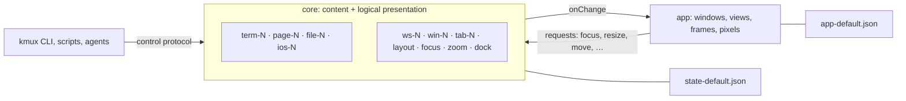

# kmux — Presentation Layers

kmux is split into three layers. The control protocol is the line between the first two and the third:

| Layer | What it holds | Where |
|-------|---------------|-------|
| **Content** | What panes show: terminals (`term-N`), web pages (`page-N`), markdown files (`file-N`), iOS apps (`ios-N`), each with what it needs to start again (command and cwd, URL, path, app and device) | The core (`KmuxCore`, `reference/kmux/core.js`) |
| **Logical presentation** | Workspaces (`ws-N`), windows (`win-N`) and their order, tabs (`tab-N`), each tab's split tree of content IDs with fractional sizes, the docked pane and its width, focus and zoom | The core |
| **Physical presentation** | Where each window is on screen and how large it is, the views drawn for each pane, pixel sizes, markdown magnification, scroll positions, keyboard focus | The app (`Kmux`, `reference/kmux/index.html`) |

## Rules

- **The app changes the core only by requests,** the same ones a client sends: a click on a pane is `focus {pane}`, a window becoming key is `focus {window}`, a dropped divider is `resize {tab, path, index, share}`, the dock's divider `resize {pane, size}`. The model's fields can't be set outside `KmuxCore`, so the compiler holds the app to this. While a divider is dragged the app draws a preview of its own and sends one `resize` when it is dropped. What a pane's content finds out about itself (a shell's directory, the simulator an iOS pane runs on) is reported to the core, which saves it.
- **The core publishes, the app renders.** Every change to the core calls `onChange`; the app redraws its windows from the core's model. The app's own state never feeds back into the core's.
- **Content IDs name content, not places.** A terminal is one program run: `restart` makes a new terminal in the same place with a new ID, and the pane's name, focus and position go with it. Web, markdown and iOS panes keep their IDs through `restart` and `navigate`. Each kind is numbered on its own.
- **Each layer saves its own.** The core's state file (`state-default.json`, version 2) has the content and the logical presentation. The app's file beside it (`app-default.json`, or the socket's path with `.app.json`) has window frames and markdown magnification. A version 1 state file had frames and magnification in it: the app takes them from there once, and the core ignores them.

## Not split yet

kmux is still one process: the core runs in the app, and Ghostty's terminals live in the app's process with their views. Separate server and app processes would need terminals hosted outside the app (Ghostty owns the pty), and a socket `subscribe` command to publish changes over the protocol. Neither is built. The split above is the line such a server would follow.
