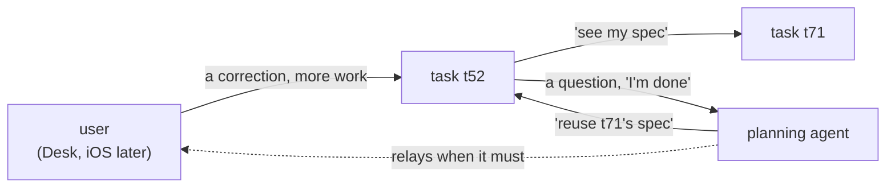
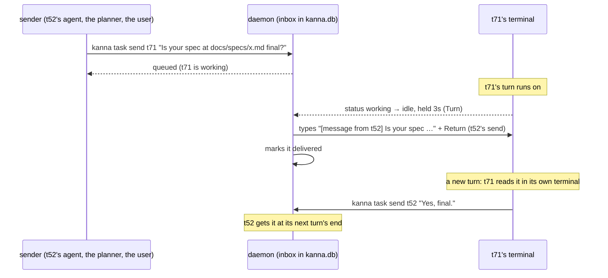
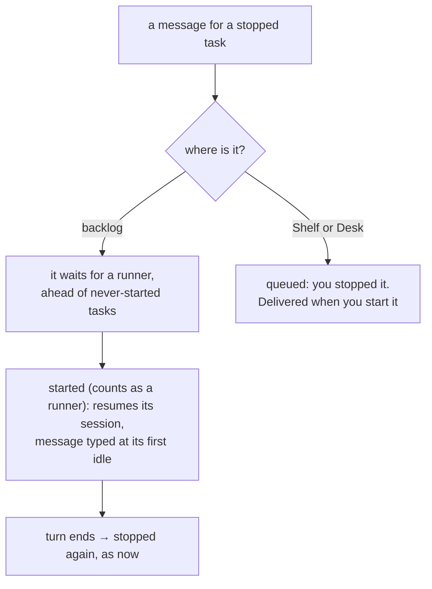

# Agent messaging: how the user, the planner and tasks message each other

> 2026-10-15. Research for a build task; nothing is built. Checked against Claude Code 2.1.300 (installed, and the newest in its changelog) and Codex 0.162.1 (newest release, 2026-10-09; not installed here, so from its docs and source only). Copilot CLI, opencode and Antigravity are from their docs only.

Today the only way to tell a running agent something is to type into its terminal (`kanna send`, then often `kanna send-key return`). Typed text can land mid-turn, and it's lost if the agent isn't running. Agents can't message each other at all. **Recommendation:** an inbox per task in the daemon, delivered by typing the message into the agent's terminal **when its turn ends**. It works for every agent Kanna runs, needs no hooks, and keeps every message visible in the task's terminal.

## Contents

1. [Who messages whom](#1-who-messages-whom)
2. [Candidates](#2-candidates)
3. [Recommendation](#3-recommendation)
4. [Stopped tasks](#4-stopped-tasks)
5. [What the build task includes](#5-what-the-build-task-includes)
6. [Glossary](#6-glossary)

## 1. Who messages whom

| From → to | Needs |
|---|---|
| user → task | Delivery while busy (don't break the turn) and while stopped. The Desk has a terminal for this already; iOS won't. |
| planner → task | The same; the planner shouldn't have to start a task first. |
| task → task | The same, and the recipient should know who to answer. |
| task → planner | A question or "I'm done"; the planner is usually idle, waiting for the user. |

A reply is just a message back. Nobody needs to block waiting for an answer: agents already work turn by turn, so a reply arrives as the next turn.

## 2. Candidates

| Candidate | While busy | While stopped | Agents | Visible to the user | Cost to build |
|---|---|---|---|---|---|
| **A. Type into the terminal** (`kanna send`, fixed by t52) | Lands mid-turn: queued or steered by the agent, or mangled by its input mode | Lost | all | yes, as a prompt | done |
| **B. Inbox, typed when the turn ends** | Waits for the turn's end, then delivered as the next prompt | Queued; wakes a backlog task ([4](#4-stopped-tasks)) | all: needs only agent status and `kanna send` | yes, as a prompt | small |
| **C. Inbox, delivered by hooks** (Stop `decision: block` + reason) | At the turn's end, as B | Queued, as B | claude, codex, copilot, antigravity; opencode by a JS plugin | partly: Claude folds it under "Stop hook feedback" | medium: hooks in the user's settings again (agent setup [took them out](../specs/agent-setup.md#1-what-it-does)); codex asks to trust each hook once (`/hooks`). **An idle agent runs no hook, so B is still needed.** |
| **D. MCP server with send/receive tools** | Only if the agent thinks to call `receive` | Queued | all have MCP clients | as a tool call | medium. Plain MCP notifications can't start a turn in claude or codex, so nothing arrives unless the agent asks for it. |
| **E. Claude channels** (an MCP server pushes `notifications/claude/channel`) | Queued to the next turn | not available | claude only | a `←` line | medium. Research preview: needs a claude.ai or API-key login, and a custom server needs `--dangerously-load-development-channels`. |
| **F. The agents' own APIs** (codex `app-server` + `codex --remote`, `turn/start` and `turn/steer`; `opencode serve`; Claude's SDK) | Queued, or steered into the turn | `thread/resume` or `--resume` with the message | a different one for each agent; none for copilot or antigravity | only if the TUI attaches to the server (codex, opencode) | large: changes how Kanna runs each agent |
| **G. Resume with the message as the prompt** (`claude --resume ID "msg"`, `codex resume ID "msg"`) | n/a | yes | claude, codex (with t98's resume by ID); others differ | yes | small, but covers stopped tasks only |

- **B needs nothing from the agents** except what Kanna already relies on: their [status](../specs/agent-status.md) (working, needs you, idle) and the [turn's end](../specs/backlog-runners.md#2-how-its-built) the runners already detect.
- **C and B deliver at the same moment.** A hook only saves the roughly 3s B waits to be sure the turn has ended, and it can't wake an idle agent. That doesn't justify hooks in five agents' settings.
- **D and E** are where push may come from one day. Today only Claude's channels push, and only as a preview.
- **F is the most capable and the most work:** codex's `turn/steer` could deliver mid-turn. Revisit it if mid-turn delivery is ever wanted. For now it isn't: a message that lands mid-turn is what goes wrong today.

## 3. Recommendation

**B: an inbox per task in `kanna.db`, delivered by typing the message when the agent's turn ends.**

- **Address by task ID or `planner`** (the planning agent of the Desk that shows the repo). `--from` is the sender's own task, found from `KANNA_PANE`, or `user`.
- **Deliver when it's idle, never when it needs you:** text typed while a question or approval is on screen would answer it. Several waiting messages go in one prompt, oldest first.
- **Don't type over the user:** hold delivery while the user has typed into that pane in the last few seconds.
- **Every message shows where it lands,** in the task's terminal as a prompt with its sender. `kanna task messages TASK` lists what's queued and what was delivered, for when the terminal has scrolled.
- **The skills teach it:** kanna-tasks says how to message the planner or another task and to answer with `kanna task send`; kanna-planning says tasks may write to it.

## 4. Stopped tasks

- **A backlog task wakes for it, as a runner:** that's what runners are for, and a task waiting on an answer should get one before new work starts. It doesn't jump past `backlog.runners`.
- **A task you stopped on the Shelf stays stopped:** you meant it. The message waits.
- **A task that's Done** refuses messages: `kanna task send` says so.
- **At a turn's end, a waiting message comes before stopping:** a backlog task with a message waiting isn't stopped; it gets the message and runs another turn.

## 5. What the build task includes

1. **An inbox table** in `kanna.db`: id, to, from, text, made, delivered ([database](../specs/database.md)).
2. **`kanna task send TASK|planner TEXT`** and **`kanna task messages [TASK]`**.
3. **Delivery in the daemon:** on the turn's end (`Turn`, already used by the runners), or at once if the agent is idle; typed with t52's `kanna send`; skipped while it needs you or the user is typing.
4. **Runners:** a waiting message makes a stopped backlog task next to start, and keeps a running one from being stopped.
5. **Skills:** kanna-tasks and kanna-planning learn `kanna task send`.
6. **A spec,** `docs/specs/agent-messaging.md`, and an e2e scenario with the mock agent: send to a working task, a stopped backlog task and the planner; each gets it once, in order, as a prompt.

**Not included:** hooks, MCP, channels, app-server, mid-turn delivery, iOS (it calls the same command later).

## 6. Glossary

| Term | Meaning |
|---|---|
| **Turn** | An agent's work from a prompt until it waits for the next; its end is when status settles idle or needs you for 3s |
| **Inbox** | A task's waiting and delivered messages, kept by the daemon |
| **Stop hook** | A command Claude, Codex and others run as a turn ends; it can return a reason that starts another turn |
| **Channel** | Claude Code's preview feature: an MCP server that pushes messages into a session |
| **app-server** | Codex's JSON-RPC server; its TUI can attach with `--remote`, and clients can start or steer turns |
