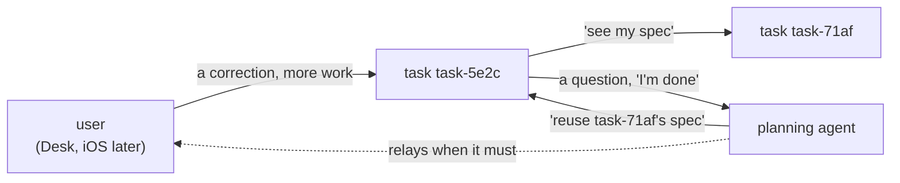
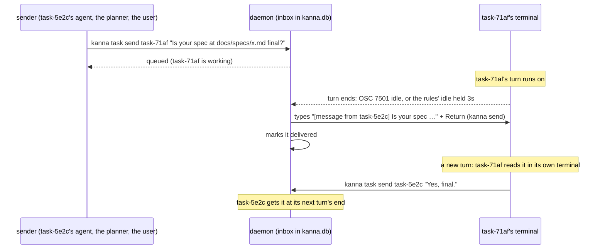
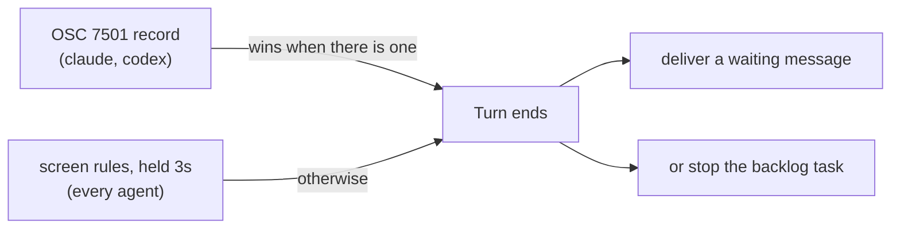
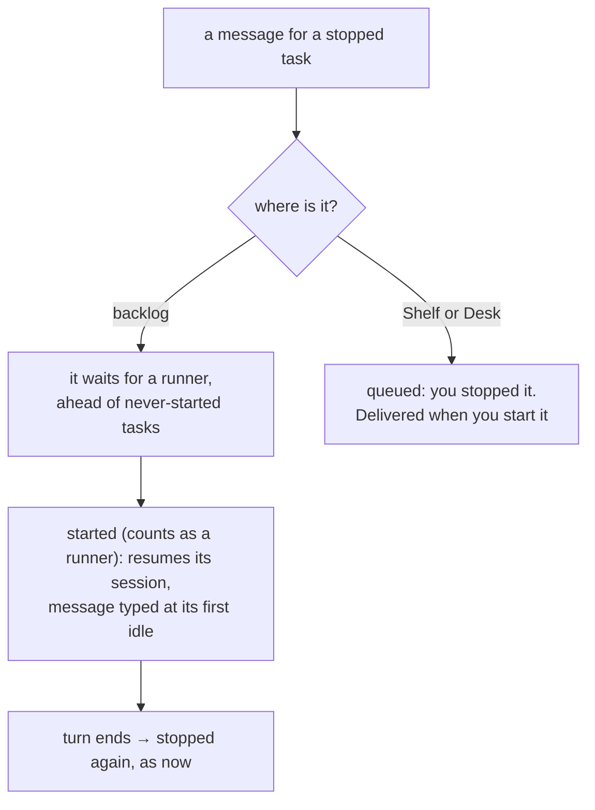

# Agent messaging: how the user, the planner and tasks message each other

> 2026-10-16. Research for a build task; nothing is built. Checked against the installed binaries, Claude Code 2.1.301 and Codex 0.163.0 (their `--help` and the strings in them), and against Anthropic's docs (code.claude.com/docs) and OpenAI's (developers.openai.com/codex, which now redirects to learn.chatgpt.com/docs) and `openai/codex` source. Copilot CLI, opencode and Antigravity are from their own docs only, not run.

Today the only way to tell a running agent something is to type into its terminal (`kanna send`, then often `kanna send-key return`). Typed text can land mid-turn, and it's lost if the agent isn't running. Agents can't message each other at all. **Recommendation:** an inbox per task in the daemon, delivered by typing the message into the agent's terminal **when its turn ends**, as Kanna already detects it ([4](#4-the-end-of-a-turn)). It works for every agent Kanna runs, needs no hooks, and keeps every message visible in the task's terminal.

## Contents

1. [Who messages whom](#1-who-messages-whom)
2. [Candidates](#2-candidates)
3. [Recommendation](#3-recommendation)
4. [The end of a turn](#4-the-end-of-a-turn)
5. [Stopped tasks](#5-stopped-tasks)
6. [What the build task includes](#6-what-the-build-task-includes)
7. [Glossary](#7-glossary)

## 1. Who messages whom

| From → to | Needs |
|---|---|
| user → task | Delivery while busy (don't break the turn) and while stopped. The Desk has a terminal for this already; iOS won't. |
| planner → task | The same; the planner shouldn't have to start a task first. |
| task → task | The same, and the recipient should know who to answer. |
| task → planner | A question or "I'm done"; the planner is usually idle, waiting for the user. |

A reply is just a message back. Nobody needs to block waiting for an answer: agents already work turn by turn, so a reply arrives as the next turn.

## 2. Candidates

| Candidate | While busy | While stopped | Agents | Visible to the user | Cost to build |
|---|---|---|---|---|---|
| **A. Type into the terminal** (`kanna send`, which now [presses Return itself](../specs/kanna-send.md)) | Lands mid-turn: queued or steered by the agent, or mangled by its input mode | Lost | all | yes, as a prompt | done |
| **B. Inbox, typed when the turn ends** | Waits for the turn's end, then delivered as the next prompt | Queued; wakes a backlog task ([5](#5-stopped-tasks)) | all: needs only the turn's end and `kanna send` | yes, as a prompt | small |
| **C. Inbox, delivered by a Stop hook** (`decision: "block"` + `reason` continues the turn with it) | At the turn's end, as B | Queued, as B | claude, codex; copilot (`agentStop`), antigravity; opencode by a JS plugin | partly: Claude shows it as "Stop hook feedback" | medium: hooks back in the user's settings (agent setup [took them out](../specs/agent-setup.md#1-what-it-does)); codex runs a hook only once you've trusted it. **An idle agent runs no hook, so B is still needed.** |
| **D. MCP server with send/receive tools** | Only if the agent thinks to call `receive` | Queued | all have MCP clients | as a tool call | medium. MCP notifications can't start a turn in claude or codex (codex only logs them), so nothing arrives unless the agent asks. |
| **E. Claude channels** (an MCP server sends `notifications/claude/channel`) | Queued to the next turn | not available | claude only | a `←` line | medium. Research preview: claude.ai or Console API-key login only, and a server of Kanna's own needs `--dangerously-load-development-channels`. |
| **F. The agents' own APIs** (codex `app-server` + `codex --remote`, `turn/start` and `turn/steer`; `opencode serve`; Claude's SDK) | Queued, or steered into the turn | `thread/resume` or `--resume` with the message | a different one for each agent; none for copilot or antigravity | only if the TUI attaches to the server (codex, opencode) | large: changes how Kanna runs each agent |
| **G. Resume with the message as the prompt** (`claude --resume ID "msg"`, `codex resume ID "msg"`) | n/a | yes | claude, codex (both by the session ID Kanna keeps: `codex resume [SESSION_ID] [PROMPT]`); others differ | yes | small, but covers stopped tasks only |

- **B needs nothing from the agents** except the turn's end, which Kanna already has for every agent ([4](#4-the-end-of-a-turn)).
- **C delivers when B does,** and can't wake an idle agent. That doesn't justify hooks in five agents' settings.
- **D and E** are where push may come from one day. Today only Claude's channels push, and only as a preview.
- **F is the most capable and the most work:** codex's `turn/steer` could deliver mid-turn. Revisit it if mid-turn delivery is ever wanted. For now it isn't: a message that lands mid-turn is what goes wrong today.

## 3. Recommendation

**B: an inbox per task in `kanna.db`, delivered by typing the message when the agent's turn ends.**

- **Address by task ID or `planner`:** a [planner workspace](../specs/presentation-layers.md) of the task's repo: the Desk's of the app that has the sender out (its claim), else the repo's only one; with several and no claim, it asks which. `--from` is the sender's own task, found from `KANNA_TERMINAL`, or `user`.
- **Deliver when it's idle, never when it needs you:** text typed while a question or approval is on screen would answer it. Several waiting messages go in one prompt, oldest first.
- **Don't type over the user:** hold delivery while the user has typed into that pane in the last few seconds.
- **Every message shows where it lands,** in the task's terminal as a prompt with its sender. `kanna task messages TASK` lists what's queued and what was delivered, for when the terminal has scrolled.
- **The skills teach it:** kanna-tasks says how to message the planner or another task and to answer with `kanna task send`; kanna-planning says tasks may write to it.

## 4. The end of a turn

Delivery (B), the [backlog runners](../specs/backlog-runners.md) and agent status all hang on one signal: the turn has ended, and did it end idle or asking you? Kanna has two ways to know today, and hooks would be a third.

| Signal | claude | codex | copilot, opencode, antigravity | Tells needs you from idle | Setup | Delay |
|---|---|---|---|---|---|---|
| **Screen rules + 3s hold** (built) | yes | yes | yes | yes | none | 3s |
| **OSC 7501** ([agent status §4](../specs/agent-status.md#4-the-agents-own-report-osc-7501), built) | 2.1.295+ | 0.163.0+ | no | yes (`blocked`) | none: Kanna answers the probe | none |
| **Stop hook** | yes; not on Esc, and not while asking (that's `PermissionRequest` or `Notification`) | yes | per their docs: copilot `agentStop`, antigravity `Stop`, opencode a plugin on `session.idle` | only with a second hook | a hook in each agent's settings; codex makes you trust it | none |
| **codex `notify`** (`agent-turn-complete`) | – | yes | – | no | `notify` in `~/.codex/config.toml` | none |

- **Hooks add nothing for claude and codex:** OSC 7501 already gives the turn's end at once, says needs you apart from idle in the same report, and needs no files in the user's home. The branch `program-status-osc7501` (merged) built it, including ending a backlog task's turn on working → idle or done.
- **For copilot, opencode and antigravity** hooks could replace the 3s hold, but each needs its own hook format installed in its own settings, to save 3s on agents Kanna doesn't test end to end. Not worth it; they keep the rules.
- **So the build task uses `Turn` as it is** and gets OSC 7501's speed for free wherever an agent reports.

## 5. Stopped tasks

- **A backlog task wakes for it, as a runner:** that's what runners are for, and a task waiting on an answer should get one before new work starts. It doesn't jump past `backlog.runners`.
- **A task you stopped on the Shelf stays stopped:** you meant it. The message waits.
- **A task that's Done** refuses messages: `kanna task send` says so.
- **At a turn's end, a waiting message comes before stopping:** a backlog task with a message waiting isn't stopped; it gets the message and runs another turn.

## 6. What the build task includes

1. **An inbox table** in `kanna.db`: id, to, from, text, made, delivered ([database](../specs/database.md)), keyed by task, not terminal, since a restart gives the agent a new `term-N`.
2. **`kanna task send TASK|planner TEXT`** and **`kanna task messages [TASK]`**.
3. **Delivery in the daemon:** on the turn's end (`Turn`, already used by the runners, OSC 7501 or rules), or at once if the agent is idle; typed with `kanna send`; skipped while it needs you or the user is typing.
4. **Runners:** a waiting message makes a stopped backlog task next to start, and keeps a running one from being stopped.
5. **Skills:** kanna-tasks and kanna-planning learn `kanna task send`.
6. **A spec,** `docs/specs/agent-messaging.md`, and an e2e scenario with the mock agent: send to a working task, a stopped backlog task and the planner; each gets it once, in order, as a prompt.

**Not included:** hooks, MCP, channels, app-server, mid-turn delivery, iOS (it calls the same command later).

## 7. Glossary

| Term | Meaning |
|---|---|
| **Turn** | An agent's work from a prompt until it waits for the next |
| **Inbox** | A task's waiting and delivered messages, kept by the daemon |
| **OSC 7501** | The Program Status Protocol: an agent tells its terminal it's working, blocked, idle or done |
| **Stop hook** | A command an agent runs as its turn ends; it can return a reason that starts another turn |
| **Channel** | Claude Code's preview feature: an MCP server that pushes messages into a session |
| **app-server** | Codex's JSON-RPC server; its TUI can attach with `--remote`, and clients can start or steer turns |
