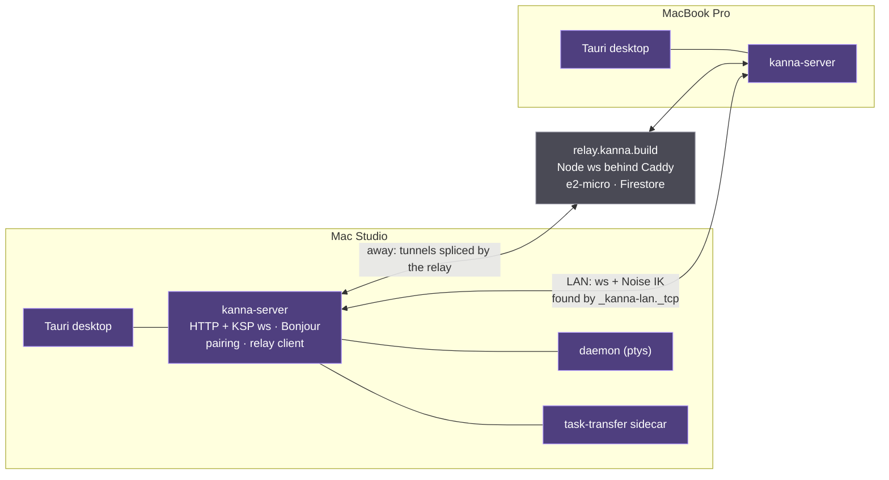
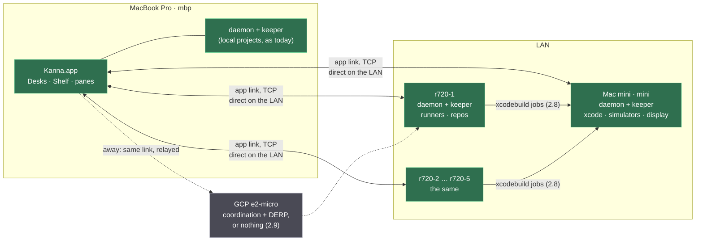
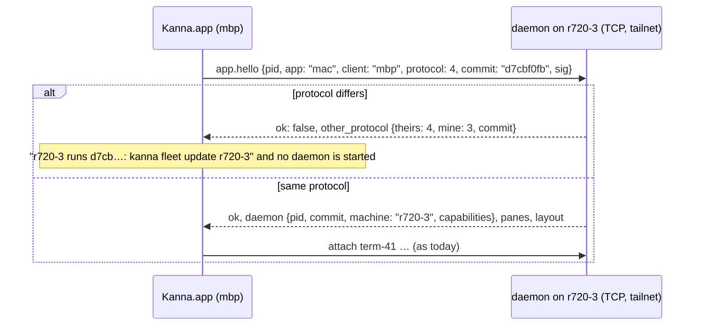
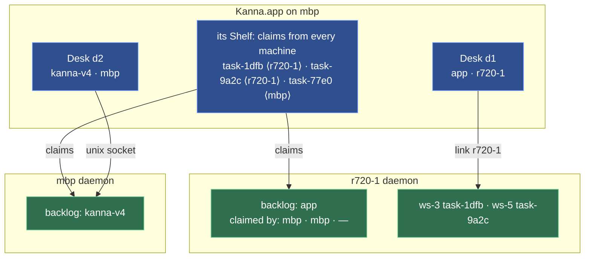
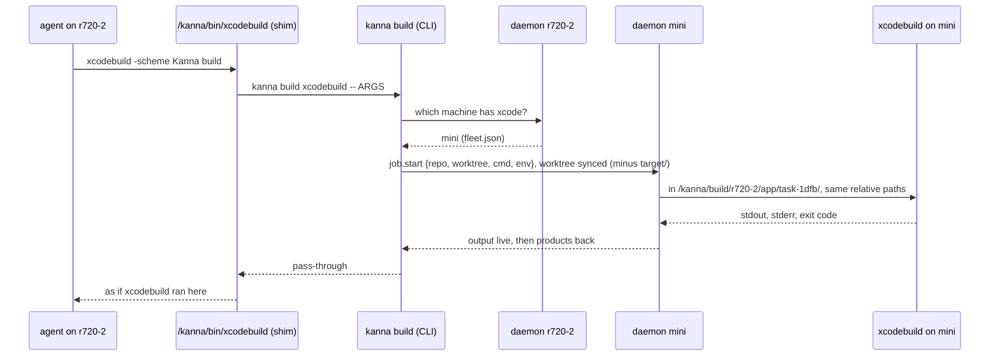

# Kanna v4 across machines: one Mac, five Linux servers, a Mac mini, a relay

> 2026-10-21. Research and a proposal, nothing built; no repo was changed. Builds on [multi-machine-and-people.md](./multi-machine-and-people.md) (scenarios A–H, principles 1–9) and doesn't repeat it. `kanna2/…` paths are Kanna v2's, under `~/.kanna/repos/kanna2`. Copied from the planner's scratchpad into the repo on 2026-10-21; the [fleet spec](../specs/fleet.md) is what was decided.

## Contents

1. [What v2 did: keep, avoid](#1-what-v2-did-keep-avoid)
2. [The proposal](#2-the-proposal): 2.1 roles · 2.2 reach, identity, encryption · 2.3 the app link · 2.4 Desks, Shelf, backlog · 2.5 terminal latency · 2.6 panes · 2.7 where tasks run · 2.8 the Mac mini · 2.9 setup, updates, GCP
3. [Build order](#3-build-order)
4. [Open decisions](#4-open-decisions)

## 1. What v2 did: keep, avoid

v2 had multi-machine working as a hybrid: a Tauri desktop with a `kanna-server` sidecar per machine, a Node relay in GCP with Firebase identity, Bonjour on the LAN, a Noise channel inside both, and a task-transfer sidecar. By September 2026 the MacBook Pro viewed the Studio's tasks over the staging relay. What kept breaking was almost never terminals or tasks; it was reach, trust, and orchestration living in the wrong process.



| Area | What v2 did | Verdict | Where |
|---|---|---|---|
| **Finding machines** | mDNS (`_kanna-lan._tcp` with `desktopId`, `environment`, `protocolVersion` in TXT); the system DNS-SD API on macOS after `mdns-sd`'s raw sockets fought mDNSResponder; `mdns-sd` elsewhere, re-registering every 60 s; no multicast fallback, the relay instead. A 17-byte service name never resolved; `kDNSServiceErr_NoAuth` logged 68,233 identical warnings; never tested on two physical Macs. | **Avoid.** For a fixed fleet of seven, discovery is a file. | `kanna2/crates/runtime-defaults/src/bonjour_services.rs:36-51`, `kanna2/crates/kanna-server/src/lan_discovery.rs:7-11, 34-76`, `kanna2/crates/kanna-server/src/bonjour.rs:16-70, 911-974`, `kanna2/docs/2026-09-10-lan-discovery-multicast-e2e-gap.md:13-35` |
| **Identity** | A key per purpose: X25519 for phones, another for sibling desktops, another for transfer, Ed25519 for push, a private TLS CA per desktop; `desktop_id` + `desktop_secret` for the relay, which saw only the hash. | **Keep** one pinned key per client in a fail-closed `0600` file; drop the count. | `kanna2/docs/specs/secure-channel.md:89-107`, `kanna2/crates/kanna-server/src/channel_identity.rs:1-20`, `kanna2/docs/2026-06-12-relay-desktop-credential-bootstrap.md:25-40` |
| **Pairing** | Phones: a QR or a typed code with a 6-digit SAS (5 min, 5 tries). Desktops: a pasted `KANNA-PEER:…` string, or automatic enrollment with the relay introducing keys (trust on first use: the relay can MITM once). Two trust stores, `machine_trust` (bearer secrets, TLS CA, 24 h leases) then `peer_trust` (pinned keys); the first retired inbound 2026-09-20. A changed key is `identity_mismatch`, never re-trusted. | **Keep:** one-time code, pin, never re-trust a changed key. **Avoid:** two trust systems, an introducer you don't control. | `kanna2/crates/kanna-server/src/pairing.rs:12-13, 436-452`, `kanna2/crates/kanna-server/src/peer_pairing.rs:1-47`, `kanna2/crates/kanna-server/src/peer_enrollment.rs:1-45`, `kanna2/crates/kanna-server/src/machine_trust.rs:1-44`, `kanna2/crates/kanna-server/src/http_api/secure_channel.rs:33-52` |
| **Encryption** | KSC: standard `Noise_IK_25519_ChaChaPoly_SHA256` (`snow`), framed `ksc1:` + base64 inside plain `ws://`, sequential nonces, a fresh handshake per reconnect; the relay sees ciphertext only. Before it, a pinned private CA with bearer secrets; under it, the sidecar's own X25519 + HKDF + XChaCha20. Unreleased, and legacy plaintext mobile access still on by default. | **Avoid building it:** correct and small (1,208 lines), but three cipher layers for one person's LAN. WireGuard gives the same below Kanna. | `kanna2/crates/kanna-secure-channel/src/lib.rs:6-70`, `kanna2/docs/specs/secure-channel.md:3-13, 20-83, 304-316`, `kanna2/crates/task-transfer/src/crypto.rs:1-17`, `kanna2/crates/kanna-server/src/lan_tls_identity.rs:1-32` |
| **The relay** | One Node `ws` process behind Caddy on one 1 GB e2-micro, identities in Firestore; `tunnel_request` → `tunnel_establish` → the desktop dials back → the relay splices. Base64-in-JSON (1.4×), 64 MiB of buffer per tunnel, every OTA byte through the same event loop, RAM spikes the binding limit, ~$11/mo plus Firestore. | **Avoid.** It re-solved NAT traversal and identity, with keystrokes and 100 MB assets on one loop. | `kanna2/services/relay/src/router.ts:13-52, 505-530, 910-950`, `kanna2/crates/kanna-server/src/relay.rs:25-60, 1143-1230`, `kanna2/docs/specs/relay-scaling.md:12-55, 82-99, 123-127`, `kanna2/docs/self-hosted-relay.md` |
| **Remote terminals** | KSP: `term_snapshot` (serialized screen) then `term_output` bytes, `term_input` back: a byte stream plus snapshots, like v4's app link. The lag reports were about *units*: a 10,000-row scrollback on every open or reconnect (4.9 MB in 5 min on 4G; 114.8 MiB truecolor at 240×60), fixed late with a two-screen snapshot (≤256 KiB), scrollback on demand, and resume from a 512 KiB ring; plus a resize feedback loop in the viewer that the relay's 200 ms RTT turned into a visible 49-step descent. The docs never mention mosh or keystroke latency. | **Keep the stream; copy the two fixes.** Principle 6's "laggy ssh-style streams" is really this. | `kanna2/crates/kanna-agent-protocol/src/frames.rs:238-249, 393-465`, `kanna2/docs/kanna-server-boundary.md:418-471`, `kanna2/crates/kanna-server/src/terminal_window.rs:1-64`, `kanna2/docs/task-specs/226a06b2.md:5-14`, `kanna2/docs/2026-09-19-remote-terminal-geometry-stepping.md:8-60` |
| **Task transfer** | A `git bundle` of the committed tip (uncommitted work *not* shipped), the agent's session files, the input ledger, a terminal picture; the receiver imports refs into `refs/kanna/transfers/<id>/`, finds the repo by remote URL then path, else clones into `~/.kanna/repos/<name>`, and derives its own Claude slug from its worktree. The 2026-08-06 incident: the transcript staged from `~/.claude/tasks/<id>` (a lock file) and silently dropped; adopted ptys refusing SIGINT; a duplicate push leaking a reservation; orchestration in the renderer behind window-election leases. Rebuilt as a server-side engine with a durable queue; a destination restart still wedged 1 in 5 runs. | **Keep:** boundaries, remote-URL identity, receiver-derived paths, the durable queue. **Avoid:** moving anything while an agent runs; tests that check "completed" not "the conversation continued". | `kanna2/crates/kanna-server/src/transfer_engine/payload.rs:22-36, 411-451`, `kanna2/crates/kanna-server/src/transfer_engine/import.rs:1271-1340, 1694-1720`, `kanna2/crates/kanna-server/src/transfer_artifact.rs:17-64`, `kanna2/docs/2026-08-06-task-transfer-rearchitecture-plan.md:20-103, 247-252`, `kanna2/docs/2026-08-17-destination-restart-transfer-resume-e2e-gap.md:9-57` |
| **Dev previews** | Tasks claimed ports from `.kanna/config.json` (base+1, HMR at +1); dev servers stay on loopback, so even the LAN needed a forwarder: a minted enter token and cookie, an ephemeral listener, a hyper proxy rewriting `Host`/`Origin` and splicing WebSocket upgrades; never rewrite bodies. The relayed version was designed, never built. | **Keep:** claimed ports, loopback stays loopback, a forwarder, no body rewriting. | `kanna2/docs/specs/remote-dev-preview.md:17-60, 175-258, 291-330`, `kanna2/crates/kanna-server/src/http_api/preview.rs:29-31` |
| **Linux** | `kanna-worker`, a supervisor parent, because the daemon trusted its parent's `/proc/<pid>/exe` and `systemd --user` is non-dumpable; a user unit with `KillMode=process` so agents survive a restart; local-only by design. Phases 0–2 measured on an ARM64 VM, Phase 3 (apt archive) partial, Linux CI deleted, cross-machine acceptance never run. | **Keep:** `KillMode=process`, XDG paths. **Avoid:** a supervisor (v4's daemon has no parent check), apt packaging for five machines. | `kanna2/crates/kanna-worker/src/main.rs:1-34`, `kanna2/crates/kanna-worker/src/unit.rs:15-30, 80-124`, `kanna2/crates/kanna-worker/src/config.rs:319-355`, `kanna2/docs/2026-09-08-linux-phase1-headless-worker.md:164-250`, `kanna2/docs/2026-09-09-linux-phase3-supported-distribution.md:312-357` |

**Size of what's avoided:** `relay.rs` 5,204 lines, `relay_client.rs` 1,378, `pairing.rs` 1,393, `machine_trust.rs` 1,129, `bonjour.rs` 1,217, `lan_discovery.rs` 932, `peer_*.rs` ≈2,400, the secure channel 1,208, the transfer sidecar ≈4,700 plus runtime: about 20,000 lines for reach, trust and transfer, mostly without a two-host test (`kanna2/docs/2026-09-05-lan-auth-e2e-gap.md`, `kanna2/docs/2026-09-05-trusted-lan-task-files-e2e-gap.md`). The one regret stated outright is structural: "the desktop process held the pipe, which made every transfer depend on an open, signed-in window" (`kanna2/docs/kanna-server-boundary.md:1441-1448`). v4 starts on the right side of that line: everything a remote machine does already lives in a headless daemon.

## 2. The proposal

### 2.1 Machines and roles

Every machine runs the same daemon and keeper of one commit ([architecture](../specs/architecture.md): both are Rust for macOS and Linux; the keeper has its Linux `cfg`s in `crates/kanna-keeper/src/{fdpass,sig,paths,session}.rs`, the daemon's watcher is `notify` 8, and `scripts/build-ghostty-vt.sh:15-18` already takes Linux targets). What differs is what each is *for*, advertised as capabilities (principle 8).



| Machine | Role | Capabilities |
|---|---|---|
| `mbp` | the client; a Kanna machine for local projects too (unchanged) | `macos`, `display`, `xcode` |
| `r720-1` … `r720-5` | task machines: daemon, keeper, agents, repos under `/kanna/repos` | `linux`, cores, RAM |
| `mini` | build machine; also a Mac task machine with a logged-in session for e2e | `macos`, `xcode`, `display`, `simulator` |
| GCP e2-micro | reachability when the LAN isn't there | — |

**One rule:** a task lives on exactly one machine, with its worktree, agent, terminals and workspace, as it lives in one daemon today. The app shows machines; it never owns work. Every current spec stays true ([presentation layers](../specs/presentation-layers.md)), and the app gains one dimension: *which daemon*.

### 2.2 Reach, identity, encryption

How does the app find `r720-3` (LAN first, café second), who is talking, and who can read the bytes? v2 answered all three itself, and that's where its 20,000 lines and its flakiness went. For one person with seven machines a layer below Kanna answers all three, so Kanna should answer only what's its own: names, roles, claims, jobs.

| | ssh | v2's channel + relay | WireGuard mesh (Tailscale, or Headscale on the GCP instance) |
|---|---|---|---|
| Find a machine | hostname; LAN vs away is ssh config, plus reverse tunnels from each server to GCP | Bonjour on the LAN, relay registration otherwise | direct WireGuard on the LAN (LAN-first by construction, wire speed), a DERP relay only when direct fails; stable names |
| Identity | ssh keys per pair, by hand | X25519 pins, two ceremonies, enrollment via the relay | a node key per machine; plus Kanna's own client key (below) |
| Encryption | ssh | Noise IK | WireGuard |
| Away | `ProxyJump` through GCP, 7 reverse tunnels to keep up | the Node relay, Firebase, Caddy | DERP, Tailscale's or yours on the e2-micro |
| Kanna code | a stdio bridge, reconnects, `-L` per web pane, the app babysitting `ssh` | ~20k lines again | a TCP listener and a signed hello: ~500 lines |
| Cost | every feature is another ssh invocation | months | a SaaS control plane until you run Headscale |

**Pick: a WireGuard mesh, with Kanna's own thin identity on top.**

- **Transport:** the daemon gains a TCP listener (`KANNA_LISTEN=100.64.0.3:7421`, bound to the tailnet address only), speaking the unix socket's JSON lines. Local clients (agents, `KANNA_SOCKET`) keep the unix socket.
- **Identity and pairing:** each client (the app, the CLI on `mbp`) has an Ed25519 key in `~/.kanna-v4/fleet/`; each daemon pins the keys it accepts. `kanna fleet token` on a server prints a one-time code; `kanna fleet add r720-3 CODE` on the Mac sends its public key over the tailnet and the daemon pins it; `hello` then carries a signed nonce. Why not the tailnet alone: the daemon needs to know *who* for claims (`claimed by: mbp`) and jobs, and a stray process on one tailnet node mustn't drive every daemon. Why not Noise: WireGuard already encrypts and authenticates the node; v2 needed Noise *inside* its relay because the relay was untrusted, and a DERP relay never sees WireGuard plaintext.
- **Names:** `fleet.json` on each machine lists the others: name, tailnet address, key, capabilities. The app shows each machine as direct or relayed (`tailscale status --json`), so LAN-first is visible, not assumed.
- **Tailscale or Headscale:** Tailscale first (no operations; the personal plan covers 100 devices). Move the control plane to Headscale on the e2-micro when owning it matters (2.9).

**Rejected: ssh as the app link.** Right for setup and for the shim's first version (2.8), and a `kanna link --stdio` bridge would work in a day, but nothing in it leads to the target: the app spawning `ssh`, a `-L` per web pane, reverse tunnels for away.

### 2.3 The app link over the network

[app-link.md](../specs/app-link.md) assumes one daemon on one socket. Over the network four things change; snapshot, output, input, resize, layout, diffs, toasts and `debug.*` carry over unchanged, which is the payoff of a headless daemon.



| Today | In the fleet | Why |
|---|---|---|
| `build` is the daemon binary's SHA-256; a mismatch stops the daemon and the app starts its own ([daemon-build.md](../specs/daemon-build.md)) | a **local** daemon keeps that rule; a **remote** hello carries `protocol` (bumped on incompatible change) and `commit`; mismatch is `other_protocol`, the daemon keeps running, the app names the fix | a Linux binary never hashes like the Mac's, and a remote daemon isn't the app's to replace |
| the app starts the daemon (`DaemonStarter.swift`) | only for local sockets; systemd owns the server's daemon (2.9) | |
| one link, one `Daemon` object | one link **per machine**; every view keyed by (machine, content ID), since `term-41` exists on every daemon | |
| one app at a time (`app_attached`) | kept, per daemon; lifting it is a later slice (the daemon's model allows it; v2's controller election shows what two live viewers cost) | |

**The CLI** gets `--host NAME` (`KANNA_HOST`) through `fleet.json`, and `kanna r720-3:/kanna/repos/app` opens a Desk there. In a remote terminal nothing changes: the CLI runs *on the server* against its unix socket.

**Two connections per machine.** The control link stays small and latency-bound (keystrokes, layout). Bulk (a forwarded dev server, a screenshot coming back, an `.app`) goes over a second **bulk** connection on the same listener, authenticated the same way, so a 20 MB page never queues behind a keystroke. v2 put everything through one event loop with 64 MiB per tunnel (`kanna2/docs/specs/relay-scaling.md:21-30`).

### 2.4 One app, several machines: Desks, Shelf, backlog

[app-desk.md](../specs/app-desk.md) already gives each app its own Desk and Shelf, with claims in the daemon. A Desk is on a *project*; in the fleet a project is on a *machine*, so a Desk is on `(machine, project)`.



- **A Desk window** is titled by project and machine (`app · r720-1`); its planning terminal runs *on that machine*, so the planner reads the code where the code is; its backlog page lists that daemon's backlog for the project. The new-Desk prompt gains a machine picker; Open Recent becomes `r720-1:/kanna/repos/app`.
- **The Shelf** is the app's, as now: claims in its order, saved in `app-state.json` keyed by (machine, task), each card with a machine badge; three per (machine, project).
- **The backlog with five servers:** one per Desk, that is per (machine, project). Five clones of a repo are five backlogs; 2.7 says how that becomes one.
- **Claims:** `claimed by: mac` becomes the client name from the hello; runners leave claimed tasks alone, as today. **Toasts** held while no app is attached arrive on connect, so five servers' finished tasks show when you open the lid.

### 2.5 Terminal latency

A keystroke costs one round trip to echo (`input` → pty → `output`). Over WireGuard on the LAN that's under a millisecond. Through a relay it's the RTT to the relay and back, 40–150 ms: ssh-over-the-internet, usable, not local.

Was v2's lag the byte stream? No: it was base64-in-JSON through one Node loop with 64 MiB buffers, a full 10,000-row scrollback re-shipped on every reconnect, and a viewer resizing itself in a loop ([§1](#1-what-v2-did-keep-avoid)). Bufferbloat and bad units, not the stream. So: **keep snapshot + bytes, fix the units, measure before building mosh.**

1. **Bounded snapshots on attach.** Today's snapshot is the screen plus up to 10 MB of scrollback. Add `attach {scrollback: N}` for the screen and a page, older scrollback on demand (v2's bound: two screens, ≤256 KiB, `kanna2/crates/kanna-server/src/terminal_window.rs:1-64`).
2. **Reconnect by offset.** Give `output` a running byte offset; `attach {from}` replays only the gap from the daemon's outbox (v2's `term_resume` against a 512 KiB ring worked).
3. **The 16 / 64 MiB rules** stay; they're the backpressure v2's relay lacked.
4. **Mosh-style screen state** (principle 6): the daemon has the screen in libghostty-vt, so "far behind, send the screen not the bytes" is cheap and half exists (the resnapshot at 16 MiB behind). What mosh really adds is *predictive local echo*, which means the app guessing the pty: not in these slices; decide after measuring the relayed RTT from where you actually work.
5. **Resize** stays the daemon's, last app wins; with one app per daemon there's no controller to elect.

### 2.6 Files, diffs, markdown, web and iOS panes

A remote task's content must come over the link; the app can't read `r720-1`'s disk. Diffs already do (`diff.subscribe`, one watcher), and the unmerged **[file panes through the daemon](../specs/file-panes.md)** (task e044) does the same for markdown and code: "An app on another machine (planned) can only show what comes over its link." Merge it first.

| Content | Over the link? | What's left |
|---|---|---|
| Terminal, diff | yes | 2.5's bounds |
| Markdown, code | with e044 | the renderer still reads images and relative links from disk: `file.read {path}` on the bulk connection |
| Doc markup threads | no: `kanna markup` works on the thread file "without the daemon" ([cli.md](../specs/cli.md#2-where-kanna-differs-from-kmux)) and the app writes comments to disk | `markup.*` through the daemon, the same move as files |
| `kanna screenshot` | the app writes the PNG on *its* disk | bytes return over bulk; the daemon writes where the agent asked |
| Web pane | WebKit loads the URL; `127.0.0.1:5173` on r720-1 is unreachable | the **port tunnel** |
| iOS | only the Mac running the app has simulators | 2.8 |

**The port tunnel.** A task's dev server binds loopback on its server (Vite's default; v2 called this "the single biggest constraint", `kanna2/docs/specs/remote-dev-preview.md:48-56`). When a web pane on a remote daemon names `127.0.0.1:PORT`, the app sends `port.open {port}` and listens on a local ephemeral port; each local TCP connection becomes a stream on the bulk connection, which the daemon connects to `127.0.0.1:PORT` on its machine. WebKit loads `http://127.0.0.1:LOCAL/`, so cookies, `Host` and Vite's HMR checks see localhost with none of the `Host`/`Origin` rewriting v2's proxy needed; HMR's `PORT+1` is tunnelled the same way (the task's claimed ports). Never rewrite bodies. LAN-first falls out of the mesh. *The stopgap that isn't a step:* `vite --host` on the tailnet and open `http://r720-1:5173`: a demo that leaks the dev server to every node and breaks origin-sensitive apps.

### 2.7 Where tasks run

**Placement, in two steps.** First, **per-machine backlogs**: a task runs where you planned it, since the planner runs on that Desk's machine and `kanna task new` adds to that daemon. With 5 × `backlog.runners` agents that's already more than one person reviews (principle 1), so losing "oldest first across the fleet" costs little now.

The target is **a home per repo**: one daemon owns a repo's backlog (the clone you planned on); any machine with a clone is a runner for it: its `Backlog::tick` asks the home for the oldest waiting task it can run (capabilities match) and claims it with a compare-and-set in the home's `kanna.db`, as app claims work today; worktree, agent and workspace live on the runner, the home records `runs on: r720-4`. Per-machine backlogs are this model with every repo's home being its own machine, so step one isn't thrown away.

**Teleport** (a stopped task moving, principle 7) comes after, Linux-to-Linux first, with v2's lessons: stop the agent cleanly (v4's `Backlog::end_agent` quits by keys and captures the session ID, which v2's SIGINT never managed, `kanna2/docs/2026-08-06-task-transfer-rearchitecture-plan.md:46-62`), commit WIP, push, copy the transcript from where the agent really keeps it, let the receiver derive its own session slug (v2 got that right, `kanna2/crates/kanna-server/src/transfer_artifact.rs:17-64`). **Task IDs** stay random 32 bits ([task-ids.md](../specs/task-ids.md)); the app keys by (machine, ID) and the home checks uniqueness, so [tasks.md §9](../specs/tasks.md) needs no change.

**Repos and paths.** Every Linux server keeps clones at `/kanna/repos/<name>`. The session-path problem ([multi-machine-and-people.md §5.1](./multi-machine-and-people.md)) vanishes between servers, where teleport happens first; the Mac stays different and out of teleport. Clones come from origin, so the remote URL identifies a repo across machines, as v2's `remote_url_hash` did (`kanna2/docs/kanna-server-boundary.md:1115-1121`).

**Credentials:** each server has its own git identity (a deploy key or `gh auth login` with a fine-grained token; your personal key never leaves the Mac), its own agent logins (`claude`, `codex`, once per machine over ssh), and repo secrets through `tasks.setup` as now.

### 2.8 The Mac mini and the xcodebuild redirect

Shape 2 of the prior research: the task stays on Linux and borrows the Mac for the build. A separate job studies the shim itself; this is where it sits.



- **Where the redirect sits:** on each Linux server, in the task environment's PATH (`/kanna/bin` first), so the agent, `scripts/build.sh` and anything Xcode-shaped hit it unknowingly. Its brain is `kanna build`, so fleet knowledge stays Kanna's.
- **How the worktree gets there:** rsync of the worktree's files, committed and not, excluding `target/`, `.build/`, `node_modules/`, to a mirror on the mini keyed by (server, repo, worktree), so DerivedData stays warm per task. Not git: the agent builds what it has. First version: rsync over Tailscale SSH (node identity, no keys to distribute), run by the CLI. Target: the daemon's bulk connection carries the sync and the shim needs no ssh.
- **The queue:** first a lock per mirror (same worktree serializes, different ones run in parallel); target: the mini's daemon runs **jobs** as it runs backlog tasks, with runners and a queue visible in the app.
- **Results back:** output and exit code pass through live; products (`-derivedDataPath` inside the worktree, or `target/`) rsync back so tests and `.app` bundles are where the agent expects.
- **iOS Simulator panes:** a simulator is where a Mac is. Either the mini streams its simulator's screen to the app (a frame stream from CoreSimulator over bulk: a project of its own), or the **MBP** runs the simulator for a remote task, fetching the mini-built `.app` over the link and `simctl install`ing it, the `ios-N` content living on the MBP's own daemon. Recommend the second: the existing iOS pane plus a file fetch. e2e that needs a display runs on the mini as Mac tasks (shape 1), screenshots coming back as files.
- **The mini is also a Mac task machine:** kanna-v4's own Swift work runs as tasks *on* the mini, pulled onto the MBP's Desk like any remote task.

### 2.9 Server setup, updates, the GCP instance

**Linux install.** Ubuntu 24.04 LTS Server on each R720 (Ivy Bridge: build at `baseline` CPU, as `build-ghostty-vt.sh` does). One account, yours, with `loginctl enable-linger` so user units run without a session. Install git, build tools, Node (for `claude`, `codex`), Tailscale, and Kanna's Linux tarball at `/opt/kanna/<commit>/` with `/opt/kanna/current` a symlink; state in `~/.local/share/kanna-prod/` ([instances.md](../specs/instances.md) already names `$XDG_DATA_HOME`). An idempotent `scripts/server-setup.sh`; no Ansible.

**Units.** One user unit for the daemon; the keeper stays the daemon's child as on the Mac (`kanna-keeper --detach`, [keeper.md §7](../keeper.md)), so the unit needs `KillMode=process`, or `systemctl restart` kills the cgroup, keeper and every shell with it. v2 made the same choice (`kanna2/crates/kanna-worker/src/unit.rs:80-124`); v2's supervisor process isn't needed, since v4's daemon has no parent-exe check.

```ini
# ~/.config/systemd/user/kanna-daemon.service
[Service]
Environment=KANNA_SOCKET=%h/.local/share/kanna-prod/kanna.sock
Environment=KANNA_KEEPER=/opt/kanna/current/kanna-keeper
Environment=KANNA_LISTEN=100.64.0.3:7421
ExecStart=/opt/kanna/current/kanna-daemon
Restart=always
KillMode=process
[Install]
WantedBy=default.target
```

**Updates: one commit everywhere.** `scripts/release.sh` builds the DMG; the same run adds a Linux tarball (cross-compiled with zig from the Mac, as `build-ghostty-vt.sh` can, or built on one R720 at first). `kanna fleet update` copies it to every server, swaps `current`, runs `kanna-keeper --upgrade` ([keeper-upgrade.md](../specs/keeper-upgrade.md)) and restarts the daemon; terminals survive ([daemon-restart.md](../specs/daemon-restart.md)). Servers first, then the app, since the app refuses a server of another protocol and names it.

**The GCP e2-micro.**

| | Runs there | RAM | Operations |
|---|---|---|---|
| A. Tailscale SaaS | nothing (or `derper` as your own relay) | 0 (≈50 MB) | none |
| B. Headscale | Headscale + embedded DERP behind Caddy: your own control plane and relay, one static IP, one DNS name | ≈150 MB | a Go binary and a TLS cert |
| C. A Kanna relay, v2's shape | Node, Caddy, Firebase | 1 GB and it hurt | rejected: re-solves what WireGuard solves |

A now, B when you want to own it. The instance stays an e2-micro; nothing of Kanna's runs there.

## 3. Build order

Each slice is one agent's task and leaves `main` releasable. Slices 1–3 connect the MBP to one R720 on the LAN and run a task there.

| # | Slice | Proves | After |
|---|---|---|---|
| 1 | **Kanna on Linux, headless.** Build daemon, keeper, CLI on an R720 (`build-ghostty-vt.sh x86_64-unknown-linux-gnu`, `cargo build`), fix what doesn't run, `scripts/server-setup.sh` with the unit above; `kanna task new` and `task start` over ssh with a real agent. | a Linux daemon runs tasks with runners, no app | — |
| 2 | **TCP listener and pairing.** `KANNA_LISTEN`, `fleet.json`, Ed25519 client keys, `kanna fleet token/add`, a signed hello, `kanna --host`; Tailscale on both machines by hand. | `kanna --host r720-1 task list` from the MBP, direct on the LAN | 1 |
| 3 | **The app connects to a remote daemon.** A `Link` per machine; `app.hello` with `protocol`, `commit`, `client`; no `DaemonStarter` for remote links; views keyed by (machine, ID); a Desk on `r720-1:/kanna/repos/app` with its planner there; Shelf badges; terminals and diffs over the link. | plan a task on r720-1 from the MBP, pull it, type into its agent | 2, e044 merged |
| 4 | **Files and threads through the daemon.** Merge e044; `file.read` for images; `markup.*` through the daemon; `screenshot` returning bytes. | a remote task's spec, code and comments show | 3 |
| 5 | **Bulk connection and port tunnel.** `port.open`; remote web panes on `127.0.0.1:LOCAL`. | a remote dev server in a web pane, HMR working | 3 |
| 6 | **Fleet update.** The Linux tarball in `release.sh`, `/opt/kanna/<commit>`, `kanna fleet update`, the app's `other_protocol` message. | one command puts one commit on every machine | 1, 2 |
| 7 | **The build shim, first version.** `kanna build xcodebuild`, `/kanna/bin/xcodebuild`, rsync over Tailscale SSH, a lock per mirror, products back; the mini set up as a Kanna machine. | a Linux task builds Kanna.app on the mini | 2 |
| 8 | **Remote terminals through a relay, measured.** Bounded snapshots, reconnect by offset, an RTT and echo table from away; decide on local echo. | typing through DERP is acceptable, or the numbers say what's next | 3 |
| 9 | **Servers 2–5.** Run the script, pair, add to `fleet.json`; nothing new to build. | five machines in the app | 6 |
| 10 | **A home per repo.** Runner claims against the home's backlog, `runs on`, `needs: xcode` on tasks. | oldest-first across machines | 9 |
| 11 | **Teleport, Linux to Linux.** Stop at a turn's end, WIP commit, push, transcript, resume elsewhere. | a stopped task moves | 10 |
| 12 | **Jobs in the mini's daemon; iOS `.app` fetch to the MBP.** | the queue is visible; a remote task's app runs in a local simulator | 7, 5 |

## 4. Open decisions

| # | Decision | Recommendation | Why, and the cost |
|---|---|---|---|
| 1 | Network: Tailscale, Headscale on GCP, plain WireGuard, ssh | **Tailscale now, Headscale later** | LAN-first and away for free; the cost is a SaaS control plane until Headscale (ops, no Kanna code) |
| 2 | Kanna identity on top of the tailnet, or trust the tailnet | **Per-client Ed25519 keys pinned by each daemon** | the daemon needs names for claims and jobs anyway; a day of code against a shared token's half day |
| 3 | Version check for remote daemons | **Protocol integer, exact match, commit shown** | honest for a fleet updated together, never silent; ranges can come with a second person |
| 4 | Repo root on servers | **`/kanna/repos/<name>` on every Linux machine** | the session-path problem vanishes between servers; the Mac stays different and out of teleport |
| 5 | Backlog: per machine, or a home per repo | **Per machine (slices 1–9), home at slice 10** | per-machine is the home model's degenerate case; the home costs a claims protocol |
| 6 | Account on servers | **Yours, with linger** | agent logins and `~` are the agent's; a service account needs its own logins to every agent |
| 7 | Keeper under systemd | **Child of the daemon, `KillMode=process`** | matches the Mac and v2; a separate unit fights the keeper's idle exit |
| 8 | Web panes | **Port tunnel through the link** | origin stays localhost, nothing listens on the server; the tailnet shortcut is for demos |
| 9 | iOS for remote tasks | **MBP runs the simulator from a fetched `.app`** | the existing pane plus a file fetch; streaming the mini's simulator is a project |
| 10 | The shim's transport | **ssh+rsync first, bulk connection at slice 12** | Tailscale SSH needs no keys; the daemon path later removes ssh from the design |
| 11 | Mosh-style local echo | **Measure at slice 8, then decide** | principle 6 was written against v2's relay; the stream wasn't the problem |
| 12 | Linux distribution | **Ubuntu 24.04 LTS** | what v2's Linux work measured; widest agent-CLI support |
| 13 | The MBP's local daemon | **Keep it** | local projects and offline work; it's just another machine in the app |
