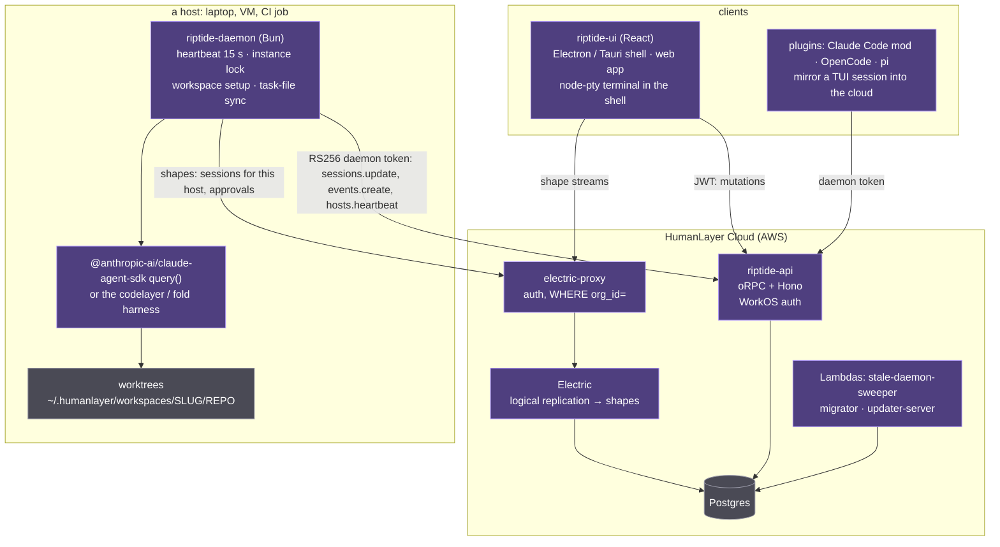
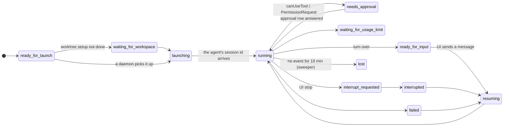
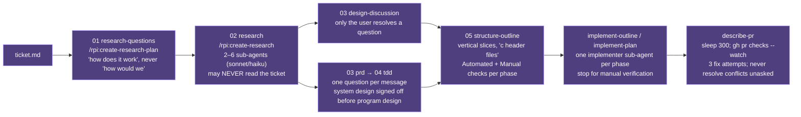
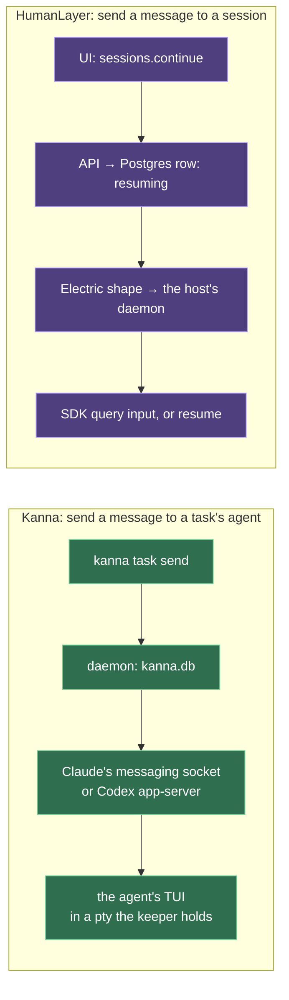

# HumanLayer, open-sourced: what Kanna should learn, adopt, avoid

> 2026-10-25. Research only: nothing was built and no code or spec was changed. Written by a task's agent from a shallow clone of HumanLayer's repos at that day's `main` (humanlayer `4e22fd0`, 2026-10-24), their docs and blog, and Kanna's own specs. `HL:` paths are in the humanlayer repo; `K:` paths are Kanna's. Where a verdict is a judgement call it says so.

## Contents

1. [What's open now](#1-whats-open-now): 1.1 two generations · 1.2 the stack · 1.3 the daemon and hosts · 1.4 worktrees and workspaces · 1.5 approvals · 1.6 agent integrations · 1.7 workflows and skills · 1.8 essays · 1.9 side repos · 1.10 timeline
2. [Kanna and HumanLayer, part by part](#2-kanna-and-humanlayer-part-by-part)
3. [Recommendations, ranked](#3-recommendations-ranked): 3.1 copy · 3.2 Kanna already does better · 3.3 avoid · 3.4 what this changes in the specs
4. [What didn't load](#4-what-didnt-load)
5. [Sources](#5-sources)

## 1. What's open now

### 1.1 Two generations

HumanLayer has shipped two different products under one repo and three names. Knowing which is which matters, because the first one looked a lot like Kanna and they abandoned it.

| | **CodeLayer** (2025 to January 2026) | **HumanLayer** (June 2026 on, code name "riptide") |
|---|---|---|
| Daemon | `hld`, Go, JSON-RPC 2.0 over a Unix socket (`~/.humanlayer/daemon.sock`, 0600, line-delimited JSON), SQLite at `~/.humanlayer/daemon.db` | `riptide-daemon`, Bun and Effect, no local API: it follows rows synced from Postgres and calls a cloud API |
| App | `humanlayer-wui`, Tauri; `dev.humanlayer.wui.nightly` | `riptide-ui` (React) in an Electron shell (primary) and a Tauri shell; also served as a web app at app.humanlayer.com |
| State | on the machine | Postgres in the cloud, synced to every client by [Electric](https://electric-sql.com) |
| Agents | Claude Code only | Claude Code through the Agent SDK; "Codex" through their own harness; OpenCode and pi through plugins; Fold (their own agent) in preview |
| Open | Apache-2.0 all along (the SDK repo) | Apache-2.0 since 2026-10-23: "HumanLayer core is now open source. Hosted HumanLayer is unchanged for now." |

Evidence: the tag `nightly-0.1.0-nightly-20260227142452` (committed 2026-01-07) still has `hld/`, `hlyr/`, `humanlayer-wui/` and `claudecode-go/`; `HL:hld/PROTOCOL.md` and `HL:hld/CLAUDE.md` describe the socket and the SQLite file. Today's `main` has none of those folders. GitHub's releases page shows only those CodeLayer nightlies (the newest 2026-02-27); the real release notes are in the docs ([1.10](#110-timeline)).

The 2026-10-23 post says the repo is "all the same code HumanLayer Cloud runs": the desktop app, the daemon "shipped in the `humanlayer` CLI", the cloud API and the Electric proxy, the plugins, the RPI skills, the Linear CLI, and the data model ("orgs, teams, projects, tasks, sessions, plans and comments, diffs, PRs, and the GitHub / Linear / Jira / Slack integrations"). Self-hosting is "in progress": the README warns the compose file uses default passwords, and the post says processes "refuse to start" without WorkOS, Slack and Linear keys. A build from source sends no telemetry: Sentry, PostHog and the WorkOS client ID are off when unset.

Hosted pricing (the homepage, a stale snapshot still saying "© 2025" and "Not yet" to "Is HumanLayer open source?"): Starter free for up to 3 members and 200 sessions a month; Pro $100 per user a month with BYOK, unlimited sessions, worktrees and "Remote Daemons"; Enterprise with SSO and on-prem. A free Hobby plan arrived with 0.115.0 (2026-06-17).

### 1.2 The stack

The one idea to take from this picture: **nothing calls a host.** The UI writes a row (a session set to `resuming`, `interrupt_requested`, an approval answered), Postgres replicates it, and every daemon follows a shape of "sessions for this host" (`HL:packages/session-sdk-sessions/src/inbox.ts:1-11`). The daemon's own writes go the other way through the API. `HL:golden/sync_architecture.md` draws it; `HL:golden/session_state_machine.md` gives the statuses:

**The data model** (`HL:packages/db/src/tables/`, 55 tables, uuidv7 keys, `organization_id` and `resource_owner_user_id` on nearly every row, which is what the Electric proxy filters on):

- **A task has no status column**, no priority, no order and no dependencies (`tasks.ts:28-111`; a grep for `depends_on|blocked_by|parent_task` finds nothing). It has a `slug`, a `workspace_spec`, a `workflow_type` (default `rpi`), `worktree_timing` (default `later`) and five auto-advance booleans. Progress lives on **sessions**: 13 statuses (`ready_for_launch`, `waiting_for_workspace`, `draft`, `launching`, `running`, `failed`, `ready_for_input`, `needs_approval`, `waiting_for_usage_limit`, `interrupt_requested`, `interrupted`, `resuming`, `lost`; `HL:packages/schemas/src/effect/session/session-status.ts:7-21`), a `coding_agent_session_id` to resume by, `permissions_mode` (`default`, `accept_edits`, `auto`, `bypass`), `host_id` and `working_directory`, lineage by `forked_from_session_id` and `handoff_source_session_id`, and `labels` such as `rpi:research` that name the phase.
- **Hosts** are `online_hosts` rows keyed by (host, org, user), with `status` online or offline, version, capabilities, the probed model catalog, machine stats, usage limits and a pending update request; the heartbeat's reply carries the version to update to.
- **Approvals** are one kind only, tool use: `tool_name`, `tool_input`, `tool_use_id`, `suggestions` and `applied_suggestions` (Claude's `PermissionUpdate`: `addRules`, `setMode`, `addDirectories`), `status` pending, approved or denied. There is no ask-a-human table left from the old SDK.
- **Comments**: `artifact_comments` with threads, anchors, `is_resolved`, `created_by_agent` and a `kind` of `comment`, `deletion` or `approval` (the machine-readable verdict); `diff_comments` the same on diffs. **Diffs aren't tables**: the host builds the working tree against the task's base with a copied index and publishes changed rows to durable streams; "env files and `.humanlayer/` never leave the machine" (`HL:packages/session-sdk-diffs/src/sync.ts:1-6`).
- **Sync**: clients hold TanStack DB collections fed by Electric shapes, falling back to oRPC polling after 3 errors (4 s for events, 10 s otherwise); v1 shapes are filtered by owner and task ACLs, v2 by the whole org (`syncVisibility` per org). **No offline mode**: nothing is persisted client-side, and every mutation waits on a Postgres transaction id (`awaitTxId`, 10 s). Several processes following one host's shape claim an action with an exclusive marker file before acting (`HL:packages/session-sdk-sessions/src/claims.ts:12-21`).

Repo size, for scale: `apps/` 3,954 files, `packages/` 1,331, `contracts/` 330. The daemon alone is 38,630 lines of TypeScript (`find apps/riptide-daemon/src -name '*.ts' | xargs wc -l`).

### 1.3 The daemon and hosts

- **A host is a daemon with an identity**: `~/.humanlayer/riptide/host_id`, a refresh token from `humanlayer login` (WorkOS device flow) or a short-lived launch token from the app's Settings → Hosts. One daemon per (user, org, host, stage) through a lock file (`HL:apps/riptide-daemon/src/effects/services/daemon-instance-lock/`). The Electron app spawns the local daemon detached and supervises it (`HL:apps/riptide-electron/src/daemon/daemon-supervisor.layer.ts:145-157`); since 0.183.0 it can be turned off for teams that run everything remotely.
- **Heartbeat every 15 s** carrying hostname, version, capabilities, the host's probed model catalog, machine stats and usage limits (`HL:apps/riptide-daemon/src/lib/heartbeat.ts:14-99`). The first beat must succeed before any session is dispatched. **A host that misses 120 s is swept**: its running sessions become `failed` ("Session failed because the daemon timed out") and its pending approvals `denied` (`HL:apps/stale-daemon-sweeper/stale-daemons.ts:7,92-115`). A `running` session with no event for 10 min, or `launching` for 2 min, becomes `lost` (`lost-sessions.ts:24-43`). Ephemeral hosts (CI) expire after 10 min, offline ones after 90 days.
- **Shutdown interrupts every session** and tells the API "Session failed due to daemon shutdown" (`HL:apps/riptide-daemon/src/lifecycle/graceful-shutdown.ts:48-81`). There is no equivalent of Kanna's keeper: the agent process is a child of the daemon's `query()` call, so a daemon restart ends it, and the docs warn the app "before an update stops running sessions" (0.181.0). The one exception is a 10-minute idle TTL during which a finished Claude query is kept alive so a follow-up can be pushed into it instead of resuming (`claude-sessions.live.ts:62-63`).
- **Self-update** installs the npm package, then either exits 75 for systemd (`Restart=on-failure` ignores a clean exit) or launches the replacement first, which waits for the instance lock, then exits (`self-update.layer.ts:14-16,54-83`). Per-host opt-out with `--no-self-update`.
- **Orphan detection**: a daemon whose parent dies (ppid becomes 1) shuts itself down, except when started by systemd (`lib/orphan-detection.ts`).
- **Dispatch is pull by subscription, not push:** the daemon's shape of its sessions arrives as changes; for each `ready_for_launch` row it checks the task's workspace setup, marks the session `waiting_for_workspace` if the worktree isn't ready, and otherwise hands it to the runner exactly once through a small state machine (`workspace-session-launch.machine.ts:15-19`). There is **no concurrency limit** in the daemon or API (no runners setting); a host runs whatever is assigned to it.
- **Which host** is chosen by the user in the task form (the API only validates ownership: `HL:apps/riptide-api/src/orpc/api/sessions/launch.ts:105`). Placement is a human decision, or the orchestrate skill's.
- **Startup loads only this host's tasks**: on a large org that cut startup "from about 4 seconds to half a second" (0.183.0).
- **A commit ledger**: a HEAD-watch on every repo a session works in records each commit with numstat, a content-derived change id and whether it is co-authored by an agent, versioned by capture algorithm so metrics never silently shift (`HL:apps/riptide-daemon/src/lib/git/commit-tracker.ts:10-27`). It feeds PR tracking and per-org spend and attribution metrics (Pro).
- **Task-file sync**: `.humanlayer/tasks/<slug>/` in the repo is a symlink to a synced folder; the daemon downloads a task's artifacts when work starts and uploads on the agent's Write/Edit (10 MB per text file; images and HTML to object storage). It is "task-file sync, not a backup of the repository".

### 1.4 Worktrees and workspaces

Configured per repo in `.humanlayer/workspace.json` (committed) plus `workspace.local.json` (ignored), strict JSON, all keys optional (`docs/reference/workspace-config`):

| Key | Default | Note |
|---|---|---|
| `pathTemplate` | `~/.humanlayer/workspaces/{{ TASKSLUG }}/{{ REPOBASENAME }}` | outside the repo; one folder per task, a child per repo |
| `branchTemplate` | `{{ TASKSLUG }}` | the slug is the branch; "Every task gets its own worktree" |
| `sourceRef` | `HEAD` | recommended `origin/main` in shared config |
| `setupCommand` | `""` | `sh -c` in the worktree after the copy |
| `copyGlobs` | `.env`, `.env.local`, `.env.development.local`, `.claude/settings.local.json`, the two workspace files | append-only: a local file can't remove a default |
| `repos[]` | the selected repo, `primary: true` | multi-repo: one worktree each, sharing a parent folder |
| `setupBlocksFirstSession` | `false` | otherwise the agent starts while setup runs and sees a `<workspace_setup_status>` block |

The daemon's `createOrAdoptWorkspaceWorktree` (`HL:apps/riptide-daemon/src/effects/services/workspace-setup-executor/create-or-adopt-worktree.ts`) is worth reading whole (265 lines): it fetches the branch's remote with `GIT_TERMINAL_PROMPT=0`, refuses a remote task branch that doesn't contain the source commit (:116-127), **adopts** an existing folder after probing it is the right worktree (:144-162), creates with `--track` when the branch exists on the remote (:181-186), fast-forwards a local branch behind its remote, and refuses one that has **diverged** (:216-226). Setup is a ledger of stages `setup_requested → preflight → worktree → copy_globs → setup_command → done` per repo (`lib/workspace/ledger.ts:3`). Worktree timing is **Now, Later or Never** per task; the RPI flow does research and design on main and only implementation in a worktree ("We tend to do everything else on main", ACE-FCA :248). Cleanup of worktrees isn't documented or coded anywhere I found.

### 1.5 Approvals and human-in-the-loop

The 2024 to 2025 HumanLayer SDK (`require_approval`, Slack and email contact channels, Factor 7 "contact humans with tool calls") is gone from the repo. What remains of human-in-the-loop is **tool approvals inside a coding session**, three ways in, one row out:

| Where the agent runs | How the request is caught | Who answers |
|---|---|---|
| the daemon, Claude SDK | `canUseTool` → `requestToolApproval`: a whitelist and remembered suggestions auto-allow; else `approvals/create` and wait on the approvals shape racing the abort signal (`workflows/approvals.ts:62-160`) | the web or desktop UI; the answer carries `updatedPermissions` and `user_permanent`/`user_temporary` |
| Claude Code's own TUI, with the plugin | the `classic.PermissionRequest` hook matches the request to the running `tool_use_id`, long-polls the plugin's server; Claude's own prompt stays up and **whichever side answers first wins** (`riptide-claude-code-plugin/hooks/mod.ts:322-339`, `src/mirror.ts:509-562`) | the UI or the terminal |
| OpenCode | `permission.asked` → `approvals/create`; `ctx.permission.reply` | the UI or the TUI |
| "Codex" (their harness), pi | none: the Codex hook is `ctx.next()` (`agents/codelayer/hooks.ts:147-149`); "pi runs every tool without asking" | — |

The server sets `needs_approval` whenever an approval row is created (`HL:apps/riptide-api/src/orpc/daemon/approvals/create.ts:85-89`), so "needs you" is a database fact, not a screen state. Tasks run with `permissionsMode` `bypass` by default in the orchestrate skill, which must "Confirm `bypass` with the user before you use it". Beyond approvals, the human loop is **comments**: on artifacts (design docs, mockups, PR walkthroughs) and on diffs, with the `/rpi:review-artifact-comments` skill reading them through MCP tools and replying or resolving; since 0.179.0 public review links let outsiders comment without task access.

### 1.6 Agent integrations

How HumanLayer learns what an agent is doing, and talks to it. Nothing reads a screen; nothing uses OSC 7501, Claude's messaging socket or Codex's app-server.

| Agent | Runs as | Status from | Message in | Stop |
|---|---|---|---|---|
| Claude Code (daemon) | `query()` from `@anthropic-ai/claude-agent-sdk` 0.3.280 with streaming input, `includePartialMessages`, `plugins: [rpi, hl]`, `allowDangerouslySkipPermissions: true` (`sdk/query-options.ts:74-120`) | `system:init` → running; `result.subtype` → `ready_for_input` or `failed` (`workflows/process-events.ts:534-541,696-726`) | pushed into the live query within a 10 min idle TTL, else `resume: coding_agent_session_id` | `sdkQuery.interrupt()`, 2 s grace, then force-close |
| Claude Code (TUI, plugin) | the user's own `claude`; a **hooks module** ("mod", Claude Code ≥ 2.1.287) running inside it, talking to the plugin's MCP server over a Unix socket per pid | `turn.start` → running; `turn.complete(reason: answer, aborted, refusal, error)` then a 2 s settle for open tool calls (`src/mirror.ts:57,472-499`); transcript JSONL read from saved offsets for content | `$.prompt.submit({ text, asUser: true })` or `$.command.run` from a long poll (`mod.ts:106-135`) | `$.turn.abort({ turnId })` |
| "Codex" | **not the codex CLI**: `codingAgent: 'codelayer'` is HumanLayer's own harness (`@humanlayer/codelayer`) with an OpenAI Codex provider on the ChatGPT backend; `codex login` is replaced by `humanlayer agents auth codex login` | the harness's `finishReason` | resumes from HumanLayer-stored state, not a provider session (`execute-codelayer.ts:622-648`) | `AbortController` |
| OpenCode | plugin on OpenCode's v2 event bus: `session.execution.started/succeeded/failed/interrupted`, `permission.asked` | those events | `ctx.session.prompt({ delivery: 'queue' })` | `ctx.session.interrupt` |
| pi | extension: `agent_start`, `message_end(stopReason)`, `agent_settled` | those events | `pi.sendUserMessage(text, { deliverAs: 'followUp' })` | `ctx.abort()` |
| Fold | their own Effect-native agent core (MIT, `humanlayer/fold`), behind an experiment; Codex, Grok and OpenCode Zen providers, its own TUI `foldcode` | event log | — | `session.interrupt()` |

Plugins report only four statuses (`running`, `ready_for_input`, `interrupted`, `failed`) and heartbeat with `attachedSessionsOnly`, so the app knows it can't launch on that host. **Handoff between agents** (0.179.0) is server-side and plain: the source session must be `ready_for_input` or `interrupted`; the API renders its events to a text transcript, optionally with tool calls, and starts a **new** session on the same task, worktree and host with that text as its first prompt (`HL:apps/riptide-api/src/orpc/api/sessions/handoff.ts:40,122-186`). **Queued messages** for a running session are delivered at idle, batched by a user preference (15 m to 1 d), or "send now" interrupts; multiplayer prompting lets teammates type in one shared prompt.

The desktop shell has an embedded terminal since 0.182.0 (Cmd+J): `node-pty` in the Electron main process (and `pty.rs` in Tauri) with a 64 KiB replay buffer for a detached view, xterm.js in the renderer (`HL:apps/riptide-electron/src/pty/pty-service.layer.ts:16`). It opens a shell in the task's worktree; it isn't where the agent runs, and it dies with the app.

### 1.7 Workflows and skills

This is where HumanLayer puts most of its product. The daemon bundles two Claude Code plugins into every session: `rpi` (22 skills) and `hl` (3). Each phase writes a numbered artifact in the task folder, and **"later artifacts win"**.

Rules worth quoting (file paths under `HL:apps/riptide-rpi-claude-plugin/skills/`):

- **Research is documentation, not design.** "ONLY describe what exists" (`create-research/SKILL.md:10-17`); the research agents are "a documentarian, not a critic or consultant" and must "Always include file:line references" (`HL:apps/riptide-daemon/src/agents/claudecode/agents/codebase-analyzer.ts:117,139`). Research "may NEVER read `ticket.md`" so it "stay[s] objective about the current codebase" (:30,40). Headers state the takeaway: "### Sessions persist to Postgres before the daemon acks the write" (:133-144). "If there are no tests, say so explicitly — that's a finding" (:235-239).
- **Questions leak nothing.** "GOOD QUESTIONS DO NOT LEAK ANY IMPLEMENTATION DETAILS … NO "HOW WOULD WE XYZ" - ONLY "HOW DOES IT WORK"" (`create-research-questions/SKILL.md:68`).
- **Only the user closes a design question**: "You may recommend an option, but you must NOT resolve or close a question yourself" (`create-design-discussion/SKILL.md:78-89`). The final message suggests sharing the doc with "someone who will be reviewing the PR later".
- **One question per message** in PRD and TDD interviews; "Never ask for a vague 'any feedback?'"; the doc "is always a cohesive description of what's known - never a log" (`create-prd/SKILL.md:14-20`).
- **Vertical slices**: "Avoid horizontal phases like 'add all types', 'add API endpoints', 'implement UI'"; "Do not structure a phase N such that Phase N+1 must be completed before Phase N can be verified" (`create-structure-outline/SKILL.md:53-76`). Each phase names its Automated and Manual checks; "If a phase cannot be manually checked, it may be too small or not vertical enough".
- **Pushback is verified, not obeyed**: "DO NOT just accept the correction — Spawn new research tasks to verify"; "interpret ALL user feedback as instructions to update the document, not to begin implementation" (:129-135).
- **Implementation stops per phase**: "Ready to proceed to Phase [N+1] after manual verification"; one commit per phase; never commit `.humanlayer/tasks/` (`implement-plan/SKILL.md:56-67,94`).
- **Explicit invocation only**: nearly every skill's description is "Only use when the user explicitly invokes this skill by name." Movement between phases is the app's **auto-advance**: five flags, all off by default, and the orchestrate skill is told to "Leave the plan and worktree steps off unless the user asks. They skip the human review of the plan." A `PostToolUse` hook on the `Skill` tool injects the next `/rpi:` command for the task's workflow (`workflow-routing-hook.ts`). The engine is in the API (`HL:apps/riptide-api/src/orpc/daemon/sessions/check-auto-advance.ts:36-101`): when a daemon moves a session to `ready_for_input`, a rule fires if its flag is on, the session carries the source label, an artifact of the phase's `type` exists (or a next-step suggestion was extracted) and no session with the target label exists yet; it then creates a new session on the same host and directory with the next label.

| Source label | Target label | Skill it runs |
|---|---|---|
| `rpi:research-questions` | `rpi:research` | `/rpi:create-research` |
| `rpi:research` | `rpi:design` | `/rpi:create-design-discussion` |
| `rpi:plan` | `rpi:worktree-setup` | `/rpi:setup-worktree` (skipped for timing `now` or `never`) |
| `rpi:worktree-setup` | `rpi:implementation` | `/rpi:implement-plan` |
| `rpi:implementation` | `rpi:describe-pr` | `/rpi:describe-pr` |

  Design → outline, PRD → TDD and outline → implementation never auto-advance: those are the human review points.
- **Workflows** offered in the task form: RPI, PRD-Oriented, Oneshot (implement from `ticket.md`), Freeform; "~40% of tasks get oneshot" (WSFF :583). QRSPI (Questions, Research, Design, Structure, Plan, Implement) is the talk-form name; the docs don't use it.

The `hl` plugin (`HL:apps/riptide-humanlayer-claude-plugin/skills/`):

- **`/hl:orchestrate`** (0.182.0) is "a CLI toolbox, not a loop": a table of jobs each with a reference file of `humanlayer` CLI commands to create tasks (`tasks v2 create` with a first session JSON), pick a workflow, list tasks and their sessions, find PRs, move artifacts. "A task has no status of its own. Its sessions do." It has no wait loop; it checks status on demand. "Never start two tasks in the same checkout."
- **`/hl:teleport`** (0.182.0) moves a task to another machine without moving the conversation: "The remote session is a new session in the same task. It does not resume this conversation. It starts from `handoff.md` and the pushed branch." Steps: ask every question once (compute, access, agents, secrets by key name), commit and push (stop if a file looks like a secret), write `.humanlayer/tasks/<slug>/handoff.md` (goal, decisions and why, done and left, next step, open questions, key files, repo/branch/SHA, source URL), prepare the host in named tmux sessions, install the CLI, Claude Code and `gh` "even if present", start the daemon ("Never leave this step to the user"), launch a session with "Read handoff.md, check out BRANCH, then continue the task", poll until the daemon moves it. Secrets go by `scp -p` and `chmod 600`, never through chat or `handoff.md`.
- **`/hl:show-me`**: explain with the smallest view that works: pseudocode, call trees, component and file trees, Mermaid, `diff` versions of each, or one self-contained HTML artifact. The RPI design skills symlink to it.

Their own repo's harness (`HL:CLAUDE.md`, `.claude/`): `<important if="you are running tests or typechecks">` conditional blocks; `run_silent` wrappers so a passing check costs the agent one line (`✓ quality passed`) and a failure shows the full output once (`HL:scripts/run_silent.sh:18-41`); a `PreToolUse` hook that blocks piping test output to `head`/`grep` (`.claude/hooks/block-test-output-filtering.sh:24-40`); a Stop hook that exits 2 until typecheck and quality pass (`stop-checks.sh`); 27 local skills, among them `subagent-orchestrator` ("All non-trivial operations should be delegated to sub-agents"), `grill-me` (one question at a time; "If a question can be answered by exploring the codebase, explore the codebase instead") and `html-mockups`. The hooks exist but `.claude/settings.json` registers none; I couldn't find what wires them. Contributing requires a design discussion first and a maintainer's `!vouch` (Mitchell Hashimoto's Vouch).

### 1.8 Essays

| | Date | Licence | Thesis, in their words |
|---|---|---|---|
| [12-Factor Agents](https://github.com/humanlayer/12-factor-agents) | 2025-04-15, last commit 2025-09-21 | Apache-2.0 code, CC BY-SA 4.0 content | Factor 6 "Launch/Pause/Resume with simple APIs"; 7 "Contact humans with tool calls"; 8 "Own your control flow", interrupt "between the moment of tool selection and the moment of tool invocation"; 12 "Make your agent a stateless reducer"; 13 "pre-fetch all the context you might need" |
| [Advanced Context Engineering for Coding Agents](https://github.com/humanlayer/advanced-context-engineering-for-coding-agents/blob/main/ace-fca.md) | 2025-08-29 | none in the repo | "frequent intentional compaction": keep context "in the 40%-60% range"; "A bad line of a **plan** could lead to hundreds of bad lines of code. And a bad line of **research**… thousands"; "I can't read 2000 lines of golang daily. But I *can* read 200 lines of a well-written implementation plan"; 300k-line Rust codebase, 35k LOC in 7 hours, "$12k on opus per month" for three people |
| [Why Software Factories Fail](https://github.com/humanlayer/advanced-context-engineering-for-coding-agents/blob/main/wsff.md) | 2026-07-22 (keynote AI Engineer World's Fair 2026) | none | "the lights off factory does not work": "In July 2025 we went full lights-off"; by "the ~third time in november" the codebase was rewritten; RL rewards pass/fail tests so "there is **no penalty** for eroding codebase maintainability"; "review is now the bottleneck"; put review back in four phases (Product Requirements → System Architecture → Program Design → Vertical Slices); "Read the dang code" |
| [SlopCodeBench reports](https://github.com/humanlayer/advanced-context-engineering-for-coding-agents) | 2026-07-27 to 2026-10-15 | none | staged checkpoints plus 41 code-quality metrics; strict pass 12.2 to 16.3% across models in October 2026: "keeping the lights on for a while" |
| Blog 2026: [Skill Issue](https://humanlayer.dev/blog/skill-issue-harness-engineering-for-coding-agents) (03-12), [Long-Context Isn't the Answer](https://humanlayer.dev/blog/long-context-isnt-the-answer) (03-23), [Context Forking](https://humanlayer.dev/blog/context-forking-to-save-time-trouble-and-tokens) (05-15), [show-me](https://humanlayer.dev/blog/show-me-skill) (08-12), [Open sourcing HumanLayer](https://humanlayer.dev/blog/open-sourcing-humanlayer) (10-23) | | sub-agents as a "context firewall"; they switched back from 1M context to 200k because "instruction budget" tracks model size; forking a context is a stack pop at a user turn; agents should "converse visually instead of in walls of prose" |

### 1.9 Side repos

| Repo | Last commit | Licence | What |
|---|---|---|---|
| [humanlayer/skills](https://github.com/humanlayer/skills) | 2026-10-08 | MIT | `npx skills add humanlayer/skills --skill NAME`: portable `rpi` (writes to `.agents/artifacts/`, five sub-agents), `show-me`, `visual-pr`, `improve-claude-md`, `narrow-react-prop-types`, `build-iterated-agentic-loop`, `design-control-loop` |
| [humanlayer/fold](https://github.com/humanlayer/fold) | 2026-10-15 | MIT | their own agent core and coding agent (Effect v4, Bun); sessions as event logs with "configuration epochs"; used in the daemon behind the Fold experiment |
| [humanlayer/humanlayer-pi](https://github.com/humanlayer/humanlayer-pi), [humanlayer-opencode](https://github.com/humanlayer/humanlayer-opencode) | 2026-10-05 | no LICENSE file; built from the Apache-2.0 main repo | published bundles of the mirror plugins, with split RPI skills for those agents |
| [humanlayer/agentcontrolplane](https://github.com/humanlayer/agentcontrolplane) | 2025-07-02 | Apache-2.0 | a Kubernetes operator for "outer-loop agents"; alpha; nothing since, and nothing newer references it: abandoned |
| Context shards (in the main repo) | | | "short, reusable steering instructions that the team keeps repeating to their coding agents", mined by an LLM from an org's conversations, enabled per user, injected into fresh launches only (`HL:apps/riptide-daemon/src/agents/shared/context-shards.ts:12-31`) |

### 1.10 Timeline

From `HL:apps/docs/release-notes.md` (58 releases) and the blog; the GitHub releases page stops at the February 2026 CodeLayer nightlies.

| Date | What |
|---|---|
| 2025-04-15 | 12-Factor Agents |
| 2025-08-29 | ACE-FCA essay; CodeLayer private beta |
| 2026-01-07 | last commit still containing `hld` and `humanlayer-wui` |
| 2026-06-06 | 0.101.7: "RPI becomes the default workflow" |
| 2026-06-17 | HumanLayer launch video; 0.115.0 free Hobby plan; docs site 06-19 |
| 2026-07-22 | Why Software Factories Fail |
| 2026-08-20 | 0.162.0: collaborative diff review; "tasks are now shared by default" |
| 2026-08-25 | 0.164.0: horizontal tabs, Context Shards (early access) |
| 2026-08-26 | 0.166.0: HumanLayer in GitHub Actions (`humanlayer automation run`); Fold sessions preview |
| 2026-09-18 | 0.176.0: PR tracking through the commit ledger |
| 2026-09-29 | 0.179.0: hand off a session between Claude Code and Codex; public review links |
| 2026-10-05 | 0.181.0: whole-file diffs, notification bell, pi sessions |
| 2026-10-09 | 0.182.0: `/hl:orchestrate`, `/hl:teleport`, task terminal, PR check follow-up |
| 2026-10-14 | 0.183.0: local daemon can be turned off; daemon loads only its host's tasks |
| 2026-10-23 | "Open sourcing HumanLayer", Apache-2.0 |

## 2. Kanna and HumanLayer, part by part

The two products answer the same question, how a person runs several coding agents on real codebases, from opposite ends. Kanna is a **terminal multiplexer that grew a task model**: the agent's own TUI is the conversation, the daemon owns ptys and layout, and everything is local and git-based. HumanLayer is a **cloud database that grew a daemon**: the conversation is a stream of events in Postgres, the agent is a library call, and the UI renders rows.

| Part | Kanna (spec) | HumanLayer | Verdict |
|---|---|---|---|
| **Process model** | headless daemon + keeper holding ptys; apps are views; a daemon restart loses nothing ([architecture](../specs/architecture.md)) | daemon runs the agent as a library call; a restart or a missed heartbeat **fails** the session; the first generation (`hld`) was a Unix-socket daemon like Kanna's, replaced by cloud rows | Kanna's is the stronger foundation for one person's fleet. HL's move to the cloud was driven by teams ("tasks are now shared by default"), not by a flaw in the local daemon. |
| **Where the agent runs** | the agent's own TUI in a terminal, any agent Kanna has rules for | Claude through the SDK, "Codex" through their own harness; the real TUIs only through mirror plugins | Kanna keeps the real product (Claude Code's TUI, slash commands, its own permission UI) and gets any agent for free; HL gets structured events and remote approvals but had to re-implement Codex. |
| **Task** | one agent, one repo, one worktree `.kanna-worktrees/task-ID` on branch `task-ID`, renamed by the agent; made only by `kanna task new` ([tasks](../specs/tasks.md)) | a task is a folder of artifacts and **many sessions**, each with its own agent, model and status; "A task has no status of its own"; worktree at `~/.humanlayer/workspaces/SLUG/REPO` on branch SLUG; Now/Later/Never | Kanna's is simpler and shows on a Desk. HL's artifacts-per-task and sessions-per-task make the research→plan→implement chain and agent handoff natural; Kanna has no place for a task's documents except the repo. |
| **Worktree setup** | `tasks.setup`/`teardown` in `.kanna/config.json`, run in the worktree with the task in env; cleanup on Done when merged ([task scripts](../specs/task-scripts.md)) | `workspace.json`: `sourceRef`, `copyGlobs`, `setupCommand`, multi-repo; adopt-or-create with remote tracking and divergence checks; no cleanup | HL's `copyGlobs` and `sourceRef: origin/main` are concrete gaps in Kanna; Kanna's teardown and cleanup are a gap in HL. |
| **Backlog and runners** | the backlog is the queue; `backlog.runners` (3) run oldest-first, blocked tasks wait (`--after`), Kanna stops a task at its turn's end and resumes it on the Shelf ([backlog runners](../specs/backlog-runners.md), [blocked tasks](../specs/task-dependencies.md)) | no queue, no limit, no dependencies: a session is assigned to a host by the user or the orchestrate skill and runs until the agent stops; auto-advance flags start the next phase's session | Kanna's runners and dependencies have no counterpart. HL's auto-advance is the same "stop at a boundary, start the next thing" idea, scoped to phases rather than tasks. |
| **Agent status** | the screen's last lines against hot-loaded rules, or OSC 7501; `working`, `needs you`, `idle`, `exited`; needs-you is strict ([agent status](../specs/agent-status.md)) | 13 statuses from the SDK/hook events; `needs_approval` is a row the server sets with the tool name and input; `lost` after 10 min of silence; plugins report only four | HL's `needs_approval` carries *what* is being asked and can be answered remotely; Kanna's shows that something is asked. HL's `lost` has no Kanna equivalent. Kanna's screen reading is what lets it work with any agent and the real TUI. |
| **Messaging** | `kanna task send` to a task or `planner`, kept in `kanna.db`, delivered at the turn's end through the agent's own door ([agent messaging](../specs/agent-messaging.md)); a message wakes a stopped backlog task | queued messages delivered at `ready_for_input`, batched by a user preference, or "send now" with interrupt; multiplayer prompting; agent-to-agent only through the orchestrate CLI | Same delivery rule, arrived at independently. Kanna's wake-a-stopped-task and planner address are extra; HL's interrupt-and-send is extra. |
| **Planning** | the planning agent in the main checkout, `kanna-planning` skill: read the code, settle scope and done-criteria, write a first message an agent can do in one go, `--after` ([planning agent](../specs/planning-agent.md)) | no planner role; the RPI skills run inside a task's sessions, phase by phase, with the user resolving design questions; `/hl:orchestrate` lets any session make tasks | Kanna's one first message per task is HL's "oneshot" (their 40% case). For the other 60% HL has a structured, reviewed path that Kanna's planner only has as prose. |
| **Review** | diff pane, markdown and code tabs, doc markup comments the agent answers, code tours, presenting ([presenting](../specs/presenting.md), [doc markup](../specs/doc-markup.md), [code tour](../specs/code-tour.md)) | collaborative diff review with viewed marks and comments, artifact comments with resolve, public review links, PR status and actions in-app, PR walkthrough HTML for big PRs, `show-me` | Equivalent in kind; HL is ahead on PRs and sharing, Kanna on the agent explaining code in place. |
| **Fleet** | iroh peers, LAN first, pairing by PAKE, replicated backlog, owner grants, transfer by bundle plus transcript so **the conversation continues** ([fleet](../specs/fleet.md), [fleet tasks](../specs/fleet-tasks.md)) | hosts register with a cloud; the UI picks the host; teleport = push, `handoff.md`, new session; the local daemon can be turned off | HL has shipped the "many hosts, one view" product that Kanna's fleet spec describes, by paying with a cloud. Kanna's transfer design is better where it matters (the agent resumes); HL's `handoff.md` is a good fallback for agents that can't. |
| **Updates** | the app replaces a daemon of another build; keeper upgraded in place, terminals survive ([daemon restart](../specs/daemon-restart.md), [keeper upgrade](../specs/keeper-upgrade.md)) | npm install, exit 75 for systemd or launch-then-exit; the app warns that an update stops sessions | Kanna's wins; HL's "the replacement waits for the instance lock" is a neat detail. |

## 3. Recommendations, ranked

### 3.1 Copy, in this order

1. **A per-task artifact folder and phase conventions, in the skills.** HL's strongest asset is the research → design → outline → implement chain with its rules ([1.7](#17-workflows-and-skills)), and almost all of it is prompt text. Kanna's `kanna-planning` skill already says "read the code, settle the outcome, write a first message an agent can do in one go"; it should also say, for a task that isn't a oneshot: research first and keep it to what exists (file:line, no design); one question per message; only the user closes a design question; plan in vertical slices each with its check; verify a correction before accepting it. The outputs already have a home in Kanna: `docs/specs/<topic>.md` and `references/mockups/` under reference-driven design, which is HL's PRD-plus-mockup step with a better rule (the mockup outlives the spec). **Where:** `kanna-skills/skills/kanna-planning` and `kanna-tasks` (rules), a short section in [planning agent](../specs/planning-agent.md) §2; no daemon change. **Judgement:** copy the rules, not the 22 skills or the numbered-file layout.
2. **`copyGlobs` and `sourceRef` for worktrees.** Every HL worktree copies `.env`, `.env.local`, `.claude/settings.local.json` and the workspace files, and starts from `origin/main`. Kanna's tasks start "from the repo's checked-out commit" and setup is one command. Add `tasks.copy` (globs, with HL's defaults) and `tasks.source` (a ref, default the checkout) to [task scripts](../specs/task-scripts.md) §1 and the daemon's worktree creation. **Where:** `task-scripts.md`, `backlog.rs`. **Judgement:** small, certain win; `.env` copying is the setup step every agent otherwise does by hand.
3. **Adopt-or-create with divergence checks, for the fleet.** When a task's branch already exists on the remote, HL fetches, refuses a remote branch that doesn't contain the source commit, fast-forwards, and refuses one that diverged (`create-or-adopt-worktree.ts:105-227`). Kanna's transfer ([fleet tasks §3](../specs/fleet-tasks.md#3-transfer)) ships a bundle to a receiver that may already have a clone of the branch from an earlier run; these are exactly the checks it needs. **Where:** the transfer slice, `fleet-tasks.md` §3.
4. **`handoff.md` as the fallback when a conversation can't follow.** Kanna's transfer resumes the agent by session ID, which HL's teleport doesn't try. But Kanna already has agents that can't resume ([which agents resume](../specs/tasks.md#which-agents-resume)), and a transcript copied between machines can fail (v2's incident). HL's teleport makes the agent write what the next agent needs before the move: goal and status, decisions and why, done and left, next step, open questions, key files, branch and SHA. Make that a step of `kanna-tasks` ("before you're stopped for a move") and of transfer when the session can't be copied. **Where:** `kanna-tasks` skill, `fleet-tasks.md` §3. This also gives Kanna HL's **agent handoff** (Claude → Codex on the same task) nearly for free: a new agent in the same worktree with the hand-off as its first message.
5. **An approval's content in needs-you.** HL's `needs_approval` row carries the tool name and input, and the UI answers it. Kanna's needs-you dot says only that the agent asks. OSC 7501 `blocked:kind=…` already names the kind; the Shelf card or `kanna task list` could show it (`needs you: approve Bash`), and `kanna status explain` already has the matched text. **Where:** [agent status](../specs/agent-status.md) §1 and the Desk card. **Judgement:** show, don't answer: Kanna answers through the agent's own prompt (`kanna send-key`), which is the right boundary.
6. **A `stuck` signal.** HL marks a session `lost` after 10 min with no event while `running`. Kanna's working state can hide an agent that hung; a backlog runner would then never free. Add "working with no screen change for N minutes" as a visible state or a toast, without changing the status enum. **Where:** `agent-status.md` §1, `backlog-runners.md` §1.
7. **Backpressure as a skill rule.** `run_silent` plus "never pipe test output to head/grep" keeps a passing check to one line of the agent's context. Kanna's `kanna-tasks` says how to test a change; it should recommend the same shape (`scripts/run-silent`-style wrappers already exist in many repos as `make check`). **Where:** `kanna-tasks`, and Kanna's own `CLAUDE.md`. Low effort.
8. **Daemon startup loads only what it needs.** HL's 4 s → 0.5 s came from loading one host's tasks instead of the org's. Kanna's fleet replicates every task to every daemon ([fleet tasks §1](../specs/fleet-tasks.md#1-the-replicated-backlog)); keep the replica, but make the app's and runner's views indexed by (repo, machine) from the start.

### 3.2 Kanna already does better

- **Terminals outlive the daemon, and the agent's TUI is the conversation.** HL fails sessions on a daemon restart, a 120 s heartbeat gap or an app update, and is now adding an embedded terminal to its Electron shell that dies with the app. Kanna's keeper, external-I/O Ghostty and "every command works with no app" are the right answers to the problems HL is still working around.
- **Any agent, through its screen.** HL supports Claude Code fully, replaced Codex with its own harness, and reaches OpenCode and pi only through plugins that report four statuses. Kanna's rules plus OSC 7501 cover claude, codex, copilot, opencode and antigravity with one mechanism, hot-loaded.
- **Runners, dependencies and the turn boundary.** HL has no queue, no concurrency limit and no `--after`; its tasks run when a human or a skill starts them. Kanna's "stop at the turn's end, resume on the Shelf" is the boundary HL's auto-advance approximates per phase.
- **Transfer that resumes the conversation.** HL's teleport is push, hand-off doc, new session. Kanna's design ([fleet tasks §3](../specs/fleet-tasks.md#3-transfer)) moves the transcript and resumes by session ID, with v2's failure modes already written down.
- **Free, local, no account.** HL's hosts can't exist without the cloud (`humanlayer login` or a launch token; the open-sourced stack needs WorkOS to start). Kanna's fleet rule "Free unless it needs infrastructure" ([fleet §1](../specs/fleet.md#1-rules)) stands.
- **The planning agent as a role.** HL's `/hl:orchestrate` gives any session a CLI to make tasks; Kanna gives each Desk a planner that isn't a task, in the main checkout, told so in its first message.
- **Teardown and cleanup.** HL doesn't remove worktrees; Kanna's Done removes a merged task's worktree and branch.
- **The reference model.** HL's PRD step writes a mockup HTML as a one-off artifact; Kanna's reference-driven design keeps the mockup as the standard the product is compared against.

### 3.3 Avoid

- **A cloud row store as the source of truth, and failing work when a host goes quiet.** HL's sweeper fails sessions and denies approvals after 120 s. For one person's machines that trades the LAN's reliability for a server's. Kanna's fleet keeps the owner model ("An offline owner's tasks wait") and the keeper.
- **Running the agent as a library.** HL gets structured events and has to rebuild the TUI's features one by one (slash command menus, compaction folds, nested sub-agent groups, a terminal). The SDK is right for CI (their `automation run`), not for the Desk.
- **Re-implementing an agent.** "Codex" in HumanLayer is their harness with an OpenAI provider, with no tool approvals. Kanna should keep running the vendor's CLI.
- **Auto-advance as an engine.** Five server-side flags, a routing hook and a context shard explaining the transition table, all to start the next phase's session. Kanna's turn-end stop plus `kanna task new --after` gives the same control with one mechanism; the planner decides.
- **22 explicit-invocation skills and a workflow picker.** Even HL says "~40% of tasks get oneshot" and moved "from giant RPI prompts to smaller workflows with more structure and human ownership" (2026-03-24 talk). Keep Kanna's skills few and keyed on role.
- **Mined "context shards" and org metrics.** Team features; not for the first milestone.
- **Hooks without a wiring.** HL's repo ships Stop and PreToolUse hooks that nothing registers. Kanna's agent setup installs what it means to run.

### 3.4 What this changes in the specs

Nothing in `docs/specs` was edited. These are the places a decision should be revisited, with the evidence:

| Spec | Decision | What HumanLayer shows | Suggested change |
|---|---|---|---|
| [task scripts](../specs/task-scripts.md) §1 | setup is one command; the worktree starts from the checked-out commit | every HL worktree copies a default glob list and starts from `origin/main` | add `tasks.copy` globs and `tasks.source` ref |
| [fleet tasks](../specs/fleet-tasks.md) §3 | transfer ships a bundle and the transcript | HL fetches, checks ancestry, fast-forwards, refuses divergence; teleport writes `handoff.md` | add the branch checks; add the hand-off doc as the fallback and as the agent-handoff path |
| [tasks](../specs/tasks.md) §1 | a task is one agent | HL's handoff Claude↔Codex is a new session on the same task and worktree with the transcript as its first prompt | no model change needed: a hand-off is `kanna task stop`, then a new agent in the same worktree with the hand-off doc; worth a line in §5 |
| [agent status](../specs/agent-status.md) §1 | needs-you is a dot | `needs_approval` carries tool and input; `lost` after 10 min | show the kind from OSC 7501 or the matched rule; add a stuck signal |
| [planning agent](../specs/planning-agent.md) §2 | the planner writes one first message | HL splits research, design and plan into reviewed artifacts; "40% oneshot" | say when a task gets a spec and mockup first (reference-driven design) and the research-then-design rules in `kanna-planning` |
| [fleet](../specs/fleet.md) §8, [fleet tasks](../specs/fleet-tasks.md) §1 | the backlog is replicated to every daemon | HL's daemon got 8× faster by loading one host's tasks | no change to replication; index by (repo, machine) in the app and the runner |
| [backlog runners](../specs/backlog-runners.md) | a turn's end frees a runner | HL's `lost` state exists because `running` can be a lie | a stuck signal so a runner is freed, or the user told |

Nothing here argues against the fleet spec's core choices (iroh, no account, keeper, transfer by resume). The strongest external confirmation is that HL's own first generation had Kanna's shape and the second generation's rewrite was for multiplayer, which Kanna defers.

## 4. What didn't load

- `api.github.com` was refused by the sandbox's TLS interception (`x509: OSStatus -26276`), so the org's repo list came from the GitHub org page and the repos were cloned with `git clone --depth 1` into a scratch folder. Nothing was installed or run.
- `humanlayer.dev`, `humanlayer.dev/code` and `humanlayer.dev/docs` all served the same stale landing page ("© 2025", "Is HumanLayer open source? Not yet"); the real docs are at `docs.humanlayer.com`, and `docs.humanlayer.com/guide/quickstart` is a 404 (it moved to `/tutorials/first-session`).
- `humanlayer.dev/qrspi` redirects to a YouTube talk ("Everything We Got Wrong About Research-Plan-Implement", 2026-04-20), so QRSPI's phase definitions come from the docs' workflow pages, which don't use the name.
- The GitHub releases page lists only CodeLayer nightlies up to 2026-02-27; the release notes used here are `HL:apps/docs/release-notes.md`.
- The clones are shallow, so per-file dates are the repo's HEAD date unless the text itself is dated.

## 5. Sources

- Open-sourcing post: https://humanlayer.dev/blog/open-sourcing-humanlayer (2026-10-23) · chronology: https://humanlayer.dev/blog/humanlayer-resources (2026-09-04) · blog index: https://humanlayer.dev/blog
- Repo: https://github.com/humanlayer/humanlayer (`4e22fd0`, 2026-10-24; README, CONTRIBUTING.md, `golden/session_state_machine.md`, `golden/sync_architecture.md`, `packages/db/src/tables/*.ts`, `packages/schemas/src/**`, `packages/sync/src/**`, `packages/session-sdk-*/src/**`, `contracts/riptide-api-contract/src/contract-router.ts`, `contracts/riptide-electron-rpc/src/**`, `apps/riptide-electric-proxy/src/**`, `apps/riptide-api/src/orpc/daemon/sessions/check-auto-advance.ts`, `apps/riptide-daemon/src/**`, `apps/riptide-api/src/orpc/api/sessions/{handoff,launch,queued-messages*}.ts`, `apps/stale-daemon-sweeper/*.ts`, `apps/riptide-electron/src/{daemon,pty}/`, `apps/riptide-rpi-claude-plugin/skills/**`, `apps/riptide-humanlayer-claude-plugin/skills/**`, `apps/riptide-claude-code-plugin/{hooks,src}/`, `apps/docs/release-notes.md`, `.claude/`, `CLAUDE.md`, `scripts/run_silent.sh`); the January 2026 tag `nightly-0.1.0-nightly-20260227142452` for `hld/PROTOCOL.md`, `hld/CLAUDE.md`
- Docs: https://docs.humanlayer.com (tutorials/first-session, guide/remote-daemons, guide/workspaces, guide/automation-sessions, explanation/remote-daemons, explanation/tasks, explanation/workflow-phases, explanation/workspace-model, reference/skills-workflows, reference/workspace-config, reference/system-prompt-additions, reference/subagent-models, release-notes)
- Essays: https://github.com/humanlayer/12-factor-agents · https://github.com/humanlayer/advanced-context-engineering-for-coding-agents (`ace-fca.md`, `wsff.md`, `benchmarking-*.md`) · https://humanlayer.dev/blog/skill-issue-harness-engineering-for-coding-agents · https://humanlayer.dev/blog/long-context-isnt-the-answer · https://humanlayer.dev/blog/context-forking-to-save-time-trouble-and-tokens · https://humanlayer.dev/blog/show-me-skill · https://humanlayer.dev/blog/context-efficient-backpressure · https://humanlayer.dev/blog/brief-history-of-ralph · https://humanlayer.dev/blog/stop-claude-from-ignoring-your-claude-md
- Side repos: https://github.com/humanlayer/skills · https://github.com/humanlayer/fold · https://github.com/humanlayer/humanlayer-pi · https://github.com/humanlayer/humanlayer-opencode · https://github.com/humanlayer/agentcontrolplane · https://github.com/humanlayer/homebrew-humanlayer
- Kanna: [architecture](../specs/architecture.md), [tasks](../specs/tasks.md), [backlog runners](../specs/backlog-runners.md), [blocked tasks](../specs/task-dependencies.md), [task scripts](../specs/task-scripts.md), [agent status](../specs/agent-status.md), [agent messaging](../specs/agent-messaging.md), [planning agent](../specs/planning-agent.md), [presenting](../specs/presenting.md), [doc markup](../specs/doc-markup.md), [code tour](../specs/code-tour.md), [fleet](../specs/fleet.md), [fleet tasks](../specs/fleet-tasks.md), [fleet research](fleet.md)
