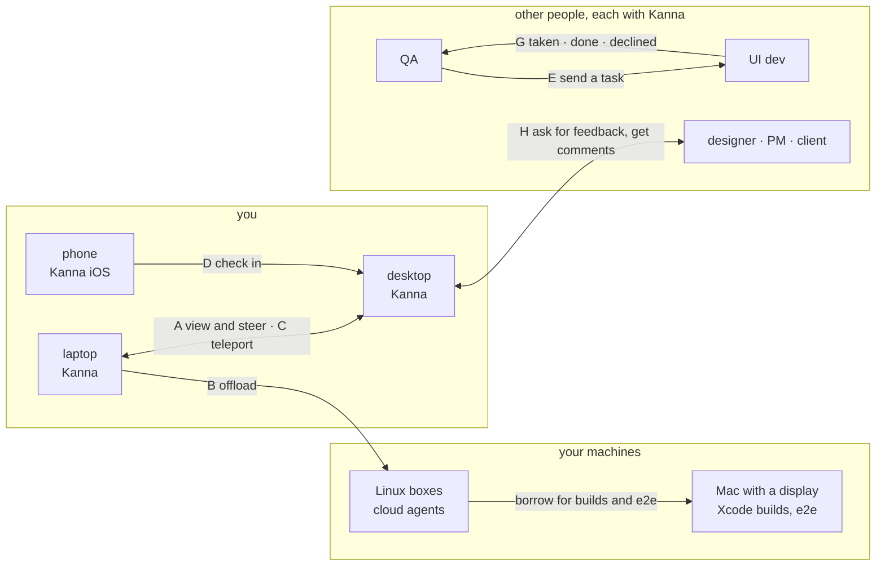
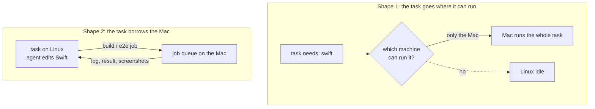
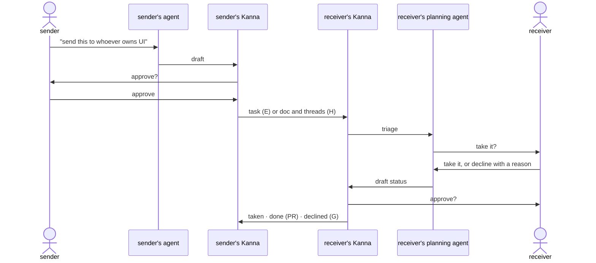

# Kanna beyond one person on one machine: scenarios

> 2026-10-15. Research, nothing to build yet. The scenarios the user and the planning agent worked out for **1 person, n machines** and **n people**, so the user can rank them and pick what's worth building. **What came of it:** [fleet research](fleet.md), then [your machines](../specs/machines.md) and [Kanna Cloud](../specs/kanna-cloud.md). Names follow [the Desk view](../specs/desk-view.md): the backlog is now the Shelf. When this was written, Kanna was roughly half done for 1 person on 1 machine and had nothing for the other two. The point is to see which problem each scenario actually solves before building any of it.

## Contents

1. [Principles](#1-principles)
2. [The picture](#2-the-picture)
3. [One person, several machines (A–D)](#3-one-person-several-machines-ad)
4. [Several people (E–H)](#4-several-people-eh)
5. [Shared questions](#5-shared-questions)
6. [Cheap or big, and the smallest experiment](#6-cheap-or-big-and-the-smallest-experiment)
7. [Rank them](#7-rank-them)
8. [Glossary](#8-glossary)

## 1. Principles

| # | Principle | What it rules out |
|---|---|---|
| 1 | **You are the bottleneck, on purpose.** Things move only as fast as you understand them. | A planner acting as a manager that makes decisions for you |
| 2 | **A Shelf task isn't tied to a machine.** | Tasks that only make sense where they were made |
| 3 | **People send each other tasks, not terminals.** A dev who owns UI receives UI issues and ideas on their Shelf. | Shared terminal sessions between people |
| 4 | **Everyone involved has Kanna.** | Email, web or Slack front ends for outsiders |
| 5 | **Agents draft, people approve.** Every message that leaves a Kanna was approved by its person. | Agents talking to other people's Kanna on their own |
| 6 | **Remote terminals aren't byte streams.** ssh-style streaming was laggy in Kanna v2. Instead, the agent CLI runs as client and server (a responsive local UI, the agent on the remote), and/or mosh-style screen state (the headless daemon already keeps every terminal's screen with libghostty-vt, [architecture](../specs/architecture.md#2-what-the-daemon-keeps-what-the-apps-keep)). | Streaming a pty over ssh |
| 7 | **Tasks move only at boundaries:** not started yet, or stopped at a turn's end ([Shelf runners](../specs/shelf-runners.md)), with the branch pushed and the transcript carried. | Moving live processes |
| 8 | **Machines advertise what they can do.** | Guessing, or you choosing a machine for every task |
| 9 | **iOS is for quick checks:** brainstorming, simple work, quizzes, answering a task that needs you. | Deep work on the phone |

## 2. The picture

## 3. One person, several machines (A–D)

| | Actor, trigger | What happens | What has to work | Open questions |
|---|---|---|---|---|
| **A. Away from the desk** | You, on the laptop; tasks run on the desktop | You pick one of the desktop's tasks onto the laptop's Desk, read its presentation, and steer it | The laptop's app connects to the desktop's daemon: the daemon already serves any number of apps, each with its own Desk and Shelf over the daemon's backlog ([each app's Desk and Shelf](../specs/app-desk.md)); a remote agent that feels local (principle 6); the task's tabs (docs, mockups) reach the laptop | Client/server agent CLI, screen state, or both? Which tabs travel: files only, or web panes too? Is the desktop reachable from outside home (tailnet, relay)? |
| **B. Offload** | You make tasks on the laptop; a bigger machine runs them | A machine with free [runners](../specs/shelf-runners.md) takes the next task, oldest first | One Shelf across machines (principle 2); task IDs that stay unique across machines ([tasks open question 1](../specs/tasks.md#8-open-questions)); capabilities (principle 8); the repo and its credentials on that machine | Who owns the backlog: one machine, or each machine's merged? How does a machine claim a task without two taking it? |
| **C. Teleport** | You, finishing for the day; a stopped task | It moves from the laptop to the desktop: its branch with uncommitted work, its conversation, its tabs; its terminals start again there | A boundary (principle 7); the same repo path on both, or a way round it ([5.1](#51-repo-paths-and-agent-sessions)); the agent's session files carried | Uncommitted work: a WIP commit pushed, or a patch? What about worktree-only files (`.kanna/tmp/`)? |
| **D. Phone check-in** | You, on the phone | You see what finished, answer a task that needs you, or take a quiz | The phone reaches a Kanna; a task's needs-you question and its reply fit a phone; [quiz](../specs/quiz.md) on iOS | Answer through the agent's terminal, or a short form? Notifications? |

### Machines that can't run everything

The user wants a stack of Linux boxes for cloud agents and a Mac with a display for Xcode builds and e2e tests. Two shapes:

| | Shape 1: route the task | Shape 2: borrow the Mac |
|---|---|---|
| Unit sent | a whole task | a job (a build, an e2e run) |
| For kanna-v4 | nearly every task touches Swift, so the Linux boxes sit idle | Linux agents work; the Mac only builds and tests |
| Needs | capabilities on tasks and machines | a job queue on the Mac; sending the worktree's state to it; results back |
| Open | how a task says what it needs | how a job gets the worktree (push a branch, rsync); iOS panes and screenshots from a remote Mac; one e2e run at a time on one display? |

## 4. Several people (E–H)

| | Actor, trigger | What happens | What has to work | Open questions |
|---|---|---|---|---|
| **E. Send someone a task** | A QA person finds a UI bug | Their agent drafts the task, they approve it, and it lands on the UI dev's Shelf; the UI dev's planning agent triages it with them | Kanna-to-Kanna messages ([5.2](#52-kanna-to-kanna-messages)); a received task that stands alone as a first message; the receiver accepts the repo it's for | Does a received task land in the backlog directly, or in an inbox first? Can it run by itself before the receiver has seen it (runners)? |
| **F. Routing** | The sender, about to send | They learn who owns UI | A map of areas to people, like CODEOWNERS, or the sender picks | Where the map lives (in the repo?), and who keeps it up to date |
| **G. Closing the loop** | The sender, later | They see taken, done or declined, with the PR | The receiver's Kanna sends status back; the receiver approves declines with a reason | Are status updates messages that need approval too, or automatic? |
| **H. Feedback from stakeholders** | A task's mockup or spec needs a designer's, PM's or client's eye | The task's agent drafts the request, you approve; they comment with [doc markup](../specs/doc-markup.md), their agent drafts their reply, they approve; it lands in the task's threads and the agent revises | Kanna-to-Kanna messages that carry a doc and its threads; doc markup threads that come from someone else | Do they get the file, or a link to view it on your machine? Does their reply reopen a stopped task? |

**E and H likely share one mechanism:** Kanna-to-Kanna messages with agent drafts and human approval. Within one Kanna, [agent messaging](../specs/agent-messaging.md) is built: `kanna task send` leaves a task or the planner a message, delivered when its turn ends ([why that design](agent-messaging.md)). E and H would carry it to another person's Kanna, with approval at each end.

## 5. Shared questions

### 5.1 Repo paths and agent sessions

Kanna v2 had push and pull of tasks across machines; it was flaky, partly because repos lived at different paths. The idea: every repo under `~/.kanna-v4/repos/`, so paths match. The catch: the agents key sessions by absolute path.

| Agent | Where the path is | Example |
|---|---|---|
| claude | the project folder's name | `~/.claude/projects/-Users-NAME-.kanna-v4-repos-app/` |
| codex | `cwd` recorded in the session | `/home/name/.kanna-v4/repos/app` |

`~` differs across usernames and between macOS (`/Users/NAME`) and Linux (`/home/NAME`), so `~/.kanna-v4/repos` alone isn't enough.

| Option | For | Against |
|---|---|---|
| A fixed absolute root (`/kanna/repos`) | Paths match on every machine | Needs root to make on macOS (a synthetic firmlink, `/etc/synthetic.conf`) |
| Rewrite session paths on teleport | Works with any home folder | Depends on each agent's private session format, which can change |
| Require the same username and OS | Nothing to build | Rules out a Mac laptop with Linux boxes, the user's own setup |

### 5.2 Kanna-to-Kanna messages

Open: identity (how one Kanna knows another's person), transport (a relay, a tailnet, git itself), what a message may carry (a task, a doc, threads, a PR link), and whether one arriving is an [agent message](../specs/agent-messaging.md) to the receiver's planner, held until its person approves.

## 6. Cheap or big, and the smallest experiment

| | Size | Why | Smallest experiment that shows it's real |
|---|---|---|---|
| **E** | cheap | No remote terminals: a message that becomes a Shelf task | For two weeks, write down every time you'd have sent a task to someone, or wished someone sent you one |
| **F** | cheap | A map in the repo, or the sender picks | Write the map for a real team by hand; count how often the sender didn't know |
| **G** | cheap, after E | Status back along E's path | Rides on E's experiment: did the sender chase for status? |
| **H** | cheap | No remote terminals: a doc and its threads both ways | Send a stakeholder a mockup by hand, have them comment in their Kanna, paste the threads back; see if the loop beats a call |
| **D** | medium | A phone client for a Kanna you can reach, small screens | Count, for a week, the times a task waited on you while you were away from every Mac |
| **C** | big | Paths, sessions, uncommitted work across machines | Teleport one stopped claude task by hand (push WIP, copy the session, fix its path); see what breaks |
| **B** | big | One Shelf across machines, claims, capabilities, shape 1 or 2 | Run a second Kanna on a Linux box by hand, `kanna task new` there for laptop work; count idle hours; try one build-on-Mac job by hand |
| **A** | biggest | A remote agent that feels local, and tabs that travel | Run claude on the desktop and drive it from the laptop with mosh; see whether the lag the v2 ssh streams had is gone |

## 7. Rank them

| Rank | Scenario | Your notes |
|---|---|---|
| | A. Away from the desk | |
| | B. Offload | |
| | C. Teleport | |
| | D. Phone check-in | |
| | E. Send someone a task | |
| | F. Routing | |
| | G. Closing the loop | |
| | H. Feedback from stakeholders | |

## 8. Glossary

| Term | Meaning |
|---|---|
| **Boundary** | A point where a task can move with no live process: not started, or stopped at a turn's end |
| **Teleport** | Moving a stopped task, with its branch, conversation and tabs, to another machine |
| **Capability** | What a machine can run (Swift, Xcode, a display for e2e), advertised to the others |
| **Job** | One build or test run sent to another machine for a task that stays where it is (shape 2) |
| **Mosh-style screen state** | Sending a terminal's screen as state to bring up to date, not a byte stream to replay |
| **Kanna-to-Kanna message** | A task, doc or status sent from one person's Kanna to another's, drafted by an agent and approved by the sender |
