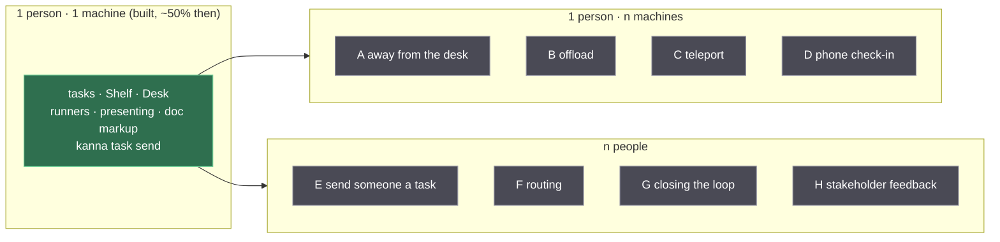
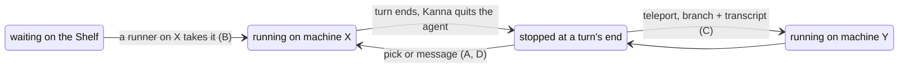
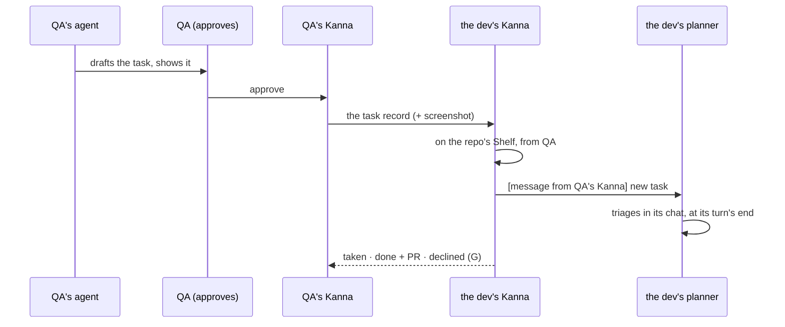

# Kanna beyond one person on one machine: scenarios A–H

> 2026-10-15, rewritten 2026-11-01. Research to rank, not a plan: eight ways Kanna could be used across machines or between people, each with the problem it solves, so the user can pick what is worth building. Nothing here is built as such; the ranking table in [§7](#7-ranking) is the user's to fill.
>
> **What came of it:** the one-person-many-machines half (A–C) went through the [fleet research](./fleet.md) into [your machines](../specs/machines.md), [tasks across machines](../specs/machine-tasks.md) (a replicated Shelf, one owner per task, transfer at a boundary) and [Kanna Cloud](../specs/kanna-cloud.md) (placement by capability, build Macs); repos now live at one place under `~` ([project folder](../specs/project-folder.md)). The many-people half (E–H) and the phone (D) have no spec yet; [agent messaging](../specs/agent-messaging.md) inside one Kanna is the piece they would extend.

When this was written Kanna was about half built for one person on one machine, and had nothing for one person on several machines or for several people. The names are main's today ([Desk view](../specs/desk-view.md)): the **Shelf** holds a repo's waiting tasks, the **Desk** up to three with one active, and the CLI verbs are `pick`, `shelve`, `activate` and `park`.

## Contents

1. [The three columns](#1-the-three-columns)
2. [Principles](#2-principles)
3. [Scenarios A–H](#3-scenarios-ah)
4. [Two mechanisms](#4-two-mechanisms)
5. [Paths and sessions](#5-paths-and-sessions)
6. [Cheap or big, and the smallest experiment](#6-cheap-or-big-and-the-smallest-experiment)
7. [Ranking](#7-ranking)
8. [Open questions](#8-open-questions)
9. [Glossary](#9-glossary)

## 1. The three columns

What's already there and carries over: the daemon is headless and keeps each terminal's screen with libghostty-vt, and any number of apps connect to it ([architecture](../specs/architecture.md)); each app has its own Desk and claims, the Shelf is the daemon's ([each app's Desks](../specs/app-desk.md)); Shelf tasks run by themselves and stop at a turn's end ([Shelf runners](../specs/shelf-runners.md)); a task sets up its tabs to show its work before it stops ([presenting](../specs/presenting.md)); the user, the planner and tasks leave each other messages delivered at a turn's end ([agent messaging](../specs/agent-messaging.md)); comments on a spec or mockup reach the agent beside it ([doc markup](../specs/doc-markup.md)).

## 2. Principles

Stated by the user; numbered as other docs cite them.

| # | Principle | What it rules out |
|---|---|---|
| 1 | **The user is the bottleneck, and that's fine.** Kanna moves only as fast as they understand the system. | a planner-as-manager that takes decisions out of their hands |
| 2 | **A task is abstracted from the machine it runs on.** | the app or the user tracking which box a task is on, except where it matters |
| 3 | **No shared terminal sessions between people.** Send a task to someone's Shelf instead: the dev who owns UI receives UI issues and ideas from others. | pair-programming views, watching another person's agent type |
| 4 | **Everyone involved has Kanna.** | email, Slack or GitHub as the way in; any web view for non-users |
| 5 | **Agents draft, a person approves.** Every message that leaves a Kanna was approved by its user. | agents talking to other people's agents on their own |
| 6 | **Remote terminals over ssh-style byte streams were laggy in Kanna v2.** Prefer the agent CLI as client/server (local UI, agent remote) and/or mosh-style screen state (the daemon already keeps every screen). | a plain ssh bridge as the design (the [fleet research §2.5](./fleet.md#25-terminal-latency) later found v2's lag was its units, not the stream) |
| 7 | **Tasks move only at boundaries:** not started, or stopped at a turn's end, branch pushed, transcript carried. Never a live process. | process migration, moving an agent mid-turn |
| 8 | **Machines advertise capabilities.** Anyone may have several machines. For Kanna Cloud, the user (as its operator) wants a stack of Linux boxes for dev boxes and a Mac with a display for Xcode builds and e2e. | one shape of machine; see [§4.3](#43-capabilities-xcode-on-a-linux-dev-box) |
| 9 | **iOS is for quick checks:** brainstorming, simple work, quizzes, answering a task that needs you. Not deep work. | a phone terminal, editing on the phone |

## 3. Scenarios A–H

| | Actor | Trigger | What happens | What has to work | Open questions |
|---|---|---|---|---|---|
| **A. Away from the desk** | the user on the laptop | tasks run on the desktop; the user is elsewhere with the laptop | the laptop's Kanna shows the desktop's Shelf and tasks; the user picks one onto the laptop's Desk, reads the presentation its agent left, types into its agent | an app link to a remote daemon; the Shelf of another machine; a claim by the laptop's app; terminals, diffs, markdown and web panes over the link; latency a person accepts (6) | Can two apps have the same task out? Over the internet, not the LAN? What does the user see when the link drops: the last screen, or nothing? |
| **B. Offload** | the user on the laptop; a bigger machine | tasks made on the laptop; the bigger machine has free runners | the next waiting task starts on the machine with a free runner; it shows on the laptop like a local task | one Shelf seen by several machines; exactly one machine starts a task; the repo cloned and set up there (`tasks.setup`, git and agent logins); a task that needs macOS goes to a Mac (8) | Who decides: machines asking, or a scheduler? Is a task made on the laptop owned by the laptop until a machine asks? An offline owner's tasks wait or time out? |
| **C. Teleport** | the user | a stopped task on the laptop should continue on the desktop | at a boundary (7): WIP commit, branch to the other machine, transcript copied, the task re-made there; terminals restart, tabs reopen, the agent resumes its conversation | a clean stop that keeps the session ID; the branch moved (push, or a bundle); each agent's transcript found where it keeps it; resume at another path ([§5](#5-paths-and-sessions)); tabs whose paths still point at files; every step durable and resumable | Untracked files? Thread files in `.kanna/docs`? Which agents resume by ID at a new path and which don't? Does the worktree keep its name? |
| **D. Phone check-in** | the user on the phone | a spare moment away from the desk | sees what finished and what needs them; answers a task with a message; brainstorms with the planner; takes a quiz (9) | a second app on a daemon; reach from away; a phone-sized view of the Desk's tasks, the Shelf and statuses; `kanna task send` from the phone (built on the daemon side); a quiz that fits a phone ([quiz](../specs/quiz.md)) | Push and reach from away need a server of someone's: whose? ([machines build order](../specs/machines-build-order.md) leaves both for later.) What of a task's presentation reads on a phone: markdown yes, a terminal no? A message or typing into the prompt? |
| **E. Send someone a task** | a QA person (sender); a UI dev (receiver) | QA finds a UI bug | QA tells their planner; it drafts the task (name, first message, steps, screenshot); QA approves (5); the task lands on the UI dev's Shelf for that repo; the UI dev's planner triages it in its chat | Kanna-to-Kanna delivery (identity, reach, approval); a task record that travels, its repo named by origin, its ID unique across Kannas ([tasks §9](../specs/tasks.md#9-open-questions)); attachments; a triage skill for the receiving planner | Does a sent task run by itself as a runner, or wait for triage? Must the receiver accept before it lands? Which of the receiver's machines, when they have several? Can QA send to a repo they haven't cloned? |
| **F. Routing** | the sender's planner | a task to send; who owns UI? | the planner looks up an area-to-person map (CODEOWNERS-like) in the repo and proposes a recipient; or the sender picks a person | a map kept in the repo; a directory from a person to a Kanna they can be reached at; a fallback when the map has no answer | Who maintains the map, and is it per repo or per team? What when the owner is away: it waits on their Shelf, or goes to a second? Is "a person" one Kanna or all of their machines? |
| **G. Closing the loop** | the sender | the receiver takes, finishes or declines the task | the sender sees *taken*, *done* (with the PR or branch) or *declined* (with why), in their planner's chat or on the record they sent | task events that cross Kannas (sent, taken, done, declined); a link from the receiver's task back to the sender's copy; the PR URL or merged branch | How much does the sender see: events only, never the terminal (3)? What is *done* in a repo with no PRs (this one merges branches straight into main)? Can the sender reply or reopen? |
| **H. Stakeholder feedback** | a task's agent and its user; a designer, PM or client with Kanna (4) | the task has a mockup or spec that needs their view | the agent drafts a request carrying the doc; the user approves; the stakeholder opens it with doc markup and comments; their agent drafts the reply; they approve; it lands in the task's threads and the agent revises | the doc and its images delivered; threads from two Kannas merged into one file per doc; replies routed to the task's agent; the same approval step as E | Does the stakeholder need a clone, or only the doc and its assets? Who resolves threads? Thread IDs (`c1`, `c2`, per doc) collide between two Kannas. An HTML mockup with scripts and images: as a bundle? |

## 4. Two mechanisms

A–D are one mechanism, **a task on another machine**; E–H are another, **a message from one Kanna to another**. D sits on the first, since the phone is another app on the same daemons.

### 4.1 A task elsewhere (A–D)

The daemon is the unit. A task lives in exactly one daemon at a time with its worktree, agent and workspace, and an app anywhere views it over its link (principle 2: the user picks a task, not a machine). What the user sees from the laptop in A is what the desktop's daemon has, since the screen is kept there, not in the app. Moving is only ever an edge out of **stopped** (7).

### 4.2 A message between Kannas (E–H)

The same loop with a doc instead of a task is H, and with a thread reply instead of a task record it's the stakeholder's answer. Inside one Kanna this exists: `kanna task send` queues a message in `kanna.db` and the daemon hands it to the agent when its turn is over ([agent messaging](../specs/agent-messaging.md), [its research](./agent-messaging.md)). Across Kannas it needs three things it doesn't have: a recipient that isn't on this daemon, an approval step on the way out (5), and a way to carry a task, a doc or a thread reply rather than text. No terminal is shared at any point (3).

### 4.3 Capabilities: Xcode on a Linux dev box

Two different sets of machines, easy to mix up:

| | Whose | What it is |
|---|---|---|
| **Your machines** | any user's | a laptop, a desktop, a mini, a Linux box, paired; a task runs whole on one of them ([your machines](../specs/machines.md)) |
| **The fleet** | the user's, as Kanna Cloud's operator | how Kanna Cloud is provisioned: Linux servers that host users' dev boxes, and Mac Studios or minis that build ([fleet research](./fleet.md), [Kanna Cloud](../specs/kanna-cloud.md)) |

A Kanna Cloud dev box looks like it can build Xcode projects: its `xcodebuild` is a shim that quietly sends the build to a Mac Studio or mini and streams the output back ([build Macs](../specs/build-macs.md)). Two shapes were compared:

| | Shape 1: the task goes to a machine that can run it | Shape 2: a Linux task borrows the Mac for builds and e2e |
|---|---|---|
| Placement | a task's `needs: xcode` sends the whole task to the Mac | the task stays on Linux; `xcodebuild` and the e2e run are jobs in the Mac's queue |
| Moving parts | capabilities and a match; nothing new in the task | a shim in the task's PATH, the worktree synced both ways, a job queue, products back |
| For kanna-v4 | nearly every task touches Swift, so almost all go to the one Mac and the Linux boxes sit idle | agents run on the Linux boxes; the Mac is shared for the Swift parts |
| Fails when | the Mac is busy: tasks queue whole | the sync or the queue breaks mid-build; a job's output differs from a local run |
| Chosen | no: a dev box doesn't need to be a Mac to build Apple code | yes, invisibly: the task never knows; its `xcodebuild` runs on a build Mac |

## 5. Paths and sessions

Kanna v2 pushed and pulled tasks between machines, and it was flaky, partly because repos lived at different paths on each machine. The fix proposed here was to force every repo into `~/.kanna-v4/repos`, which main has since done ([project folder](../specs/project-folder.md)).

### 5.1 The session-path problem

Claude keys a session by its project's absolute path (`~/.claude/projects/-Users-NAME-...`), and Codex records `cwd` in each session's first line ([tasks: which agents resume](../specs/tasks.md#which-agents-resume)). A path under `~` is the same relative to home, and still differs across usernames and between macOS (`/Users/NAME`) and Linux (`/home/NAME`).

| Option | What it needs | Costs | Where it works |
|---|---|---|---|
| **A fixed absolute root** (`/kanna/repos`) | the same root on every machine | root on users' Macs; a folder outside `~` that tools don't expect | everywhere, but rejected for Macs ([machines §12](../specs/machines.md#12-rejected)) |
| **Rewrite session paths on teleport** | knowing each agent's session format: Claude's folder slug and the paths inside its `.jsonl`, Codex's `session_meta.cwd` | breaks when an agent changes its format; one rewriter per agent | any two machines |
| **Same username and OS** | nothing | rules out Mac to Linux, and two people | Linux to Linux, or Mac to Mac, with one account name |
| **Resume by ID at the receiver's path** (what [transfer](../specs/machine-tasks.md#3-transfer) does) | the transcript copied into the receiver's own session folder, the agent resumed by session ID | none found: checked 2026-10-21 with Claude Code 2.1.305 and Codex 0.163 | any two machines; the home prefix stops mattering |

So the fixed path buys consistency for Kanna's own records (a project's place from `~`), and the agent's conversation travels by ID, not by path.

## 6. Cheap or big, and the smallest experiment

| Scenario | Size | Why | Smallest experiment that shows it's real |
|---|---|---|---|
| E, H | cheap | no remote terminal: a record or a doc travels, agents and people already have the message loop; the new parts are reach, identity and the approval step | two Kannas on one LAN (two instances on one Mac would do): `kanna task send` with a recipient on the other daemon, the message held until its user approves; then carry a task record instead of text and see the receiver's planner triage it |
| G | cheap once E exists | events back over the same channel | the receiver's `picked`, `done` and a decline sent back as messages the sender's planner reads out |
| F | cheap | a file in the repo and a lookup | an `owners` map read by the planning skill before it drafts a recipient |
| D | medium | a second app per daemon and reach from away are [your machines](../specs/machines.md)'; the phone UI is new but small (9) | lift one-app-per-daemon; show the Desk's tasks and statuses in a second client; send one message from it |
| A | big | the app link over a network, every pane kind over it, and latency work | the app on the laptop attached to the desktop's daemon over the LAN; type into an agent; measure echo delay, then again through a relay |
| B | big | a Shelf shared by machines with exactly one starter, plus repos and logins on each machine | two daemons, one repo cloned on both, one Shelf: the second machine takes the oldest task and the first shows it running |
| C | big | the whole stop-move-resume chain across agents, durable | stop a Claude task, copy branch and transcript to another machine by hand, resume by ID, and check the conversation carries on; then the same for Codex |

## 7. Ranking

For the user to fill: what problem each solves, in their words, and the order to build in.

| Scenario | Problem it solves | Rank | Notes |
|---|---|---|---|
| A. Away from the desk | the work is on the desktop and the user isn't | | |
| B. Offload | the laptop is too small, or too few runners, for the tasks planned | | |
| C. Teleport | a task begun on one machine has to finish on another | | |
| D. Phone check-in | tasks stop for an answer that takes ten seconds and an hour to notice | | |
| E. Send someone a task | an issue reaches the right dev as a task, not a chat message | | |
| F. Routing | the sender doesn't know who owns the area | | |
| G. Closing the loop | the sender never learns what became of it | | |
| H. Stakeholder feedback | a spec or mockup waits on someone who isn't a developer | | |

## 8. Open questions

Beyond each scenario's column in [§3](#3-scenarios-ah):

1. **Which comes first, machines or people?** A–C and E–H share only identity and reach; building one doesn't bring the other.
2. **Is a sent task (E) a task or a message?** A record on the receiver's Shelf is a task; the receiver's planner would still read about it as a message. One table or two.
3. **Approval (5) as a Kanna step or an agent step?** The daemon holding every outbound message until the user approves in the app, or the skill telling the agent to ask first. Only the first is enforceable.
4. **Identity for people** isn't identity for machines: your machines' peer log is one person's devices ([identity](../specs/machine-identity.md)). Another person's Kanna is a peer of a different kind, trusted for messages and never for tasks running on it.
5. **Thread files across Kannas (H):** merge two writers into `<repo>/.kanna/docs/PATH.json`, or keep the stakeholder's threads as a separate file the task's agent reads.

## 9. Glossary

| Term | Meaning |
|---|---|
| **Shelf** | A repo's tasks off the Desk: waiting, or run by runners a few at a time ([tasks](../specs/tasks.md)) |
| **Desk** | A project's window, and the up to three tasks it holds, one active ([Desk view](../specs/desk-view.md)) |
| **Runner** | One of `shelf.runners` places in which Shelf tasks run by themselves ([Shelf runners](../specs/shelf-runners.md)) |
| **Turn** | An agent's work from a message until it waits for the next; a task is stopped only at a turn's end |
| **Boundary** | A point a task can move at: not started, or stopped at a turn's end with its branch and transcript kept |
| **Teleport** | Moving a stopped task from one machine's daemon to another's (scenario C; *transfer* in [machine-tasks](../specs/machine-tasks.md)) |
| **Capability** | What a machine advertises it can run: macOS, Xcode, a display, a simulator, Linux, cores |
| **Doc markup** | Comments on a markdown file or HTML mockup, kept in threads beside the file and typed to the agent ([doc markup](../specs/doc-markup.md)) |
| **Planner** | The planning agent in a Desk window's planning terminal; triages, plans and makes tasks, never writes code ([planning terminal](../specs/planning-agent.md)) |
| **Kanna-to-Kanna message** | A task, doc or reply carried from one person's Kanna to another's, drafted by an agent and approved by its sender (E–H; not built) |
