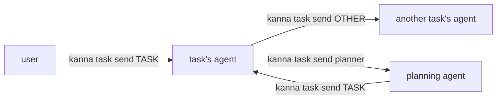
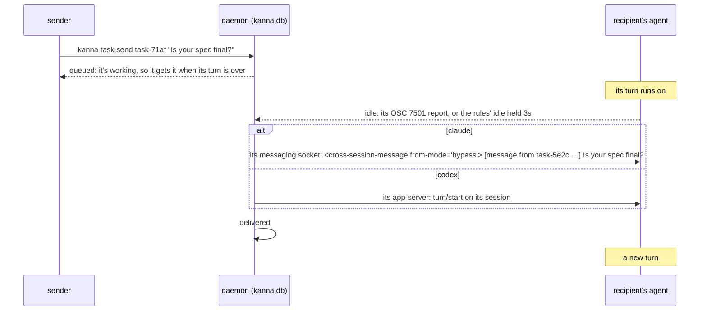
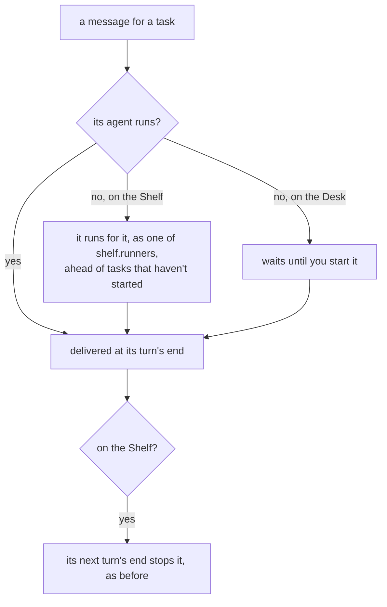

# Agent messaging

**Status:** built · **Tested:** e2e `agent_messaging` (the mock agent as `claude` on its socket, as `codex` through its app-server, as `copilot` warned), `cargo test -p kanna-daemon` (messages, codex_remote, db) · **Builds on:** [tasks](tasks.md), [Shelf runners](shelf-runners.md), [agent status](agent-status.md), [Codex's app-server](codex-app-server.md) · **Why this design:** [research](../research/agent-messaging.md)

The user, the planning agent and task agents leave each other messages with `kanna task send`. Agents send one only when the user asks them to pass something on, or to answer a message they got. The daemon keeps each one in `kanna.db` and hands it to the recipient's agent through the agent's own door **once its turn is over**: Claude's messaging socket, Codex's app-server. Nothing is typed into a prompt, so a message never lands mid-turn or in your draft, isn't lost while the agent is stopped, and shows in the agent's own terminal. Only Claude and Codex take messages; for any other agent `kanna task send` warns.

## Contents

1. [Sending](#1-sending)
2. [Delivery](#2-delivery)
3. [Stopped tasks](#3-stopped-tasks)
4. [CLI](#4-cli)
5. [How it's built](#5-how-its-built)
6. [Glossary](#6-glossary)

## 1. Sending

- **Who to:** a task (any form `kanna task list` takes: `task-71af`, `71af`, its agent's pane), or `planner`, the planning agent of the sender's repo.
- **Who from:** the task whose terminal runs the command (`$KANNA_TERMINAL`), else `planner` from a planning terminal, else `user`.
- **What it looks like:** `[message from task-5e2c "Send spec"] Is your spec final?`. Several waiting messages go in one prompt, oldest first, a blank line apart.
- **The user starts them:** the skills tell agents to send a message only when the user asks. A task that's done or needs you says so in its own chat, and the Desk view and strip show it; the planner never asks a task to report back or sends tasks to talk to each other.
- **Answering:** a task answers a message once, briefly, with another `kanna task send`, since the sender can't see its chat, and a message from `user` in the chat. The planner tells you in its chat what a task's message means for you, without a back-and-forth with the task. Nobody waits on an answer: it comes as a turn of its own.
- **A done task takes none:** `kanna task send` says it's done.

## 2. Delivery

- **Only at its prompt:** a message waits while the agent is working, and while it needs you. It goes when the agent is idle: at once when it reports its turn over ([OSC 7501](agent-status.md#4-the-agents-own-report-osc-7501)), otherwise once idle has held 3s, the [turn's end](shelf-runners.md#2-how-its-built) the runners use.
- **Claude takes it on its messaging socket:** every Claude Code session listens on a Unix socket for messages from other local sessions, and Kanna writes the message there as one JSON line. Claude shows it as "Another Claude session sent a message:".
- **It says the sender's permissions:** Claude holds a message for your approval when its sender's permission class (`bypass` or `prompting`) isn't its own, or when the sender states none and Claude bypasses prompts, as Kanna's agents do. So Kanna wraps the message in Claude's envelope with `from-mode`: a task's or planner's own class, from its command line when it sends (`--dangerously-skip-permissions`, `--yolo`, `--permission-mode bypassPermissions` and the like mean `bypass`); for a message from you, the recipient's, since you could type it yourself. Several messages at once are `bypass` only if every one is. A prompting agent's message to an unprompted Claude waits for your approval in that Claude.
- **`from-mode` is Claude's check, not Kanna's boundary:** Kanna passes it on so Claude doesn't hold every message, and enforces nothing with it. A Codex turn carries no mode, and the sender is the `by` the client names (`$KANNA_TERMINAL`), not one Kanna checks against the connection. Neither gives anyone more than they had: whatever can reach `kanna.sock` can already type into any agent's prompt (`kanna send`) and answer its approval menu (`kanna send-key`), and any process of yours can write to Claude's messaging socket or Codex's app-server directly. The boundary is who can reach `kanna.sock`. An agent whose permission rules allow `kanna task send` but not `kanna send` can still get a `--yolo` Codex to act for it.
- **Codex takes it through its app-server:** Kanna starts every Codex with an app-server of its own ([Codex's app-server](codex-app-server.md)), and a message is a `turn/start` on its session. The TUI shows it as a prompt.
- **Your prompt is left alone:** neither touches what's in the agent's input, so a draft you left there, or the agent's suggested next prompt, stays as it is, and a message doesn't wait on your typing.
- **Never typed:** with no door (a Claude without a socket, a Codex started some other way, or any other agent), the message waits and Kanna warns: `kanna task send` and `kanna task messages` say why, and the daemon logs it. Kanna has no toasts yet.
- **Once:** marked delivered when the agent took it; one that fails is tried again once the agent has been idle another 3s, and one with no door every 5s. A waiting message outlives a restart of the daemon.
- **The planner:** the planning terminal of a Desk whose folder is the sender's repo (the first, if several are). With none open, the message waits until one is.

## 3. Stopped tasks

- **A stopped Shelf task runs for a message,** resuming its session, as a [runner](shelf-runners.md): it waits for a free one, but goes before tasks that haven't started. With `shelf.runners` 0 it waits.
- **A running Shelf task with a message waiting isn't stopped** at its turn's end: it gets the message, and the turn that starts ends it as usual (Kanna gives the agent 5s to start on it). One whose turn ends asking you is stopped as before, and runs again for the message.
- **A task stopped on the Desk stays stopped:** you stopped it. It gets its messages when you start it.
- **Only a task whose agent takes messages runs for one:** a stopped task started as another agent isn't woken for a message it couldn't take.

## 4. CLI

| Command | Does |
|---|---|
| `kanna task send TASK\|planner TEXT` | Leave a message; says whether the recipient is working, idle, asking you or stopped, and warns if its agent can't take it |
| `kanna task messages [TASK]` | A task's messages, sent and received, or every message: when, from, to, delivered, waiting or held (and why), the text |

## 5. How it's built

- **`messages` table** in `kanna.db` ([database](database.md)): who to (a task ID or `planner`), the repo, who from, when, when delivered, the text. Keyed by task, not terminal, since a restart gives an agent a new `term-N`.
- **The daemon delivers** (`Tasks::deliver` in `tasks.rs`, `messages.rs`): it keeps every agent pane's status and since when (`Ready`), updated from the status events agent status sends, and on each tick hands waiting messages to each recipient that's idle long enough, off the main thread. Each delivery is a `messaged` event on the task.
- **Which door** (`messages::Channel`): agent status knows the pane's agent and its pid. Claude: its socket from its registry entry. Codex: the `--remote unix://SOCKET` its TUI was started with. Anything else: none, and a waiting message holds no runner and wakes no stopped task.
- **Claude's socket** (`messages::inbox`, `messages::post`): agent status knows the pane's agent and its pid; Kanna reads `~/.claude/sessions/PID.json` (Claude's own registry: its `messagingSocketPath`, `peerProtocol` 1) and writes `{"type":"user","message":{"role":"user","content":ENVELOPE}}` there off the main thread. When Claude was started with `CLAUDE_CONFIG_DIR`, the registry is there instead; Kanna reads it from the agent's environment. No auth: on macOS the socket is your user's alone (0600), and Claude takes a message from any process of yours.
- **The envelope** (`messages::envelope`, `messages::permissions`): `<cross-session-message from-mode="MODE">`, a newline, the text, a newline, `</cross-session-message>`, checked against Claude Code 2.1.303. Claude takes it only in exactly the form it would write, so a closing tag inside the text is escaped as Claude escapes it (`<\/cross-session-message`); one Kanna doesn't escape the same way leaves the message held for your approval, never lost. The sender's class is kept with the message (`messages.mode`).
- **Codex's app-server** (`messages::codex_turn`): a WebSocket on the server's Unix socket, JSON-RPC `initialize`, `thread/loaded/list` and `thread/read` to find the session (not the ephemeral thread Codex titles it with), then `turn/start`.
- **Runners** (`Tasks::fill`) wake a stopped Shelf task with a message (`Tasks::wake`: the pane's resume command, or a new agent if its pane is gone), and the turn's end skips a pane with mail.
- **The planner** is found from the daemon's layout: a planner workspace's terminal, running, whose folder's repo is the message's.

## 6. Glossary

| Term | Meaning |
|---|---|
| **Message** | Text one of the user, the planner or a task leaves for another, kept until it's delivered |
| **Delivered** | Taken by the agent: written to Claude's messaging socket, or started as a turn by Codex's app-server |
| **Held** | Waiting with no door to deliver through: the agent isn't Claude or Codex, or has no socket |
| **Turn's end** | The agent back at its prompt: reported by OSC 7501, or idle on screen for 3s |
| **Messaging socket** | Claude Code's Unix socket for messages from other local sessions, `/tmp/cc-socks/PID.sock`, named in `~/.claude/sessions/PID.json` |
