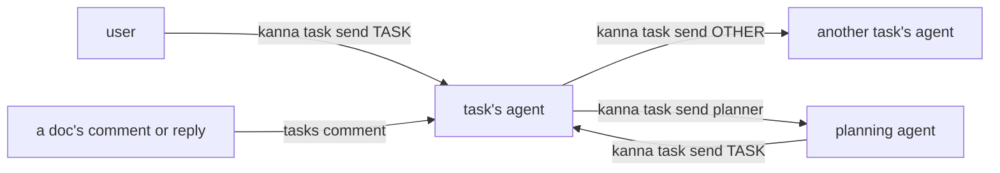
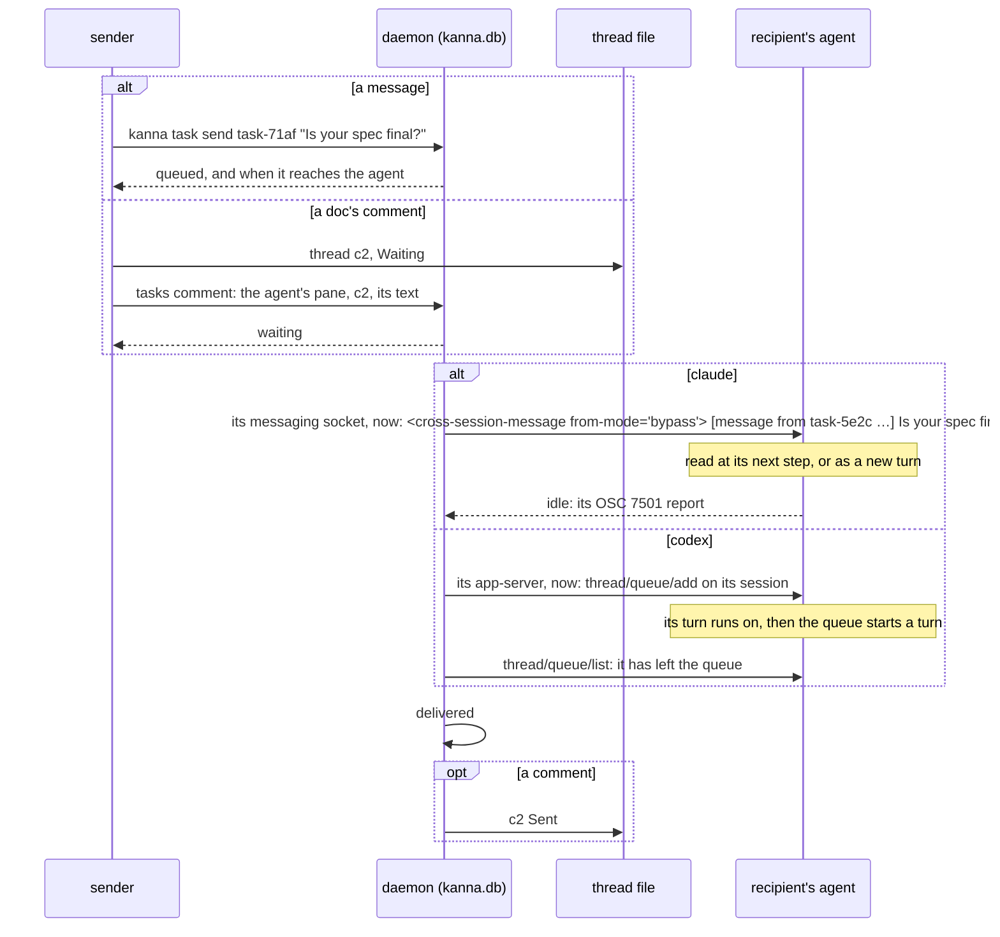
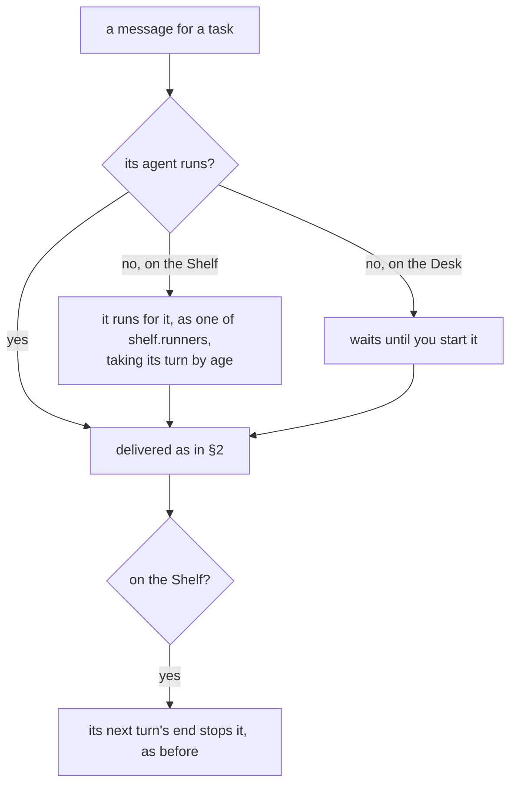

# Agent messaging

**Status:** built · **Tested:** e2e `agent_messaging` (the mock agent as `claude` on its socket, a stopped `claude` woken by a message that makes its socket late and isn't warned about, as `codex` through its app-server, as `agy` warned), `real_agent_messages` (real Claude mid-turn, stopped and killed; real Codex busy and interrupted), `message_unknown_status`, `md_comments`, `page_comments`, `comment_before_socket` and `markup_events` (comments and thread events as messages), `cargo test -p kanna-daemon` (messages, codex_remote, db) · **Builds on:** [tasks](tasks.md), [Shelf runners](shelf-runners.md), [agent status](agent-status.md), [Codex's app-server](codex-app-server.md) · **Why this design:** [research](../research/agent-messaging.md)

The user, the planning agent and task agents leave each other messages with `kanna task send`, and [doc markup](doc-markup.md#3-reaching-the-agent) comments on a doc reach its agent the same way. Agents send one only when the user asks them to pass something on, or to answer a message they got. The daemon keeps each one in `kanna.db` and hands it to the recipient's agent through the agent's own door: Claude's messaging socket, at once, since Claude holds it for the next step of its turn; Codex's app-server queue, at once, since Codex runs it after the turn. Nothing is typed into a prompt, so a message never lands in your draft, isn't lost while the agent is stopped, and shows in the agent's own terminal. Only Claude and Codex take messages; for opencode and agy `kanna task send` warns.

## Contents

1. [Sending](#1-sending)
2. [Delivery](#2-delivery)
3. [Stopped tasks](#3-stopped-tasks)
4. [CLI](#4-cli)
5. [How it's built](#5-how-its-built)
6. [Glossary](#6-glossary)

## 1. Sending

- **Who to:** a task (any form `kanna task list` takes: `task-71af`, `71af`, its agent's pane), or `planner`, the planning agent of the sender's repo.
- **Who from:** the task whose terminal runs the command (`$KANNA_TERMINAL`), else `planner` from a planning terminal, else `user`. A doc's comment is from `user`, since you wrote it. A [schedule](scheduler.md) leaves messages too, from `schedule NAME`, carrying your permissions as yours do.
- **What it looks like:** `[message from task-5e2c "Send spec"] Is your spec final?`. A comment keeps its own header instead, `[kanna comment c2 · docs/specs/tab-container.md:18]`, then the quoted passage and your words, and resolving or reopening a thread sends `[kanna resolved c2 · FILE:LINE]` or `[kanna reopened c2 · FILE:LINE]`, as [doc markup](doc-markup.md#3-reaching-the-agent) shows. Several waiting messages go in one prompt, oldest first, a blank line apart.
- **The user starts them:** the skills tell agents to send a message only when the user asks. A task that's done or needs you says so in its own chat, and the Desk view and strip show it; the planner never asks a task to report back or sends tasks to talk to each other.
- **Answering:** a task answers a message once, briefly, with another `kanna task send`, since the sender can't see its chat, and a message from `user` in the chat. The planner tells you in its chat what a task's message means for you, without a back-and-forth with the task. Nobody waits on an answer: it comes as a turn of its own.
- **A done task takes none:** `kanna task send` says it's done.
- **From the phone:** a message to the planner or a task is from `phone`, and it answers with `kanna phone` ([phone chat](mobile-chat.md#3-the-conversation), [Shelf §3](mobile-shelf.md#3-what-a-task-says)). Both carry the recipient's permission class, as yours do.

## 2. Delivery

- **When each agent gets it:** the table says when Kanna hands a message over, from what [its status](agent-status.md#3-the-report-osc-7501) reports. Each rule rests on a [test with the real agents](../research/agent-messaging.md#7-messages-to-a-busy-agent).

| Status | Claude | Codex |
|---|---|---|
| idle | now | now |
| working | now, unless Claude would hold it for your approval | now, into its queue |
| needs you | waits until you've answered | now, into its queue |
| unknown | now | now, into its queue |

- **Why Claude takes it mid-turn:** Claude keeps a message that arrives during a turn and adds it to its next model request, in order, as sent "while you were working". A long tool call, your draft and an open question are left alone, and it never takes a message as the answer to a prompt.
- **Why needs you waits:** Claude can't read it until you've answered, and a Shelf runner stops a task at that point: its rest key would cancel the question and start the message as a new turn.
- **Why approval waits:** Claude's dialog for a message from another permission class opens at once, over the turn, and reports blocked, which ends a Shelf turn. At its prompt the dialog does no harm.
- **Why Codex's queue:** `thread/queue/add` keeps a message in Codex's own durable queue, and Codex starts a turn with it once the thread is idle: at once at its prompt, after the running turn otherwise. The answer it's streaming, an open approval and your draft are left alone. `turn/start` and `turn/steer` on a busy Codex cancel the response in flight and drop its text. The queue is an experimental API, so Kanna asks for it (`experimentalApi`); a Codex that refuses it gets a `turn/start` at its prompt, and mid-turn the sender is warned and the message tries again.
- **After Esc:** an interrupted turn leaves Codex's queue where it is. When the queue still holds a message on two looks in a row and the thread is idle, Kanna calls `thread/queue/start`.
- **Unknown status:** after a daemon restart, say, Kanna has no report until the agent's next one. Neither agent needs one: both get their messages regardless. A terminal that has run no agent Kanna can reach for 10s, long enough for one to start, gets a warning from `kanna task send` and `kanna task messages`, and a toast.
- **Delivered at the turn's end:** a message handed to a working Claude lives only in Claude's memory until its next model request, and a hard kill or hangup loses it: resuming doesn't bring it back. So Kanna keeps it waiting until Claude reports idle, which it does only after reading everything it holds. If the agent ends first, the message goes again to the next agent: one Claude had already read arrives twice, which beats losing it. A daemon restart in that window sends it again too. A message in Codex's queue survives a kill and runs when the thread resumes, so Kanna counts it delivered once it has left the queue, and sends it again only when the pane runs another session or no Codex at all, taking it out of the old queue first.
- **Claude takes it on its messaging socket:** every Claude Code session listens on a Unix socket for messages from other local sessions, and Kanna writes the message there as one JSON line. Claude shows it as "Another Claude session sent a message:".
- **It says the sender's permissions:** Claude holds a message for your approval when its sender's permission class (`bypass` or `prompting`) isn't its own, or when the sender states none and Claude bypasses prompts, as Kanna's agents do. So Kanna wraps the message in Claude's envelope with `from-mode`: a task's or planner's own class, from its command line when it sends (`--dangerously-skip-permissions`, `--yolo`, `--permission-mode bypassPermissions` and the like mean `bypass`); for a message from you, one of your schedules or the planner's [Desk news](desk-news.md) (`desk`, reporting what you or Kanna did), the recipient's, since you could type it yourself. Several messages at once are `bypass` only if every one is. A prompting agent's message to an unprompted Claude waits for your approval in that Claude.
- **`from-mode` is Claude's check, not Kanna's boundary:** Kanna passes it on so Claude doesn't hold every message, and enforces nothing with it. A Codex message carries no mode, and the sender is the `by` the client names (`$KANNA_TERMINAL`), not one Kanna checks against the connection. Neither gives anyone more than they had: whatever can reach `kanna.sock` can already type into any agent's prompt (`kanna send`) and answer its approval menu (`kanna send-key`), and any process of yours can write to Claude's messaging socket or Codex's app-server directly. The boundary is who can reach `kanna.sock`. An agent whose permission rules allow `kanna task send` but not `kanna send` can still get a `--yolo` Codex to act for it.
- **Codex takes it through its app-server:** Kanna starts every Codex with an app-server of its own ([Codex's app-server](codex-app-server.md)), and a message joins its session's queue. The TUI shows it as a prompt when its turn starts.
- **Your prompt is left alone:** neither touches what's in the agent's input, so a draft you left there, or the agent's suggested next prompt, stays as it is, and a message doesn't wait on your typing.
- **Comments to an agent with no door are typed:** a doc's comment goes into a messages queue only when its pane is a task's agent, or the planner, with a door (or a stopped or just-started task whose agent has one). A Claude or Codex inside its 20s grace counts as having one, reported status or not. For any other pane, and for a Claude or Codex still with no door after the grace, it's typed at once, as [doc markup](doc-markup.md#3-reaching-the-agent) always did, so markup keeps working with every agent.
- **Never typed:** a message with no door (a Claude without a socket, a Codex started some other way, or any other agent) waits and Kanna warns: `kanna task send` and `kanna task messages` say why, the daemon logs it and raises a [toast](toasts.md#its-first-user-messages-that-wait).
- **Not while it starts:** a Claude writes its registry entry a moment after it starts, often after it first reports idle, and a stopped Shelf task woken by a message has only just started. So until a Claude's or Codex's process is 20s old (`messages::GRACE`), a missing door isn't a warning: the message waits, tried again at least every 5s, and goes once the door is there. A door still missing after that warns. Any other agent never has one, and warns at once.
- **Once:** marked delivered when the agent took it, apart from the repeat above; one that fails is tried again 3s later, and one with no door every 5s. A waiting message outlives a restart of the daemon.
- **Kanna's own messages to the planner:** from `kanna` (a crash, [crashes](crashes.md)) and from `desk` (a Desk change it didn't make, [Desk news](desk-news.md)).
- **The planner:** the planning terminal of a Desk whose folder is the sender's repo (the first, if several are). With none open, the message waits until one is.

## 3. Stopped tasks

- **A stopped Shelf task runs for a message,** resuming its session, as a [runner](shelf-runners.md). One from you, on the Mac or the phone, runs it at once, past the limit. Any other joins the one queue of Shelf tasks and takes its turn by when it was made, so an older task that hasn't started goes first and a newer one goes after. The planner's merge nudges message many tasks at once, and they shouldn't jump new work. With `shelf.runners` 0 it waits.
- **A running Shelf task with a message waiting isn't stopped** at its turn's end: it gets the message, and the turn that starts ends it as usual (Kanna gives the agent 5s to start on it). A message Claude read during the turn starts no new turn, and the turn's end stops it as usual. One whose turn ends asking you is stopped as before, and runs again for the message when its turn in the queue comes.
- **A task stopped on the Desk stays stopped:** you stopped it. It gets its messages when you start it.
- **Only a task whose agent takes messages runs for one:** a stopped task started as another agent isn't woken for a message it couldn't take.
- **A task that hasn't started isn't woken:** the message goes with its first message, in a `notes` field of its replicated record ([phone Shelf §4](mobile-shelf.md#4-a-message-to-a-task-that-hasnt-started)), and `kanna task send` says so.

## 4. CLI

| Command | Does |
|---|---|
| `kanna task send TASK\|planner TEXT` | Leave a message; says whether the recipient is working, idle, asking you or stopped, and warns if its agent can't take it |
| `kanna task messages [TASK]` | A task's messages, sent and received, or every message: when, from, to, delivered, waiting or held (and why), the text |

## 5. How it's built

- **`messages` table** in `kanna.db` ([database](database.md)): who to (a task ID or `planner`), the repo, who from, when, when delivered, the text, and for a comment its doc and thread (`comment`, JSON). Keyed by task, not terminal, since a restart gives an agent a new `term-N`.
- **The daemon delivers** (`Tasks::deliver` in `tasks.rs`, `messages.rs`): it keeps every agent pane's status and since when (`Ready`), updated from the status events agent status sends, and on each tick hands waiting messages to each recipient that can take them (`messages::mid_turn`), off the main thread. What a working Claude holds is kept in `Tasks::unread` with its door, until it reports idle (delivered) or its door changes (they go again). What Codex's queue holds is kept in `Tasks::queued` with its thread and submission, and every 2s `messages::codex_queue` says which have left it (delivered). Each delivery is a `messaged` event on the task.
- **Which door** (`messages::Channel`): agent status knows the pane's agent and its pid, and the pid's start time gives the agent's age for the grace (`lifeline::age_of`). Claude: its socket from its registry entry. Codex: the `--remote unix://SOCKET` its TUI was started with. Anything else: none, and a waiting message holds no runner and wakes no stopped task.
- **Claude's socket** (`messages::inbox`, `messages::post`): agent status knows the pane's agent and its pid; Kanna reads `~/.claude/sessions/PID.json` (Claude's own registry: its `messagingSocketPath`, `peerProtocol` 1) and writes `{"type":"user","message":{"role":"user","content":ENVELOPE}}` there off the main thread. When Claude was started with `CLAUDE_CONFIG_DIR`, the registry is there instead; Kanna reads it from the agent's environment. No auth: on macOS the socket is your user's alone (0600), and Claude takes a message from any process of yours.
- **The envelope** (`messages::envelope`, `messages::permissions`): `<cross-session-message from-mode="MODE">`, a newline, the text, a newline, `</cross-session-message>`, checked against Claude Code 2.1.303. Claude takes it only in exactly the form it would write, so a closing tag inside the text is escaped as Claude escapes it (`<\/cross-session-message`); one Kanna doesn't escape the same way leaves the message held for your approval, never lost. The sender's class is kept with the message (`messages.mode`).
- **Codex's app-server** (`messages::codex_post`): a WebSocket on the server's Unix socket, JSON-RPC `initialize` with `experimentalApi`, `thread/loaded/list` and `thread/read` to find the session (not the ephemeral thread Codex titles it with), then `thread/queue/add` with `clientUserMessageId` `kanna-ID`.
- **Comments** (`Tasks::comment`, the `tasks` action `comment` the app calls): queued from `user` with their thread when the pane takes messages or is `Tasks::coming_up`, else typed with `send`; on delivery `Tasks::mark_sent` sets the thread's status from `waiting` to `sent` in its file (`kanna-threads`, the CLI's code and lock), once none of its comments still waits.
- **Runners** (`Tasks::fill`) wake a stopped Shelf task with a message (`Tasks::wake`: the pane's resume command, or a new agent if its pane is gone), and the turn's end skips a pane with mail.
- **The planner** is found from the daemon's layout: a planner workspace's terminal, running, whose folder's repo is the message's.

## 6. Glossary

| Term | Meaning |
|---|---|
| **Message** | Text one of the user, the planner or a task leaves for another, or a doc's comment, kept until it's delivered |
| **Delivered** | Taken by the agent: read by Claude, or out of Codex's queue and into a turn |
| **Held** | Waiting with a warning: the agent is opencode or agy, or has no socket |
| **Turn's end** | The agent back at its prompt, as its OSC 7501 report says |
| **Messaging socket** | Claude Code's Unix socket for messages from other local sessions, `/tmp/cc-socks/PID.sock`, named in `~/.claude/sessions/PID.json` |
