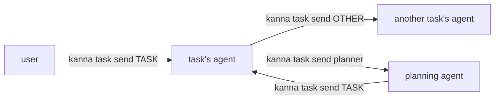
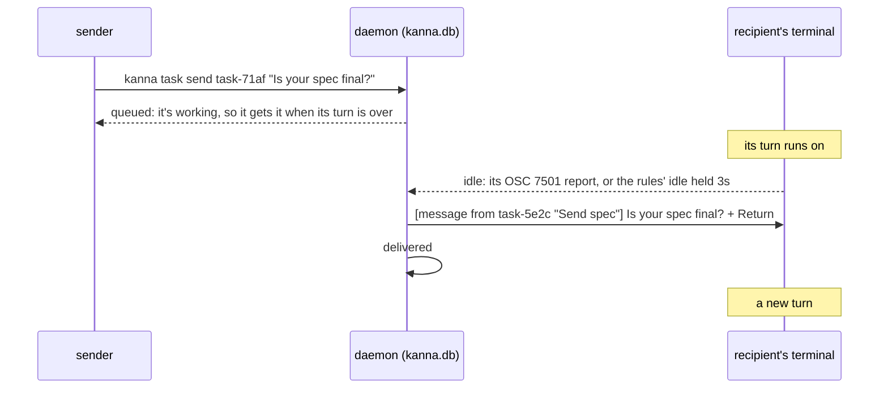
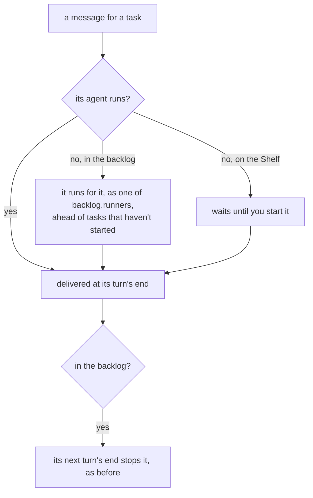

# Agent messaging

**Status:** built · **Tested:** e2e `agent_messaging`, `cargo test -p kanna-daemon` (messages, db) · **Builds on:** [tasks](tasks.md), [backlog runners](backlog-runners.md), [agent status](agent-status.md), [kanna send](kanna-send.md) · **Why this design:** [research](../research/agent-messaging.md)

The user, the planning agent and task agents leave each other messages with `kanna task send`. The daemon keeps each one in `kanna.db` and types it into the recipient's terminal as a prompt **once its turn is over**, so a message never lands mid-turn, isn't lost while the agent is stopped, and shows where it lands, in the agent's own terminal.

## Contents

1. [Sending](#1-sending)
2. [Delivery](#2-delivery)
3. [Stopped tasks](#3-stopped-tasks)
4. [CLI](#4-cli)
5. [How it's built](#5-how-its-built)
6. [Glossary](#6-glossary)

## 1. Sending

- **Who to:** a task (any form `kanna task list` takes: `task-71af`, `71af`, its agent's pane), or `planner`, the planning agent of the sender's repo.
- **Who from:** the task whose terminal runs the command (`$KANNA_TERMINAL`), else `planner` from a planning terminal, else `user`.
- **What it looks like:** `[message from task-5e2c "Send spec"] Is your spec final?`. Several waiting messages go in one prompt, oldest first, a blank line apart.
- **Answering** is another `kanna task send`: the skills tell agents to answer the sender that way, and a message from `user` in the chat. Nobody waits on an answer: it comes as a turn of its own.
- **A done task takes none:** `kanna task send` says it's done.

## 2. Delivery

- **Only at its prompt:** a message waits while the agent is working, and while it needs you (typed text would answer the question). It goes when the agent is idle: at once when it reports its turn over ([OSC 7501](agent-status.md#4-the-agents-own-report-osc-7501)), otherwise once idle has held 3s, the [turn's end](backlog-runners.md#2-how-its-built) the runners use.
- **Not over your typing:** a pane you typed into in the last 5s waits until you've stopped.
- **Typed as `kanna send` types it,** a bracketed paste and then Return, so a long message submits whole ([kanna send](kanna-send.md)).
- **Once:** marked delivered when the send succeeds; one that fails waits for the next turn's end. A waiting message outlives a restart of the daemon.
- **The planner:** the planning terminal of a Desk whose folder is the sender's repo (the first, if several are). With none open, the message waits until one is.

## 3. Stopped tasks

- **A stopped backlog task runs for a message,** resuming its session, as a [runner](backlog-runners.md): it waits for a free one, but goes before tasks that haven't started. With `backlog.runners` 0 it waits.
- **A running backlog task with a message waiting isn't stopped** at its turn's end: it gets the message, and the turn that starts ends it as usual.
- **A task stopped on the Shelf stays stopped:** you stopped it. It gets its messages when you start it.

## 4. CLI

| Command | Does |
|---|---|
| `kanna task send TASK\|planner TEXT` | Leave a message; says whether the recipient is working, idle, asking you or stopped |
| `kanna task messages [TASK]` | A task's messages, sent and received, or every message: when, from, to, delivered or waiting, the text |

## 5. How it's built

- **`messages` table** in `kanna.db` ([database](database.md)): who to (a task ID or `planner`), the repo, who from, when, when delivered, the text. Keyed by task, not terminal, since a restart gives an agent a new `term-N`.
- **The daemon delivers** (`Backlog::deliver` in `backlog.rs`, `messages.rs`): it keeps every agent pane's status and since when (`Ready`), updated from the status events agent status sends, and on each tick types waiting messages into each recipient that's idle long enough, through the `send` command. Each delivery is a `messaged` event on the task.
- **Your typing** reaches the daemon as the app's `input` to the terminal, which marks the pane typed.
- **Runners** (`Backlog::fill`) wake a stopped backlog task with a message (`Backlog::wake`: the pane's resume command, or a new agent if its pane is gone), and the turn's end skips a pane with mail.
- **The planner** is found from the daemon's layout: a planner workspace's terminal, running, whose folder's repo is the message's.

## 6. Glossary

| Term | Meaning |
|---|---|
| **Message** | Text one of the user, the planner or a task leaves for another, kept until it's delivered |
| **Delivered** | Typed into the recipient's terminal as a prompt |
| **Turn's end** | The agent back at its prompt: reported by OSC 7501, or idle on screen for 3s |
