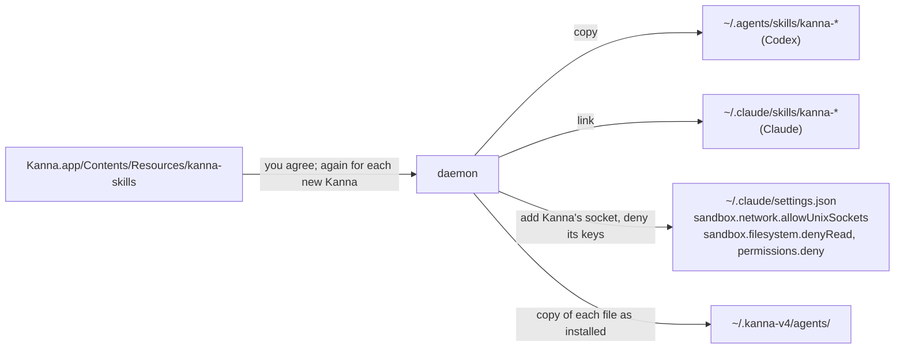

# Agent Setup

**Status:** built; agents are told in their first message, not a hook (2026-10-14) · **Tests:** `crates/kanna-daemon/src/agents.rs` and `backlog.rs` (unit), `scripts/e2e-kanna.sh` `desk_shelf`, `real_agent_tasks`, `real_agent_planners` · **Part of:** [tasks](tasks.md)

Kanna's skills teach an agent how to work in Kanna: name its branch, add tasks to the Shelf, plan, answer review comments. They live in this repo (`.agents/kanna-skills`), so today only agents working on Kanna itself have them. **Agent setup** puts them where Claude and Codex find them in any repo, once you agree.

**Done when** the agents Kanna starts in another repo use their skills, with Claude and with Codex: the planner kanna-planning, a task's agent kanna-tasks (names its branch, adds follow-up work to the Shelf), the quiz's kanna-quiz.

## Contents

1. [What it does](#1-what-it-does)
2. [How an agent knows it's in Kanna](#2-how-an-agent-knows-its-in-kanna)
3. [Asking](#3-asking)
4. [Updates and your files](#4-updates-and-your-files)
5. [CLI](#5-cli)
6. [How it's built](#6-how-its-built)

## 1. What it does



- **The skills:** `kanna-tasks`, `kanna-planning`, `kanna-new-project`, `kanna-markup`, `kanna-explain`, `kanna-quiz`, copied to `~/.agents/skills/` and linked from `~/.claude/skills/` (`../../.agents/skills/NAME`), the layout `install.sh --global` uses.
- **The socket entry** lets an agent in Claude's sandbox run `kanna`. That lets it control Kanna's terminals, which run outside the sandbox, as the kmux socket entry in a repo's own settings did; the prompt says so. The rest of `settings.json` stays as it was, keys in their order and its permissions kept. A `settings.json` Kanna had to make is deleted again by remove.
- **The key deny entries** keep agents from reading the daemons' signing keys ([machine identity](machine-identity.md#4-risks)): `//SUPPORT/kanna*/device.key` in `sandbox.filesystem.denyRead`, and `Read(//SUPPORT/kanna*/device.key)` in `permissions.deny`, where SUPPORT is the application support folder ([instances](instances.md#1-the-folders)); a daemon whose state folder is elsewhere (`KANNA_STATE_DIR`) adds its own key too. Like the socket, each entry is recorded, kept on each launch and taken out by remove, leaving yours.
- **No hooks.** Kanna tells the agents it starts that they're in Kanna in their first message ([2](#2-how-an-agent-knows-its-in-kanna)). Setup and update remove the `SessionStart` hooks earlier Kannas added to `~/.claude/settings.json` and `~/.codex/hooks.json` (their command ends `# kanna agents setup`), leaving yours.
- **Nothing else.**

## 2. How an agent knows it's in Kanna

An agent picks a skill by its description, from what's in its context, so it has to be told it's in Kanna. **Kanna starts every agent it uses** (the planner, every task's, and the quiz's, which the planner asks for with `kanna quiz open`), so each is told in its first message:

| Agent | Its first message |
|---|---|
| The [planning agent](planning-agent.md) | You are the Kanna planning agent. |
| A task's agent | You're a task's agent in Kanna (term-9), in your task's worktree. Your task: *the task's first message* |
| The [quiz](quiz.md)'s agent | You are the Kanna quiz agent, on main: quiz me on what landed on main. |

- **A task's agent gets its task as before,** with that line ahead of it; resuming sends nothing, since the conversation already has it.
- **Every agent Kanna starts has Kanna's environment** (`KANNA_TERMINAL`, `KANNA_SOCKET`), so `kanna` works from it; Codex runs attached to an app-server started from the same terminal ([Codex's app-server](codex-app-server.md)), so its commands get it too.
- **The environment says where, not who.** `KANNA_SOCKET` is which Kanna, `KANNA_TERMINAL` which pane a command runs in (for "the task I'm in", "open beside me"), as `TMUX_PANE` is tmux's. Neither tells an agent its role, and there's no `KANNA_PLANNER` or `KANNA_QUIZ`. A command can't find its pane another way: a sandboxed agent's commands have no terminal and can't list processes.
- **An agent you start yourself** in a Kanna terminal is told nothing and uses no Kanna skill unless you ask.
- **The skills key on what they're told,** not on environment variables an agent can't see: kanna-planning on being the Kanna planning agent, kanna-tasks on being a task's agent, kanna-quiz on being the quiz agent.

## 3. Asking

- **On first launch, the planning terminal asks.** Before it starts the planning agent, it runs `kanna agents setup --ask`, which says Kanna needs its skills and what that installs:

  ```
  Kanna needs its skills installed to work properly: they're how Claude and
  Codex, in any repo, know to name their task, plan with you and answer your
  review comments.

    ~/.agents/skills/kanna-*      the skills (Codex)
    ~/.claude/skills/kanna-*      links to them (Claude)
    ~/.claude/settings.json       Kanna's socket in Claude's sandbox, which lets
                                  sandboxed agents control Kanna's terminals

  Kanna keeps them up to date and never changes a file you've edited.
  Undo it any time with kanna agents remove.

  Install Kanna's skills? [Y/n]
  ```

- **Once.** Either answer is remembered, and the planning terminal never asks again. Nothing is written until you answer yes.
- **Without them Kanna still runs,** but its agents don't plan, explain code or answer comments; `kanna agents` says so.
- **`kanna agents setup` and `kanna agents remove`** change your mind later; `kanna agents` says where things stand.

## 4. Updates and your files

- **A new Kanna asks before it updates.** When its skills differ from the ones you have, the planning terminal runs `kanna agents update --ask` before it starts the planning agent, which lists what changed and asks:

  ```
  This Kanna has newer skills.

    kanna-tasks         updated
    kanna-markup        updated, merged with your changes
    kanna-planning      updated; your changes conflict, kept yours
    kanna-explain       new

  Update Kanna's skills? [Y]es, [n]ot now, [s]kip this version: y
  kanna-planning/SKILL.md: your changes conflict with Kanna's.
  Open it in your merge editor (opendiff)? [Y/n]
  ```

- **Your changes are merged in.** Kanna keeps a copy of each file as it installed it (`~/.kanna-v4/agents/`). A file you've edited since is merged three ways: the copy Kanna installed, yours, and the new one. A clean merge is written. For a conflict, it offers to open your merge editor (git's `merge.tool`, else FileMerge's `opendiff`) on the three; what you save is your file. Said no, it's left as yours, and `kanna agents update` offers again (`--force` takes Kanna's).
- **Not now** asks again at the next launch. **Skip this version** doesn't ask again until a newer Kanna brings newer skills. `kanna agents update` updates any time.
- **A file that was there before setup** is yours and never touched; a file identical to Kanna's is adopted.
- **Running agents** keep what they started with.
- **Remove** takes back only the files that still match what Kanna installed, and its socket entry.

## 5. CLI

| Command | Does |
|---|---|
| `kanna agents [status]` | Whether your agents are set up, and what setup installs |
| `kanna agents setup [--ask]` | Install the skills and the socket entry (`--ask`: say what and ask first) |
| `kanna agents update [--ask] [--force]` | Bring the skills up to this Kanna's, merging your changes (`--force`: Kanna's over yours) |
| `kanna agents remove` | Take back what Kanna put there |

## 6. How it's built

- **The daemon does it** (`agents` command, `crates/kanna-daemon/src/agents.rs`): it plans each update file by file against the copy it installed, merges with `git merge-file`, and writes. Each launch it only keeps this instance's socket entry in place (and takes out an earlier Kanna's hooks), once you've agreed; skills change only when you say yes.
- **The planning terminal asks** by running `kanna agents setup --ask; kanna agents update --ask` before it asks which agent plans (`planner.sh`), with the `kanna` beside the daemon (Kanna.app carries it in `Contents/Helpers`). Each asks at most once per launch, in the first planning terminal that opens, and says nothing when there's nothing to ask.
- **The merge editor runs in that terminal:** `kanna` makes a scratch git repo with the three versions as a real merge conflict and runs `git mergetool` on it, so any tool git knows works; what you save is copied over your file.
- **The skills come from the app bundle,** copied there from `.agents/kanna-skills` by `scripts/build-kanna-app.sh`.
- **For tests only:** `KANNA_AGENTS_HOME` stands in for your home folder and `KANNA_AGENT_SKILLS` for the bundle's skills; unset, Kanna uses yours. The end-to-end tests (`app_starts_daemon`, `desk_shelf`) set both, so they never touch your home; the app passes `KANNA_AGENTS_HOME` on to the daemon it starts.
