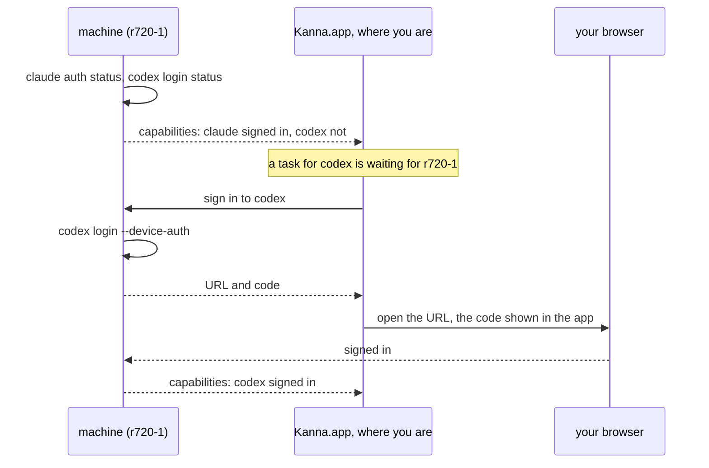

# Agent Sign-In Across Machines

**Status:** planned · **Part of:** [fleet](fleet.md) · **Builds on:** [agent setup](agent-setup.md)

Agents run on the user's own Claude or Codex login, a subscription or an API key, on every machine that runs them. Kanna keeps track of which machine is signed in to which agent, and signs one in when a task needs it, wherever you are, with as little typing as each agent allows.

## Contents

1. [Ways to sign in](#1-ways-to-sign-in)
2. [Signing a machine in](#2-signing-a-machine-in)
3. [Rules](#3-rules)

## 1. Ways to sign in

| Agent, account | Kanna does | You do |
|---|---|---|
| Claude, subscription | `claude auth login --claudeai` on the machine | sign in at the URL, paste the code back, once per machine |
| Claude, subscription, one token | `claude setup-token` once; the token is a secret, set as `CLAUDE_CODE_OAUTH_TOKEN` on each machine | sign in once |
| Claude, Console | `ANTHROPIC_API_KEY` from your secrets | paste the key once |
| Codex, ChatGPT subscription | `codex login --device-auth` on the machine | enter the code at the URL, once per machine |
| Codex, access token or API key | `codex login --with-access-token` or `--with-api-key`, from your secrets | paste it once |

The slice checks each row against the agents' current versions: that one setup token works on several machines at once, and how long each sign-in lasts.

## 2. Signing a machine in

- **Status is a capability.** Each daemon checks its agents' sign-in at start, every hour, and whenever an agent fails to authenticate, and advertises it with its other capabilities. A runner takes a task only for an agent that is signed in there ([tasks §2](fleet-tasks.md#2-owners-and-grants)).
- **Asking:** when a task waits only on a sign-in, the app shows a toast naming the machine and the agent, and one click starts the flow above. The fleet page shows every machine's sign-ins and signs one in or out.
- **Where you are:** the URL opens on the device you're using, the Mac, or later the phone. A login that needs a pasted code gets a field in the app, and the app types it into the login's terminal.
- **Enrolling** a machine signs it in to the agents you use, with the secrets you have, before it takes tasks ([fleet §9](fleet.md#9-server-setup-and-updates)).

## 3. Rules

- **Secrets** (setup tokens, access tokens, API keys) are kept in the Mac's Keychain in Local and go to a machine over the link when it's signed in. In Cloud, there is also a copy encrypted with your keys, so a machine can sign in while the Mac is closed.
- **Login files are never copied** between machines (`~/.claude/.credentials.json`, `~/.codex/auth.json`): their refresh tokens rotate, so two machines sharing one sign each other out.
- **Signing out** a machine, or revoking it ([identity §3](fleet-identity.md#3-the-peer-log)), removes its secrets and runs each agent's logout there.
- **An agent sees only its own sign-in.** A token in its environment is readable by it, so each agent gets only its own. Other secrets stay in the daemon's state folder, on each agent's sandbox deny list, as `device.key` is ([identity §4](fleet-identity.md#4-risks)).
