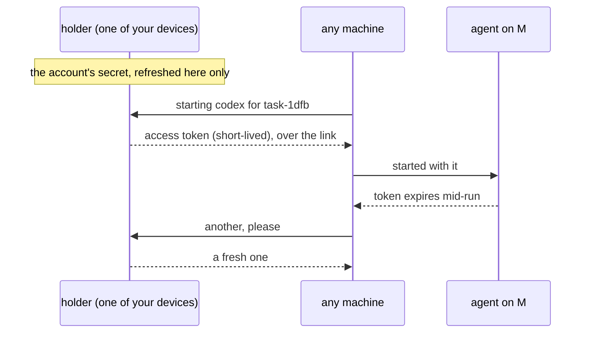

# Agent Sign-In Across Machines

**Status:** planned; model verified with Codex's per-machine fallback (2026-10-24) · **Part of:** [fleet](fleet.md) · **Builds on:** [agent setup](agent-setup.md) · **Model:** [agent-sign-in](../../references/prototypes/agent-sign-in/README.md)

Agents run on the user's own Claude or Codex accounts, subscriptions or API keys. **Accounts are the user's, not a machine's:** a shareable credential is added once and supplied to every machine. Where an agent has no verified sharing path, Kanna runs its own sign-in on each machine during enrollment, with the URL opened where the user is. Codex's current ChatGPT subscription path uses this fallback. Machines do not advertise sign-ins for task placement; enrollment supplies the configured accounts.

## Contents

1. [Accounts](#1-accounts)
2. [How a machine gets them](#2-how-a-machine-gets-them)
3. [Rules](#3-rules)

## 1. Accounts

You add an account in the app, on the Mac: Kanna runs the agent's own sign-in and keeps what it yields as a **secret**. Shared credentials go to existing and newly enrolled machines; an account using the fallback needs the user's vendor sign-in for each machine.

| Account | What Kanna keeps | What a machine gets |
|---|---|---|
| Claude subscription | a long-lived token from `claude setup-token` | the token, as `CLAUDE_CODE_OAUTH_TOKEN` |
| Claude Console | the API key | `ANTHROPIC_API_KEY` |
| Codex, ChatGPT subscription | an independent login on each machine, created through Codex's own flow | its own login; no login file is copied from another machine |
| Codex, API key | the API key | `codex login --with-api-key` |

## 2. How a machine gets them

**Model result:** on two Ubuntu 26.04 VMs on r720-1, Claude Code 2.1.310 completed concurrent requests with one setup token. Codex 0.163.0 rejected the Mac holder's ordinary ChatGPT OAuth access tokens through `login --with-access-token`, both before and after a successful holder refresh. That flag expects a different credential type: [Codex personal access tokens](https://learn.chatgpt.com/docs/enterprise/access-tokens). Independent device-code sign-ins then completed concurrent Codex requests on both VMs. Fleet 9 uses this per-machine fallback and compares its tests with the [model's evidence](../../references/prototypes/agent-sign-in/README.md#evidence-2026-10-24).

The holder flow below remains a **future option**, conditional on a supported access-token import and renewal interface being verified. It is not the current Codex implementation plan:

- **A token that lasts** (Claude's setup token, API keys) goes to every machine when the account is added or the machine enrolls, and stays there.
- **A login that refreshes:** in the current Codex fallback, each machine refreshes its own independent login. A future holder flow would keep one login on the Mac or another always-on device, with only that holder refreshing it and machines requesting short-lived access tokens. That path needs a new passing model before it replaces the fallback.
- **A broken account** (revoked, expired, a plan that ended) shows one toast, "sign in to Codex again". Replacing a shared credential repairs all machines; independent logins may need sign-in again on each affected machine.
- **Slice 9 verifies** each row against the agents' current versions. Compare with the model's successful shared-Claude runs, successful per-machine Codex runs, and rejected holder-token imports. Personal access tokens and API keys are distinct credential types; this model did not test them. Natural expiry mid-run, revocation and offline enrollment are not established by these short probes.

## 3. Rules

- **Terms:** whether a subscription may run agents on many machines is the provider's call, and the slice checks Anthropic's and OpenAI's current terms before Kanna shares one.

- **Secrets** are kept in the Mac's Keychain in Local. In Cloud, there is also a copy encrypted with your keys, so a machine enrolls while the Mac is closed. Kanna's service can't read it, so a holder is always one of your devices.
- **Login files are never copied** between machines (`~/.claude/.credentials.json`, `~/.codex/auth.json`): their refresh tokens rotate, so two machines sharing one sign each other out.
- **Removing an account** removes it from every machine. Revoking a machine ([identity §3](fleet-identity.md#3-the-peer-log)) removes everything it was given, and a setup token or key it held is worth rotating.
- **An agent sees only its own credential,** in its environment. Other secrets stay in the daemon's state folder, on each agent's sandbox deny list, as `device.key` is ([identity §4](fleet-identity.md#4-risks)).
