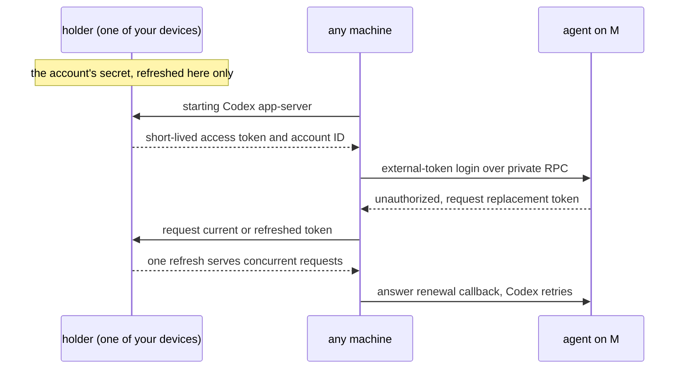

# Agent Sign-In Across Machines

**Status:** planned; holder model verified through experimental Codex app-server (2026-10-25) · **Part of:** [your machines](machines.md) · **On Kanna-run machines:** [Cloud §7](kanna-cloud.md#7-agent-sign-in-on-kanna-run-machines) · **Builds on:** [agent setup](agent-setup.md) · **Model:** [agent-sign-in](../../references/prototypes/agent-sign-in/README.md)

Agents run on the user's own Claude or Codex accounts, subscriptions or API keys. **Accounts are the user's, not a machine's:** a shareable credential is added once and supplied to every machine. Where an agent has no verified sharing path, Kanna runs its own sign-in on each machine during enrollment, with the URL opened where the user is. Codex sharing is verified through app-server; the ordinary terminal command still uses the fallback until its integration is modeled. Machines do not advertise sign-ins for task placement; enrollment supplies the configured accounts.

## Contents

1. [Accounts](#1-accounts)
2. [How a machine gets them](#2-how-a-machine-gets-them)
3. [Rules](#3-rules)

## 1. Accounts

You add an account in the app, on the Mac: Kanna runs the agent's own sign-in and keeps what it yields as a **secret**. Shared credentials go to existing and newly enrolled machines; an account using the fallback needs the user's vendor sign-in for each machine.

| Account | What Kanna keeps | What a machine gets |
|---|---|---|
| Claude subscription | a long-lived token from `claude setup-token` | the token, as `CLAUDE_CODE_OAUTH_TOKEN` |
| Claude Console | the API key | `ANTHROPIC_API_KEY` |
| Codex, ChatGPT subscription | one managed login on a holder device | short-lived access token and account ID through experimental app-server auth; independent vendor sign-in if this integration is unavailable |
| Codex, API key | the API key | `codex login --with-api-key` |

## 2. How a machine gets them

**Model result:** on two Ubuntu 26.04 VMs on r720-1, one Claude setup token worked concurrently. Codex 0.163.0 also completed concurrent inference using one Mac login's access tokens through app-server `chatgptAuthTokens`. Both workers accepted a holder refresh and recovered from an injected invalid token through the renewal callback, retaining the same process and thread. No worker login file or refresh credential was present. See the [model and evidence](../../references/prototypes/agent-sign-in/README.md#what-the-app-server-probe-measures).

**Integration boundary:** this is an experimental app-server protocol, not `codex login --with-access-token` or a terminal UI auth shim. Public docs describe the protocol, but the pinned binary's schema still labels it internal-only. The agent sign-in slice must explicitly choose and verify this app-server integration against its shipping Codex version. If Kanna retains the ordinary terminal command without a verified sharing adapter, use the passing independent per-machine sign-in fallback. Do not silently treat the app-server result as a TUI result.

- **A token that lasts** (Claude's setup token, API keys) goes to every machine when the account is added or the machine enrolls, and stays there.
- **A login that refreshes:** one holder keeps and refreshes the managed login, then supplies only its short-lived access token and account ID to each worker. Serialize refreshes and coalesce concurrent renewal requests. App-server asks for renewal after an authorization error; answer promptly within its callback deadline. A worker never gets the refresh credential. In the fallback, each machine owns and refreshes a separate vendor-created login.
- **A broken account** (revoked, expired, a plan that ended) shows one toast, "sign in to Codex again". Replacing the holder login repairs shared access; independent logins may need sign-in again on each affected machine.
- **The agent sign-in slice verifies** real concurrent inference and renewal against the model, including recovery within the same process/thread and absence of worker refresh credentials. Retain the negative CLI regression: ordinary OAuth access tokens fail `--with-access-token`, which accepts distinct automation credentials. The model covers an injected invalid signature, not natural expiry, revocation or holder outages. Personal access tokens and API keys were not tested.

## 3. Rules

- **Terms:** whether a subscription may run agents on many machines is the provider's call, and the slice checks Anthropic's and OpenAI's current terms before Kanna shares one.

- **Secrets** are kept in the Mac's Keychain, and a holder is always one of your devices. Kanna Cloud keeps no copy (proposed: [Cloud §9](kanna-cloud.md#9-open-questions)).
- **Login files are never copied** between machines (`~/.claude/.credentials.json`, `~/.codex/auth.json`): their refresh tokens rotate, so two machines sharing one sign each other out.
- **Removing an account** removes it from every machine. Revoking a machine ([identity §3](machine-identity.md#3-the-peer-log)) removes everything it was given, and a setup token or key it held is worth rotating.
- **An agent sees only its own credential,** in its environment or private app-server connection. Access JWTs carry identity claims; withholding a separate email or ID token does not hide those claims. Other secrets stay in the daemon's state folder, on each agent's sandbox deny list, as `device.key` is ([identity §4](machine-identity.md#4-risks)).
