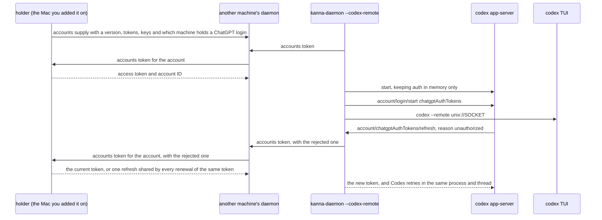

# Agent Sign-In Across Machines

**Status:** built for your own machines (slice S1) and verified against real accounts on 2026-11-03 ([§6](#6-verification)); Codex through Codex 0.163.0's app-server, including the terminal command Kanna starts · **Tests:** `cargo test -p kanna-daemon` (accounts, codex_remote, agents), `cargo test -p kanna` (accounts, `tests/machine.rs`), e2e `machine_remote_task` · **Part of:** [your machines](machines.md) · **On Kanna-run machines:** [Cloud §9](kanna-cloud.md#9-agent-sign-in-on-kanna-run-machines) · **Builds on:** [agent setup](agent-setup.md), [Codex's app-server](codex-app-server.md) · **Model:** [agent-sign-in](../../references/prototypes/agent-sign-in/README.md)

Agents run on the user's own Claude or Codex accounts, subscriptions or API keys. **Accounts are the user's, not a machine's:** one is added once, on the Mac, and every machine's agents use it. Where an account can't be shared, a machine signs in by itself, with the sign-in page opened where the user is.

## Contents

1. [Accounts](#1-accounts)
2. [How a machine gets them](#2-how-a-machine-gets-them)
3. [Rules](#3-rules)
4. [Keeping and removing secrets](#4-keeping-and-removing-secrets)
5. [How it's built](#5-how-its-built)
6. [Verification](#6-verification)

## 1. Accounts

You add an account in the app (Kanna menu → Agent Accounts) or with `kanna accounts add`: Kanna runs the agent's own sign-in and keeps what it yields as a **secret**. Each agent uses one account; adding another replaces it.

| Account | Kanna runs | What Kanna keeps | What a machine gets |
|---|---|---|---|
| Claude subscription | `claude setup-token` | its one-year token | the token, as `CLAUDE_CODE_OAUTH_TOKEN` |
| Claude Console | a hidden prompt | the API key | `ANTHROPIC_API_KEY` |
| Codex, ChatGPT subscription | `codex login` in a folder of Kanna's, never your `~/.codex` | the login, on the Mac only: this Mac is its **holder** | short-lived access token and account ID, through its Codex's app-server |
| Codex, API key | a hidden prompt | the API key | the key, through its Codex's app-server |

- **The token Claude prints is read from its output** and shown back as `sk-ant-oat01-…last4` to confirm; the screen and scrollback are cleared after. If it can't be read, Kanna asks you to paste it at a hidden prompt.
- **`kanna accounts`** lists your accounts, the machine that holds each, the machines that get them, and those received from another machine. A secret is never listed.

## 2. How a machine gets them

- **A token that lasts** (Claude's setup token, API keys) goes to every machine when it's added and when a machine joins, and stays there. The holder's daemon supplies each machine it trusts the whole set with a version number; a machine keeps the newest and drops an older one. A machine that's offline gets it when it next answers (retried every minute, backing off to 15).
- **A login that refreshes** stays on its holder. A worker's Codex asks its daemon, which asks the holder over the link. The holder refreshes one login at a time, and a renewal of a token that's already been replaced gets the new one without another refresh. It refreshes ahead of time a token that ends within five minutes. A worker never gets the refresh credential, the ID token or the login file.
- **Claude** starts as `kanna-daemon --with-account STATE claude …` when there's a Claude account, which sets the one variable and runs `claude` in its place (same process).
- **Codex** starts as it always does, through its helper ([Codex's app-server](codex-app-server.md)). With an account, the helper starts the app-server with `cli_auth_credentials_store="ephemeral"`, signs it in on its private connection before the TUI attaches, and answers its renewal requests. Your own `auth.json` is never read or written.
- **Integration boundary, decided:** this is Codex's experimental app-server auth (`chatgptAuthTokens`), which the 0.163.0 schema labels internal-only. Kanna's terminal command already runs the TUI attached to an app-server, so the TUI uses it: the [TUI probe](../../references/prototypes/agent-sign-in/tui-results.json) ran the real TUI on holder tokens, recovered from an injected invalid token twice in the same process and thread, and the renewal requests came to the helper's connection, not the TUI's. If the helper can't start the app-server, or can't reach the holder, Codex runs on the machine's own sign-in, and the terminal says so.
- **The fallback** is `kanna accounts sign-in claude|codex`, run on the machine (from a terminal of it on your Desk): it runs `claude auth login` or `codex login --device-auth`, and asks the app to open the sign-in page in your browser, on the Mac you're at (`app.open_sign_in`, which opens only Claude's and OpenAI's own sign-in hosts). That machine then owns and refreshes its own login.
- **A broken account** (a refresh refused: revoked, expired, a plan that ended) shows one toast on the holder, "Sign in to Codex again", and isn't retried for a minute. Adding the account again repairs every machine.

## 3. Rules

- **Terms** (checked 2026-10-26; these pages change):
  - **Anthropic** ([legal and compliance](https://code.claude.com/docs/en/legal-and-compliance)): "developers may not collect, store, or intermediate Claude.ai credentials or session tokens — sign-in to a Claude account must complete through Anthropic's own flow." API keys kept in "a development environment, secrets manager, or machine image for use by the customer's own authorized users" are allowed, and so is "an end user … signing in to the unmodified Claude Code binary with their own Claude subscription". Pro and Max limits "assume ordinary, individual usage". So a Claude API key may be shared; Kanna keeping and handing out a subscription's setup token is what that sentence forbids. The per-machine sign-in is allowed. **Decided (2026-11-03):** Kanna shares the setup token anyway, because a sign-in per machine is worse to use; the per-machine sign-in stays as the fallback.
  - **OpenAI** ([app-server](https://learn.chatgpt.com/docs/app-server), [auth](https://learn.chatgpt.com/docs/auth)): external tokens are "experimental and intended for host apps that already own the user's ChatGPT auth lifecycle". App-server auth "has never been permitted for commercial or hosted services", while a local or open-source app may keep using it (OpenAI recommends Sign in with ChatGPT). One refresher per login, never one `auth.json` on several machines, matches the auth guide. The [Terms of Use](https://openai.com/policies/terms-of-use/) forbid making an account available to others and bypassing limits; that page refused automated reads (403).
- **Secrets** are kept in the Mac's Keychain, and in the state folder's `agent-secrets/` (0700, files 0600) on a machine without one ([§4](#4-keeping-and-removing-secrets)). A holder is always one of your devices. Kanna Cloud keeps no copy (proposed: [Cloud §11](kanna-cloud.md#11-open-questions)).
- **Login files are never copied** between machines (`~/.claude/.credentials.json`, `~/.codex/auth.json`): their refresh tokens rotate, so two machines sharing one sign each other out.
- **Removing an account** removes it from every machine. **Revoking a machine** ([identity §3](machine-identity.md#3-the-peer-log)) first tells it to drop what it was given, then revokes it; a machine that learns it's revoked drops everything, and every machine drops what a revoked machine gave it. A setup token or key it held is worth rotating, and `kanna machine revoke` says so.
- **An agent sees only its own credential,** in its environment or its Codex's private app-server connection. Access JWTs carry identity claims; withholding a separate email or ID token does not hide those claims. The secrets folder is on Claude's sandbox deny list with `device.key` ([agent setup](agent-setup.md)); Codex, run with `--yolo`, can read it, as it can read `device.key` ([identity §4](machine-identity.md#4-risks)).

## 4. Keeping and removing secrets

- **One item per secret.** The daemon keeps each secret as a generic password in the login Keychain: service "Kanna agent accounts", account `STATE_DIR/NAME`, where NAME is the account's ID, or `received` for what other machines gave this one. Each Kanna (production, staging, dev, a test instance) has its own items. Without a Keychain (Linux, or `KANNA_KEYCHAIN=0`) a secret is a file in `agent-secrets/`.
- **The partition decides who reads.** macOS makes an item with the daemon as its trusted app and the signer's partition: `teamid:EA4J68749Z` for an Apple Development or Developer ID daemon, `cdhash:…` for an ad-hoc or Kanna Dev Signing one ([privacy prompts](privacy-prompts.md#4-how-dev-builds-are-signed)).
- **Deleting takes the same partition and file name.** macOS lets a process delete an item when it is in the item's partition and its executable has the file name of the one that made it. The daemon is always `kanna-daemon`, so a rebuild or a release update deletes what an earlier build made. A binary of the same team under another name reads and updates the item, and its delete fails with `errSecInvalidOwnerEdit` (-25244).
- **Removing deletes first.** `remove`, and `add` replacing an agent's account, delete the old secret before the book changes. If the Keychain refuses, the command fails naming the item, the account stays listed and a new one isn't added, so no secret is left behind unnoticed: delete the item in Keychain Access and run it again. A secret that is already gone counts as deleted.

| Daemon using the item | Read | Update | Delete |
|---|---|---|---|
| A rebuild, or a release update (same team, `kanna-daemon`) | yes, silently | yes | yes |
| Team-signed, on an item an ad-hoc or Kanna Dev Signing build made | asks once (Always Allow); refused headless | yes | yes |
| Same team, another file name | yes | yes | refused (-25244) |
| Ad hoc, on a team item | not found | not tried | not found |

Measured on 2026-11-08 (macOS 26.2) with a C program calling `SecItemAdd`, `SecItemCopyMatching`, `SecItemUpdate` and `SecItemDelete`, and with a copy of `Keychain` built three times as `kanna-daemon` with different bytes, each in a new `Kanna.app/Contents/Helpers/`: signed by `kanna_sign_helper` with `KANNA_SIGN_TEAM`, then the release's way (Developer ID, `--options runtime`). The first build wrote, the second and third read, updated and deleted; interaction was off, so nothing prompted.

- **Rejected: the data protection Keychain.** It needs a `keychain-access-groups` entitlement, which a helper without a provisioning profile can't have: `SecItemAdd` returns `errSecMissingEntitlement` (-34018).
- **Rejected: an ACL of our own** (`SecAccessCreate` granting delete to the team). Deleting already works for the daemon, and the `SecAccess` API is deprecated.

## 5. How it's built

| Part | Where |
|---|---|
| Accounts, secrets, the holder | `crates/kanna-daemon/src/accounts.rs`: `Accounts` (the book in `agent-accounts.json`, secrets behind `Secrets`: `Keychain` or `Files`), `Service` (the `accounts` command, peers' requests, the supply thread), `CodexRefresher` (runs `codex app-server` over stdio on the login in a private folder, `account/read {refreshToken: true}`) |
| Peers' requests | `machines.rs`: a peer's `accounts` request arrives as `Event::PeerRequest` with the peer's name; peers may only `supply` and ask for a `token`. `Caller` makes a call to a peer from a plain thread; revoking runs `Service::withdraw` first |
| Codex | `codex_remote.rs`: `supplied`, `sign_in`, `renew`; `messages::Rpc` is the WebSocket client both use |
| CLI | `crates/kanna/src/accounts.rs`: the sign-ins in a pty, the token read from Claude's output, hidden prompts, the fallback |
| App | the Kanna menu's Agent Accounts runs `kanna accounts …` in a new window; `app.open_sign_in` |

| `accounts` action | From | Does |
|---|---|---|
| `list` | this machine | accounts here, received ones, the machines they go to |
| `add {kind, secret, label?, program?}` | this machine | keeps it, replaces the agent's old one, supplies every machine |
| `remove {account}` | this machine | an ID, or `claude`/`codex` |
| `token {account?, previous?}` | this machine or a peer | the Codex access token, from here if this is the holder, else from the holder |
| `supply {version, accounts}` | a peer only | replaces what that peer gave this machine |

## 6. Verification

Run on 2026-11-03 against real accounts: a test Kanna on this Mac (secrets in its Keychain) and an Incus VM on r720-1 running this branch, paired over the LAN. Codex 0.163.0, Claude Code 2.1.310 on the VM.

| Check | Result |
|---|---|
| A machine that joins gets the accounts | the VM listed both on pairing; its `agent-secrets/received` holds the setup token and the holder's name, and no refresh token, ID token or JWT |
| One setup token, concurrent inference | `kanna-daemon --with-account … claude -p` on the Mac and the VM, started together, both answered (4.9 s and 16.5 s); without `--with-account` the Mac's Claude was signed out |
| Codex through the holder, injected invalid token | the holder's access token had its signature changed; the VM's Codex, started by `kanna-daemon --codex-remote`, answered two turns in the same process and thread; the holder's token was then a new one from a real refresh; no `~/.codex/auth.json` on the VM |
| A refused refresh | three requests from the VM, all refused, raised one toast on the Mac: "Sign in to Codex again" |
| Removing an account | `kanna accounts remove codex` took it off the VM |
| Revoking a machine | `kanna machine revoke s1-vm`: the VM dropped every account and its Claude was signed out; the Mac kept its own |

**Done when** (the slice's verification): one Claude setup token runs concurrent inference on this Mac and a paired Linux VM; Codex runs through the holder on the VM with an injected invalid token recovered in the same process and thread, and no refresh credential on the worker. Keep the model's negative regression too: ordinary ChatGPT OAuth tokens are refused by `codex login --with-access-token`.
