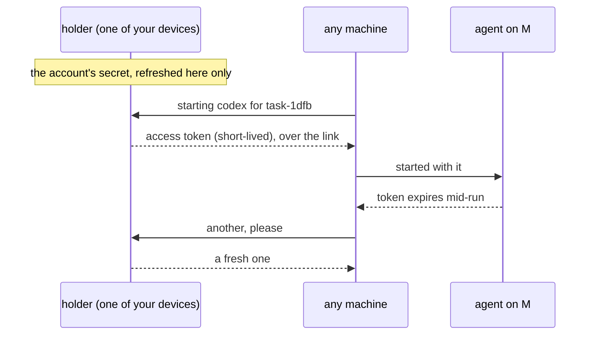

# Agent Sign-In Across Machines

**Status:** planned · **Part of:** [fleet](fleet.md) · **Builds on:** [agent setup](agent-setup.md)

Agents run on the user's own Claude or Codex accounts, subscriptions or API keys. **Accounts are the user's, not a machine's:** you add an account once, and every one of your machines can run every agent on it. Nothing is signed in per machine, and no machine advertises its sign-ins, since all of them have all of them.

## Contents

1. [Accounts](#1-accounts)
2. [How a machine gets them](#2-how-a-machine-gets-them)
3. [Rules](#3-rules)

## 1. Accounts

You add an account in the app, on the Mac: Kanna runs the agent's own sign-in there and keeps what it yields as a **secret**. From then on, every machine you have, and every one you add later, can use it.

| Account | What Kanna keeps | What a machine gets |
|---|---|---|
| Claude subscription | a long-lived token from `claude setup-token` | the token, as `CLAUDE_CODE_OAUTH_TOKEN` |
| Claude Console | the API key | `ANTHROPIC_API_KEY` |
| Codex, ChatGPT subscription | the login itself, held by one of your devices (§2) | a short-lived access token (`codex login --with-access-token`) |
| Codex, API key | the API key | `codex login --with-api-key` |

## 2. How a machine gets them

- **A token that lasts** (Claude's setup token, API keys) goes to every machine when the account is added or the machine enrolls, and stays there.
- **A login that refreshes** (Codex's ChatGPT login) stays with one **holder**: the Mac, or an always-on device of yours. Only the holder refreshes it, and machines ask it for short-lived access tokens over the link, so a hundred VMs share one login without signing each other out.
- **A broken account** (revoked, expired, a plan that ended) shows one toast, "sign in to Codex again", and signing in once fixes every machine.
- **Slice 9 verifies** each row against the agents' current versions: that one setup token works on many machines at once, and that Codex accepts access tokens minted by a holder. An agent with no shareable credential falls back to signing in on each machine, done by Kanna on enrollment with the URL opened where you are.

## 3. Rules

- **Terms:** whether a subscription may run agents on many machines is the provider's call, and the slice checks Anthropic's and OpenAI's current terms before Kanna shares one.

- **Secrets** are kept in the Mac's Keychain in Local. In Cloud, there is also a copy encrypted with your keys, so a machine enrolls while the Mac is closed. Kanna's service can't read it, so a holder is always one of your devices.
- **Login files are never copied** between machines (`~/.claude/.credentials.json`, `~/.codex/auth.json`): their refresh tokens rotate, so two machines sharing one sign each other out.
- **Removing an account** removes it from every machine. Revoking a machine ([identity §3](fleet-identity.md#3-the-peer-log)) removes everything it was given, and a setup token or key it held is worth rotating.
- **An agent sees only its own credential,** in its environment. Other secrets stay in the daemon's state folder, on each agent's sandbox deny list, as `device.key` is ([identity §4](fleet-identity.md#4-risks)).
