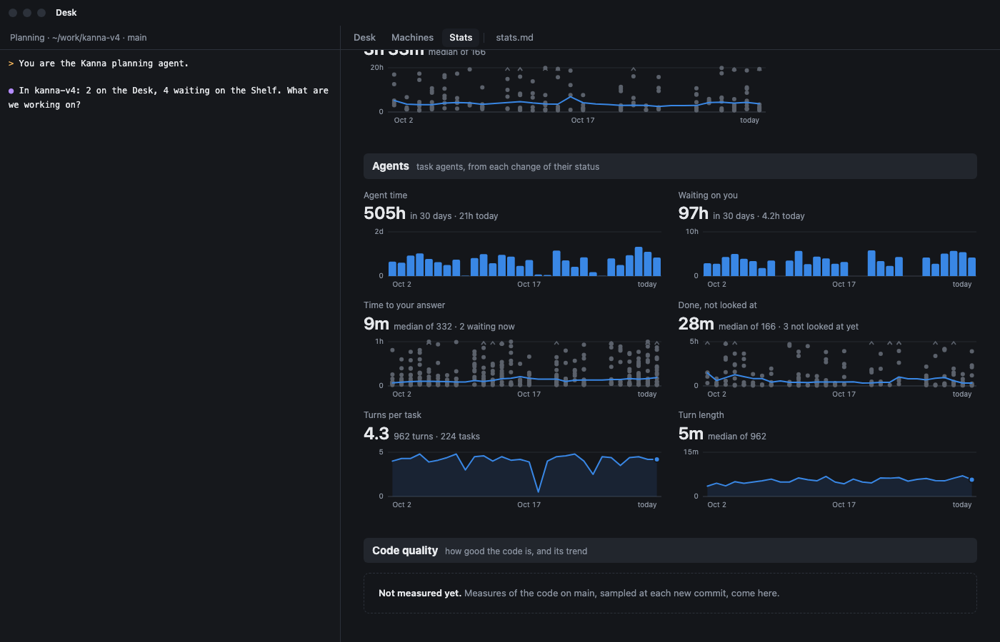
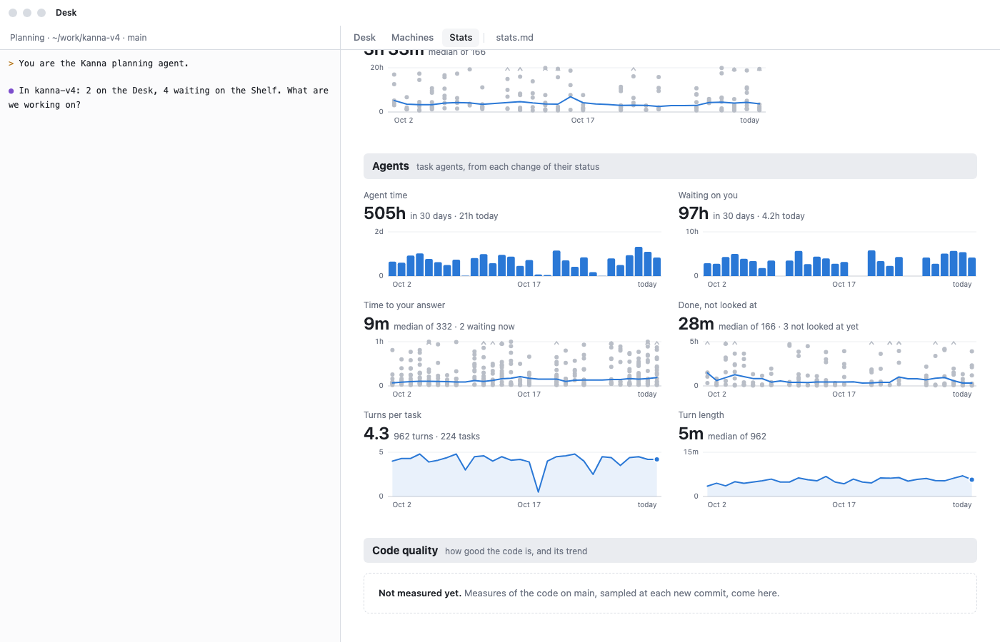
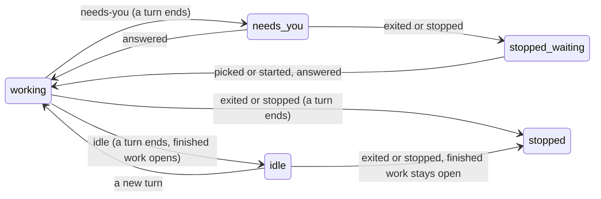

# Agent Stats

**Status:** built · **Tests:** `stats.rs`, `tasks.rs`, `AgentStatusesTests`, `StatsFormatTests`, e2e `stats_tab` · **Mockup:** [`references/mockups/stats.html`](../../references/mockups/stats.html) (`#picture,agents`) · **Builds on:** [Stats](stats.md), [agent status](agent-status.md) and its [stored status](agent-status.md#5-across-a-daemon-restart), [task history](database.md)

**The Agents section of the Stats tab:** how long task agents worked, how long they waited on you, how long finished work sat unlooked at, and how their turns went, over the last 30 days. It shows whether you are holding agents up: how much of their time went on work, and how much on waiting for you.

The numbers come from a row in `task_events` for each change of a task agent's status. The planner, a run's stages and plain terminals have no rows. Only the Stats tab, on the Mac and the [phone](mobile-machines.md#7-stats), and `kanna stats` show them: `kanna task list` and the Desk's rows have no per-task numbers yet.

| Dark | Light |
|---|---|
|  |  |

*(From the mockup: `#picture,agents`, `#picture,agents,light`.)*

## Contents

1. [The numbers](#1-the-numbers)
2. [Recording](#2-recording)
3. [From rows to spans](#3-from-rows-to-spans)
4. [Tests](#4-tests)
5. [Limits](#5-limits)
6. [Rejected](#6-rejected)
7. [Glossary](#7-glossary)

## 1. The numbers

| Tile | Figure | Note | Chart |
|---|---|---|---|
| Agent time | hours of work in the 30 days | "in 30 days · 3h today" | hours per day (columns), a span split at midnight |
| Waiting on you | hours at needs-you in the 30 days | the same | hours per day (columns) |
| Time to your answer | median wait that ended in an answer | "median of N · M waiting now" | a dot per wait on the day you answered, the 7-day median as a line |
| Done, not looked at | median time from a turn's end to your look | "median of N · M not looked at yet" | a dot per finish on the day you looked, the 7-day median as a line |
| Turns per task | turns ended ÷ tasks with a turn, one decimal | "N turns · M tasks" | the same for each day alone (line, a gap on a day with none) |
| Turn length | median turn | "median of N" | the median turn of each day (line) |

- **Empty:** a project with no status row shows the section's words and no tiles, so history starts when this lands. A figure with nothing to count shows "—".
- **Units:** `h` is hours (`212h`, `3.4h`, `40m`), so a total reads as hours rather than days; `x` is a plain number to one decimal ([adding a metric](stats.md#4-adding-a-metric)).

## 2. Recording

| Row (`what`) | Written | By |
|---|---|---|
| `status`, with `{"status": …}` | each change to `working`, `needs-you`, `idle` or `exited` | daemon, from `Tasks::status` and `Tasks::exited` |
| `looked` | the first time the app shows an idle agent's pane after a turn, in its window in front | app, `tasks {action: looked, task}` |

- **Only changes:** a status equal to the task's last one adds no row. The last one is read from `kanna.db`, so it holds across a restart. A `stopped` or `started` row clears it, so an agent that stops and starts at the same status records it again.
- **On its way out:** while Kanna quits or stops an agent, its reports add no row, so an agent stopped at needs-you isn't taken as answered. Its `exited` still does.
- **No status is no change:** a pane with no report writes nothing.
- **A restart leaves no gap:** the daemon puts a terminal's [stored status](agent-status.md#5-across-a-daemon-restart) back, which repeats the last row and adds none, so a turn under way when the daemon stopped carries on as one turn, and the daemon's time away counts. A report the keeper buffered meanwhile is a change like any other, written when the new daemon reads it.
- **Gone while no daemon ran:** at startup, once the panes are back, a task whose agent isn't running gets `exited` (`Tasks::settle_statuses`).
- **Looked at:** the app tells the pane's own machine. Any app's look counts. A Mac app's *unread* mark goes when an agent exits, so `looked` is sent on its own rule and unread stays as it is.

## 3. From rows to spans

`agent_stats.rs` reads each task's rows at each request and folds them into spans, as `stats.rs` does with made and done. Nothing is stored twice.

- **A turn** is one span of `working`: the same as a [turn's end](agent-status.md#3-the-report-osc-7501), so an approval in the middle makes two. A turn still running counts towards Agent time, and as a turn once it ends.
- **A wait** runs from `needs-you` until the agent's next `working` or `idle`. Stopped at needs-you, wherever it is, it goes on until the task is `picked` or `started`; picking a task whose agent still runs doesn't end it.
- **Finished work** opens on `working` going to `idle`, and closes on `looked`, `picked`, `activated`, or any later status but `exited`. It stays open through a stop, so a turn a Shelf runner ended counts until you come to it.
- **`done`** ends everything. A wait or finished work it ends counts in the hours, and in no median.
- **Watched:** finished work closed within 5 s was on screen as it ended, so it isn't in the tile's median.
- **Still open** spans end at now: they count in the hours and in the note's "M waiting now", never in a median.
- **The 30 days** clip the hours. A median takes spans that ended in them.

## 4. Tests

- `stats.rs`: every tile from a fixed series of events; a restart in the middle of a turn; a task stopped at needs-you, picked, started, still waiting, running when picked, and done; finished work through a stop; a span across midnight; a project with no rows.
- `tasks.rs`: a task's changes kept, a repeat, no status and another pane adding none, a fresh `Tasks` over the same `kanna.db` continuing the turn, the same status after a stop, an agent gone while no daemon ran.
- `AgentStatusesTests`: a finish looked at once, as it came or later, and an idle agent after a launch. `StatsFormatTests` and the CLI's test: `h` and `x`.
- e2e `stats_tab`: a mock agent's turn with an approval gives `idle working needs-you working idle`; `kanna stats --json` against the tiles; the app draws the section between Tasks and Code quality, in two rows of three.

## 5. Limits

- **Time asleep counts:** a Mac asleep or a daemon away with an agent at working adds to Agent time until the next row. A reboot, which ends the terminals, adds its length, up to the `exited` the next daemon writes.
- **One machine:** rows stay on the machine that ran the agent, as with the rest of Stats until Stats across machines. A task moved away keeps its rows there, and a wait it left open goes on showing.
- **A turn under the status watcher's look** (about 100 ms) leaves no row: it's too short to change the numbers.

## 6. Rejected

- **Marking unread in the daemon:** which pane is on screen is the app's to know; the app says what you've looked at and the daemon keeps the row.
- **A row per report:** a report repeats, and the fold would only drop them.
- **Rows of spans, written as each ends:** a crash would lose the open one, and a rule change couldn't reach history.
- **Today's value as the figure:** agent time varies by the hour, so a 30-day total reads better, with today in the note.

## 7. Glossary

| Term | Meaning |
|---|---|
| **Span** | A stretch of one state of a task's agent, from one row to the row that ends it |
| **Turn** | One span of `working` |
| **Wait** | A span at needs-you, on through a stop until the task is picked or started |
| **Finished work** | A turn that ended idle, until you look at it |
