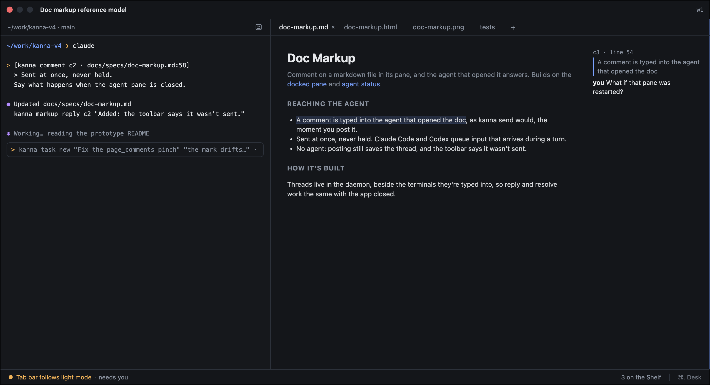
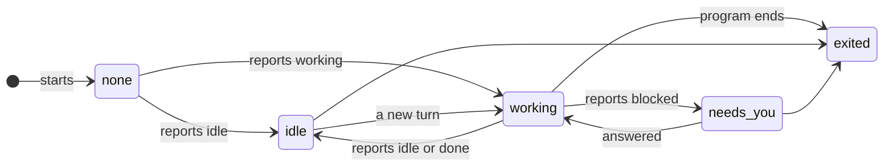
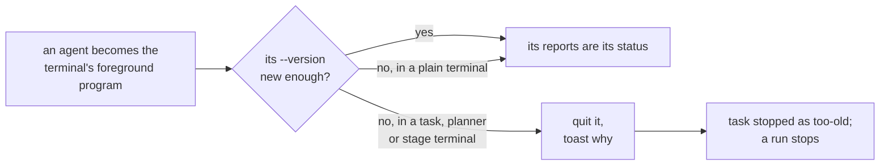
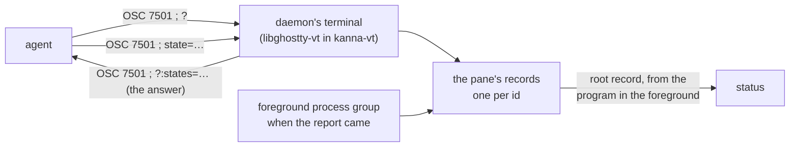
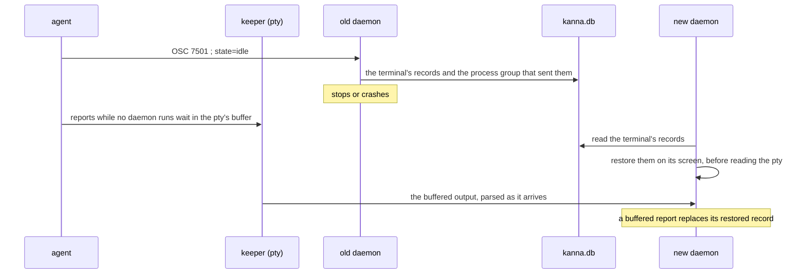

# Agent Status

**Status:** built (no dots yet: the Desk isn't built) · **Tested:** e2e `agent_status`, `agent_status_restart`, `real_agent_program_status`, `agent_too_old`; `cargo test -p kanna-vt`, `-p kanna-detect`, `-p kanna-daemon` · **Used by:** [Desk](desk.md) (the agent header, the strip and the [Desk view](desk-view.md)), [Shelf runners](shelf-runners.md), [agent messaging](agent-messaging.md), [runs](software-factory.md) · **Mockup:** the Desk's ([`references/mockups/desk.html`](../../references/mockups/desk.html)), the dots beside each task · **Evidence:** [agent status signals](../research/agent-status-signals.md)

**Agent status** tells you at a glance whether an agent is busy, waiting for you, or done, so you can leave it running and come back when it needs you. Kanna takes it from the agent's own report, the [Program Status Protocol](#3-the-report-osc-7501) (OSC 7501), and from nothing else: Kanna's agents are the ones that send it, and Kanna refuses a version too old to send it as a task's, planner's or run stage's agent.

## Contents

1. [States](#1-states)
2. [Kanna's agents](#2-kannas-agents)
3. [The report (OSC 7501)](#3-the-report-osc-7501)
4. [CLI](#4-cli)
5. [Across a daemon restart](#5-across-a-daemon-restart)
6. [How it's built](#6-how-its-built)
7. [Glossary](#7-glossary)

## 1. States

| Status | When |
|---|---|
| working | the agent's report says `working` |
| needs you | it says `blocked`, of any kind (an approval, a question, a sign-in) |
| idle | it says `idle`, `done` or `error` |
| exited | the program has ended (the pane is `exited`) |
| none | no report yet, or not an agent: a plain terminal, whatever runs in it |

- **The report is the only source:** Kanna doesn't read the screen, the title, progress reports, the bell or the agents' notifications (OSC 9, OSC 777) for status.
- **Shown at once:** a report shows as it arrives, with no settling and no hold.
- **Shown in Kanna only:** status is the dots in Kanna's windows; it doesn't badge the Dock icon or post macOS notifications.
- **Unread is separate:** an agent that goes from working to idle while its pane isn't on screen in the window Kanna has in front ([physical layout §3](physical-layout.md#3-the-window-in-front-in-the-app)) (in its active tab, zoomed pane or dock), with Kanna active, is **unread** until it is; leaving idle clears it. Unread is the app's mark of what you've seen, not an agent status: the status stays idle, and the dot shows both.
- **Names on the wire:** `working`, `needs-you`, `idle`, `exited`; none is no `status` field.

## 2. Kanna's agents

| Agent | Reports since | How it starts reporting |
|---|---|---|
| claude (Claude Code) | 2.1.295 | once its terminal answers the probe `OSC 7501 ; ?` |
| codex | 0.163.0 | whenever its output is a terminal, without asking |
| opencode | 2.2.5 | once its terminal answers the probe (OpenTUI's `setProgramStatus`) |
| agy (Antigravity) | 1.4.2 | once its terminal answers the probe; `AGY_CLI_OSC7501=on` or `off` overrides it, and every Kanna terminal sets `on` |
| mock-agent | any | `tools/mock-agent`, for tests, under any of the names above |

- **Agents are Kanna's code:** which programs are agents, and the version each needs, is built into Kanna (`kanna-detect`), matched against the foreground process group's executable with symlinks resolved (its file name, or `<agent>/versions/<n>` as Claude Code installs), else its name or a script an interpreter runs (`node …/codex.js`).
- **Too old is refused:** when an agent becomes a terminal's foreground program, Kanna asks its executable `--version` (once per binary). If it's older than the table's and the terminal is a task's agent, a planner or a run's stage, Kanna quits it with its quit keys and raises a toast saying why: `claude 2.1.290 is too old for Kanna: it needs 2.1.295 or newer, which reports its status (OSC 7501). Update it, or run it in a plain terminal.` A task is stopped as `too-old` (the full line in its events), and Shelf runners don't start it again until you do; a run stops with the line as its why.
- **A plain terminal runs anything,** any version of an agent included, with no status unless what runs there reports. A task's agent in your own config may still be any command (`tasks.agent`); one that isn't an agent has no status, so a Shelf runner can't tell its turn's end.
- **Opencode was checked by hand** (2.2.5, November 2026): run against the [mock model](../../tools/agent-harness/README.md) in a terminal that answers the probe as Kanna's does, it reported `idle` at its prompt, `working` through each turn, `blocked:kind=permission` at a bash approval and `idle` after it.
- **Trust prompts aren't reported:** claude 2.1.316 and codex 0.163.0 send no report while they ask whether to trust a folder, so the task shows no status there until you answer.
- **A Codex background terminal is work:** codex 0.163.0 reports `working` while its turn runs *and* while any background terminal it started is still running (a server, a watcher), so a task whose turn ended with one open stays working, and a Shelf runner doesn't see its turn end, until the terminal exits or you close it (`/stop`, or `/ps` to pick one). Its screen says so: `1 background terminal running · /ps to view · /stop to close`. Claude Code doesn't: its background shells don't keep it working once its turn is over, so the status shows idle. The status takes each at its word; a [Shelf runner](shelf-runners.md#background-work) also looks at claude's process tree before it ends a turn.
- **Copilot is no longer an agent:** 1.0.98 doesn't send OSC 7501. It runs in a plain terminal like anything else.

## 3. The report (OSC 7501)

The [Program Status Protocol](https://www.superlogical.com/rex/docs/build/program-status) (draft rev 0.4) lets a program tell its terminal what it's doing: `ESC ] 7501 ; state=working|blocked|idle|done|error[:kind=…][:progress=N][:id=…][:app=…][:title=b64][:msg=b64] ST`. Kanna takes reports whether or not the program asked.

- **The root record decides:** the pane's record with no `id`; records with an `id` (opencode's session, a `build/test` child) are kept but don't change the status.
- **Only the daemon's terminal answers the probe,** so the agent gets one answer; the app's Ghostty parses the reports and ignores them.
- **Records** are kept per pane, one per id, each report replacing its record whole (`state=clear` removes a record and those beneath it; one without an `app` takes its nearest ancestor's). At most 256; the one updated longest ago goes.
- **When records go:** working and blocked ones when a new prompt starts (OSC 133 A) or the program ends (another process group takes the terminal's foreground, or the pane exits); all of them at a full reset (RIS). A record counts only while the process group that reported it is in the foreground, so a `done` left by one program never speaks for the next.
- **A turn's end:** the root record going from working to idle or done (or blocked) ends a [Shelf task's turn](shelf-runners.md#2-how-its-built), [delivers a message](agent-messaging.md#2-delivery) and ends a [run's stage turn](software-factory.md#61-sequential-runs-as-built), at once. The terminal counts these turns as the reports arrive (`program_turns` in `kanna-vt`), so the watcher, which looks at the latest record now and then, still sees a turn that began and ended between two looks.
- **Untrusted text:** `msg`, `title` and `app` are shown only by `kanna status explain`, with control and invisible formatting characters taken out, and never sent back to the program.

## 4. CLI

| Command | Does |
|---|---|
| `kanna workspace list --all --json` | Adds `status` to each agent pane |
| `kanna status explain PANE` | The agent, its version, the version it needs, and the pane's records, the root one first; `no report yet` when there are none |

## 5. Across a daemon restart

An agent reports only when its state changes, so an idle agent says nothing more until its next turn. The daemon keeps each terminal's records in `kanna.db` ([database](database.md#status-reports)) and puts them back when it takes the terminal back from the keeper ([daemon restart](daemon-restart.md)), so the status after a restart is the one before it.

- **Every terminal:** a task's agent, a planner, a run's stage and a plain terminal alike; the row is the terminal's, not the task's.
- **Written on each change** of the terminal's records (a report, a clear, a prompt or the program ending dropping some), within a status tick (100 ms while an agent runs there, 1 s otherwise), and all of them again when the daemon stops. A crash loses what changed in that last tick.
- **Cleared when the terminal ends** (exits, is closed or restarted, or is hung up by `kanna instances stop`), and at start for any terminal that didn't come back.
- **Restored only to the same program:** the record keeps the foreground process group that sent it, and counts only while that group is in the foreground, as before the restart; a terminal whose pid isn't the one on disk gets nothing back.
- **Newer wins:** output the keeper buffered while the daemon was down is parsed after the restore, so a report in it replaces the restored record. A buffered `idle` after a restored `working` is a turn's end, so a [Shelf runner](shelf-runners.md) or a waiting message sees it; a restored record alone is no turn, but a runner treats an agent it finds idle after a restart as done with its turn.
- **Not in the keeper:** the keeper only holds bytes; it doesn't parse what passes through it.

## 6. How it's built

- **In the daemon**, which already keeps every terminal's screen ([app link](app-link.md#3-rules)), so status works with the app closed and `list` reads it directly. `crates/kanna-vt` parses the reports and keeps the records; `crates/kanna-detect` knows the agents, their minimum versions, the foreground program, the [quit files](shelf-runners.md#2-how-its-built) and a turn's end; `crates/kanna-daemon/src/status.rs` turns the root record into each pane's status and says when an agent is too old (`Event::TooOld`), which `Tasks::too_old` and `Runs::too_old` act on.
- **Kept across restarts** by `crates/kanna-daemon/src/reports.rs` (the doc and the `status_reports` table), written from the main loop on the status watcher's `Reported` and `Unreported` events, and put back by `Terminals::restore` before each adopted terminal's reader starts (`kanna-vt`'s `restore_program_records`, which counts no turn).
- **The app** gets a `status {pane, status}` notice on every change, and one per pane after `app.hello`, and keeps status and unread in its state (`debug.status`).
- **Tested:** `cargo test -p kanna-vt` (the probe, records, turns), `-p kanna-detect` (the agents and their minimum versions), `-p kanna-daemon` (a refused task is stopped and not run again; a plain terminal isn't refused), `crates/kanna-daemon/tests/status.rs` (reports to status; an agent that doesn't report has none; the last report outlives a restart, SIGKILL or SIGTERM, one sent while the daemon was down wins, and an ended terminal's goes), `reports.rs`'s tests (a report kept, replaced, cleared and pruned; a bad doc read safely); e2e `agent_status` (the mock agent's reports to dots), `real_agent_program_status` (real claude and codex against the mock model; claude is idle while a shell it started in the background runs, and working within 10s once it ends; codex stays working after a turn that leaves a background terminal, and is idle once `/stop` closes it), `agent_status_restart` (the mock agent's idle survives a restart of the daemon, stopped by PID, and a report it sends while the daemon is down is its status after), `agent_too_old` (a mock claude claiming 2.1.290 is refused as a Shelf task with a toast saying why, isn't run again, and runs in a plain terminal).

## 7. Glossary

| Term | Meaning |
|---|---|
| **OSC 7501** | The Program Status Protocol: a program's own report of what it's doing, kept as one record per id |
| **Root record** | The record a report with no `id` makes: the program itself |
| **Probe** | `OSC 7501 ; ?`, a program asking whether its terminal takes reports; Kanna's answers with the states and kinds it knows |
| **Unread** | An idle agent you haven't looked at since it finished; kept by the app, apart from the status |
