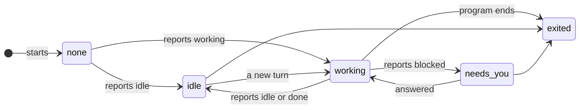
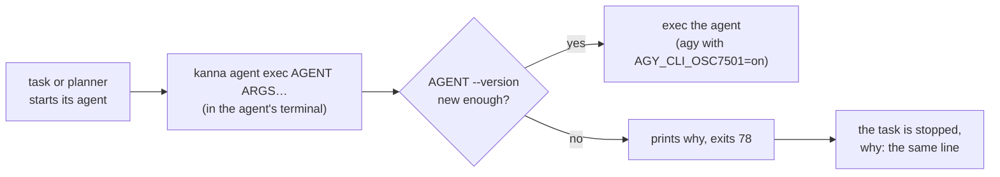
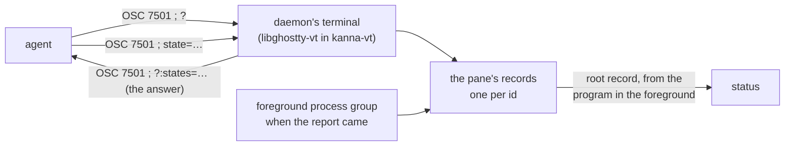

# Agent Status

**Status:** built (no dots yet: the Desk isn't built) · **Tested:** e2e `agent_status`, `real_agent_program_status`, `agent_too_old`; `cargo test -p kanna-vt`, `-p kanna-detect`, `-p kanna-daemon` · **Used by:** [Desk](desk.md) (the agent header, the strip and the [Desk view](desk-view.md)), [Shelf runners](shelf-runners.md), [agent messaging](agent-messaging.md), [runs](software-factory.md) · **Mockup:** the Desk's ([`references/mockups/desk.html`](../../references/mockups/desk.html)), the dots beside each task · **Evidence:** [agent status signals](../research/agent-status-signals.md)

**Agent status** tells you at a glance whether an agent is busy, waiting for you, or done, so you can leave it running and come back when it needs you. Kanna takes it from the agent's own report, the [Program Status Protocol](#3-the-report-osc-7501) (OSC 7501), and from nothing else: Kanna's agents are the ones that send it, and Kanna runs only a version that does as a task's or planning agent.

## Contents

1. [States](#1-states)
2. [Kanna's agents](#2-kannas-agents)
3. [The report (OSC 7501)](#3-the-report-osc-7501)
4. [CLI](#4-cli)
5. [How it's built](#5-how-its-built)
6. [Glossary](#6-glossary)

## 1. States

| Status | When |
|---|---|
| working | the agent's report says `working` |
| needs you | it says `blocked`, of any kind (an approval, a question, a sign-in) |
| idle | it says `idle`, `done` or `error` |
| exited | the program has ended (the pane is `exited`) |
| none | no report yet, or not an agent: a plain terminal, whatever runs in it |

- **The report is the only source:** Kanna doesn't read the screen, the title, progress reports, the bell or the agents' notifications (OSC 9, OSC 777) for status.
- **Shown at once:** a report shows as it arrives, with no settling and no hold.
- **Shown in Kanna only:** status is the dots in Kanna's windows; it doesn't badge the Dock icon or post macOS notifications.
- **Unread is separate:** an agent that goes from working to idle while its pane isn't on screen in the window Kanna has in front ([physical layout §3](physical-layout.md#3-the-window-in-front-in-the-app)) (in its active tab, zoomed pane or dock), with Kanna active, is **unread** until it is; leaving idle clears it. Unread is the app's mark of what you've seen, not an agent status: the status stays idle, and the dot shows both.
- **Names on the wire:** `working`, `needs-you`, `idle`, `exited`; none is no `status` field.

## 2. Kanna's agents

| Agent | Reports since | How it starts reporting |
|---|---|---|
| claude (Claude Code) | 2.1.295 | once its terminal answers the probe `OSC 7501 ; ?` |
| codex | 0.163.0 | whenever its output is a terminal, without asking |
| opencode | 2.2.5 | once its terminal answers the probe (OpenTUI's `setProgramStatus`) |
| agy (Antigravity) | 1.4.2 | once its terminal answers the probe; `AGY_CLI_OSC7501=on` or `off` overrides it, and Kanna starts it with `on` |
| mock-agent | any | `tools/mock-agent`, for tests, under any of the names above |

- **Agents are Kanna's code:** which programs are agents, and the version each needs, is built into Kanna (`kanna-detect`), matched against the foreground process group's executable with symlinks resolved (its file name, or `<agent>/versions/<n>` as Claude Code installs), else its name or a script an interpreter runs (`node …/codex.js`).
- **Too old is refused:** a task or planning agent is started through Kanna's [gate](#the-gate), which asks the agent its version and refuses one older than the table's: `claude 2.1.290 is too old for Kanna: it needs 2.1.295 or newer, which reports its status (OSC 7501). Update it (claude update), or run it in a plain terminal.` The task stays stopped, with that as its why.
- **Only agents are tasks:** `tasks.agent`, `--agent`, a planner's agent and a run's stage name one of the agents above, with any arguments (`claude --model opus`); any other command is refused the same way (`aider isn't one of Kanna's agents (claude, codex, opencode, agy)`).
- **A plain terminal runs anything,** any version of an agent included, with no status unless what runs there reports.
- **Opencode was checked by hand** (2.2.5, November 2026): run against the [mock model](../../tools/agent-harness/README.md) in a terminal that answers the probe as Kanna's does, it reported `idle` at its prompt, `working` through each turn, `blocked:kind=permission` at a bash approval and `idle` after it.
- **Copilot is no longer an agent:** 1.0.98 doesn't send OSC 7501. It runs in a plain terminal like anything else.

### The gate

- **In the agent's terminal,** so it finds the same executable on the same `PATH` the agent would run from, and asks that exact file `--version` (2s at most; no answer is refused as `couldn't tell claude's version`).
- **Execs the agent,** so the agent is the terminal's foreground program as before, and its exit is the pane's.
- **Exit 78** (`EX_CONFIG`) tells the daemon the gate refused: it stops the task with the printed line as its why, and a Shelf runner doesn't start it again until you start it yourself.

## 3. The report (OSC 7501)

The [Program Status Protocol](https://www.superlogical.com/rex/docs/build/program-status) (draft rev 0.4) lets a program tell its terminal what it's doing: `ESC ] 7501 ; state=working|blocked|idle|done|error[:kind=…][:progress=N][:id=…][:app=…][:title=b64][:msg=b64] ST`. Kanna takes reports whether or not the program asked.

- **The root record decides:** the pane's record with no `id`; records with an `id` (opencode's session, a `build/test` child) are kept but don't change the status.
- **Only the daemon's terminal answers the probe,** so the agent gets one answer; the app's Ghostty parses the reports and ignores them.
- **Records** are kept per pane, one per id, each report replacing its record whole (`state=clear` removes a record and those beneath it; one without an `app` takes its nearest ancestor's). At most 256; the one updated longest ago goes.
- **When records go:** working and blocked ones when a new prompt starts (OSC 133 A) or the program ends (another process group takes the terminal's foreground, or the pane exits); all of them at a full reset (RIS). A record counts only while the process group that reported it is in the foreground, so a `done` left by one program never speaks for the next.
- **A turn's end:** the root record going from working to idle or done (or blocked) ends a [Shelf task's turn](shelf-runners.md#2-how-its-built), [delivers a message](agent-messaging.md#2-delivery) and ends a [run's stage turn](software-factory.md#61-sequential-runs-as-built), at once. The terminal counts these turns as the reports arrive (`program_turns` in `kanna-vt`), so the watcher, which looks at the latest record now and then, still sees a turn that began and ended between two looks.
- **Untrusted text:** `msg`, `title` and `app` are shown only by `kanna status explain`, with control and invisible formatting characters taken out, and never sent back to the program.

## 4. CLI

| Command | Does |
|---|---|
| `kanna workspace list --all --json` | Adds `status` to each agent pane |
| `kanna status explain PANE` | The agent, its version, the version it needs, and the pane's records, the root one first; `no report yet` when there are none |
| `kanna agent exec AGENT [ARGS…]` | [The gate](#the-gate): checks AGENT's version and execs it; what Kanna runs a task's or planner's agent with |

## 5. How it's built

- **In the daemon**, which already keeps every terminal's screen ([app link](app-link.md#3-rules)), so status works with the app closed and `list` reads it directly. `crates/kanna-vt` parses the reports and keeps the records; `crates/kanna-detect` knows the agents, their minimum versions, the foreground program, the [quit files](shelf-runners.md#2-how-its-built) and a turn's end; `crates/kanna-daemon/src/status.rs` turns the root record into each pane's status.
- **The app** gets a `status {pane, status}` notice on every change, and one per pane after `app.hello`, and keeps status and unread in its state (`debug.status`).
- **Tested:** `cargo test -p kanna-vt` (the probe, records, turns), `-p kanna-detect` (the agents, versions, the gate's verdicts), `crates/kanna-daemon/tests/status.rs`; e2e `agent_status` (the mock agent's reports to dots), `real_agent_program_status` (real claude and codex against the mock model), `agent_too_old` (a mock agent claiming an old version is refused as a task and as the planner, its why shown, and runs in a plain terminal).

## 6. Glossary

| Term | Meaning |
|---|---|
| **OSC 7501** | The Program Status Protocol: a program's own report of what it's doing, kept as one record per id |
| **Root record** | The record a report with no `id` makes: the program itself |
| **Probe** | `OSC 7501 ; ?`, a program asking whether its terminal takes reports; Kanna's answers with the states and kinds it knows |
| **Gate** | `kanna agent exec`: what checks an agent is new enough to report before Kanna runs it as a task's or planner's agent |
| **Unread** | An idle agent you haven't looked at since it finished; kept by the app, apart from the status |
