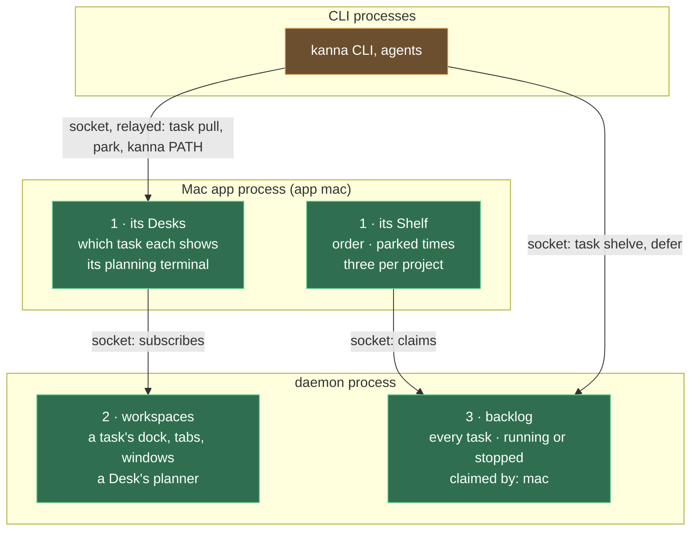

# Each app's Desk and Shelf

**Status:** built · **Changes:** [presentation layers](presentation-layers.md), [Desk](desk.md), [tasks](tasks.md), [planning terminal](planning-agent.md), [database](database.md), [workspaces](workspaces.md) · **Builds on:** [presentation layers](presentation-layers.md)

Each app has its own **Desk** and its own **Shelf**. The **backlog** is the daemon's, every app's: today one Mac app's, later shared. A task an app moves to its Shelf is that app's **claim**: the daemon records which app has the task out, and the app decides where it shows it.

## Contents

1. [Who keeps what](#1-who-keeps-what)
2. [Rules](#2-rules)
3. [Commands](#3-commands)
4. [How it's built](#4-how-its-built)
5. [Rejected](#5-rejected)

## 1. Who keeps what

| What | Kept by | Saved in |
|---|---|---|
| Every task, running or stopped, and which app has it out (its claim) | daemon | `kanna.db`, the task's row |
| A task's workspace: its agent docked, its tabs, its windows, focus, zoom | daemon | `kanna.db`, the layout |
| A Desk's planner: its planning terminal, with its project | daemon, as a workspace with no task | `kanna.db`, the layout |
| Which tasks are on this app's Shelf, in what order, parked when | the app, from its claims | `app-state.json` |
| This app's Desk windows: each one's project, the task it shows, its planner | the app | `app-state.json` |
| Which window is in front, and the front-to-back order ([physical layout](physical-layout.md)) | the app | `app-state.json` |

## 2. Rules

- **A task is out when an app claims it.** Move to Shelf claims it for that app (`kanna task shelve`, for the CLI's instance's app); Move to Backlog drops the claim. An app's Shelf is the tasks it claims; every other running or stopped task is in the backlog.
- **An app's Shelf holds three per project,** its Desk's task included. Another app has its own three. A claim past three is refused.
- **Backlog runners leave a claimed task alone:** they start and stop only tasks no app has out.
- **Pulling and parking are the app's.** Pulling a task onto a Desk, parking it, and which Desk shows what never reach the daemon, so two apps can show the same task on their Desks, each its own way. The CLI's `task pull`, `task park` and `kanna PATH` are relayed to the CLI's instance's app, which the CLI starts if none is running.
- **A task's windows show in an app while its task is on one of that app's Desks,** and are hidden there otherwise; free windows show in every app.
- **A Desk's planner is a workspace with no task,** its planning terminal docked, made when the app asks for a planning terminal (`backlog plan`) and closed when the app closes that Desk. Its ID is the Desk's, kept by the app.
- **`open --dock` makes a task claimed by the CLI's instance's app,** at the front of its Shelf; `kanna task pull` shows it.
- **Pull, park and `kanna PATH` reply with the Desk's ID** (`d1`, `d2`, …, the app's own), as in `pulled term-3 onto d1`.
- **The task list says Shelf or Backlog,** and which app has it out; never a Desk.
- **History records claims, not pulls:** shelved and deferred stay in a task's events, and pulled and parked go.

## 3. Commands

| Command | Does |
|---|---|
| `backlog shelve {task, app?}` | Claim a task for an app (default: the instance's Mac app, `mac`), starting it if it's stopped |
| `backlog defer {task}` | Drop its claim: it's in the backlog again, running or stopped |
| `task pull {task}`, `task park {task?}`, `task desk {project, new?}` | Relayed to the attached app as `desk {action, …}`, the daemon first turning a task's ID, workspace or any of its panes into its agent's pane; `no_app` without one (the CLI starts it) |
| `open {dock, claim?}`, `open {dock, backlog: true}` | A task's agent in a new workspace, claimed by an app (default `mac`) or in the backlog; a docked pane never goes in a window |
| `open {planner: true, claim?}` | A Desk's planner: a terminal in a workspace with no task |
| `open {workspace: ws-N}` | Into that workspace's tabs (a planner's: a new window); how the app opens into a Desk |
| layout `task {action: list, app?}`, `find`, `hold`, `claim {task, app}` | An app's claims; a task's agent and workspace; to the backlog; onto an app's Shelf |
| `layout` notice | Every workspace (`workspaces`: id, task, claim, dock, tabs with their trees, focused, zoomed, windows), the free and task windows (`windows`), and the backlog's claims |

## 4. How it's built

- **The daemon's model has no Desk.** A workspace is a task's or a planner's; it isn't placed in a window. A window is free or a task's.
- **The app composes a Desk window** from its own Desk record and the workspace it shows: the docked agent on the left, the workspace's tabs on the right, the Shelf strip from its claims; with no task, the planner's terminal beside the full Shelf.
- **The app's identity** is `mac`, sent when it attaches; another kind of app sends its own.
- **Upgrading:** tasks on a Desk or the Shelf become claimed by `mac`; each Desk window becomes one of the app's Desks, showing the task it showed, its lead becoming its planner.

## 5. Rejected

- **A shared Shelf** (the earlier design): one app's Move to Shelf would fill another's, and the limit would be everyone's.
- **The Shelf kept only by the app:** the backlog couldn't tell a task someone is working on from an idle one, so runners would stop it, and a shared backlog later couldn't say who has it.
- **Pulls in the daemon:** which Desk shows which task is how one app presents its work.
