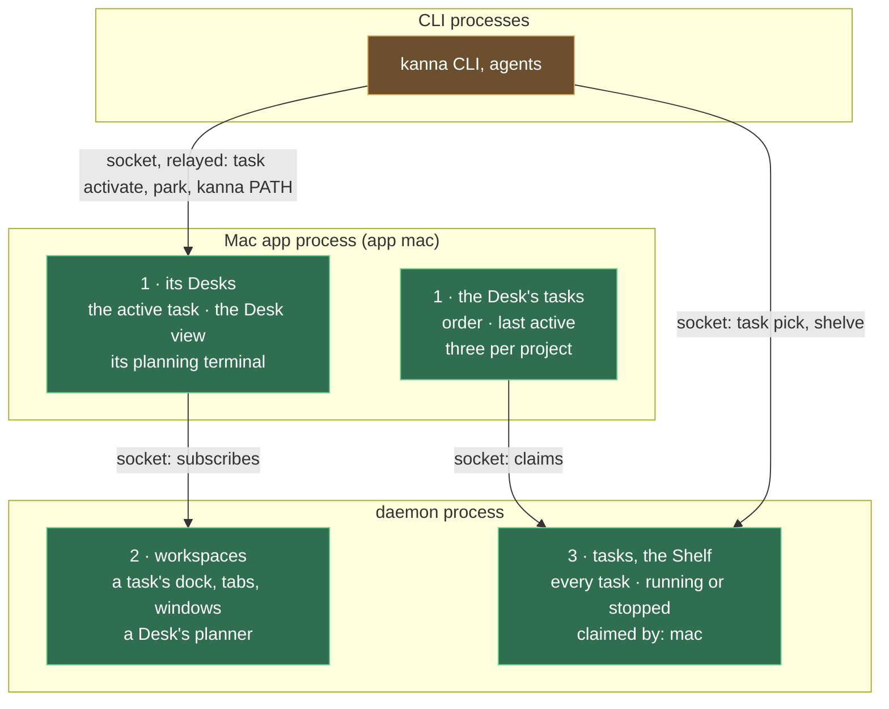

# Each app's Desks

**Status:** built · **Changes:** [presentation layers](presentation-layers.md), [Desk](desk.md), [tasks](tasks.md), [planning terminal](planning-agent.md), [database](database.md), [workspaces](workspaces.md) · **Builds on:** [presentation layers](presentation-layers.md)

Each app has its own **Desks**, and the tasks on them. The **Shelf** is the daemon's, every app's: today one Mac app's, later shared. A task an app moves to its Desk is that app's **claim**: the daemon records which app has the task out, and the app decides where it shows it, and which task is active.

The daemon and the protocol keep the names from before the [Desk view rename](desk-view.md#5-internal-names): `backlog` (the `backlog` command, `Place::Backlog`, `Where::Backlog`, `place = 'backlog'`) is the Shelf, and `shelf` (`Place::Shelf`, `Where::Shelf(app)`, `place = 'shelf'`, the claim, Swift `ShelfTask`, `ShelfStrip`, `ShelfPage`) is on a Desk; `parkedAt` is when a task was last active, and the `desk` command's `park` and `pull` show the Desk view and make a task active.

## Contents

1. [Who keeps what](#1-who-keeps-what)
2. [Rules](#2-rules)
3. [Commands](#3-commands)
4. [How it's built](#4-how-its-built)
5. [Rejected](#5-rejected)

## 1. Who keeps what

| What | Kept by | Saved in |
|---|---|---|
| Every task, running or stopped, and which app has it out (its claim) | daemon | `kanna.db`, the task's row |
| A task's workspace: its agent docked, its tabs, its windows, focus, zoom | daemon | `kanna.db`, the layout |
| A Desk's planner: its planning terminal, with its project | daemon, as a workspace with no task | `kanna.db`, the layout |
| Which tasks are on this app's Desk, in what order, last active when | the app, from its claims | `app-state.json` |
| This app's Desk windows: each one's project, its active task, whether it shows the Desk view, its planner | the app | `app-state.json` |
| Which window is in front, and the front-to-back order ([physical layout](physical-layout.md)) | the app | `app-state.json` |

## 2. Rules

- **A task is out when an app claims it.** Move to Desk claims it for that app (`kanna task pick`, for the CLI's instance's app); Move to Shelf (`kanna task shelve`) drops the claim. An app's Desk tasks are the tasks it claims; every other running or stopped task is on the Shelf.
- **An app's Desk holds three per project,** the active task included. Another app has its own three. A claim past three is refused.
- **[Shelf runners](shelf-runners.md) leave a claimed task alone:** they start and stop only tasks no app has out.
- **The active task and the Desk view are the app's.** Making a task active, showing the Desk view, and which Desk shows what never reach the daemon, so two apps can show the same task on their Desks, each its own way. The CLI's `task activate`, `task park` and `kanna PATH` are relayed to the CLI's instance's app, which the CLI starts if none is running.
- **A task's windows show in an app while its task is on one of that app's Desks,** and are hidden there otherwise; free windows show in every app.
- **A Desk's planner is a workspace with no task,** its planning terminal docked, made when the app asks for a planning terminal (`backlog plan`) and closed when the app closes that Desk. Its ID is the Desk's, kept by the app.
- **A task reaches a Desk only from the Shelf,** with `kanna task pick` (claimed for the CLI's instance's app) or Move to Desk; `open` docks nothing ([every task starts on the Shelf](tasks-start-on-the-shelf.md)). `kanna task activate` shows it.
- **`activate`, `park` and `kanna PATH` reply with the Desk's ID** (`d1`, `d2`, …, the app's own), as in `term-3 is active on d1`.
- **The task list says Desk or Shelf,** and which app has it out; never which Desk window.
- **History records claims, not which task is active:** a task's events keep `shelved` (moved to the Desk) and `deferred` (moved to the Shelf), and drop `pulled` and `parked`.

## 3. Commands

| Command | Does |
|---|---|
| `backlog shelve {task, app?}` | Claim a task for an app (default: the instance's Mac app, `mac`), starting it if it's stopped: `kanna task pick` |
| `backlog defer {task}` | Drop its claim: it's on the Shelf again, running or stopped: `kanna task shelve` |
| `task pull {task}` (`activate`), `task park {task?}`, `task desk {project, new?}` | Relayed to the attached app as `desk {action, …}`, the daemon first turning a task's ID, workspace or any of its panes into its agent's pane; `no_app` without one (the CLI starts it) |
| `open {dock, claim?}`, `open {dock, backlog: true}` | A task's agent in a new workspace, claimed by an app (default `mac`) or on the Shelf; a docked pane never goes in a window |
| `open {planner: true, claim?}` | A Desk's planner: a terminal in a workspace with no task |
| `open {workspace: ws-N}` | Into that workspace's tabs (a planner's: a new window); how the app opens into a Desk |
| layout `task {action: list, app?}`, `find`, `hold`, `claim {task, app}` | An app's claims; a task's agent and workspace; to the Shelf; onto an app's Desk |
| `layout` notice | Every workspace (`workspaces`: id, task, claim, dock, tabs with their trees, focused, zoomed, windows), the free and task windows (`windows`), and the tasks' claims |

## 4. How it's built

- **The daemon's model has no Desk.** A workspace is a task's or a planner's; it isn't placed in a window. A window is free or a task's.
- **The app composes a Desk window** from its own Desk record and the workspace it shows: the docked agent on the left, the workspace's tabs on the right, the strip from its claims; in the Desk view, the planner's terminal beside the Desk's tasks and the Shelf ([Desk view](desk-view.md)).
- **The app's identity** is `mac`, sent when it attaches; another kind of app sends its own.
- **Upgrading** (from before each app had its own): tasks on a Desk or the old Shelf became claimed by `mac`; each Desk window becomes one of the app's Desks, showing the task it showed, its lead becoming its planner.

## 5. Rejected

- **A shared Desk** (the earlier design): one app's Move to Desk would fill another's, and the limit would be everyone's.
- **The Desk's tasks kept only by the app:** the daemon couldn't tell a task someone is working on from an idle one, so runners would stop it, and a shared Shelf later couldn't say who has it.
- **The active task in the daemon:** which Desk shows which task is how one app presents its work.
