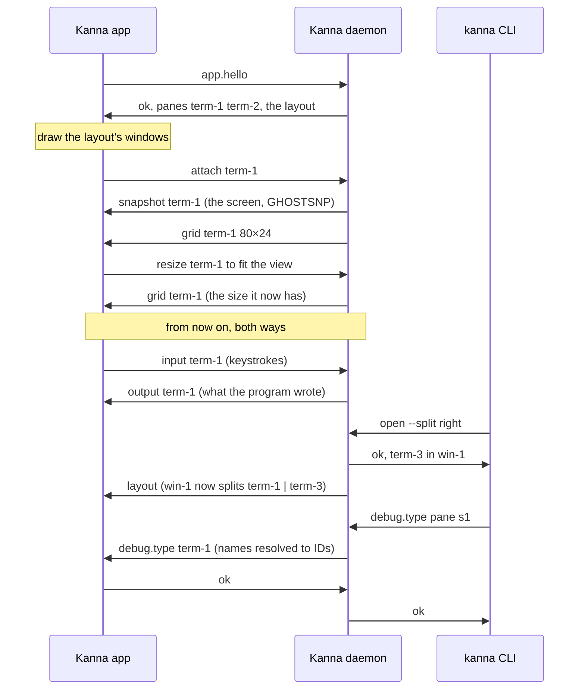

# The App Link

**Status:** built · **Builds on:** [architecture](architecture.md) · **Related:** [the daemon follows the app's build](daemon-build.md), [layout](layout.md), [app panes](app-panes.md)

The app is a client of the daemon, like the CLI, but it stays connected: it shows the daemon's terminals, types into them, draws the layout the daemon publishes, and answers the requests only the app can (its web, markdown and iOS panes, `debug.*`). The **app link** is that one connection, on the daemon's own socket (`$KANNA_SOCKET`). A link to a daemon on another machine carries the same lines over iroh, checked by a protocol range instead of build ([your machines](machines.md#5-the-app-link-over-the-network)).

## Contents

1. [The wire](#1-the-wire)
2. [Messages](#2-messages)
3. [Rules](#3-rules)
4. [The app starts the daemon](#4-the-app-starts-the-daemon)
5. [Glossary](#5-glossary)

## 1. The wire

**The control protocol's wire.** One JSON object per line, both ways. A message with `cmd` is a request, `{"id", "cmd", "args"}`; with an `id` it wants a reply, `{"id", "ok": true, …}` or `{"id", "ok": false, "error": {"code", "message"}}`, and without one it's a notice that gets none. Each side numbers its own requests, and a reply goes to the side that asked. Terminal bytes are base64 in a `data` field.

**Saying it's the app.** The app's first line is `{"id": 0, "cmd": "app.hello", "args": {"pid", "build"}}`. The daemon answers `{"id": 0, "ok": true, "daemon": {"pid", "build"}, "panes": [{"id", "name", "type"}, …], "layout": {…}}`, listing every pane and the layout as it is, and the connection is the app link from then on. One app at a time: a second gets `app_attached` and is closed. If the daemon goes away, the app keeps trying to connect, and on reconnecting says hello and attaches its terminals again.

**The daemon follows the app's build.** `build` is the SHA-256 of the daemon binary. With no app attached, a hello of another build gets `other_build` and the daemon stops as on SIGTERM; the app then starts its own, which adopts every terminal. A hello without `build` is accepted. Detail: [daemon build](daemon-build.md).

## 2. Messages

| Message | From | What it says |
|---|---|---|
| `app.hello {pid, build, protocols, commit, client}` | app | I'm the app, of this build; the reply accepts or refuses it (`app_attached`, `other_build`, `other_protocol`) and has the protocol, the daemon's machine and capabilities, its panes and layout; over the network `build` is left out ([links §2](machine-links.md#2-the-hello)) |
| `layout {windows, …}` | daemon | the layout changed; this is the whole view to draw ([layout](layout.md)) |
| `attach {terminal}` / `detach {terminal}` | app | I show (or no longer show) this terminal, by its terminal ID (`term-41`, [presentation layers](presentation-layers.md#3-ids)) |
| `snapshot {terminal, data}` | daemon | the terminal's whole screen as a GHOSTSNP snapshot; sent on attach, before anything else for that terminal |
| `grid {terminal, cols, rows}` | daemon | the terminal's size, after a snapshot or a resize |
| `output {terminal, data}` | daemon | bytes the program wrote since the snapshot |
| `exited {terminal, code}` | daemon | the program ended |
| `status {pane, status}` | daemon | an agent pane's status changed (`working`, `needs-you`, `idle`), a terminal ended (`exited`), or `null` when it's no longer an agent; for every terminal, shown or not, and once per pane after `app.hello` ([agent status](agent-status.md)) |
| `input {terminal, data}` | app | bytes the view wrote: keys, paste, mouse and focus reports |
| `resize {terminal, cols, rows, width, height}` | app | the view now fits this many cells (and pixels) |
| `settings {foreground, background, cursor, palette, scheme, cursorStyle, cursorBlink, graphemes}` | app | the terminal settings from the app's Ghostty config, sent before any attach and again when the config or appearance changes ([terminal](terminal.md#2-the-config)) |
| `debug.*` (with an `id`) | daemon | a request from a client, passed on; the app's reply is the client's |
| `start`, `stop`, `pane`; `update`; the app's own requests | both | web, markdown and iOS panes ([app panes](app-panes.md)); `pane` also tells the app a terminal pane's new `terminal` when it starts again, and the app makes a new view for it |
| `diff.subscribe {view, path, args}` (with an `id`), `diff.show {view, show}`, `diff.unsubscribe {view}` | app | this view shows the diff of that folder and git arguments; the reply has its content ID and latest diff ([diff viewer](diff-viewer.md#5-how-its-built)) |
| `file.subscribe {view, path, kind}` (with an `id`), `file.unsubscribe {view}` | app | this view shows that file as `md` or `code`; the reply has its content ID and latest read ([file panes](file-panes.md#2-messages)) |
| `diff {content, serial, diff, updating}` | daemon | a subscribed diff changed |
| `quit` | daemon | the daemon is shutting down on purpose: quit, and don't start a daemon ([stopping an instance](instance-stop.md)) |
| `toast {id, title, detail, pane, task, about}` | daemon | show a toast; also each one held while no app was attached, after `app.hello` ([toasts](toasts.md)) |
| `file {content, path, serial, text\|error}` | daemon | a subscribed file was read and differs ([file panes](file-panes.md#2-messages)) |

## 3. Rules

- **Messages from the daemon are handled in order** on the app's main thread; `debug.*` may answer later.
- **The daemon decides a terminal's size.** The view asks with `resize`, only for the size it has (a request Ghostty makes for another, such as its 800×600 before the view sizes it, is dropped); the daemon sets the pty's size, and the view takes the size `grid` gives it, in order with the output ([pane sizes](pane-sizes.md)). A resize beyond 1000 cells a side is refused.
- **Requests for the app** (every `debug.*` the core doesn't answer itself, which is all but `debug.saveState` and `debug.restoreState`) can come from any client. The daemon turns a top-level pane name into its ID, passes the request on and returns the app's reply, so a debug command the app adds needs no change in the daemon. With no app attached they fail with `no_app`; if the app goes away first, `app_gone`; with no answer within 10 s, `timeout`. The app answers one it doesn't know with kmux's `unknown command`. The app's debug commands: [windows](windows.md#5-debug-commands), [terminal](terminal.md#5-debug-mode).
- **`screenshot` is passed on the same way**, but isn't a debug command, so the app always answers it ([screenshot](screenshot.md)).
- **Debug commands are off by default.** The app answers `debug.*` only when started with `KANNA_DEBUG=1` (the test scripts set it). `debug.snapshot` takes a plain file name and writes a new file in `$KANNA_STATE_DIR` (or `$TMPDIR`); it never overwrites one.
- **Limits:** a line over 16 MiB drops the app; a terminal whose outbox passes 1 MiB before the main loop sends it (a burst faster than the daemon encodes it) gets a new snapshot in place of that output, then live output again, so the app may see a terminal's last output in a snapshot just before `exited`; an app that falls 16 MiB behind on output stops getting it and starts its terminals over (snapshot, grid) once it has caught up, and one 64 MiB behind is dropped.
- **The layout is the daemon's:** it applies every command, from the app as from the CLI, and sends the app the new view ([layout](layout.md)).
- **Screens:** the daemon keeps each terminal's screen with libghostty-vt (`crates/kanna-vt`), fed from the pty, with up to 10 MB of scrollback. `read` answers from it, so it works with the app closed.
- **Queries are answered once, by the daemon.** Cursor position, device status and attributes, modes, size reports and XTVERSION are answered by the daemon's screen, written back to the pty as they're parsed, whether or not the app is attached. The app's surfaces parse the same output but drop their replies, so the program never gets two. Colour queries and scheme reports are answered from the app's `settings` ([terminal](terminal.md)).
- **Attaching:** the daemon takes the snapshot on its main loop under the lock the pty reader feeds the screen and the outbox with, and empties the outbox as it does: what the snapshot has isn't sent again, and every later byte follows as `output`. The app loads the snapshot (`ghostty_surface_load_snapshot`), then applies the `grid` that follows; both go through the same queue as output, in order. A terminal started again (`restart`, a task started again) is a new terminal with a new ID: the daemon tells the app with `pane`, and the app stops the old surface and attaches a new one to the new ID ([terminal](terminal.md#4-the-apps-terminal-views)).
- **When a snapshot fails:** inside some unfinished sequences (an APC holding a C1 byte) libghostty-vt can't encode one. The daemon then sends nothing for that pane and tries again after the terminal's next output, or when it exits. If the app's surface refuses a snapshot (a full mailbox), it retries every 2 ms; after 250 refusals it goes on with the live output.

## 4. The app starts the daemon

Kanna.app carries the daemon, the keeper and the `kanna` CLI in `Contents/Helpers`, and nothing else has to be run first.

- **When:** at launch, as soon as nothing answers on the daemon socket; after losing a daemon it was attached to, once nothing has answered for 2 s (so a daemon being restarted on purpose gets there first). At most one start every 10 s. The daemon's lock makes a race harmless: a second daemon on the folder exits ([restarting](daemon-restart.md#1-files-on-disk)).
- **How:** in its own session (`setsid`), so it outlives the app; signals back to their defaults; no descriptors of the app's; stdin from `/dev/null`, stdout and stderr appended to `daemon.log` in the state folder. It gets the app's environment without `KANNA_*` and `KMUX_*` (only `KANNA_STATE_DIR` and `KANNA_DEBUG` pass), plus `KANNA_SOCKET` and `KANNA_KEEPER` (the bundled keeper). The daemon then starts the keeper.
- **Not after `quit`:** a daemon that is shutting down on purpose says `quit` first, and the app then quits without starting one ([stopping an instance](instance-stop.md)).
- **Quitting the app** leaves the daemon and its terminals running; the next launch attaches to it if it's the same build, and replaces it if not.
- **Why the app and not launchd:** the daemon is needed only when the app or the CLI is, and the app knows the socket and state folder it uses. A launch agent would add install steps and a second definition of both. On Linux, which has no app, systemd starts it ([Linux setup](machine-setup.md#2-the-daemon-unit)), and on a Mac that serves your other machines launchd ([machines §5](machines.md#5-the-app-link-over-the-network)).
- **The first terminal.** When the first attach after launch leaves the layout empty, the app opens a terminal, as kmux opens a window. Reopening the app from the Dock with nothing open does the same. `KANNA_NO_INITIAL_WINDOW=1` turns it off (the e2e scenarios set it).

## 5. Glossary

| Term | Meaning |
|---|---|
| **App link** | The app's one connection to the daemon, on the daemon's socket. |
| **Snapshot** | A terminal's whole screen (grid, scrollback, modes, colours, an unfinished sequence) as bytes (GHOSTSNP), sent on attach and saved on disk. |
| **Surface** | One terminal view's Ghostty terminal in the app (GhosttyKit): it draws the screen and handles keys, mouse, selection and clipboard. |
| **Outbox** | The daemon's queue of output not yet sent to the app. |
