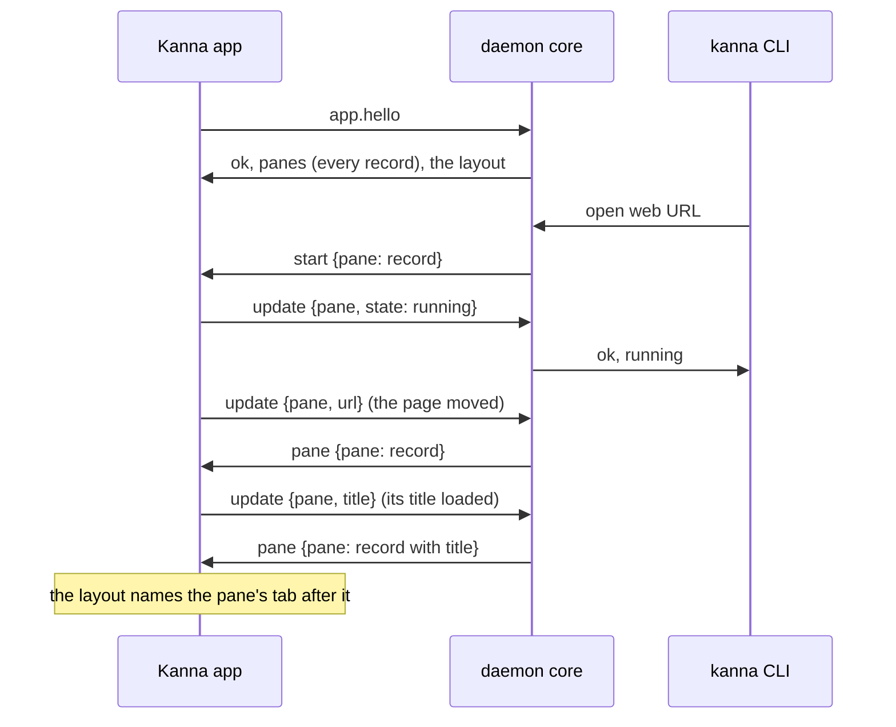

# Web, Markdown and iOS Panes

**Status:** built ([plan](../plans/mux-build.md) M3) · **Builds on:** [the app link](app-link.md), [layout](layout.md) · **Related:** [code viewer](code-viewer.md), [doc markup](doc-markup.md)

A web, markdown or iOS pane is a record in the daemon's layout and a view in each app: a web pane's URL (and whether it keeps history), a markdown pane's file and zoom, whether either is open for comments (`kanna markup`), the agent pane that opened a doc for comments ([doc markup](doc-markup.md)), an iOS pane's app and device, saved in `layout.json`. The daemon's `kanna-mux` core gives them their IDs, checks and answers every command about them as kmux does (`open`, `navigate` with its history, `close`, `restart`, `list`), and tells the app to show them. A markdown file's front matter (the `---` block at its top) shows as a YAML code block on the same lines.

## 1. The daemon keeps the records; the app shows them

The records are content of the task's workspace ([presentation layers](presentation-layers.md)): they live in the daemon with the layout, whether or not an app is attached. Every change to a record goes through the daemon's core and comes back to the app, so there is one writer.

## 2. Messages

| Message (app link) | From | What it says |
|---|---|---|
| `app.hello {pid}` | app | the reply lists every pane, terminals and records; the app shows each record it doesn't show yet, and reports the state of each it does |
| pane tables (`panes` in the hello reply) | daemon | records: `{id, name, type}` plus the state file's fields (`url`, `history`; `path`, `zoom`, `agent`; `app`, `device`; `cmd`, `cwd` for terminals) |
| `start {pane: record}` | daemon | show this pane (`open`, `restart`, `navigate`, `debug.restoreState`), replacing any view it had |
| `stop {pane}` | daemon | the pane closed, or is about to start again |
| `update {pane, state?, error?, url?, title?, device?, zoom?}` | app | the view is `running` or `failed` (with `error`); the page moved (`url`, applied as kmux's page moves, history included); the page's title changed (`title`, `""` for none: it names the pane's tab, [tab names](tab-names.md)); the simulator chosen; the markdown zoom |
| `pane {pane: record}` | daemon | the record after an `update` |
| requests (`{id, cmd, args}`) | app | `navigate` from the views (the URL editor, a markdown link, back and forward), answered as any client's |
| `debug.web`, `debug.md`, `debug.ios` (with an `id`) | daemon | kmux's commands for these panes (the page's URL and text; the rendered markdown; a tap or Home on the simulator), passed on like `debug.text` |

## 3. Rules

- **Starting:** a web pane reports `running` as soon as its view loads the URL (a server that isn't up yet shows a notice and is retried, as kmux); a markdown pane once the file is read (`failed`: "No such file"); an iOS pane once the simulator is booted, the app launched and the screen attached (up to 180 s). `open` waits for that, as kmux.
- **With the app closed** `open web|md|ios`, `navigate`, `close` and `restart` work, and the pane is `running` at once: an app shows it when it attaches. `send`, `send-key` and `read` answer `wrong_type` for them; `debug.web|md|ios` fail with `no_app` (the CLI starts the app, [layout](layout.md#5-the-cli-starts-the-app)).
- **When the app goes away** the panes stay; one still starting counts as running, so an `open` waiting for it finishes.
- **After a relaunch** the app gets the records in the hello reply and shows them: pages load at their URL (cookies and logins stay in WebKit's store; back and forward lists aren't kept, as kmux), files reopen at their zoom, iOS panes find their device (still booted) and attach to its screen, launching the app only if it isn't running. After a daemon restart the views are untouched: the daemon restores the records from `layout.json` as running, and the app reports the state of each view it still shows.
- **kmux's commands are kmux's:** there is no `web.*` namespace; `debug.web`, `debug.md` and `debug.ios` are kmux's, and Kanna follows them.
- **The iOS screen** comes straight from the simulator (Xcode's private CoreSimulator and SimulatorKit frameworks, as kmux); `simctl` boots, installs and launches. Kanna never shuts a simulator down.

## 4. Checked by

All of kmux's protocol cases also pass through the daemon and the app link (the test app reports every pane running at once). `crates/kanna-daemon/tests/panes.rs` checks every pane type with no app, updates, the app's requests and an app that goes away; `web_md_ios_panes` of `scripts/e2e-kanna.sh` checks the real views: a page and a markdown file open, `navigate` with history, `list` and `navigate` with the app closed, both back after a relaunch and untouched by a daemon restart, and, when an iPhone simulator is already booted, an iOS pane running and reattached after a relaunch.
