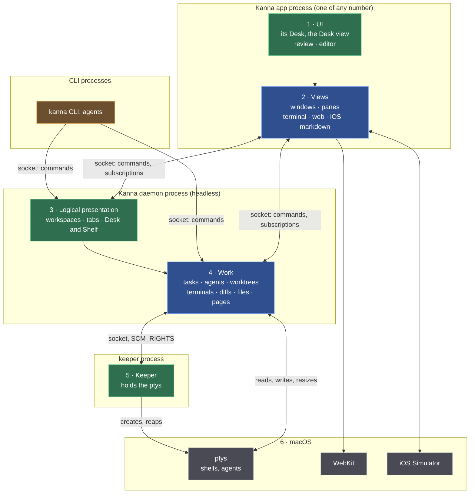
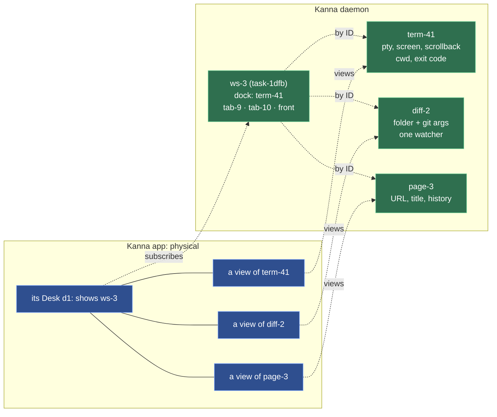
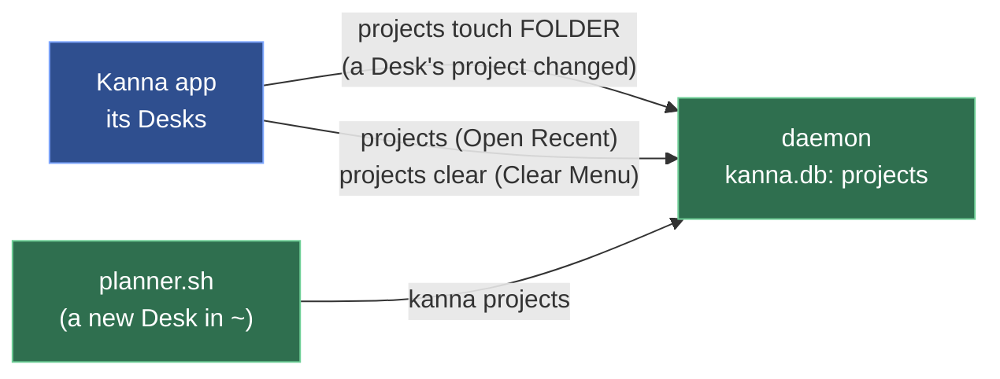
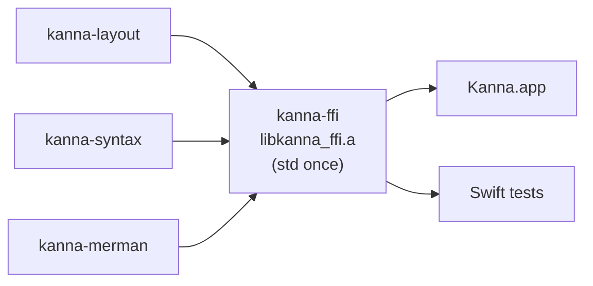

# Architecture: Layers and Processes

**Status:** built (milestones M0–M4: [the build plan](../plans/mux-build.md), [the architecture research](../research/mux-architecture.md)) · **Reference:** [kmux](kmux-reference.md)

Kanna is a background **daemon** and a **keeper**, with any number of apps (Kanna.app now) connected to view its tasks. The daemon runs headless: tasks, their content and their workspaces live there, so quitting or crashing an app loses nothing, and the keeper holds the terminals open, so even restarting the daemon loses nothing. It shows the same kinds of content as kmux (terminal, web, markdown, iOS) and answers the same commands ([presentation layers](presentation-layers.md)).

## Contents

1. [The stack](#1-the-stack)
2. [What the daemon keeps, what the apps keep](#2-what-the-daemon-keeps-what-the-apps-keep)
3. [Languages and platforms](#3-languages-and-platforms)
4. [Glossary](#4-glossary)

## 1. The stack

Read top to bottom, like the OSI model: each layer uses the ones below it. The outer boxes are processes. Green is Kanna's own, blue is Kanna's code that follows kmux, grey is macOS, orange is the CLIs.

| Layer | What's in it | Process |
|---|---|---|
| 1 · UI | the app's Desk, the Desk view, markdown review, code editor | each app |
| 2 · Views | windows and panes: views of the daemon's content, their sizes, focus and zoom; Swift, started from kmux's views | each app |
| 3 · Logical presentation | each task's workspace and tabs, what they show, whether it's on a Desk or the Shelf; Rust, kanna-mux's model | daemon |
| 4 · Work | tasks, agents, worktrees, and content: terminals (each screen kept by libghostty-vt), diffs, files, pages; the commands (kmux's protocol); Rust | daemon |
| 5 · Keeper | creates the ptys and holds a copy of each; Rust | keeper |
| 6 · macOS | ptys and shells, WebKit, iOS Simulator devices | — |

- **The CLI and the apps are clients, not layers:** each calls down into the daemon with the same commands ([app link](app-link.md), [CLI](cli.md)); an app also subscribes, so the daemon publishes every change to it. None serves another, and the daemon never asks an app for anything.
- **Daemons on other machines:** an app holds one link per machine, the CLI reaches one with `--host`, and daemons talk to each other over iroh ([your machines](machines.md)).
- **The keeper isn't in the path of any byte:** it hands each pty to the daemon, which reads and writes it.
- **How a terminal starts:** the daemon asks the keeper of its state folder (`keeper.sock`, started as `$KANNA_KEEPER` or the `kanna-keeper` beside the daemon if none runs) to spawn the program; the keeper answers with the pid and the pty's master (`SCM_RIGHTS`), and later with the exit code, which the daemon records and acknowledges. `close` and `restart` end the program through the keeper; the daemon sets the size itself (`TIOCSWINSZ`). If the keeper goes away the daemon logs it and stops ([keeper](../keeper.md)). Stopping or crashing the daemon ends no terminal: the next daemon takes them back ([restarting the daemon](daemon-restart.md)).
- **A terminal's environment is the session's**, not whoever started the keeper. The keeper keeps only session-wide variables from its own environment (`HOME`, `USER`, `LOGNAME`, `SHELL`, `TMPDIR`, `LANG`, `LC_*`, `__CF_USER_TEXT_ENCODING`, `SSH_AUTH_SOCK`, and on Linux `DISPLAY`, `WAYLAND_DISPLAY`, `XDG_RUNTIME_DIR`, `XDG_SESSION_TYPE`, `DBUS_SESSION_BUS_ADDRESS`), sets `PATH` to the login default (`/usr/bin:/bin:/usr/sbin:/sbin`), and adds Ghostty's variables (`TERM=xterm-ghostty`, `TERMINFO`, `COLORTERM`, shell integration) and the daemon's (`KANNA_SOCKET`, `KANNA_TERMINAL`, `KANNA_INSTANCE`). The shell is a login and interactive one, so the user's profile and rc files build the rest, as when Ghostty or kmux is opened from the Dock. Why: the first daemon may have been started from a terminal, whose variables would otherwise leak into every pane for as long as the keeper lives (`EDITOR=nvim` alone puts zsh in vi mode, where Ctrl-A and Ctrl-K insert themselves).
- **The shell and commands:** the shell is `$SHELL`, else the account's login shell, else `/bin/sh` (Ghostty's order). A command (`open --cmd`, a task's agent) runs in an interactive login shell: [the shell a command runs in](command-shell.md).
- **An app draws terminals from the daemon** through a forked Ghostty whose surfaces take their output from outside instead of a pty ("external I/O"; [terminal behaviour](terminal.md)).

## 2. What the daemon keeps, what the apps keep

**Work and logical presentation live in the daemon; physical presentation lives in each app** ([presentation layers](presentation-layers.md)). A task, its content and its workspace work with no app; an app keeps only how it shows them.

| | What it is | Kept by | After an app restarts |
|---|---|---|---|
| **Work** | tasks; content: terminals (pty, screen, scrollback, cwd, exit code), diffs, files, pages, iOS devices | the daemon | exactly as it was, still running |
| **Logical presentation** | workspaces, their logical windows, tabs and arrangement, what each tab shows, the shown tab, focus and zoom, which app's Desk each task is on, or whether it's on the Shelf | the daemon | as it was, changed meanwhile by tasks and the CLI |
| **Physical presentation** | window frames, the app's Desks (d1, d2, …) and their tasks, sizes, magnification, font, the dock's width | each app | reopened from the app's own file |
| **History** | the recent projects, newest first (File → Open Recent, a new Desk's where prompt) | the daemon, in `kanna.db` | as it was, shared by every app |

**Recent projects are the daemon's, though only an app knows a Desk's project** ([recent projects](recent-projects.md)). A Desk is physical, so the app that has it says when a Desk opens on a project or moves to one (`projects touch FOLDER`); the daemon keeps the list in `kanna.db`, makes each folder its project (the main repo for a worktree, as `project()` does), and answers anyone who asks (`projects`): each app's Open Recent menu and a planning terminal's script, so every app and every new Desk shows the same list.

Every command works with no app: content commands (`send`, `send-key`, `read`, `restart`, taking content IDs) and layout commands (`open`, `close`, `focus`, tab changes), which change the daemon's workspaces. Only commands about an app itself (`debug.*`, `screenshot`) need one.

## 3. Languages and platforms

| Part | Language | Runs on |
|---|---|---|
| Kanna.app (layers 1–2) | Swift (AppKit) | macOS |
| Daemon and `kanna-mux` (layers 3–4) | Rust | macOS and Linux |
| Keeper (layer 5) | Rust | macOS and Linux |
| `kanna` CLI | Rust | macOS and Linux |

The daemon has to run on Linux too, so everything below the app is Rust. A Linux UI would be its own, on the same daemon. Kanna.app, kmux and iOS panes need macOS; kanna with tmux on Linux is **[Assumption]**. The chosen mux (Kanna.app, kmux, tmux or cmux) must be installed ([backends](backends.md)).

**The app's Rust is one static library, `crates/kanna-ffi`.** The app calls three Rust crates through C headers: `kanna-layout` (split sizes as fractions), `kanna-syntax` (code highlighting) and `kanna-merman` (diagrams). Each is an rlib, and `kanna-ffi` links them into `libkanna_ffi.a`, the only Rust library the app and its Swift tests link. Each Rust static library carries its own copy of Rust's std, so linking two can fail with duplicate symbols (`rust_eh_personality`), as the Swift test bundle did; one library links std once. Each crate keeps its own C header and Swift module (`KannaLayoutC`, `KannaSyntaxC`, `KannaMerman`). What macOS they're built for: [deployment target](deployment-target.md).

**Where the app's time goes is measured inside it:** signposts, a main-thread hang detector, `debug.perf`, and the daemon's slow-request log ([performance monitoring](performance-monitoring.md)).

## 4. Glossary

| Term | Meaning |
|---|---|
| **Daemon** | Kanna's headless background process that keeps tasks, their content and their workspaces; it outlives every app. |
| **Keeper** | A tiny background process that creates the ptys and holds them open, so shells outlive the daemon too. |
| **kanna-mux** | Kanna's mux core (Rust): kmux's protocol, the content and the workspace model, in the daemon. |
| **Logical presentation** | Workspaces, tabs and what they show; kept by the daemon. |
| **Physical presentation** | Windows, panes, sizes and focus; kept by each app. |
| **External I/O** | A mode of Kanna's forked Ghostty where a terminal view draws output it's given instead of running its own pty. |
| **libghostty-vt** | Ghostty's terminal engine as a library, without drawing; the daemon's copy of each screen. |
| **pty** | Pseudo-terminal: what a shell talks to as if it were a real terminal. |
