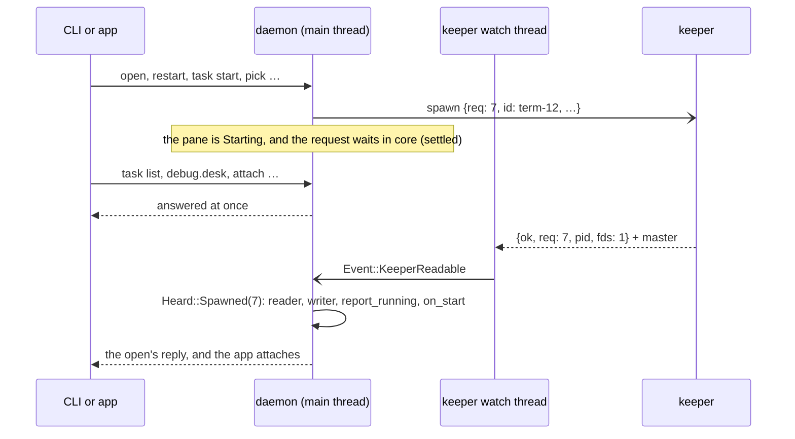

# Spawns Without Waiting

**Status:** built · **Changes:** [the keeper's client](../keeper.md#8-the-client-for-the-daemon), [architecture](architecture.md) · **Builds on:** [moving to the Desk at once](move-to-desk-latency.md)

The daemon starts a terminal by **sending** the keeper a spawn request and going back to its loop. The keeper's reply comes back later, read from the keeper's socket like an exit, and finishes the start then. While a busy or paused keeper is spawning, the daemon keeps answering the app, the CLI and the Desk. Before, `Terminals::start` waited on the reply on the daemon's main thread (up to its 10 s reply timeout), and nothing else on the daemon ran meanwhile.

## Contents

1. [A start](#1-a-start)
2. [Rules](#2-rules)
3. [How it's built](#3-how-its-built)
4. [Tested](#4-tested)
5. [Not yet](#5-not-yet)

## 1. A start

## 2. Rules

- **The daemon never waits on a spawn.** A start sends the request and returns; the pane stays `Starting` until the reply. Requests that wait for a pane to start (`open`, a task's start, a pick's reply) wait in core (`settled`), not on the main thread.
- **In order with exits.** Spawn replies and exits are read from the one socket and handled in the order the keeper sent them, so a program that exits at once is started before its exit is seen.
- **A failed spawn** fails the pane with the keeper's error (`could not start CMD: cannot run …`), as before.
- **Ten seconds:** a pane still `Starting` after core's start timeout (10 s) fails (`did not start within 10 seconds`). A reply that comes later still starts the terminal and reports it running.
- **Stopped while starting** (closed, restarted, its task stopped): when the reply comes, the daemon closes the keeper's pty and starts nothing. **Hung up while starting** (`end`): the program gets `SIGHUP` as soon as it has started.
- **Resized while starting:** the size is kept and set on the pty when it arrives, and the app gets it in the grid that comes with the terminal's screen when it attaches.
- **Input** to a terminal that hasn't started is dropped, as for one that has none.

## 3. How it's built

- **The keeper protocol already allows it.** Every request carries a `req` tag its reply echoes, the keeper answers a spawn only once its child has exec'd (other requests meanwhile are answered at once), and a reply's masters arrive on that reply's line. Nothing in the protocol changed.
- **Client** (`kanna_keeper::client`): `send_spawn(&SpawnRequest) -> tag` sends without waiting; `poll() -> Vec<Heard>` returns what has arrived, in order: `Heard::Exited(Exited)` and `Heard::Spawned(tag, io::Result<Pty>)`. A blocking request (`close`, `ack`, `adopt`) that reads a spawn reply on its way keeps it for `poll`. `spawn` and `poll_events` stay for blocking users.
- **Daemon** (`keeper.rs`): `Spawner::spawn` sends and returns the tag. `Keeper::take` gives everything heard (`pty::Heard`); what a blocking request read on its way is kept and announced with `Event::KeeperHeard`, as exits were.
- **Terminals** (`terminals.rs`): `start` keeps a `Starting` per tag (terminal, pane, serial, size, stopped, hung up). `heard` handles the keeper's messages in order: an exit as before, a reply in `spawned`, which runs the terminal (reader, writer, store, detector), calls `on_start` and `report_running`.
- **Main loop:** `Event::KeeperReadable | Event::KeeperHeard` → `terminals.heard(keeper.take())`, then `ended` for each exit, as before.

## 4. Tested

- **Keeper** (`tests/keeper.rs`, `spawns_sent_together_answer_in_turn_while_other_requests_are_answered`): three spawns sent at once and a `hello` between them; the `hello` is answered, the three replies come back by tag (one an `exists` error), and the first program's exit comes after its reply.
- **Daemon** (`terminals.rs`, `a_spawn_whose_reply_is_held_doesnt_hold_up_other_commands`): a fake keeper holds a spawn's reply; `list` is answered meanwhile, the pane is `Starting` and the `open` still waits; once the reply (with a real pty) comes, the `open` answers and the pane runs with the keeper's pid.
- **e2e `pick_keeper_paused`:** the run's own keeper (the pid in `$KANNA_STATE_DIR/keeper.pid`, checked to be this run's) is paused with `SIGSTOP`; a stopped task with a tab, clicked on the app's Shelf, is on the app's Desk within 200 ms (about 35 ms here), and `kanna task list` answers within 200 ms with it on the Desk. After `SIGCONT` its agent resumes, its tab runs, there's no note and the daemon is still running. Before, the daemon waited on the paused keeper.

## 5. Not yet

- **`close`, `ack` and `adopt` still wait** for their reply. The keeper answers them at once, but a paused keeper holds them for up to the 10 s reply timeout, after which the daemon treats the keeper as lost and stops. `adopt` runs only at the daemon's start.
- **No stop for a starting spawn:** the keeper refuses `close` of a pty still starting, so the daemon closes it once the reply comes. Every start has a new pty ID, so a restart meanwhile doesn't collide with it.
