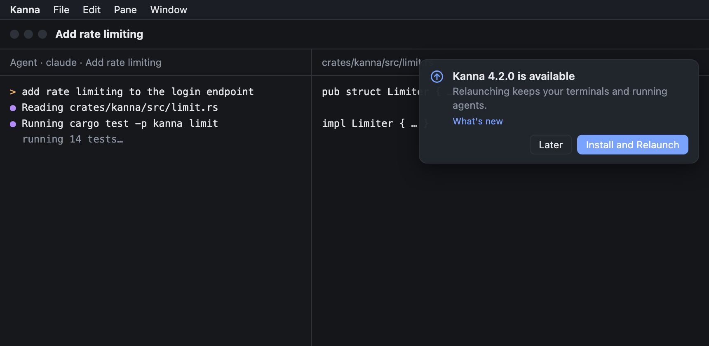
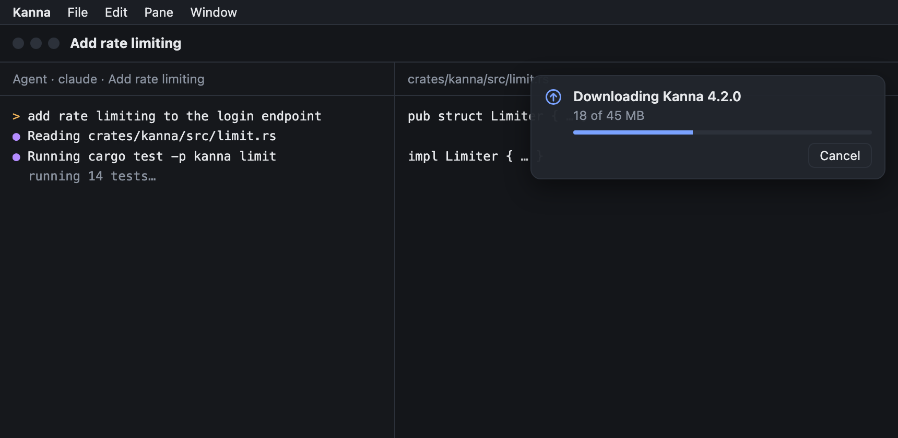
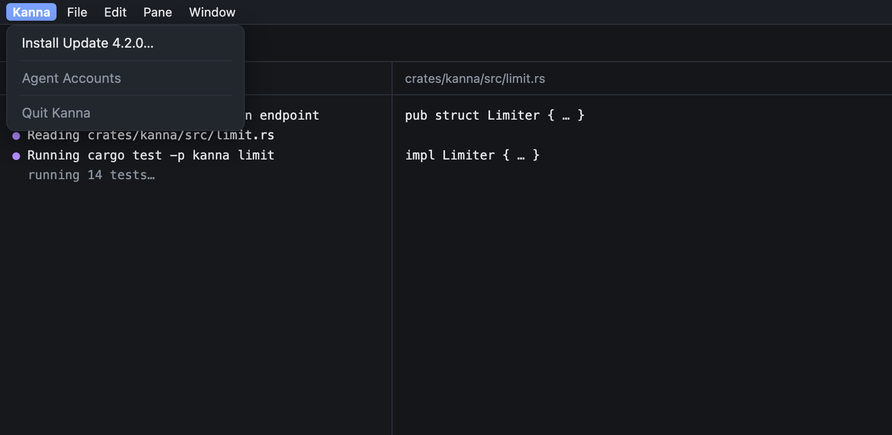
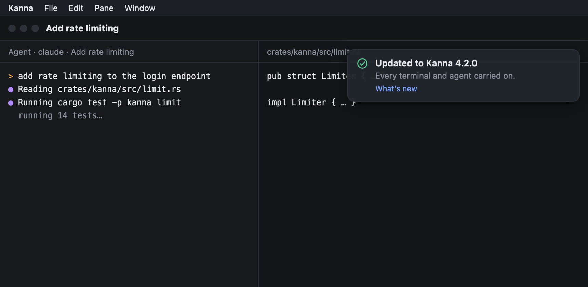
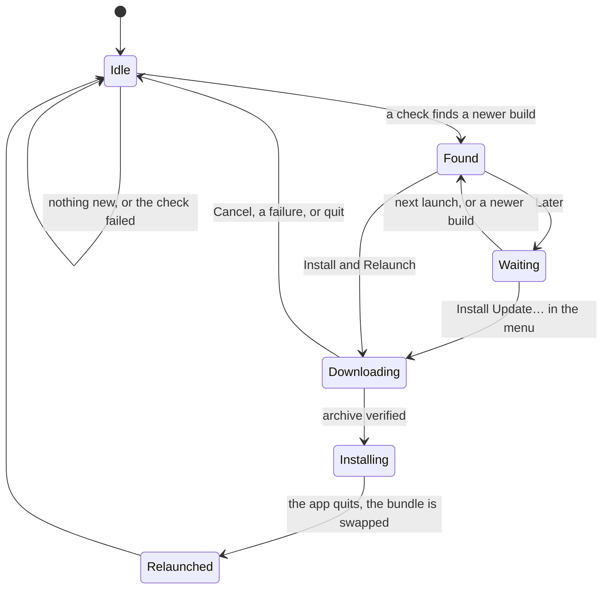
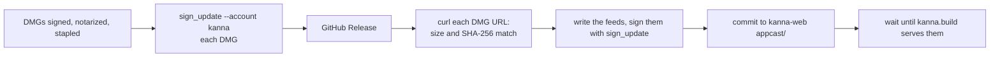
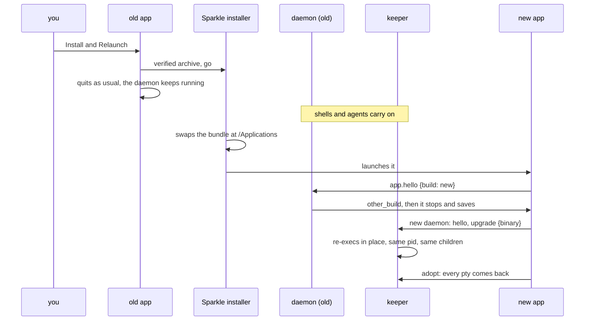
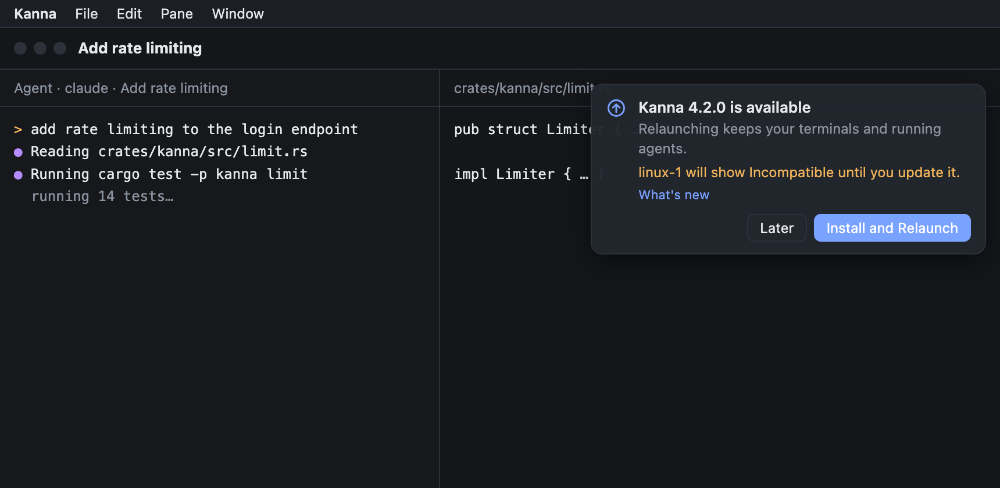

# Auto Update

**Status:** draft for review · **Mockup:** [`references/mockups/auto-update.html`](../../references/mockups/auto-update.html) · **Builds on:** [release](release.md), [build channels](build-channels.md), [upgrading the keeper](keeper-upgrade.md), [restarting the daemon](daemon-restart.md), [versions across machines](machine-versions.md), [toasts](toasts.md)

Kanna on macOS has no updater: every new version is a DMG you download by hand. This adds one, built on [Sparkle](https://sparkle-project.org) 2.10.1. Kanna checks by itself and asks. Nothing installs without your yes, at quit included. Installing relaunches the app, and every terminal and running agent carries on.

macOS only. Production and staging each have their own feeds, and dev builds have none. Linux stays manual ([why](machine-versions.md#3-why-kanna-doesnt-update-your-linux-machines)).

**The first release with the updater is installed by hand:** v4.1.1 has no updater, so it can't update itself. Updates start from the release after that one.

## Contents

1. [Decision for review](#1-decision-for-review)
2. [What you see](#2-what-you-see)
3. [The flow](#3-the-flow)
4. [Sparkle in the app](#4-sparkle-in-the-app)
5. [Feeds and archives](#5-feeds-and-archives)
6. [The update key](#6-the-update-key)
7. [Publishing](#7-publishing)
8. [Terminals across an update](#8-terminals-across-an-update)
9. [A machine left behind](#9-a-machine-left-behind)
10. [Testing](#10-testing)
11. [Rejected](#11-rejected)
12. [Glossary](#12-glossary)

## 1. Decision for review

**Sparkle can't both download in the background and promise no install at quit.** Its only background download is its automatic mode, and that mode starts the installer as soon as the download ends. From then on, the app ending in any way installs the update.

| Sparkle 2.10.1 source | What it does |
|---|---|
| `SPUCoreBasedUpdateDriver.m`, `downloadDriverDidDownloadUpdate` | goes straight from the download to `extractUpdate`, with no hook that can stop it |
| `Autoupdate/AppInstaller.m`, `listenForTerminationWithCompletion` | once preparation has finished, the host ending runs `finishInstallationAfterHostTermination` |
| `SPUUpdaterDelegate.h`, `updater:willInstallUpdateOnQuit:…` | "In either case Sparkle will always attempt to install the update when the app terminates" |

Cancelling the installer in `applicationWillTerminate` isn't enough: a crash or a force quit never gets there, so the update would install.

| Option | Your yes | Later and quit | Cost |
|---|---|---|---|
| **A. Ask, then download (recommended)** | downloads with progress (45 MB), then relaunches | nothing on disk, nothing to install | one change to what we agreed: the download waits for your yes |
| B. Fork Sparkle | relaunches at once | the archive waits in Sparkle's cache | an added hook of about 10 lines, but we build and sign Sparkle's framework ourselves and merge every upstream security fix |
| C. Kanna's own downloader beside Sparkle | relaunches at once | the archive waits in Kanna's cache | a second download path, plus a loopback web server to feed Sparkle, which refuses `file:` URLs |

This spec describes A. It keeps "ask first" with no patched updater and no second download path, and a slow connection can still cancel from the toast. B is the one to take if an instant relaunch matters more than staying on upstream Sparkle.

## 2. What you see

Mockup scenes, opened as `#picture-SCENE`.

The update is found. The toast stays until you answer ([`#picture-found`](../../references/mockups/auto-update.html#picture-found)):

Your yes starts the download ([`#picture-download`](../../references/mockups/auto-update.html#picture-download)):

Later closes the toast. The update stays offered in the Kanna menu ([`#picture-later`](../../references/mockups/auto-update.html#picture-later)):

After the relaunch ([`#picture-updated`](../../references/mockups/auto-update.html#picture-updated)):

- **Later** changes nothing. The toast comes back at the next launch, or when a newer version appears.
- **The Kanna menu** has Check for Updates…, or Install Update X.Y.Z… while one waits. Checking by hand also answers "Kanna is up to date", or says why it couldn't check.
- **Failures:** a scheduled check that fails stays silent and tries again at the next one. A failure after your yes shows a toast with the reason, such as a read-only disk.
- **No skip:** there is no Skip This Version.

## 3. The flow

Quit in any state before Installing installs nothing, because no installer is running yet. Installing begins only after your yes.

## 4. Sparkle in the app

- **Dependency:** the SwiftPM package `sparkle-project/Sparkle`, exact 2.10.1, a prebuilt `Sparkle.framework`. `build-kanna-app.sh` copies it to `Contents/Frameworks`, without its XPC services, which only sandboxed apps need. All channels link it. It is added to `NOTICE`.
- **Own interface:** `SPUUpdater` with a custom `SPUUserDriver`, so prompts are Kanna's toasts. The driver answers Sparkle's found prompt with install only after your yes, and answers its ready prompt with install at once, since you already said yes.
- **Pure logic apart:** the toast and menu states live in a `KannaUpdates` target with unit tests. Sparkle stays in a thin layer in `Kanna`.
- **Only the default instance** of production or staging runs the updater. The menu items don't exist elsewhere.

| Info.plist key | Value | Why |
|---|---|---|
| `SUFeedURL` | this channel and architecture's feed | set by `build-kanna-app.sh`; left out of dev builds, which start no updater |
| `SUPublicEDKey` | the update key's public half | in `scripts/env.sh` |
| `SUEnableAutomaticChecks` | `YES` | checks without Sparkle's first-run question |
| `SUScheduledCheckInterval` | `21600` | every 6 hours |
| `SUAutomaticallyUpdate`, `SUAllowsAutomaticUpdates` | `NO` | Sparkle's install-at-quit mode can't be turned on |
| `SUVerifyUpdateBeforeExtraction`, `SURequireSignedFeed` | `YES` | archive and feed are checked against the key before anything is unpacked or believed |

`kanna_sign_app` signs inside out: `Autoupdate`, `Updater.app`, then the framework, each with the same identity and options, before the app. release.sh's stray Mach-O check learns the framework.

## 5. Feeds and archives

- **Where:** `https://kanna.build/appcast/CHANNEL-ARCH.xml`, four files: `production-arm64`, `production-x86_64`, `staging-arm64`, `staging-x86_64`. They live in the `appcast/` folder of `tampopogk/kanna-web`, which GitHub Pages already serves on our own domain, so hosting can move without changing a URL.
- **One item:** each feed names only the newest release. A release is built for one architecture, and an install stays on its architecture.
- **What Sparkle downloads:** the same DMG people download by hand, from the GitHub Release. It is already signed, notarized and stapled, and Sparkle unpacks DMGs with an `/Applications` link in them, so no zip is needed. The real-update test proves this; if it fails, a zip beside the DMG takes its place.
- **Versions:** Sparkle compares `CFBundleVersion`, the commit count of main, which rises with every release. `sparkle:shortVersionString` is the full version, `4.2.0-staging.1` on staging, shown in the toast.
- **Rolling back:** `git revert` of the feed commit stops a bad release from being offered. Anyone who already installed it stays on it until a newer build ships.

## 6. The update key

- **Private half:** the login keychain of the release Mac, in Sparkle's item under the account `kanna`. It is created once with `generate_keys --account kanna`. Nothing else holds it: never in the repo, in `.env.release.local`, in a log or in a test.
- **Backup:** `generate_keys --account kanna -x FILE`, which you store in your password manager and delete from disk.
- **Public half:** `KANNA_UPDATE_PUBLIC_KEY` in `scripts/env.sh`, the same for both channels.
- **Lost key:** a new key can ship inside a release signed with the same Developer ID, since Sparkle accepts a change of either one, never both.
- **Tests** generate a throwaway key and never touch the keychain item.

## 7. Publishing

release.sh gains these steps. The feed moves last, so it never names a DMG that isn't there.

- **Preflight adds:** `sign_update` can reach the key, the signature it makes verifies against `KANNA_UPDATE_PUBLIC_KEY`, push access to `kanna-web`, and a build number above the one in the published feed.
- **`--dry-run`** writes and signs the feeds in `target/release-dmg/vX.Y.Z/feeds/` and pushes nothing.
- **`latest.json`:** nobody installed Kanna v2, so its rule and both checks leave [release](release.md) and release.sh.

## 8. Terminals across an update

- **Nothing new in the daemon or keeper:** this is the path a relaunch of a rebuilt app already takes ([daemon build](daemon-build.md#2-hello-from-another-build), [keeper upgrade](keeper-upgrade.md#6-who-triggers-it)). The differences a real update adds, each checked in [Testing](#10-testing), are that the helpers' files vanish under the running daemon and keeper, and that Sparkle relaunches through Launch Services.
- **While the bundle swaps,** a `kanna` command in a terminal may fail once with file not found. Sparkle swaps the bundle atomically where the disk allows, so the gap is brief.
- **After the relaunch** the window layout comes back as it does at any launch ([layout](layout.md#3-saving-and-restoring)).

## 9. A machine left behind

An update may raise `kanna_build::PROTOCOL`. Nothing translates between protocols ([versions](machine-versions.md#2-protocols)), so a paired machine left on the older one goes Incompatible: the Machines tab says which side to update, its tasks keep their places on the Desk, and it comes back once updated. Nothing is lost on either side.

So that this isn't a surprise, each feed item carries `<kanna:protocol>N</kanna:protocol>`. When N differs from this build's, the toast names the paired machines that will fall behind, and you can still answer Later:

## 10. Testing

- **Real update, by hand once and as e2e `auto_update` where it can run:** build A and build B of this worktree's dev channel, so the state folder is this worktree's own and never the user's, each signed with the Developer ID and hardened runtime, with a throwaway key and a feed on `127.0.0.1` baked in at build time. A claude agent working, a shell, a Desk task not active and a Shelf task run on A. Then accept in the toast, and check for B: the same pids, the keeper's pid kept with a new build, the screens, output written meanwhile, the agent carrying on, `exit 7` reporting 7.
- **Ask first:** quit, Later, a crash and `kill -9` at Found, Waiting and Downloading each leave A in place with no installer running.
- **Bad updates refused, A left running:** wrong signature, wrong size, a feed signed by another key, a truncated DMG.
- **Machine left behind:** A and a peer daemon on A's protocol, then B with the protocol raised: the peer shows Incompatible, its tasks keep their places, updating the peer brings it back.
- **Unit:** `KannaUpdates` states, `swift test --filter KannaUpdatesTests`. **Release:** `release.sh --dry-run` feeds pass `sign_update --verify`.

## 11. Rejected

- **Sparkle's own windows:** a modal alert over running agents, and its Install on Quit choice breaks ask first.
- **Feeds as GitHub Release assets:** `releases/latest` can't serve staging, whose releases are pre-releases, so there would be two mechanisms.
- **Our own updater without Sparkle:** signature checks and bundle swapping are the hard part, and Sparkle has years of those edge cases behind it.
- **A delta or universal build:** a 45 MB download is small, and per-architecture feeds were agreed.

## 12. Glossary

| Term | Meaning |
|---|---|
| **Appcast** | Sparkle's feed: an RSS file naming the newest version and where to get it. |
| **EdDSA** | The signature scheme Sparkle checks archives and feeds with. |
| **User driver** | The part of Sparkle that shows prompts; Kanna supplies its own. |
| **Autoupdate** | Sparkle's installer process: it waits for the app to end, then swaps the bundle. |
