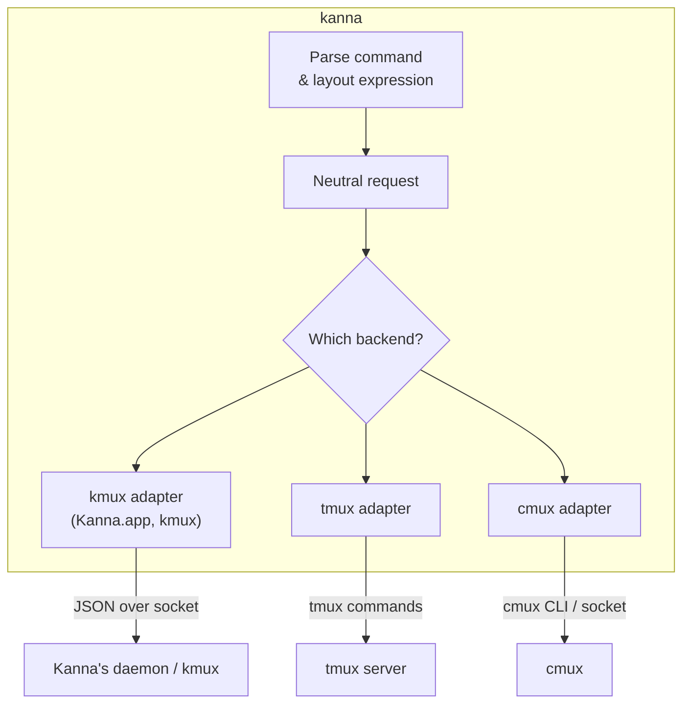
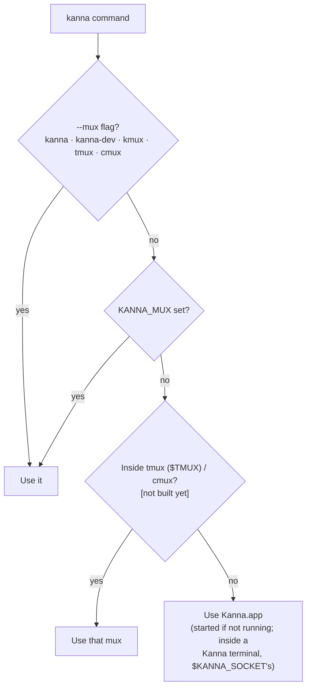
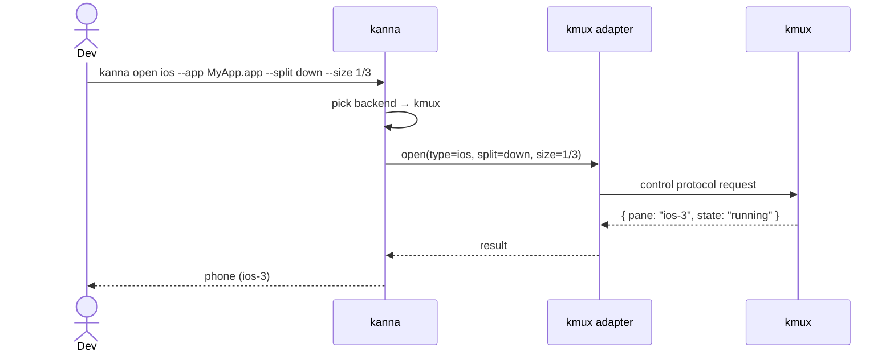

# Mux Backends

**Status:** Kanna.app and kmux built; tmux and cmux adapters and auto-detection planned · **Part of:** [the kanna CLI](cli.md)

kanna isn't tied to one mux. It turns each command into a backend-neutral request and passes it to an **adapter**, one per mux, which talks to its mux in that mux's own way. kanna stores nothing between commands: the mux owns all the state.



## 1. What each backend supports

| Capability | kmux | tmux | cmux |
|---|:-:|:-:|:-:|
| Terminal panes | ✅ | ✅ | ✅ |
| Web panes | ✅ | ❌ | ✅ **[Assumption]** |
| iOS Simulator panes | ✅ | ❌ | ❌ |
| Fractional sizing | ✅ | ✅ | ✅ **[Assumption]** |
| Named panes | ✅ | ✅ (kanna stores the name as a pane option) | **[Assumption]** |
| Pane states | Full ([kmux lifecycle](https://github.com/tampopogk/kmux/blob/main/docs/kmux-spec.md#43-lifecycle)) | Running / exited only | **[Assumption]** |

Kanna.app supports what kmux does. How sizes apply on each: [arranging panes](arranging-panes.md#4-how-sizes-map-to-each-backend).

## 2. Choosing a backend



`kanna` is Kanna.app; `kanna-dev` is another name for it; `kmux` is a kmux the user runs.

## 3. Adapter interface

Every adapter implements the same operations; adding a mux means writing an adapter. The kmux adapter maps them one-to-one onto the [kmux control protocol](https://github.com/tampopogk/kmux/blob/main/docs/kmux-spec.md#7-control-protocol).

| Operation | Purpose |
|---|---|
| `capabilities()` | Report the supported pane types and features. |
| `open(type, options, placement)` | Create a pane. `placement` holds the split direction and size. |
| `arrange(layoutTree)` | Apply a parsed layout. |
| `resize(pane, fraction)` | Change a pane's size. |
| `list()`, `focus()`, `close()`, `restart()` | Manage panes. |
| `send(pane, text)`, `sendKey(pane, keys)`, `navigate(pane, url)` | Act on a pane's contents. |

## 4. Example session

```sh
kanna open term --name server --cmd "npm run dev"
kanna open web http://localhost:3000 --name site --split right --size 1/3
kanna open ios --name phone --app ./build/MyApp.app --split down --size 1/3
```



## 5. Open questions

1. **Unsupported pane types:** should `web` on tmux fall back to opening the system browser, or always fail?
2. **cmux:** confirm what its API supports (web panes, sizing, naming).
3. **Mixed backends:** should one `kanna.yaml` be able to use several muxes, for example terminals in tmux and web panes in kmux?
4. **Targeting:** how does kanna choose which window or tab (or tmux session) to act on?

## 6. Glossary

| Term | Meaning |
|---|---|
| **Mux (multiplexer)** | An app that shows several separate sessions in one window. |
| **Pane** | One rectangular area in a mux showing one thing. |
| **Backend** | The mux that kanna is currently controlling. |
| **Adapter** | The part of kanna that translates its commands for one specific backend. |
| **tmux** | A widely used terminal multiplexer that runs inside a terminal. It shows terminal panes only. |
| **cmux** | A third-party macOS terminal app with panes. |
