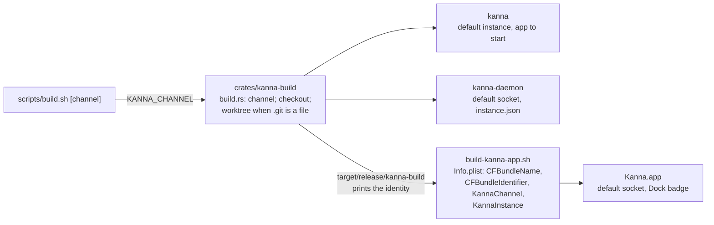
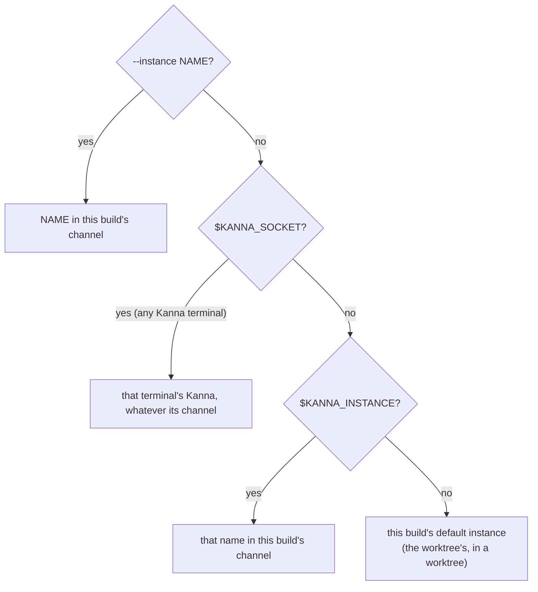

# Build Channels

**Status:** built · **Builds on:** [instances](instances.md) · **Why:** Kanna is developed inside Kanna: every task builds and runs its own Kanna in its worktree while the Kanna it works in keeps running

A build of Kanna is one of three **channels**, chosen when it's built. Each channel is a separate app (its own name, bundle ID and folders), so all three run side by side; a **dev** build made in a git worktree is, in addition, an app of its own named after the worktree, so every task's Kanna runs beside the others and beside the one it was built from.

Channels and instances are for developing and testing Kanna, not a user feature: the app offers no way to start an instance, and users get one Kanna and work on another project in a Desk (File → New Desk, `kanna PATH`). Developers reach instances through dev builds, the e2e scripts and `kanna --instance`.

## 1. What each build is

| Build | App name | Bundle ID | Default instance | Its folder | CLI starts it with |
|---|---|---|---|---|---|
| `scripts/build.sh production` | Kanna | `dev.kanna.app` | `default` | `kanna-prod` | `open -b dev.kanna.app` (installed in /Applications) |
| `scripts/build.sh staging` | Kanna Staging | `dev.kanna.app.staging` | `default` | `kanna-staging` | `open -b dev.kanna.app.staging` |
| `scripts/build.sh` in the main checkout | Kanna Dev | `dev.kanna.app.dev` | `default` | `kanna-dev` | `open -a <checkout>/target/Kanna.app` |
| `scripts/build.sh` in `.kanna-worktrees/task-3f9a1c2e` | Kanna Dev task-3f9a1c2e | `dev.kanna.app.dev.task-3f9a1c2e` | `task-3f9a1c2e` | `kanna-dev-task-3f9a1c2e` | `open -a <worktree>/target/Kanna.app` |

The dev build in the main checkout is the Kanna that came before channels: same bundle ID, same `kanna-dev` folder, same terminals and layout.

```text
~/Library/Application Support/
├── kanna-prod/                  production's default instance
├── kanna-prod-work/             production's instance named work
├── kanna-staging/               staging's
├── kanna-dev/                   the main checkout's dev build
├── kanna-dev-task-3f9a1c2e/     the dev build of worktree task-3f9a1c2e
│   └── instance.json            {channel, name, bundle, checkout, worktree, app}, written by its daemon
└── kanna-dev-task-7c01d4aa/     another worktree's
```

Each folder is a whole Kanna (daemon, keeper, terminals, layout, Shelf), so nothing is shared between them. Instance names are per channel: `--instance work` in a staging build is `kanna-staging-work`.

## 2. How a build knows what it is



- **One source of truth:** `crates/kanna-build` derives everything from the channel and the worktree's folder name (kept to letters, digits, `-` and `_`, 32 at most; the bundle ID lowercases it). `KANNA_CHANNEL` defaults to `dev`; a plain `cargo build` in a worktree makes that worktree's dev CLI.
- **The app** reads `KannaChannel` and `KannaInstance` from its Info.plist; staging and dev builds put a STAGING or DEV band on their Dock icon, and the Kanna menu's Quit item is named after the app.

## 3. Which Kanna a command reaches



So in production's terminals every `kanna` talks to production; to reach the worktree's own Kanna from there, use `scripts/run-kanna.sh`, which clears `KANNA_SOCKET`, `KANNA_INSTANCE` and `KANNA_TERMINAL`.

## 4. Running and cleaning up

| Command | Does |
|---|---|
| `scripts/build.sh [production\|staging\|dev]` | builds everything as that channel (default `dev`); `scripts/build-kanna-app.sh` takes the same argument. Dev builds the Swift app in debug, the others in release; a worktree starts from the main checkout's builds ([build speed](build-speed.md)) |
| `scripts/run-kanna.sh` | opens this checkout's `target/Kanna.app` |
| `scripts/run-kanna.sh COMMAND …` | runs this checkout's CLI against this checkout's Kanna (starting it if needed), from anywhere, a production terminal included |
| `kanna instances` | the running instances of every channel: name, channel, windows and panes, and the worktree a dev build came from (`(gone)` once it's removed) |
| `kanna instances prune` | deletes the folders of instances whose worktree is gone, keeping any that still answer or whose keeper still runs |
| `kanna --version` | the CLI's version and which app it is, e.g. `kanna 0.1.0 (Kanna Dev task-3f9a1c2e)` |

Any build can run with `KANNA_DEBUG=1` (the planner's dev Kanna does): it answers `debug.*` and shows **Debug** in its title bars, and is otherwise the same, its clipboard included ([terminal](terminal.md#5-debug-mode)).

Production is the build that goes in /Applications (`ditto target/Kanna.app /Applications/Kanna.app`); its folder starts empty. To carry the main checkout's dev Kanna over (layout, Shelf, terminals), quit it, stop its keeper (`kill $(cat ~/Library/Application\ Support/kanna-dev/keeper.pid)`, which ends its terminals) and move `kanna-dev` to `kanna-prod`.

## 5. Open questions

- **Pruning on `task done`:** the daemon removes a task's worktree; it could also prune that worktree's dev instance then, rather than waiting for `kanna instances prune`.
- **The older apps' names:** `/Applications/Kanna.app` and `Kanna Staging.app` may still be Kanna v3 (`build.kanna`, `build.kanna.staging`, folder `Kanna`); channels use different bundle IDs and folders, so installing production replaces only the file.
