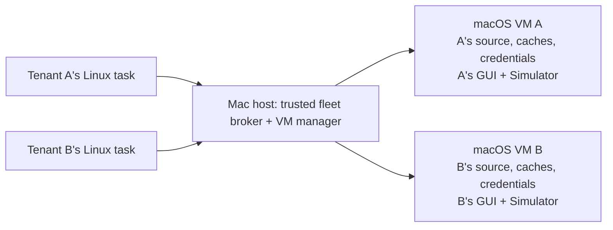

# Isolation on Shared Build Macs

**Status:** required, not yet modelled · **Part of:** [build Macs](build-macs.md), in [Kanna Cloud](kanna-cloud.md) · **Model:** `references/prototypes/build-mac-isolation/` (to be built)

Several mutually untrusted users may use the same physical Mac. Every remote build runs inside a macOS VM assigned exclusively to one tenant. Separate host accounts and serialized host UI tests do not meet this requirement. The owner-account shim experiment demonstrated transport and build behaviour only.

## Contents

1. [Boundary](#1-boundary)
2. [Host and guest](#2-host-and-guest)
3. [Files, credentials and network](#3-files-credentials-and-network)
4. [Sessions and lifecycle](#4-sessions-and-lifecycle)
5. [Proof before product](#5-proof-before-product)

## 1. Boundary

- The host OS, hypervisor, administrator and fleet broker are trusted. Tenant repositories, build phases, plugins, tests and their outputs are untrusted. A malicious host administrator is outside this boundary.
- A VM never contains two tenants' workloads or private state. A tenant may have multiple VMs. Tenant means an authenticated user or explicitly shared trust domain, never a caller-supplied username.
- Guest compromise, including guest root, must not grant access to the host's fleet identity, personal account, other guests or host management APIs. Hypervisor escape remains a platform risk requiring supported, patched software; a VM is not a claim of absolute security.
- Same-tenant jobs may share warm caches. Mutually untrusted repositories within a tenant require separate disposable VMs too; per-task mirror locks are not isolation.
- The physical host never executes submitted project code, including Git hooks, package resolution or archive extraction helpers. There is no automatic fallback to host execution when VM capacity is exhausted.

## 2. Host and guest

- The host daemon retains the host's `device.key`. A small VM manager accepts authorized requests from it, selects a tenant-owned guest, and enforces resource limits. Privileged operations are limited to VM and network lifecycle; tenants cannot supply host commands, host paths or a target UID.
- The guest executor receives a job-scoped capability for its assigned tenant, VM and request. It can receive that job's snapshot and return status/artifacts; it cannot enroll peers, submit another tenant's jobs or request host-side signing. Do not copy the host's private fleet identity or broad owner agent credentials into a guest.
- Build and UI workers run as a non-admin guest job user. The guest's supervisor and worker separation is defence in depth; the VM is the cross-tenant boundary.
- The existing snapshot, mirror lock, pinned Xcode, durable status and artifact contracts remain. Mirrors and DerivedData live on tenant-private guest disks. A VM slot advertises guest architecture, Xcode and Simulator runtimes, while host capacity bounds total admission.
- Start with Apple-silicon macOS virtualization; evaluate Tart or a small Apple Virtualization.framework runner in the model. Do not advertise Intel-host VM support before it is demonstrated with a suitable backend.

## 3. Files, credentials and network

- No host home, repo, keychain, SSH-agent socket, Docker socket or other guest disk is mounted into a guest. Disable shared clipboard, host automation, device passthrough and other optional host integrations. A VM with a shared host directory is not the required configuration.
- Transfer source and artifacts through bounded job channels. Host artifact handling treats names, archives and symlinks as untrusted: no arbitrary host reads/writes, path traversal, unsafe extraction or execution of returned code. Authorize downloads by tenant as well as job ID.
- Tenant credentials and writable caches remain tenant-private. Golden images contain Xcode and public dependencies only, with no enrolled identities or secrets. Cross-tenant caches must not carry private outputs; omit them in the first version.
- Guest networking denies other guests, host management services and private LAN access by default. Explicitly allow only the job transport endpoint and approved dependency destinations. Enforce this outside the guest so guest root cannot remove it; cover IPv4 and IPv6. Plain NAT is not an isolation policy.
- Host-enforced CPU, memory, disk and concurrency budgets bound resource abuse. Fair admission and quotas are needed as well as confidentiality; killing one guest must not cancel another tenant's jobs.

## 4. Sessions and lifecycle

- Each guest has its own logged-in job-user Aqua session. UI jobs use that guest's LaunchAgent; lease GUI and Simulator resources per guest. Two tenants' UI jobs can run concurrently only in separate guests with admitted capacity, never by sharing the host console.
- Persistent guests remain pinned to one tenant. Reassignment destroys tenant disks, writable overlays, snapshots, credentials and capabilities, then clones a clean image; renaming or switching a macOS account is insufficient. Preserve no cross-tenant warm state.
- On disconnect, a job remains bound to the original tenant and guest. Cancellation and reconnect authorization cannot target another tenant's job. Lost or unhealthy guests are quarantined until ownership and cleanup are reconciled.
- Admission is bounded by measured hardware capacity and the applicable macOS/hypervisor licence. The macOS virtual-instance allowance is not by itself approval for a commercial shared service; validate the deployment arrangement before promising multi-tenant capacity. Queue or add Macs when the admitted limit is reached.

## 5. Proof before product

Build a disposable model in `references/prototypes/build-mac-isolation/` before Fleet 7 and 12. Reuse the shim fixture and contracts, not its unrestricted host executor. Demonstrate on this Mac first if resources and required setup permit:

| Probe | Required evidence |
|---|---|
| Two tenant guests | Concurrent dirty-worktree builds and UI tests, each with its own guest console, labelled app and returned screenshot |
| Private state | A malicious build, also tested as guest root, cannot read host/B canary files, disks, dummy credentials or private caches |
| IPC and network | A cannot reach B or host management ports, forge tenant/VM IDs, fetch B artifacts or cancel B's jobs; explicit job transport still works |
| Artifacts | Traversal and symlink payloads cannot cause privileged host reads, overwrites or execution |
| Reuse | Tenant B receives a clean guest after A's guest is retired; A's canaries, processes, capabilities and snapshots are inaccessible |
| Lifecycle and pressure | A's cancellation, disconnect, guest crash or resource exhaustion does not corrupt B or exceed host-enforced limits |

Use dummy secrets, record configuration and failures, and distinguish implemented controls from assumptions. Failed or unavailable probes keep the isolation gate open. README must explain reproduction, the backend chosen, limits and what the product should copy.

The existing [xcodebuild-shim model](../../references/prototypes/xcodebuild-shim/README.md) remains the forwarding reference. Its successful host-owner UI run does not satisfy these isolation probes.

Implementation references: [Apple shared-directory API](https://developer.apple.com/documentation/virtualization/shared-directories) makes host mounts an explicit configuration choice; [Tart's FAQ](https://tart.run/faq/) documents host reachability with ordinary networking. Review the [applicable macOS agreement](https://www.apple.com/legal/sla/docs/macOSTahoe.pdf), including virtual instances and permitted deployment, when selecting capacity.
