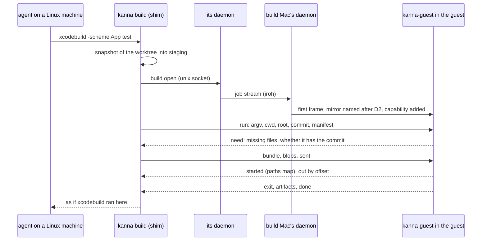
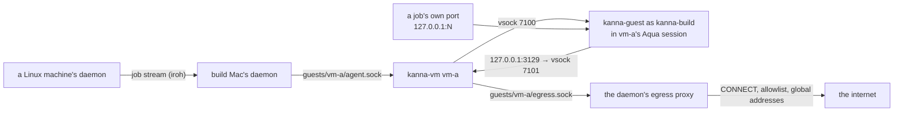

# Build Macs and the xcodebuild Shim

**Status:** first version being built (Cloud 7), for the operator as the only tenant · **Part of:** [Kanna Cloud](kanna-cloud.md#6-build-macs) · **Isolation:** [shared build Macs](build-mac-isolation.md) · **Research:** [xcodebuild shim](../research/xcodebuild-shim.md) · **Models:** [xcodebuild-shim](../../references/prototypes/xcodebuild-shim/README.md), [build-mac-isolation](../../references/prototypes/build-mac-isolation/README.md) · **Tests:** `cargo test -p kanna-guest` (jobs between the client and a supervisor: dirty, untracked and deleted files, a warm rerun, diagnostics, a fetched `.app`, a dropped connection, cancelling, a cancel before the job arrives, a commit moved after capture, `DEVELOPER_DIR`, replacing only kanna build's own products, a linked folder in a destination's path, a build Mac sending garbage; the intake's refusals; the job proxy), `cargo test -p kanna --test machines_build` (two paired daemons, a guest's socket on the build Mac, the CLI and the `xcrun` shim, no guest running)

A task on Linux works on Apple code as if Xcode were local. Its `xcodebuild`, `xcrun`, `simctl`, `codesign` and project-chosen `swift` calls run on a **build Mac** against the agent's current worktree. Output and the exit code stream back, and test results, screenshots and built apps arrive where the agent expects them. Any number of Macs, Intel and Apple Silicon, form the **pool**. Build Macs are a [Kanna Cloud](kanna-cloud.md#6-build-macs) feature: [your machines](machines.md) aren't designed around them, though a self-hoster can run them, for example in their own Kanna Cloud.

## Contents

1. [Rules](#1-rules)
2. [A job](#2-a-job)
3. [Paths and artifacts](#3-paths-and-artifacts)
4. [Guests on a build Mac](#4-guests-on-a-build-mac)
5. [The pool](#5-the-pool)
6. [iOS for remote tasks](#6-ios-for-remote-tasks)
7. [Interfaces](#7-interfaces)
8. [Build order](#8-build-order)
9. [Limits](#9-limits)

## 1. Rules

- **The shim is a PATH entry:** on Linux, the daemon links `xcodebuild`, `xcrun`, `codesign` and `swift` to the `kanna` beside it, in its state folder's `shim/`, and puts that folder first on its terminals' PATH (`KANNA_BUILD_SHIM_DIR` names it). Each link is `kanna build` by another name, so the agent, `scripts/build.sh` and anything Xcode-shaped reach it without knowing. A Mac's terminals don't get it (`KANNA_BUILD_SHIM=1` forces it, `0` turns it off).
- **Transparent only as far as PATH reaches.** A script that checks `uname`, calls `/usr/bin/xcodebuild`, or runs a path from `xcrun --find` isn't caught. For those, `kanna build -- scripts/build.sh` runs the whole script on the Mac.
- **Swift is per project:** `swift` on Linux runs the next `swift` on the PATH unless the repo's `.kanna/config.json` says `"build": {"swift": "mac"}`. The two platforms keep separate build folders.
- **Requests are structured:** arguments are passed as a list and spawned directly on the Mac, never pasted into a shell command.
- **The Mac never writes source back.** Files a build generates come back only as declared outputs.
- **A macOS VM is mandatory for remote builds:** several mutually untrusted users can share a physical Mac. Project code runs only in a tenant-exclusive guest; host accounts are not the tenant boundary. The host retains its `device.key`, only relays a job's bytes to a guest, and never falls back to executing a build itself: with no guest running it refuses (`this build Mac has no guest running; builds run only inside a guest`). See [isolation](build-mac-isolation.md) for credentials, networking, VM lifecycle and the required proof.
- **One tenant until the isolation gate opens:** the [isolation model](build-mac-isolation.md#5-proof-before-product) ran its benign probes but not its guest-root attacks (task "Build-Mac isolation: guest-root attack probes"). Until they pass, a build Mac takes jobs only from its operator's own machines, its peers in the peer log (decided with the user, 2026-11-03).
- **UI tests use the guest console:** each tenant VM has its own logged-in job-user Aqua session and Simulator state. Concurrent tenants use separate guests; UI jobs within one guest serialize. Guest capacity is admitted against host resources and applicable licensing, not an assumed unlimited pool.

## 2. A job

- **The snapshot:** the worktree's files as they are (modified, untracked, deleted, executable bits, symlinks): `git ls-files --cached --others --exclude-standard`, minus any `target/`, `.build/`, `node_modules/`, `DerivedData/` and `.kanna/build/`. `kanna build` copies them into a staging folder at submit time, each named by its SHA-256, while the agent waits on the shim; the manifest (path, hash, size, executable, or link target) goes with the job and its hash is recorded with it. The live worktree is never read later.
- **Only what the guest lacks travels:** the guest keeps a content-addressed store of files it has seen, so it asks for the missing ones only (`need`). A rebuild after editing one file sends one file. **Changed:** whole changed files, not rsync's changed blocks; block deltas are worth adding only if measured transfers say so.
- **The mirror** in the guest is keyed by (machine, repo, task): a git checkout whose objects come from a bare repository per (machine, repo), with the snapshot laid over it, since a linked worktree's `.git` file is meaningless there. Commits the guest lacks (unpushed ones) travel as a git bundle of the commit captured at submit time (under a ref named for it, `refs/kanna/send/<commit>`, deleted once bundled) less the commits it already has, so it needs no git credentials and a checkout during submission can't change what's sent. The checkout is reset to the worktree's commit with the index matching it, so `git status` on the Mac shows the worktree's changes. Laying a snapshot rewrites only files whose hash differs or that the Mac changed since, removes files deleted since the last job, and leaves files the build made alone, so rebuilds stay warm. DerivedData and SwiftPM's scratch folder live outside the source, keyed by task and Xcode version.
- **The lock** covers laying the snapshot, the run and staging artifacts for one mirror: each `--fetch` path is cloned (`cp -c`) into `jobs/<job>/fetched/` before the lock is released, so a later job can't change what a slow transfer or a reattach sends. Other mirrors run in parallel; the guest has one heavy slot and one UI slot.
- **The supervisor** (`kanna-guest`, run as the guest's job user) persists each job's request, status, raw output and artifact list in its own folder. A dropped connection reattaches to the running job by ID and output offsets (`attach`) instead of starting another; `kanna build` keeps trying for ten minutes after the last progress (output, an exit, an artifact), and gives up after three reattaches in a row without any. Data it can't take (a malformed frame, a full disk) ends the build at once instead. Cancelling (Ctrl-C or SIGTERM to `kanna build`) signals the job's process group, waits ten seconds before SIGKILL, and reports the job cancelled; a cancel asked for while the snapshot is still being made or sent is kept until the job reaches the guest and the cancel lands.
- **The exit code** is the build's, or 128 plus its signal, or 130 when cancelled. A transport failure is Kanna's own error, exit 125 with `kanna build:` and why on stderr, never a made-up build result. Build status and artifact status are reported separately.
- **Xcode is pinned per job** with `DEVELOPER_DIR` (the caller's, which on Linux can only mean the Mac's, refused when that folder isn't on the Mac; otherwise the guest's `xcode-select -p` at the time), never by changing `xcode-select`. The job records Xcode, macOS, arch, the job user's identity and the snapshot hash in its `started` frame and record.
- **The environment is minimal:** `PATH` (the job user's `~/.cargo/bin` and `~/.local/bin`, Homebrew, the system's), `HOME`, `USER`, `LANG`, `TMPDIR`, `DEVELOPER_DIR`, `KANNA_BUILD_JOB`, the job's proxy, and from the caller only `KANNA_CHANNEL`, `CI`, `RUST_BACKTRACE`, `CARGO_TERM_COLOR` and `NSUnbufferedIO`.

## 3. Paths and artifacts

| | Linux | Mac guest |
|---|---|---|
| Source | `~/repos/app/.kanna-worktrees/task-1dfb/` | `~/.kanna-build/mirrors/r720-2/app/task-1dfb-<hash>/src/` |
| Caches | — | `…/task-1dfb-<hash>/derived/<xcode>/` |
| One job's results | the path the agent named, or `.kanna/build/<job>/` | `~/.kanna-build/jobs/<job>/results/` |

- **The working directory** keeps its path relative to the worktree. Known path arguments are mapped: `-project`, `-workspace`, `-xctestrun`, `--package-path` into the mirror (refused when outside the worktree, since only the worktree is sent), `-derivedDataPath` and `--scratch-path` into the caches, `-resultBundlePath`, `-archivePath` and `-exportPath` into the job's results and back to the path named. `xcodebuild` without `-derivedDataPath` gets the mirror's; a test without `-resultBundlePath` gets `Tests.xcresult` in the results. The same holds under `xcrun` (`xcrun -sdk macosx xcodebuild test`), whose own options are skipped to find the tool.
- **Output is passed through raw.** stdout is never rewritten, since it may be JSON. Diagnostics (`file:line[:col]: error|warning|note:`) are mapped back to this worktree's paths, including Xcode's `/tmp` for `/private/tmp`, and after the run `kanna build` repeats them on stderr under one line naming `.kanna/build/<job>/diagnostics.txt`, which keeps them all.
- **Coming back, always:** the `.xcresult` and its summary by the guest's own `xcresulttool` (`tests.json`) and exported attachments (screenshots among them) into `.kanna/build/<job>/`, or the bundle to the path the agent named. **On request:** `--fetch PATH` (or `KANNA_BUILD_FETCH=PATH:…` through the shim) brings `PATH` in the mirror back to the same path in the worktree, the built `.app` for one. Each file comes back as a frame with its checksum and executable bit, each link with its target, so bundles keep their permissions and symlinks. **Changed:** frames per file rather than an archive made on the Mac, so the Linux side writes through the intake below instead of unpacking.
- **The intake** on Linux treats every returned name as hostile: plain relative paths only, written with `O_NOFOLLOW` at every folder, `O_EXCL` for files, checksums checked, case-folded collisions and over-size files refused, links only relative and never climbing out of what was returned, into a staging folder renamed into place. A destination the job didn't ask for is refused. The destination itself is opened folder by folder from the worktree (or the folder the agent named) without following links, so `out/App.app` with `out` a link is refused. Something already there is replaced only if kanna build put it there: `.kanna/build/products` lists what earlier fetches wrote (and counts for nothing if git tracks it), and anything under `.kanna/build/` is kanna build's; a file's extension proves nothing.
- **The job's record** is `.kanna/build/<job>/job.json` (argv, status, artifacts, exit code); `.kanna/build/last` names the newest. Everything under `.kanna/build/` is read and written through folders opened without following links, so a repo can't point it elsewhere.

## 4. Guests on a build Mac

- **A guest** is a folder in the daemon's state, `guests/NAME/`: `vm/` (an APFS clone of a master's `config.json`, `disk.img` and `nvram.bin`, with its own machine identity), `guest.json` (CPUs, memory, master), and the sockets and logs below. `kanna guests create NAME --from MASTER_VM_DIR [--cpus N] [--memory GIB]` makes one, `kanna guests` lists them, `stop`/`start` hold or resume one, `retire` stops it and destroys its disk. The daemon keeps every guest that isn't stopped running.
- **`kanna-vm`** (`apps/kanna-vm/`, built by `scripts/build-kanna-vm.sh`, ad-hoc signed with the virtualization entitlement) runs one guest on Virtualization.framework as the isolation model's runner does: vsock and a host-held null NIC only, no shares, clipboard, audio or serial. It serves `agent.sock` by connecting to the guest's vsock port 7100, and accepts the guest's connections on vsock port 7101 into `egress.sock`.
- **The job channel:** the daemon routes a `run` to the guest that already has the job's mirror, or the one with fewest mirrors, remembers the job's guest (`guests/routes.json`) for `attach`, `cancel` and `status`, sets the mirror's machine to the asking peer's name, adds the job's capability, and then only copies bytes both ways.
- **Egress:** `kanna-guest --egress 3129` relays the guest's `127.0.0.1:3129` to the host. Each job gets its own loopback port, named with its capability in its `HTTPS_PROXY`: a `CONNECT` passes through untouched, and an absolute-form `GET https://…` is fetched by `kanna-guest` itself through an authenticated `CONNECT` and TLS checked against the guest's trust store. That second form is for Zig: its `std.http` (0.17) sends `CONNECT` without credentials, and once a tunnel is up speaks plain HTTP into it, so it works only by falling back, after the proxy's 407, to the absolute form. The daemon's proxy takes only `CONNECT`, only with a capability it issued for a job on that guest in the last 12 hours, only to a `host:port` on the allowlist (`guests/egress.json`'s `allow`, or by default GitHub, crates.io, rustup, Zig, Codeberg and Ghostty's dependency hosts), and only when every address it resolves to is global. Each decision is a line in `guests/NAME/egress.log`.
- **The guest image** has Xcode, a non-admin `kanna-build` user logged in at boot, `kanna-guest` in its LaunchAgents (`serve --vsock --egress 3129 --require-console`), and the Rust toolchain and gettext in its home ([guest image](#guest-image)).

**Guest image (first version):** the isolation model's master (its admin password is random and its sshd off, so nothing is installed as admin), with `~kanna-build/.kanna-guest/bin/kanna-guest`, its LaunchAgent in `~kanna-build/Library/LaunchAgents/dev.kanna.guest.plist` (`launchctl bootstrap gui/502`) and rustup's minimal toolchain in `~kanna-build/.cargo`, installed as `kanna-build` by one job through the model's broker. The clone was then synced and force-stopped, since a shutdown asked of loginwindow never came (Setup Assistant's MiniBuddy screen is in front), and promoted as the master. Ghostty's build needs `msgfmt`, so gettext 0.22.5 is built from GNU's source (checksum checked) as `kanna-build` into `~/.local`, static, linking only system libraries; vm-a got it by a job (`ftp.gnu.org` added to that build Mac's `egress.json` for it), and the master still needs it. Xcode's Metal toolchain (Ghostty's shaders need `metal`) is a MobileAsset that `mobileassetd` fetches, and a guest has no route for it, so the host downloads it (`xcodebuild -downloadComponent MetalToolchain -exportPath DIR`, for the guest's Xcode build) and a job imports it (`xcodebuild -importComponent MetalToolchain -importPath …`), which needs no admin. Rebuilding the master from Apple's image installs them system-wide instead.

**Updating a guest's `kanna-guest`:** a job copies the new binary from the worktree over `~/.kanna-guest/bin/kanna-guest` and ends with `launchctl kickstart -k gui/$(id -u)/dev.kanna.guest`; that job reports `the supervisor restarted while the job ran` (exit 125), and the next job runs on the new one. A master is updated the same way in a clone that has run no tenant's job.

## 5. The pool

- **Each build Mac advertises** admitted guest capacity, guest arch/macOS, installed Xcode versions, Simulator runtimes, cores, RAM and free disk. A job states what it needs (`xcode: 26.x`, `arch: arm64`); Kanna picks a compatible tenant-owned guest with the shortest queue, preferring one that already has the task's mirror.
- **Slots:** one heavy build and one UI-test slot per guest to start, with a host-wide admission cap based on measured memory/CPU pressure and allowed VM capacity (two macOS guests per host is Virtualization.framework's limit). Xcode's own test parallelism is bounded as well.
- **Simulators are leased** by (guest, UDID) across a job's install, launch and screenshot steps, never `booted`. UI tests run through a LaunchAgent in the guest job user's console session.
- **Disk:** mirrors and DerivedData have a quota per Mac and are evicted least recently used first. Five servers' tasks fill one mini quickly.
- **A build Mac's daemon runs from launchd** (`kanna machine serve`), as a LaunchDaemon running as its service user, since no app may be open there ([machines §5](machines.md#5-the-app-link-over-the-network)).
- **Signing:** Simulator and ad-hoc signing for agent jobs. Distribution identities stay out of ordinary jobs, and a signed build uses a temporary keychain made for that job.

## 6. iOS for remote tasks

The Simulator runs on the MBP. A remote task's `.app`, built on a build Mac, is fetched over the link and installed with `simctl`, and the `ios-N` content lives on the MBP's daemon in the existing iOS pane ([app panes](app-panes.md)). Streaming a build Mac's Simulator screen comes later.

## 7. Interfaces

| Where | What |
|---|---|
| CLI | `kanna build [--mac NAME] [--fetch PATH]... [--ui] [--] COMMAND [ARG]...`; the shim's links; `kanna guests …` on a build Mac |
| Settings | `build.mac` in `~/.kanna-v4/config.json` (default: your only Mac); `build.swift: "mac"` in a repo's `.kanna/config.json` |
| Unix socket | `build.open {mac}`: answered by one line, `{ok, mac}`, then the socket carries the job's frames to the guest and back |
| Daemon link | a `job` stream (a daemon's only; an app's certificate is refused), carrying the same frames ([machines §3](machines.md)) |
| Frames | a 4-byte big-endian length, a JSON header with `op` and `size`, then `size` bytes; a header stays under 64 KiB, so lists go in payloads. Caller: `run` (manifest as payload), `bundle`, `blob {hash}`, `sent`, `attach {job, at: [stdout, stderr]}`, `cancel {job}`, `status {job}`, `hello`. Guest: `need {commit}` with `{blobs, heads}` as its payload, `exists`, `started` with `{src, argv, map, results, versions, identity}` as its payload, `out {fd, at}`, `exit {status}`, `artifact {to\|name\|fetch, dir}` then `file {path, exec, sha}`/`dir`/`link {target}` frames and `end`, `done {status}`, `error` |
| Build Mac state | `guests/NAME/{vm/, guest.json, agent.sock, egress.sock, egress.log, vm.log}`, `guests/routes.json`, `guests/egress.json` |
| Guest state | `~/.kanna-build/{store/, repos/, mirrors/, jobs/<job>/{request.json, manifest.json, status.json, out1, out2, results/, fetched/}}` |
| Linux worktree | `.kanna/build/{<job>/{job.json, diagnostics.txt, tests.json, attachments/, Tests.xcresult}, last, products}` |

## 8. Build order

[Build order](machines-build-order.md#kanna-cloud), Cloud's slices 7 and 12:

- **7, first version:** one physical Mac, the Mac Studio until the mini arrives (this MBP lacks the disk for macOS guests), with builds inside a tenant macOS VM, for the operator only until the [isolation gate](build-mac-isolation.md#5-proof-before-product) opens:
  - the shim and `kanna build`, and `kanna build -- SCRIPT`;
  - the snapshot sync, the mirror and lock, the supervisor;
  - raw output and mapped diagnostics, the exit code, artifacts;
  - guests: `kanna-vm`, `kanna guests`, the egress proxy.

  Acceptance covers files that are dirty, untracked and deleted; a warm rebuild; two tasks at once; cancelling; a dropped connection; a failed test's attachments; a screenshot coming back. Done when a Linux task builds Kanna.app and runs a Swift test.
- **12, the pool:** several Macs with tenant-isolated guest slots, matched by guest capability, guest-scoped Simulator leases, the queue shown in the app, the `.app` fetched to the MBP. Never pool different tenants inside one guest.

## 9. Limits

- **A capability lives 12 hours,** not until its job ends, and every job in one guest can use the proxy (they're one tenant's).
- **No eviction yet:** the guest's store, mirrors, DerivedData and job folders grow until a guest is retired.
- **No readiness step:** a new guest boots into Setup Assistant's MiniBuddy screen, which XCUITests trip over; the [isolation model](../../references/prototypes/build-mac-isolation/README.md#surprises) dismisses it with a UI job per new guest. Builds and unit tests don't need it.
- **Guest clocks don't sync** without a network; code signing and TLS depend on them.
- **Submission isn't retried:** if the link between the machines drops while the snapshot or bundle is being sent (seen once, about a minute of `unreachable`), `kanna build` exits 125 and is run again; only an accepted job reattaches.
- **Capabilities live in the daemon's memory:** restarting the build Mac's daemon ends every running job's egress (its proxy answers 407) though the guest and the job keep running.
- **The master was promoted from a force-stopped clone** (see [guest image](#guest-image)); APFS and the apps in it came through, but a clean shutdown it never had.
- **No Simulator leases, queue display or capability matching:** slice 12.
