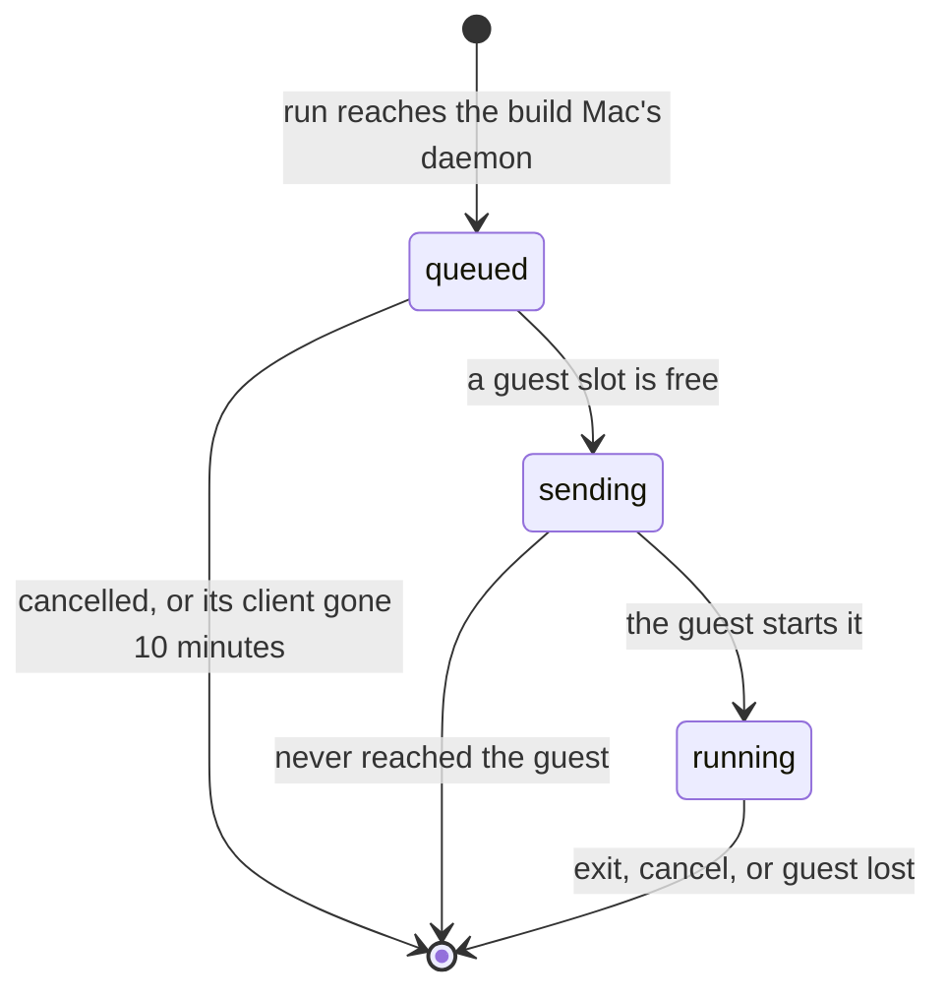
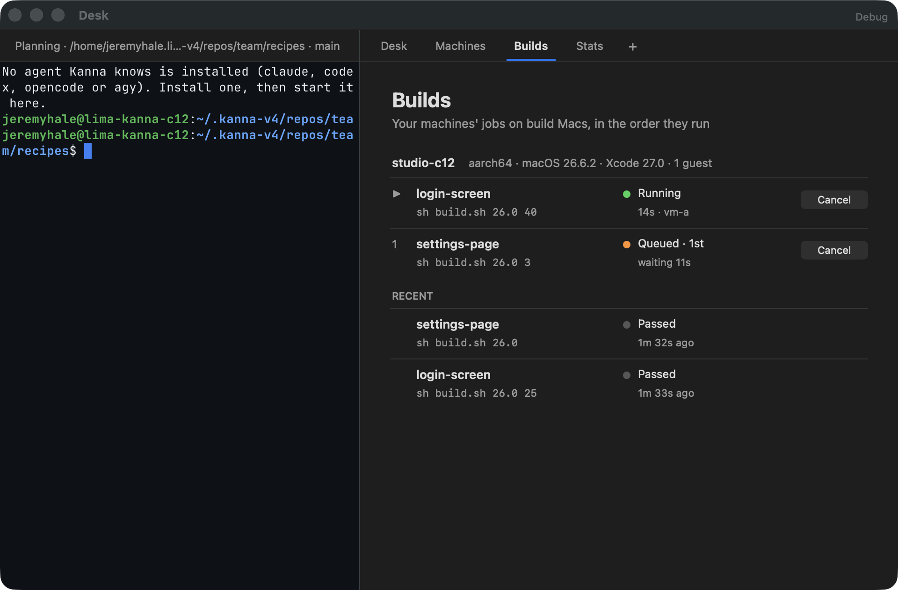
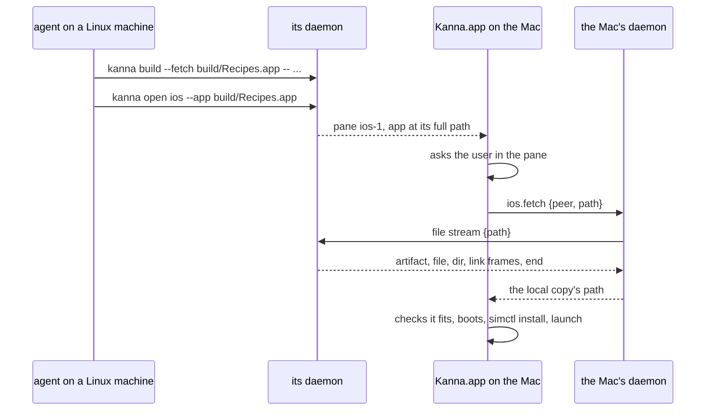
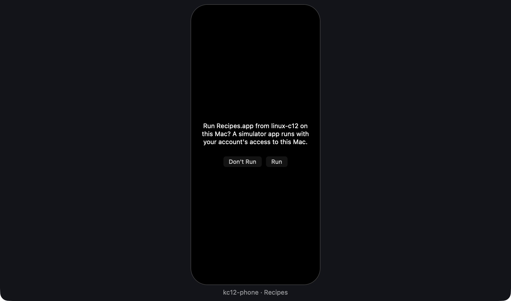
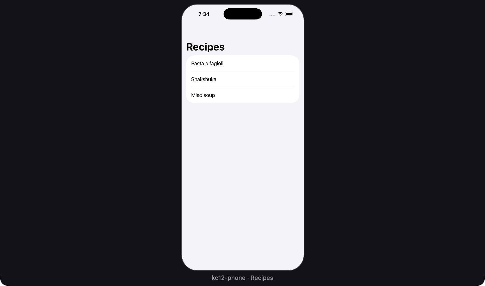

# Build Queue and a Remote Task's iOS App

**Status:** built (Cloud 12) · **Part of:** [build Macs](build-macs.md) · **Model:** [build-queue.html](../../references/mockups/build-queue.html) · **Tests:** `cargo test -p kanna-daemon --bin kanna-daemon build` (order, slots, the host limit, a mirror's guest, needs, cancelling, a waiter coming back, a restart, picking a Mac), `cargo test -p kanna-daemon --bin kanna-daemon ios_apps`, `cargo test -p kanna --test machines_build`, e2e `builds_tab`, `machine_ios_pane`

A build Mac's daemon holds its jobs in a queue, runs them in the order they came as guest slots free up, and shows them in `kanna builds` and the app's Builds tab, where any of them can be cancelled. A Linux task's iOS app, built on a build Mac, runs in this Mac's Simulator in the ordinary iOS pane.

## 1. The queue

- **The daemon holds the job before any bytes move.** It reads the `run` frame and its manifest and answers `queued {ahead}` while the job waits; the snapshot goes to the guest only after `granted {guest}`. A queued job costs its guest nothing, and the guest is chosen as late as possible. The supervisor's own locks stay as a second guard.
- **Order:** jobs are considered oldest first, each time a slot may have freed. A job can pass an older one only when the older one can't use the free slot (its task's mirror is busy, or it needs another guest).
- **Slots:** one build and one UI job per guest, one job per mirror at a time, and at most `jobs` in `guests/pool.json` across the host (default 2, the macOS guest limit). The limit is a number you set, not measured pressure.
- **A guest for a job:** the guest that holds its mirror if it matches, and then the job waits for that guest; otherwise the free matching guest with fewest mirrors.
- **Durable:** `guests/queue.json` keeps jobs and the last 20 finished. After a restart the daemon goes back to watching running jobs; queued jobs wait for their clients to come back.
- **A client that drops while queued** runs `run` again with the same job ID and keeps its place for 10 minutes. Nobody is there to send its snapshot meanwhile, so a detached job is passed over. Once granted, a drop follows [build Macs §2](build-macs.md#2-a-job).
- **A watcher per granted job** asks the guest for `status` each second, moves the job to running, and on the end frees its slot and records its result, whether or not a client is connected. A guest that doesn't answer for two minutes loses the job; a job the guest never heard of, with its relay gone, ends at once.

## 2. Matching and cancelling

- **`kanna build` needs:** `--xcode V`, `--arch A` (`arm64` means `aarch64`), `--macos V`, `--runtime V`, or `KANNA_BUILD_XCODE`, `_ARCH`, `_MACOS`, `_RUNTIME` through the shim. A version matches itself and anything under it: `26` or `26.x` match `26.1`, and `2` doesn't.
- **Choosing a Mac,** on the task machine's daemon: `--mac`, then `build.mac`, then your one Mac if the job states no needs. Otherwise it asks every peer that is a Mac or whose OS isn't known yet for `build.jobs`, waits up to 8 s, and takes the matching one that has the task's mirror, else the shortest queue. The Mac chosen first serves all of that job's later connections.
- **What a Mac reports:** `build.jobs` gives its jobs, the last finished, and for each guest its arch, macOS, Xcode and iOS runtimes (from the guest's `hello`, kept 5 minutes), plus the host's cores, memory and free disk.
- **Cancelling:** `kanna builds cancel JOB`, Cancel in the tab, or Ctrl-C at `kanna build`. A queued job leaves at once and its `kanna build` exits 130; a running one is cancelled in its guest; one still being sent is cancelled as soon as the guest has it. Peers are one operator's until the [isolation gate](build-mac-isolation.md#5-proof-before-product) opens, so any of them may cancel any job and see every job; a second tenant needs that scoped.

## 3. The Builds tab

A fixed tab in the Desk view, after Machines. It's app-wide, as Machines is. Each build Mac shows its guests' capabilities, its jobs in run order, Cancel on each, and its last finished jobs. A row's name is the task's, or its branch outside a task; its tooltip names the machine it came from. An unreachable Mac says so. The page asks the local daemon for `build.pool` every 2 seconds while it's showing, and the daemon asks the peers, so a build Mac the app has no link to still shows.

## 4. A remote task's iOS app

| Asked | Running |
|---|---|
|  |  |

- **A simulator app is code on this Mac:** it runs as a native process with the user's access. So a remote iOS pane runs nothing until the user presses **Run** in the pane; **Don't Run** fails the pane. Approval holds for that machine until the app quits, and a relaunch asks again. Only a `.app` given by full path is accepted from another machine, never a bundle ID, so a remote task can't launch what's already installed here.
- **The record stays with the task:** the pane is in the remote daemon's layout, in the task's tabs, and `kanna open`, `close` and `list` work there as for any pane. **Changed:** [build Macs](build-macs.md#6-ios-for-remote-tasks) put the content on the MBP's daemon; only the Simulator and the fetched copy are here. `kanna open` waits for the user like any pane start, up to 180 s.
- **The fetch** is a `file` stream between daemons (an app's certificate is refused). The sender accepts only a full path to a real folder ending in `.app`, with no link at its end, and uses the job artifact frames; the receiver writes through the [intake](build-macs.md#3-paths-and-artifacts) to `ios-apps/<hash of machine and path>/` in its state, replacing the last copy. Copies unused for a week go at the next fetch.
- **What won't run is refused before booting:** an app whose `DTPlatformName` isn't `iphonesimulator`, and one whose `MinimumOSVersion` is above the device's iOS, with the deployment target to build for. Xcode on a build Mac is often newer than this Mac's runtime, so the task sets `IPHONEOS_DEPLOYMENT_TARGET`, or asks for `--xcode`.

## 5. Interfaces

| Where | What |
|---|---|
| CLI | `kanna builds [--json]`, `kanna builds cancel JOB`; `kanna build`'s needs |
| Socket and peers | `build.jobs {machine, repo, task}`, `build.cancel {job}` on a build Mac; `build.pool [{job}]` on any daemon, which fans out, and cancels when given a job; `ios.fetch {peer, path}` |
| Job frames | from the daemon: `queued {ahead, jobs}`, `granted {guest}`, `done {status}` for a job cancelled while queued; on `run`: `needs`, `label` |
| Stream | `file` with `{path}`: `artifact {dir}`, then `file`, `dir`, `link` frames and `end`, or `error` |
| State | build Mac: `guests/queue.json`, `guests/pool.json` (`{"jobs": N}`); Mac: `ios-apps/` |
| Protocol | 5 |

## 6. Limits

- **Tested with one build Mac and a stand-in for the second:** matching across Macs ran between daemons on one Mac (a bare Mac and one with a guest) and in `pick`'s tests, not across two guests on two real Macs.
- **The host limit doesn't measure:** memory and CPU pressure aren't read.
- **Guests update separately:** a guest's own `kanna-guest` runs as it did; its `hello` reports runtimes once it's updated ([updating a guest](build-macs.md#guest-image)). An older one reports none, so `--runtime` finds nothing there.
- **No fetch progress:** the pane says it's fetching, without a count.
