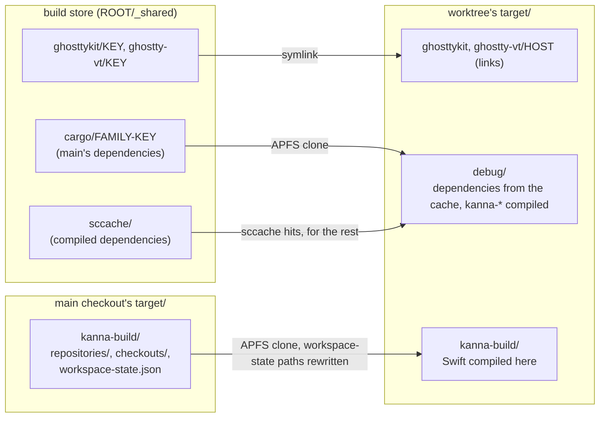

# Build Speed

**Status:** built · **Builds on:** [build channels](build-channels.md) · **Why:** every task's agent runs `scripts/build.sh` in a fresh worktree, and each worktree has its own `target/`, so cargo and SwiftPM used to start cold every time

## 1. What a fresh worktree starts from

| From | How | Saves |
|---|---|---|
| Ghostty's builds, Zig and source ([build store](build-store.md#2-the-store)) | built once per pin, then a symlink | the Zig build, cloning the fork |
| Rust dependencies ([seed](build-store.md#2-the-store)) | `cp -c` of the store's dev-profile build of main's `Cargo.lock`, without our crates | compiling ~270 registry crates |
| Dependencies that differ from main's ([compile cache](build-store.md#4-the-compile-cache)) | `sccache` as `rustc`'s wrapper | recompiling them in every worktree |
| SwiftPM's packages (`kanna_borrow_swiftpm`) | `cp -c -R -p` of `repositories/` and `checkouts/`; `workspace-state.json` with the main checkout's path replaced by the worktree's | package resolve 3.5s → 0.2s |

- **One Rust profile.** A worktree builds `target/debug` for its app and its tests alike; the main checkout builds `release` ([build store](build-store.md#3-one-rust-profile-per-worktree)).
- **Our crates always compile in the worktree,** from its own source: the seed carries none of their artifacts or fingerprints, and sccache doesn't cache incremental crates.
- **Only resolution state from SwiftPM.** Its build products record absolute paths (the module cache refuses to load from a different path), so a whole clone of `kanna-build` fails to build; the Swift modules compile in the worktree.

## 2. Dev builds the Swift app in debug

| Channel | Rust | Swift app |
|---|---|---|
| production, staging | release | release |
| dev, main checkout | release | **debug** |
| dev, task worktree | `dev` profile (`target/debug`) | **debug** |

SwiftPM's release build compiles each module whole, on one core: the `Kanna` module (6k lines) takes ~10s whatever changed. Debug compiles files in parallel batches and only what an edit affects. Rust is release in the main checkout, whose app you run all day. A task worktree builds one profile, `dev`, for its tests and its app alike, tuned so the daemon still keeps up: dependencies at `opt-level = 3`, our crates at 1 ([build store](build-store.md#3-one-rust-profile-per-worktree)). `KANNA_CONFIGURATION=release scripts/build.sh` builds a dev app in release.

## 3. Line tables in release

The workspace's `[profile.release]` sets `debug = "line-tables-only"`: optimisation is unchanged, and backtraces, `sample`, `atos -o target/release/kanna-daemon` and lldb show file:line in every build, dev and shipped.

- **On macOS the line tables stay in the `.o` files** (`split-debuginfo = "unpacked"`, cargo's default there). The linked binary gets only a debug map pointing at them, so tools find file:line while `target/release/deps` is there.
- **Shipped builds strip the map** and keep dSYMs beside the DMGs ([release: stripping](release.md#stripping)).

Measured with `scripts/build.sh`, dev channel, arm64:

| | Before | Line tables | After `strip -S` |
|---|---|---|---|
| `kanna-daemon` | 11.36 MB | 12.56 MB (+10.6%) | 11.58 MB |
| `kanna` | 1.68 MB | 1.85 MB | 1.71 MB |
| `kanna-keeper` | 1.12 MB | 1.24 MB | 1.13 MB |
| `libkanna_ffi.a` | 73 MB | 228 MB | |
| `target/release/deps` | | 1.8 GB | |
| fresh worktree, deps not borrowable | | 64s | |

## 4. Measured

`scripts/build.sh`, dev channel, in a task worktree, on a 10-core Apple Silicon Mac, the main checkout already built.

| Case | Before | After | Where the time goes after |
|---|---|---|---|
| (a) fresh worktree (`target/` absent) | 71.4s | **20.7s** | cargo, our crates 7.4s · swift debug 11.1s · rest 2s |
| (b) no-op rebuild | 1.2s | **1.0s** | two cargo no-ops 0.2s, `kanna-build` and SwiftPM planning 0.8s |
| (c) edit a Swift file in the `Kanna` module | 9.9s | **5.0s** | 9 files recompiled, then the debug link (~2.5s) |
| (c) edit a Swift leaf module (`KannaStatus`) | 1.4s | **1.2s** | |
| (c) edit `kanna-daemon/src/host.rs` | 3.6s | **3.2s** | cargo 2.3s; Swift untouched |
| (c) edit `kanna-mux` (feeds `kanna-ffi` and the daemon) | 7.9s | **8.0s** | cargo 4.0s, Swift relink 3.0s |

Before, the fresh worktree's 71s was cargo 43s (285 units, 275 CPU-seconds, ~7 of 10 cores), SwiftPM resolve 5s and a release Swift compile of 22s on ~1 core. The merman stack (merman-render, -elk-layered, -core, dugong) is a third of cargo's cold CPU time and its critical path; borrowed dependencies take it off the table.

Tests, `cargo test`, unsandboxed, in a task worktree built with `dev`, same Mac. `Instance` and `Daemon`, the test harnesses' daemons, stand in for Kanna.app with a fake that now answers `app.front`. Before, `focus` waited out the daemon's 10s `APP_TIMEOUT` for an answer that never came, then replied anyway, so nothing failed.

| Test binary | Before | After | Where the time goes after |
|---|---|---|---|
| `kanna-daemon` `protocol_cases` | 77.3s | **6.1s** | 36 `Instance`s, ~0.17s each to start and stop |
| `kanna` `cli` | 71.8s | **11.0s** | |
| `cargo test -p kanna-daemon`, its 12 binaries' times added up | 128s (`--test-threads=4`) | **52s** | |

One `Instance`, measured alone: start ~105ms, `app.hello` <1ms, a request <2ms, stopping the daemon 1ms, its keeper ~55ms, removing its folder <35ms. The 77s was 7 `focus` steps at 10.00s each, and those 36 `Instance`s at ~0.19s.

## 5. Not done

- **sccache:** the borrowed dependencies already cover what it would cache, and it can't share our crates between worktrees (their paths differ).
- **A shared `CARGO_TARGET_DIR`:** concurrent tasks would serialise on cargo's lock and overwrite each other's `kanna-*` builds.
- **A lighter Rust release profile:** our crates' critical path (`kanna-mux` → `kanna-daemon`) is ~7s; the profile is cargo's default (no LTO) plus line tables (§3).
- **Overlapping SwiftPM with cargo:** resolve is 0.2s once borrowed; Swift needs `libkanna_ffi.a` to link.
- **Skipping the bundle copy or the second cargo call:** 0.05s and 0.1s.
