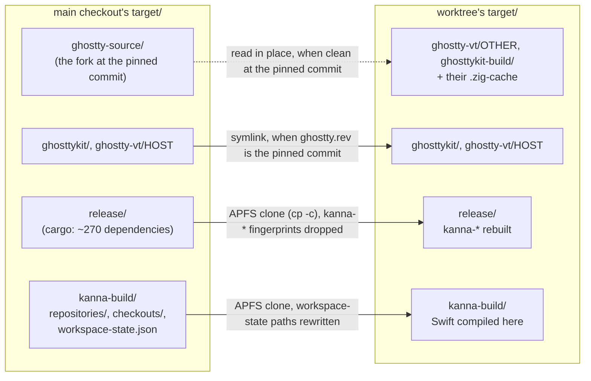

# Build Speed

**Status:** built · **Builds on:** [build channels](build-channels.md) · **Why:** every task's agent runs `scripts/build.sh` in a fresh worktree, and each worktree has its own `target/`, so cargo and SwiftPM used to start cold every time

## 1. What a fresh worktree borrows

With build outputs on another volume ([build targets](build-targets.md)), a worktree clones from the main checkout's copy there.

| Borrowed | When | How | Saves |
|---|---|---|---|
| Ghostty's source (`kanna_ghostty_source`) | the worktree builds Ghostty itself (another arch, or main's builds are stale) and the main checkout's `ghostty-source` is clean at the pinned commit | used where it is, read-only | cloning the fork |
| Ghostty builds (`kanna_borrow_built`) | the worktree has none and the main checkout's are the pinned commit | symlink | the Zig build |
| cargo's `target/release` (`kanna_borrow_cargo`) | the worktree has no `target/release` | `cp -c -R -p`, then `rm -rf .fingerprint/kanna-*` | the dependencies: cargo 43s → 7s |
| SwiftPM's packages (`kanna_borrow_swiftpm`) | the worktree has no `target/kanna-build` | `cp -c -R -p` of `repositories/` and `checkouts/`; `workspace-state.json` with the main checkout's path replaced by the worktree's | package resolve 3.5s → 0.2s |

- **One Ghostty source builds every target.** `zig build -Dtarget=...` writes wherever `-p` says, so a worktree clones the fork only when it has to. The source is `GHOSTTY_SOURCE_DIR` if set, else the main checkout's source if it's clean at `KANNA_GHOSTTY_COMMIT`, else (in the main checkout, or when main's is missing, stale or edited) its own `target/ghostty-source`.
- **Builds never write into the shared source.** Each build passes `--cache-dir` under its own checkout's `target/` (`ghostty-vt/.zig-cache-TRIPLE`, `ghosttykit-build/.zig-cache`), so two worktrees can build at once. GhosttyKit's build writes `macos/GhosttyKit.xcframework` relative to the directory zig runs in, so `build-ghosttykit.sh` runs zig from `target/ghosttykit-build/` with `--build-file`. Zig fetches packages into the source's `zig-pkg/` only when one is missing, and the main checkout's build has already fetched them.
- **`ghostty.rev` stays right.** `kanna_ghostty_rev` reads the source it built from, and a borrowed source is clean at the pinned commit, so a worktree's builds carry the same rev as main's.
- **Our crates always rebuild.** Dropping their fingerprints makes cargo compile every `kanna-*` crate from the worktree's own source, whatever the main checkout last built; only registry crates, whose fingerprints don't depend on paths, are reused. Binaries and `libkanna_ffi.a` come out byte-identical to a from-scratch build.
- **Built for the same macOS.** The clone carries the main checkout's `macos-deployment-target` stamp; `kanna_cargo_release_for` runs after the borrow and cleans the clone if it was built for another deployment target ([deployment target](deployment-target.md)).
- **Clones, not links.** A clone shares disk blocks until either side writes, so the worktree's builds never write to the main checkout's `target/`, and neither side waits on the other's cargo lock.
- **Only resolution state from SwiftPM.** Its build products record absolute paths (the module cache refuses to load from a different path), so a whole clone of `kanna-build` fails to build; the Swift modules compile in the worktree.

## 2. Dev builds the Swift app in debug

| Channel | Rust (`target/release`) | Swift app |
|---|---|---|
| production, staging | release | release |
| dev (main checkout and tasks) | release | **debug** |

SwiftPM's release build compiles each module whole, on one core: the `Kanna` module (6k lines) takes ~10s whatever changed. Debug compiles files in parallel batches and only what an edit affects. Rust stays release everywhere: its dependencies cost the same either way, the daemon parses every terminal byte, and a dev build's `target/release` is what a worktree borrows. `KANNA_CONFIGURATION=release scripts/build.sh` builds a dev app in release.

## 3. Line tables in release

The workspace's `[profile.release]` sets `debug = "line-tables-only"`: optimisation is unchanged, and backtraces, `sample`, `atos -o target/release/kanna-daemon` and lldb show file:line in every build, dev and shipped.

- **On macOS the line tables stay in the `.o` files** (`split-debuginfo = "unpacked"`, cargo's default there). The linked binary gets only a debug map pointing at them, so tools find file:line while `target/release/deps` is there.
- **Shipped builds strip the map** and keep dSYMs beside the DMGs ([release: stripping](release.md#stripping)).
- **A worktree borrows dependencies built with the same profile.** The setting is in every crate's fingerprint, so a main checkout built before it rebuilds all dependencies once, and until then a worktree rebuilds them too.

Measured with `scripts/build.sh`, dev channel, arm64:

| | Before | Line tables | After `strip -S` |
|---|---|---|---|
| `kanna-daemon` | 11.36 MB | 12.56 MB (+10.6%) | 11.58 MB |
| `kanna` | 1.68 MB | 1.85 MB | 1.71 MB |
| `kanna-keeper` | 1.12 MB | 1.24 MB | 1.13 MB |
| `libkanna_ffi.a` | 73 MB | 228 MB | |
| `target/release/deps` | | 1.8 GB | |
| fresh worktree, deps not borrowable | | 64s | |

## 4. Measured

`scripts/build.sh`, dev channel, in a task worktree, on a 10-core Apple Silicon Mac, the main checkout already built.

| Case | Before | After | Where the time goes after |
|---|---|---|---|
| (a) fresh worktree (`target/` absent) | 71.4s | **20.7s** | cargo, our crates 7.4s · swift debug 11.1s · rest 2s |
| (b) no-op rebuild | 1.2s | **1.0s** | two cargo no-ops 0.2s, `kanna-build` and SwiftPM planning 0.8s |
| (c) edit a Swift file in the `Kanna` module | 9.9s | **5.0s** | 9 files recompiled, then the debug link (~2.5s) |
| (c) edit a Swift leaf module (`KannaStatus`) | 1.4s | **1.2s** | |
| (c) edit `kanna-daemon/src/host.rs` | 3.6s | **3.2s** | cargo 2.3s; Swift untouched |
| (c) edit `kanna-mux` (feeds `kanna-ffi` and the daemon) | 7.9s | **8.0s** | cargo 4.0s, Swift relink 3.0s |

Before, the fresh worktree's 71s was cargo 43s (285 units, 275 CPU-seconds, ~7 of 10 cores), SwiftPM resolve 5s and a release Swift compile of 22s on ~1 core. The merman stack (merman-render, -elk-layered, -core, dugong) is a third of cargo's cold CPU time and its critical path; borrowed dependencies take it off the table.

## 5. Not done

- **sccache:** the borrowed dependencies already cover what it would cache, and it can't share our crates between worktrees (their paths differ).
- **A shared `CARGO_TARGET_DIR`:** concurrent tasks would serialise on cargo's lock and overwrite each other's `kanna-*` builds.
- **A lighter Rust release profile:** our crates' critical path (`kanna-mux` → `kanna-daemon`) is ~7s; the profile is cargo's default (no LTO) plus line tables (§3).
- **Overlapping SwiftPM with cargo:** resolve is 0.2s once borrowed; Swift needs `libkanna_ffi.a` to link.
- **Skipping the bundle copy or the second cargo call:** 0.05s and 0.1s.
