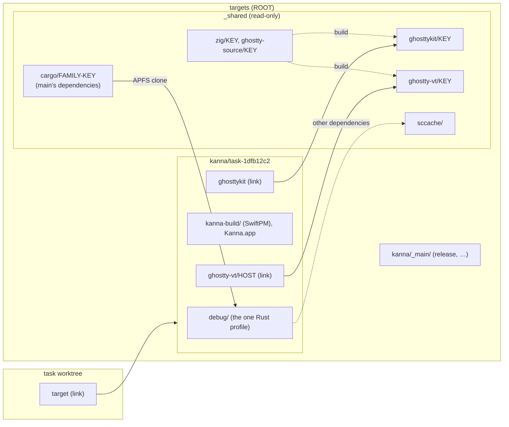
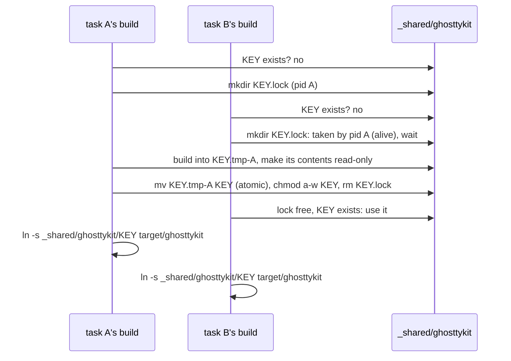
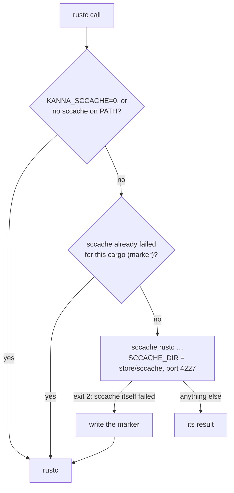
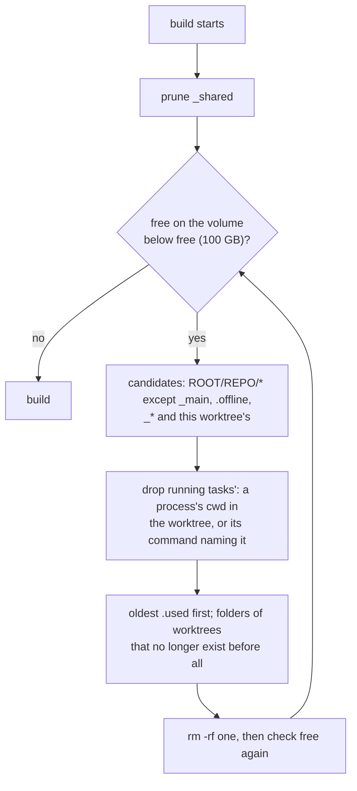

# Build Store

**Status:** built · **Tested:** `scripts/test-store.sh` (locking, publish, pruning, eviction against a fake `ROOT`), `scripts/test-teardown.sh` · **Builds on:** [build targets](build-targets.md), [build speed](build-speed.md) · **Why:** each task's build folder on the build volume grew to ~17 GB, and one merge-main round rebuilt ~40 of them, filling the external SSD to 98%

A task worktree's build folder holds only what that task builds itself: one Rust profile and its Swift build. Everything pinned (Zig, Ghostty's source, GhosttyKit, libghostty-vt, and a build of main's Rust dependencies) is built once per pin into a shared, read-only **store** that worktrees link to or clone; Rust dependencies that differ from main's come from a shared compile cache; and build folders are caches that are evicted, least recently used first, when the volume runs low.

## Contents

1. [What goes where](#1-what-goes-where)
2. [The store](#2-the-store)
3. [One Rust profile per worktree](#3-one-rust-profile-per-worktree)
4. [The compile cache](#4-the-compile-cache)
5. [Eviction](#5-eviction)
6. [Measured](#6-measured)
7. [Rejected](#7-rejected)
8. [Glossary](#8-glossary)

## 1. What goes where

| Piece | Before, per worktree | Now |
|---|---|---|
| Zig toolchain, Ghostty source | 419 MB + 531 MB | `_shared/zig/KEY`, `_shared/ghostty-source/KEY`, once per pin |
| GhosttyKit, its Zig cache, libghostty-vt | 350 MB + 2.8 GB + 245 MB | `_shared/ghosttykit/KEY`, `_shared/ghostty-vt/KEY`, once per pin; the Zig cache is deleted after publish |
| Rust | `debug/` 3.6 GB **and** `release/` 4.4 GB | `debug/` only, deps optimised without debug info |
| Rust dependencies | `release/` borrowed by clone, `debug/` compiled | `debug/` cloned from `_shared/cargo` (shared blocks); the rest from `_shared/sccache` |

The main checkout keeps its `release/` profile and real, internal copies of GhosttyKit and libghostty-vt (cloned from the store), so its app still builds with the volume unplugged ([build targets](build-targets.md#2-rules)).

## 2. The store

- **Where:** `ROOT/_shared/NAME/KEY`, `ROOT` being `targets` in the main checkout's `build.local.json` ([build targets](build-targets.md#1-where-target-lives)). With `targets` unset or its volume unmounted, it's `MAIN/target/_shared` on the internal disk (`MAIN` the main checkout).
- **Names and keys:** a key is the first 16 hex digits of the SHA-256 of what decides the output, so a Ghostty bump (or a change to a build script) is a new key and one build, and an old key is never overwritten.

| Name | Key from | Holds |
|---|---|---|
| `zig` | Zig version, host OS and architecture | the toolchain |
| `ghostty-source` | fork URL, pinned commit, Zig version | a checkout at the commit, with every Zig package it can need fetched into `zig-pkg/` (the entry is read-only, so Zig can't fetch later) |
| `ghosttykit` | pinned commit, Zig version, `KANNA_GHOSTTY_OPTIMIZE`, `build-ghosttykit.sh` | `GhosttyKit.xcframework`, `ghostty.rev` |
| `ghostty-vt` | the same with `build-ghostty-vt.sh`, and the Rust triple | `include/`, `lib/libghostty-vt.a`, `ghostty.rev` |
| `cargo` | `FAMILY` (rustc's version, triple, profile), then `Cargo.lock`, `Cargo.toml`, `.cargo/config.toml` | a worktree's profile folder with only the dependencies: our crates' artifacts, fingerprints and `incremental/` removed |

- **Built once, under a lock:** `kanna_store NAME KEY BUILDER` in `scripts/store.sh` returns the entry, building it first if it's missing. The lock is a folder, `KEY.lock`, made with `mkdir` (atomic) and holding the builder's pid. Others wait for it, saying who they wait for, then look again. A lock whose pid is dead is stale and is taken over.
- **Atomic publish:** the builder writes `KEY.tmp-PID`, its contents are made read-only, one `mv` makes it `KEY`, then `KEY` itself is made read-only (macOS won't rename a folder you can't write). A failed build removes its temp folder and the lock and exits non-zero; nothing half-built is ever at `KEY`.
- **Worktrees link** `target/ghosttykit` and `target/ghostty-vt/TRIPLE` to their entries, and `touch` an entry each time they use it. A worktree with no profile folder yet **clones** a `cargo` seed into it (`cp -c`: APFS shares the blocks until cargo rewrites a file), as the old `release/` borrowing did; cargo rewrites build scripts' `OUT_DIR` paths when the folder moves, and compiles our crates from the worktree's source. The main checkout clones them into real folders instead, marked with the key. Zig and the source aren't linked: only the store's builders use them.
- **Seeds are built only for main's `Cargo.lock`:** when the worktree's `Cargo.lock`, `Cargo.toml` and `.cargo/config.toml` are the main checkout's committed ones, a missing seed is built (both `cargo build` and `cargo test --no-run`, so the app and the tests start warm). A worktree that changed them clones the newest seed of its family instead, and cargo recompiles only what differs, through the compile cache. So a task that adds a dependency costs no store build, and a merge to main costs one.
- **Read-only:** entries are `a-w`, so a build can't change what other worktrees use. A worktree that builds Ghostty from its own source (`GHOSTTY_SOURCE_DIR`) builds into its own `target/`, as before.
- **Pruned** in the eviction pass ([§5](#5-eviction)): an entry no link under `ROOT` points to and unused for a day is deleted, under its lock. `sccache/` is never pruned; it bounds itself.

## 3. One Rust profile per worktree

| Checkout | Profile | `cargo test` | `scripts/build.sh`'s app |
|---|---|---|---|
| task worktree | `dev` (`target/debug`) | same profile | same profile |
| main checkout | `release` | `dev` | `release` |
| `scripts/release.sh` | `release`, without the compile cache | | `release` |

- **`kanna_rust_profile`** in `scripts/env.sh` says which: `debug` in a worktree, `release` in the main checkout; `KANNA_RUST_PROFILE=release|debug` overrides it. `kanna_rust_dir` is its folder (`target/[TRIPLE/]PROFILE`), which `build.sh` and `build-kanna-app.sh` (as `KANNA_RUST_DIR` for SwiftPM) build into instead of `target/release`.
- **What runs the app's build takes its binaries from the bundle:** `cargo test` can rebuild the profile's `kanna`, `kanna-daemon` and `kanna-keeper` (measured: after it they no longer matched the app's copies), so `e2e-kanna.sh` and `run-kanna.sh` use `Kanna.app/Contents/Helpers/`, which match the app (only `kanna-build` comes from the profile folder).
- **The `dev` profile is tuned** in `Cargo.toml` so one profile serves both: our crates at `opt-level = 1` with line tables, dependencies at `opt-level = 3` with no debug info. Debug assertions stay on, which the keeper's test hooks need.
- **`Package.swift`** links `libkanna_ffi.a` from `KANNA_RUST_DIR`, or else `target/debug` in a worktree and `target/release` in the main checkout, so `swift test` works in both.
- **A fresh worktree's profile folder** starts as a clone of the store's `cargo` seed ([§2](#2-the-store)), not of the main checkout's `release/`, which is another profile.
- **Release builds stay clean:** `release.sh` sets `KANNA_RUST_PROFILE=release` and an empty `RUSTC_WRAPPER` (which overrides `.cargo/config.toml`), so every crate is compiled by `rustc` itself, and builds in the main checkout, whose Ghostty copies are real folders.

## 4. The compile cache

`.cargo/config.toml` sets `build.rustc-wrapper` to `scripts/rustc-wrapper.sh`, so every `cargo` run, scripted or not, goes through it:

- **Why sccache:** it is the one maintained cache that shares Rust compiles between different target folders (by hashing a crate's inputs, not its path), it's already on this Mac (Homebrew), and it covers what the seed can't: dependencies a task changed, other triples, and the seed's own build after a lock change. Cargo itself can't share a build across workspaces (`build-dir` only moves a workspace's own intermediates).
- **Why not sccache alone:** it doesn't cache proc-macros or build scripts (dylibs and binaries), and on macOS each worktree's proc-macro dylib differs in its linker UUID and signature, so every crate that uses a proc-macro misses too. Measured, a second worktree hit 76% of what it sent and still spent 82s in cargo ([§6](#6-measured)); the seed is a clone.
- **What it doesn't cache:** our own crates (incremental), binaries, proc-macros and build-script runs.
- **Its own server and folder:** port 4227 (not the default 4226), `SCCACHE_DIR` the store's `sccache/`, `SCCACHE_CACHE_SIZE` 30G unless set. The server starts with the first compile and stops after 10 idle minutes.
- **Degrades to plain `rustc`:** with sccache missing, `KANNA_SCCACHE=0`, or sccache unable to run (a sandbox that forbids its server's socket exits 2 before compiling). The marker (`$TMPDIR/kanna-sccache-off.PID`, per cargo process) keeps a failing sccache from being tried once per crate. Builds are as fast as before, never broken.

## 5. Eviction

Run at the start of every build, by `kanna_targets` (`kanna_evict` in `scripts/store.sh`):

- **Why at build start:** that's when space is used, on every build, not once per task. Teardown only ever frees the task's own folder, and only on Done. Setup runs once per worktree, so a long task that builds a lot never triggers it. The daemon doesn't know a repo's build layout ([task scripts](task-scripts.md#5-rejected)); this repo's scripts do. The check is one `df` when there's room.
- **Running** means some process has its working folder in the worktree, or names the worktree or its build folder in its command line (an agent, a terminal, a `--bg` app). A stopped task has no processes: its terminals are hung up. If `lsof` or `ps` fails, nothing is evicted.
- **Last used** is `ROOT/REPO/WORKTREE/.used`, touched by every build.
- **Never evicted:** `_main`, `.offline`, `_shared` (only pruned), the building worktree's own folder, a running task's.
- **One at a time:** eviction holds `ROOT/_shared/.evict.lock`; a build that finds it taken skips eviction.
- **An evicted worktree rebuilds** on its next build: its `target/` link is left dangling, and `kanna_targets` makes the folder again.
- **`free`** in the main checkout's `build.local.json` sets the threshold in GB. It's this repo's, not one of Kanna's settings.

## 6. Measured

Fresh worktrees of main on the external SSD (arm64), each running `scripts/build.sh` then `cargo test --workspace --no-run`, with other tasks building at the same time. Sizes are `du` (which counts APFS clones in full) and the drop in the volume's free space (which doesn't).

| | Before | After |
|---|---|---|
| A task's build folder, `du` | 9.1 GB; ~17 GB when it built its own Ghostty | 3.8 GB (`debug/` 2.8 GB, of which 1 GB is the seed's clone) |
| A task's build folder, real disk | ~5 GB | 2.3–3.6 GB |
| A task's `build.sh` + tests | 67s + 43s = **110s** | 45s + 20s = **65s** |
| A second task's | 56s + 41s = **97s** | 44s + 19s = **63s** |
| sccache alone, no seed (second task) | | 107s + 18s: cargo 82s, 76% hits |
| Once per Ghostty pin | every behind worktree builds its own (~4.3 GB each) | the first task's `build.sh` 311s; the store's entries 1.5 GB (Zig 426 MB, source 698 MB, GhosttyKit 350 MB, libghostty-vt 15 MB) |
| Once per main `Cargo.lock` | | the seed: 122s, 1.0 GB |

- **Tests got faster** because `cargo test` now reuses the profile `build.sh` just built, and dependencies come optimised but without debug info.
- **What's left per task** is our own crates (`debug/deps`, `incremental/`, ~1.8 GB at `opt-level = 1` with line tables) and SwiftPM's debug build (850 MB).

## 7. Rejected

- **A shared `CARGO_TARGET_DIR`:** one cargo lock for every worktree serialises their builds, and their different sources keep invalidating each other's fingerprints.
- **Keeping both profiles, only sharing Ghostty:** `release/` and `debug/` are each 4 GB; tests can't run in `release` because `cargo test` uses `dev` unless every agent remembers `--release`, and the keeper's test hooks need debug assertions.
- **Eviction in the daemon:** it would have to know this repo's build layout, and Kanna's settings are for building any project.
- **Hard links instead of symlinks into the store:** a folder can't be hard-linked, and a link shows where an entry came from.

## 8. Glossary

| Term | Meaning |
|---|---|
| **Store** | `ROOT/_shared`: pinned builds, one per key |
| **Key** | A hash of what decides an entry's output |
| **Entry** | One `NAME/KEY` folder in the store |
| **Profile** | Cargo's build settings and output folder: `dev` → `target/debug`, `release` → `target/release` |
| **sccache** | Mozilla's compiler cache, run as `rustc`'s wrapper |
