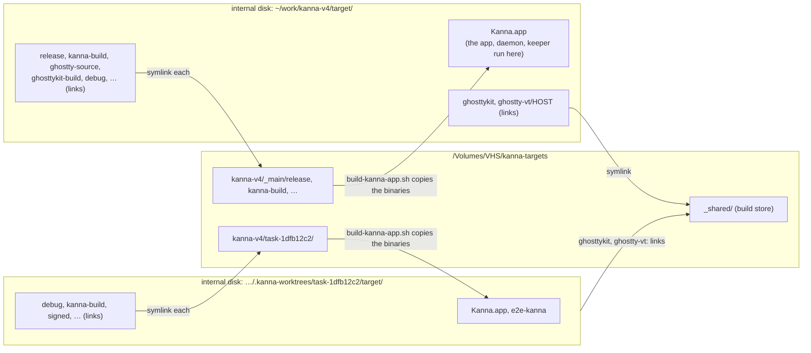
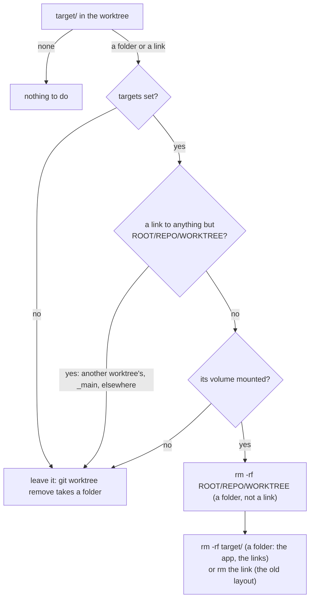

# Build Targets

**Status:** built · **Tested:** `scripts/test-teardown.sh`, `scripts/test-store.sh`, `scripts/test-volume-drop.sh` · **Related:** [build store](build-store.md) · **Builds on:** [build speed](build-speed.md), [settings](settings.md) · **Why:** each checkout's `target/` grows to 10 GB, and 57 task worktrees filled the internal disk until a task stopped

Build outputs can live on another volume, such as an external SSD: all of every checkout's except the app it runs, which stays on the internal disk. Sources stay where they are.

## Contents

1. [Where `target/` lives](#1-where-target-lives)
2. [Rules](#2-rules)
3. [Removing a task](#3-removing-a-task)

## 1. Where `target/` lives

Set `targets` in `build.local.json` at the root of the main checkout to a folder on that volume:

```json
{ "targets": "/Volumes/VHS/kanna-targets" }
```

| File | Tracked | Holds |
|---|---|---|
| `build.json` | yes | the repo's defaults: `free`, the GB [eviction](build-store.md#5-eviction) keeps free (100) |
| `build.local.json` (main checkout) | no, ignored | this Mac's: `targets`, and any key of `build.json` to override |



| Drive | Main builds | A worktree's Ghostty and dependencies |
|---|---|---|
| plugged in | on the volume; Ghostty linked from `ROOT/_shared` | links into `ROOT/_shared`; compiles from `ROOT/_shared/sccache` |
| unplugged | from scratch, in real folders on the internal disk, Ghostty included (into the main checkout's `target/_shared`) | the same, from the main checkout's `target/_shared` |

## 2. Rules

- **The build lives on the volume; only what runs is copied back.** Every checkout keeps on the internal disk `target/` itself, its `*.app` bundles, `e2e-kanna/`, the store links `ghosttykit` and `ghostty-vt/`, and in the main checkout `_shared/` (the [build store](build-store.md) while the volume is unplugged). Every other folder in it becomes a symlink to `ROOT/REPO/_main/NAME` in the main checkout, `ROOT/REPO/WORKTREE/NAME` in a worktree (the main checkout's folder name, then the worktree's), including ones a later build makes. `build-kanna-app.sh` builds `target/Kanna.app` by copying the binaries out of the profile folder, so the app, daemon and keeper always run from the internal disk, and the drive dropping out never takes an instance, its keeper and its terminals with it ([build store](build-store.md#6-running-off-the-volume)).
- **Built Ghostty is built once per pin** in the [build store](build-store.md) (`ROOT/_shared`), which the main checkout and worktrees link to (`target/ghosttykit`, `target/ghostty-vt/TRIPLE`). Both are static libraries linked into the app, so a built `Kanna.app` needs nothing from the volume.
- **The `kanna` on your PATH** should be `target/Kanna.app/Contents/Helpers/kanna`, not `target/release/kanna`, which is on the volume.
- **Unset, nothing changes:** `target/` is a folder in each checkout.
- **Set by `kanna_targets`** in `scripts/env.sh`, which `build.sh` and each `build-*.sh` run first. Each key comes from the main checkout's `build.local.json` (for every worktree), else the building checkout's `build.json`, read with `plutil`. `targets` is only ever local: the drive belongs to this Mac, not the repo, and it says what teardown and eviction may delete, so a `targets` in `build.json` is ignored, and so is a `build.local.json` that's committed. It isn't in Kanna's settings (`~/.kanna-v4/config.json`), which are for Kanna building any project; only this repo's scripts read it.
- **A missing volume falls back to the internal disk,** in the main checkout too. When the root is under `/Volumes/NAME` and `NAME` isn't mounted (absent, or an empty folder left on the internal disk), the build says so, removes the links that point at the missing volume, and builds in real folders. It builds from scratch there: `release/`, SwiftPM's packages and Ghostty (about 5 minutes, into the main checkout's `target/_shared`). The volume is almost always attached, so that's rare, and keeping a mirror of the build on the internal disk isn't worth its space or its sync on every build. `scripts/release.sh` builds the same way: through the links with the volume, from scratch without it. A root that isn't an absolute path falls back the same way.
- **The next build with the volume moves them there.** A real folder moves over (`mv` to `DEST.moving`, rename, link), keeping what it built. If the volume still has an older copy from before it was unplugged, the moved one replaces it. A link to another root moves the same way.
- **A worktree builds one Rust profile,** `debug/`, with its dependencies from a shared compile cache, and folders on the volume are evicted when it runs low ([build store](build-store.md)).
- **Everything reads it through the links:** cargo, SwiftPM (its `workspace-state.json` paths and module cache keep the worktree's `target/` path) and Zig's `--cache-dir`s. `e2e-kanna.sh` stops an app by the state folder it's tied to, not by its path ([e2e cleanup](e2e-cleanup.md)). `.gitignore` ignores `/target` as well as `target/`, since git doesn't count a symlink as a folder.

## 3. Removing a task

`git worktree remove` removes `target/` and the links in it, not the folder on the volume they point to, so Done's teardown removes that folder. The repo's `.kanna/config.json` sets `tasks.teardown` to `scripts/teardown.sh` ([task scripts](task-scripts.md#3-teardown-and-cleanup)), which runs on every Done, also when the worktree is kept: the folder and the worktree's `target/` (its app included) are caches, and the next build makes them again.



- **Never the store:** `target/ghosttykit` and `target/ghostty-vt/TRIPLE` are links into `ROOT/_shared`, and `rm -rf` removes links, not what they point to. Unused store entries are pruned by [eviction](build-store.md#5-eviction).
- **Only the worktree's own folder:** on the volume it removes only `ROOT/REPO/WORKTREE` as `kanna_targets` makes it (`ROOT` from `targets` in `build.local.json`, `REPO` the main checkout's folder name, `WORKTREE` this worktree's), and only when that path is a folder, not a link. A `target/` that's a link must read exactly that path (the old layout, from before [running off the volume](build-store.md#6-running-off-the-volume)). It never follows anything else, and never touches the main checkout, `_main/` or another worktree's folder.
- **Nothing to remove exits 0:** no `target/`, `targets` unset, its volume unmounted (it leaves `target/` too, so the folder on the volume keeps the links that lead to it), a link anywhere else, a folder already gone (then it removes `target/`). A failed teardown keeps the task from being Done, so only a failed `rm` exits non-zero.
- **The tracked `.kanna/config.json`** carries it to every clone. It runs main's copy, `"$KANNA_REPO/scripts/teardown.sh"`, so a worktree made before the script existed is torn down too. `.gitignore` ignores the rest of `.kanna/`; your `planning.agent` lives in your own `~/.kanna-v4/config.json`.
- **Tested** by `scripts/test-teardown.sh`, against a fake `ROOT` and `KANNA_AGENTS_HOME`.
