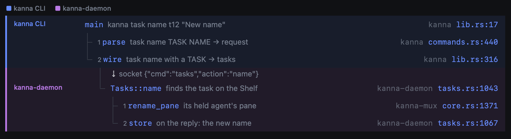
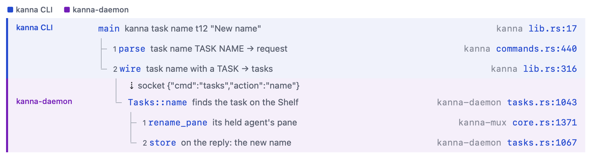

# Call Tree

**Status:** built (2026-11-01) · **Tested:** `cargo test -p kanna-calltree -p kanna-threads`, `kanna` CLI test `diagrams_check_checks_call_trees_against_the_repo`, `swift test --filter CallTreeTests` · **Builds on:** [markdown pane](app-panes.md), [diagram check](diagram-check.md), [code tour](code-tour.md) · **Mockup:** [call-tree.html](../../references/mockups/call-tree.html) · **Why:** agents walking you through a change that crosses processes (CLI, daemon, app) drew the call stack as a mermaid `sequenceDiagram` or `flowchart`, and neither shows calls nested in calls, or which process each runs in

A fenced `calltree` block in a markdown doc draws as a call tree: one indented row per call, a coloured lane per process, a hop row where a call crosses into another process, and each row's `file:line` on the right, opening the code there. A call stack is the same block with one call a level: the path one request takes through the layers, or a crash's backtrace. It's how the `kanna-explain` skill has agents show a change's calls before commenting on each part.

| Dark | Light |
|---|---|
|  |  |

## Contents

1. [The block](#1-the-block)
2. [Rules](#2-rules)
3. [How it's built](#3-how-its-built)

## 1. The block

````markdown
```calltree
kanna CLI
main          crates/kanna/src/lib.rs:17                kanna task name t12 "New name"
  parse       crates/kanna/src/commands.rs:440          task name TASK NAME → request
  wire        crates/kanna/src/lib.rs:316               task name with a TASK → tasks
    -> socket {"cmd":"tasks","action":"name"}
kanna-daemon
    Tasks::name    crates/kanna-daemon/src/tasks.rs:1043  finds the task on the Shelf
      rename_pane  crates/kanna-mux/src/core.rs:1371      its held agent's pane
      store        crates/kanna-daemon/src/tasks.rs:1067  on the reply: the new name
```
````

| Line | Is |
|---|---|
| No location (`kanna CLI`) | A **process**: the calls under it, up to the next process, are in its lane |
| `NAME  PATH:LINE  [NOTE]` | A **call**: its depth is its indent (two spaces a level); fields are split by two or more spaces |
| `-> LABEL` | A **hop**: the next call is made in the next process, carried by LABEL (a socket request, an XPC message) |

## 2. Rules

- **One lane per process,** in the order they first appear, each with its colour from a fixed set; the legend above the rows names them. A process can come back (a reply handled in the CLI again).
- **Indent is nesting.** A call is a child of the nearest call above it with less indent; tree guides join them, through hop rows and comments. When a call has two or more children they're numbered 1, 2, …, in the order they run.
- **A call stack is a call tree** with one call a level: it draws the same, with no numbers. A backtrace (a panic, a crash report, `lldb`'s `bt`) goes in as one, innermost call last. A frame outside the repo keeps its own path (absolute, or `~/.cargo/…`): it's drawn dimmed, isn't a link and isn't checked.
- **Locations are repo-relative** (to the doc's repo: the nearest folder above it with `.git`). A row shows the location's package (the folder holding `src/`) dimmed, then `file:line`; the full path on hover. A click opens it in a code tab at that line, as `kanna open code PATH:LINE`. Any markdown link to a file with a `#L12` fragment does the same.
- **Comments:** `kanna comment DOC:LINE` on a call's source line quotes the row's `file:line` and marks the whole row, with the comment by it; on a process or hop line, its name or label. A walkthrough steps down the tree one row at a time. A comment made in the pane anchors to the row's line too.
- **Checked** by `kanna diagrams check` and `kanna open md`, with mermaid's: each `FILE:LINE: message` for a repo path that doesn't exist, a line past the file's end, an indent that jumps more than one level, a call before any process, or a hop not followed by a process.
- **In a [markdown diff](markdown-diff.md),** a changed block shows before and after, like a diagram.

## 3. How it's built

- **`kanna-calltree`** (Rust) parses a block into processes, calls (depth, name, path, line, note, parent) and hops, numbers siblings, works out each row's tree guides (`through`, `tee`, `end`), and checks repo paths and lines. `kanna diagrams check` and `kanna open md` run its check beside mermaid's; `kanna-threads` asks it for the quote a call-tree line comments on.
- **The app** gets the parsed tree as JSON from `kanna_calltree_parse` in `kanna-ffi`. The markdown pane lays it out as a three-column `NSTextTable` (lane, call, location), one row per call or hop, each cell tinted its lane's colour, the lane column's left border its bar; so rows wrap, select, take links and comments like the rest of the doc. `MarkdownLayoutManager` draws the tree guides behind the call column, through each row's padding so they join across rows and hops.
- **The mockup** that settled the look: [call-tree.html](../../references/mockups/call-tree.html).
