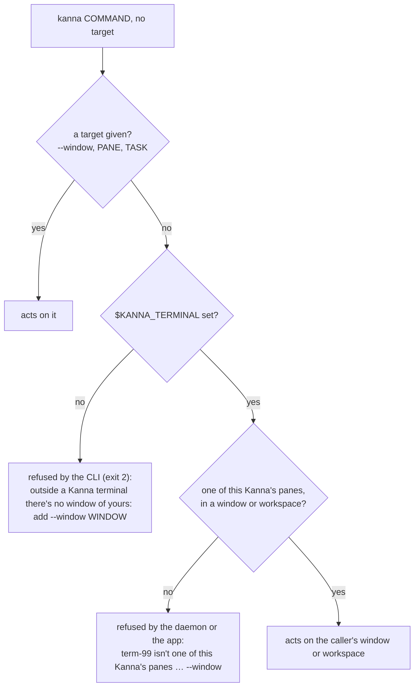

# The CLI acts on its caller

**Status:** built (2026-10-28), in Kanna · **Builds on:** [the kanna CLI](cli.md), [workspaces](workspaces.md#3-commands-target-and-reply) · **Followed by:** [the app owns the physical layout](physical-layout.md) · **Why:** which window is in front is the app's (physical) layout, not the daemon's; a CLI command run from an agent's terminal must not land in whatever window the user happens to have in front

A `kanna` command that needs a window or a pane and isn't given one acts on **its caller**: the Kanna terminal it runs in (`$KANNA_TERMINAL`), and so that terminal's window or workspace. Run from anywhere else, it's refused with the flag to give. It never falls back to the key (front) window.

This is step one of splitting the logical layout (the daemon's: panes, tabs, windows, workspaces) from the physical one (the app's: which window is in front, their order and frames). Step two, [the app owns the physical layout](physical-layout.md), took the key window out of the daemon.

## Contents

1. [Commands](#1-commands)
2. [Desks by project](#2-desks-by-project)
3. [What stays](#3-what-stays)
4. [How it's built](#4-how-its-built)

## 1. Commands

| Command, with no target | From a Kanna terminal | From anywhere else |
|---|---|---|
| `open` (any pane type, `--tab`, `--split`) | beside the caller, in its window or workspace ([workspaces](workspaces.md#3-commands-target-and-reply)); from a planning terminal, a new window | refused: `add --window WINDOW (or --window new)` |
| `open --dock` | a new task on the Desk: it needs no window | the same |
| `comment FILE:LINE`, `markup FILE` | the caller's window: a code or markdown pane already showing the file there is reused, else one opens beside the caller | refused: `add --window WINDOW (or --window new)`; with `--window W`, a pane showing the file in W is reused |
| `open code FILE` | reuses a code pane showing FILE in the caller's window | needs `--window W`, and then reuses one in W |
| `arrange LAYOUT` | the caller's window's shown tab | refused: `add --window WINDOW` |
| `screenshot` | the caller's window, if it's showing | refused: `say PANE or --window WINDOW` |
| `task park` | the caller's task | refused: `park needs a TASK, or run it from the task's terminal` |
| `task activate TASK` | active on the caller's Desk (the one showing its planning terminal or its task) | onto a Desk on the task's project ([2](#2-desks-by-project)), else a new Desk |
| `focus`, `zoom`, `close`, `move`, `resize`, `send`, … | — | — (they always name their pane, tab or window) |

- **An unknown caller** (`$KANNA_TERMINAL` names no pane of this Kanna, as from another machine with `--host`, or a pane in no window or workspace) is refused, never sent to the front window: the daemon says `no_caller` or `not_found`, the app's screenshot `not_shown`.
- **`--mux kmux`** is unchanged: kmux has no caller, and its `open` goes to its key window ([workspaces §8](workspaces.md#8-backport-to-kmux)).
- The CLI checks before it connects (`unplaced` in `crates/kanna/src/lib.rs`), so a refused command starts nothing. The parse table stays kmux's, so kmux's examples still parse to kmux's requests.

## 2. Desks by project

`kanna PATH` (the daemon's `task desk`) and `task activate` from outside a Desk pick a Desk by project, never by the daemon's key window. The daemon relays them to the app, which knows every Desk's project and which it had in front:

- **One Desk on the project:** that one.
- **Several:** the one the app had in front last (its own front-to-back order: the Desk it last showed, else `NSApp.orderedWindows`), brought forward.
- **None:** `kanna PATH` opens one; `task activate` opens a new one for the task.

A Desk's project is its docked task's, else its planning terminal's, else the folder it was opened on, as before ([new Desk](new-desk.md#3-how-its-built)).

## 3. What stays

- **kmux's protocol:** a request with no `window` and no `from` (a kmux client, `kanna raw`) goes to the only window, or is refused when there are several ([physical layout §4](physical-layout.md#4-a-request-that-names-no-window)).
- **The app's menus and shortcuts**, which act on the window the app has in front, and the app's own choices of a Desk (a toast's click).
- **`debug.*`** requests default to the window the app has in front: they are the e2e harness's, not commands.

## 4. How it's built

- **CLI** (`crates/kanna`): `from_caller` adds `from: $KANNA_TERMINAL` to `open`, `comment`, `markup`, `tour`, `screenshot` and now `arrange`; `unplaced` refuses those with no target and no caller; `task park` needs a task or a caller.
- **Daemon** (`crates/kanna-mux`): `open` refuses a `from` that names no pane (`no_caller`); placing beside a caller in no window or workspace is refused (`not_found`), as is `arrange` from one; finding a pane already showing a file looks in the caller's window or the `window` given, never the key window; a new terminal with no caller and no window starts in `$HOME`, not the key window's task folder.
- **App:** `screenshot` with no target needs `from` and refuses one that isn't showing; `desk {action: pull}` (`task activate`) picks the caller's Desk (`by`), else `projectDesk`, else a new one; `park` needs its task; `openDesk` picks `projectDesk`, the project's frontmost Desk.
- **Checked by** `crates/kanna/tests/cli.rs` (the refusals before connecting, `arrange` and `screenshot` from a caller), and e2e `cli_caller` (each command refused outside Kanna, an unknown caller, and from a terminal in win-1 while win-2 is in front: `open`, `comment` and its reuse, `comment --window`, `markup`, `arrange`), `screenshot` (the caller's window while another is in front, the refusals), and `path_last_in_front` (`task activate` from two Desks' planning terminals, `kanna PATH` with two Desks on one project bringing forward the one last in front, `task park` from a task's terminal).
