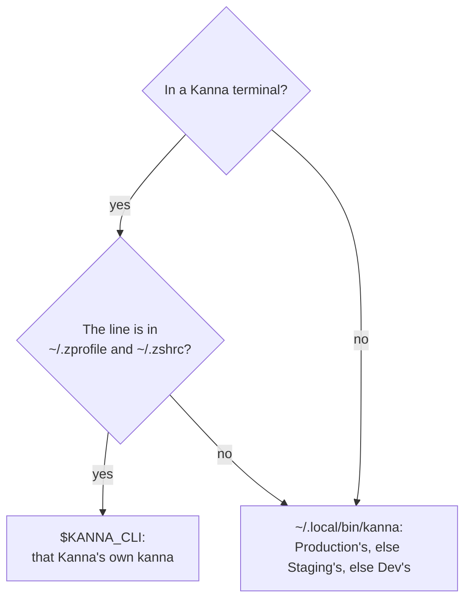

# Which kanna a shell runs

**Status:** built · **Decided with the user:** 2026-11-10 · **Builds on:** [build channels](build-channels.md), [the kanna CLI](cli.md) · **Why:** several Kannas run at once on a developer's Mac, and a `kanna` of one build talking to another build's daemon fails or misbehaves ([daemon build](daemon-build.md))

Plain `kanna` is whatever is first on `PATH`. Two rules make that the right one:

1. **In a Kanna terminal,** `KANNA_CLI` is the full path of that Kanna's own `kanna`. A developer puts it first on `PATH` with one line in their own shell files.
2. **Everywhere else,** `~/.local/bin/kanna` is a link to the highest channel's CLI installed: Production, then Staging, then Dev.



Without the line, a Kanna terminal runs the global link's `kanna`, which still talks to that terminal's Kanna (`KANNA_SOCKET`, [build channels §3](build-channels.md#3-which-kanna-a-command-reaches)); it's another build's CLI only when two channels are installed.

## 1. KANNA_CLI

- **Set by the daemon:** every terminal a daemon starts gets `KANNA_CLI`, the `kanna` beside that daemon (`Kanna.app/Contents/Helpers/kanna`), with `KANNA_SOCKET` and `KANNA_TERMINAL`. A daemon with no `kanna` beside it sets none.
- **Kanna changes no shell files** and adds nothing to its shell integration for this. Kanna v2 set the same variable as `KANNA_CLI_PATH`.
- **The line,** for someone who runs several Kannas at once, at the end of both `~/.zprofile` and `~/.zshrc`:

  ```zsh
  [[ -n $KANNA_CLI ]] && path=(${KANNA_CLI:h} $path)
  ```

- **Why the shell files:** they put `~/.local/bin` first in every new shell, an agent's included, after the terminal's environment is set. A `PATH` set by the daemon alone would lose to it.
- **The end of PATH is unchanged:** a terminal's `PATH` still ends with its Kanna's Helpers folder, so `kanna` is found where nothing else provides one.
- **After an instance move:** a terminal carried to another Kanna ([instance move](instance-move.md)) keeps its old `KANNA_CLI` until it's restarted, as it keeps the rest of its environment.

## 2. The global link

When a daemon starts, it installs `~/.local/bin/kanna` as a link to the `kanna` beside it, or repoints the link there, unless the link already points at a higher channel's CLI that still exists.

| `~/.local/bin/kanna` is | Production starts | Staging starts | Dev (main checkout) starts |
|---|---|---|---|
| missing | takes it | takes it | takes it |
| a dangling link | takes it | takes it | takes it |
| a link to a `kanna` outside any Kanna.app, or to a worktree's Dev build | takes it | takes it | takes it |
| Dev's | takes it | takes it | repoints if the app moved |
| Staging's | takes it | repoints if the app moved | kept |
| Production's | repoints if the app moved | kept | kept |
| a file or folder, not a link | left alone | left alone | left alone |

- **Who takes part:** a daemon running from a `Kanna.app` and serving its build's default instance folder (`kanna-prod`, `kanna-staging`, `kanna-dev`). A Dev build from a task's worktree never touches the link, nor does an instance with a name or a private state folder (`--instance`, the e2e scripts), nor a Linux server's daemon, whose link `scripts/server-setup.sh` makes ([machine setup](machine-setup.md)).
- **The link's channel** is read from the `Info.plist` of the app the link resolves into (`KannaChannel`, `KannaInstance`).
- **Replaced in one step:** a new link is made beside it and renamed over it. `~/.local/bin` is made if it's missing. Kanna doesn't add it to `PATH`.
- **Uninstalling a channel** leaves a dangling link, which the next Kanna to start takes.

## 3. Checked by

- `crates/kanna-daemon/src/cli.rs`: the owner rule against a temporary home (no link, a lower channel's, a higher channel's, a dangling one, a worktree's Dev build, a plain file).
- `crates/kanna-daemon/src/terminals.rs`, `a_started_terminal_is_told_its_daemons_kanna`: a started terminal's environment names an existing `kanna` beside the daemon.
- e2e `cli_per_instance`: in a private instance `$KANNA_CLI` is that instance's CLI, and with the line in a test `ZDOTDIR` and another `kanna` earlier on `PATH`, `which kanna` is the instance's, in a terminal tab and in a command pane.
