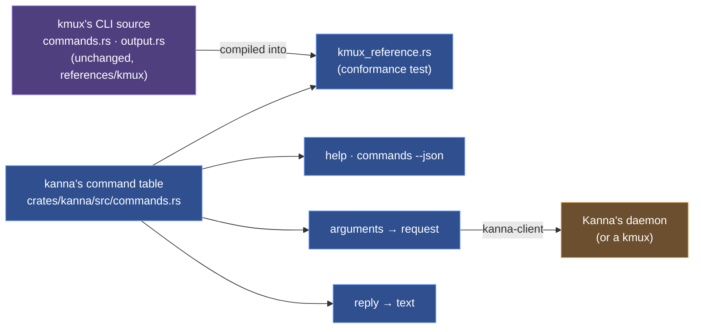
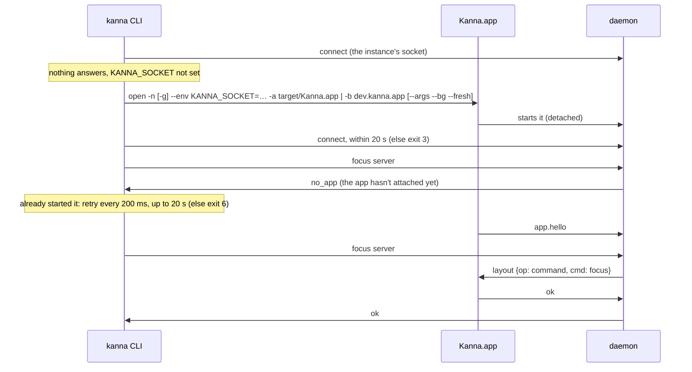

# The kanna CLI

**Status:** built ([plan](../plans/mux-build.md) track B) · **Reference:** kmux's `kmux` CLI ([kmux reference](kmux-reference.md)) · **Related:** [commands](commands.md), [workspace list](workspace-list.md), [instances](instances.md), [tab completion](tab-completion.md)

`kanna` is kmux's command line for Kanna: every command, option, help text, output, error and exit code of kmux's `kmux` (kmux's `crates/kmux`), branded kanna, plus a few additions of Kanna's. It sends kmux's control protocol to Kanna's daemon over its socket (or, with `--mux kmux`, to a kmux), through `crates/kanna-client`, a copy of kmux's `kmux-client`. The commands: [commands](commands.md).

## Contents

1. [A port of kmux's CLI](#1-a-port-of-kmuxs-cli)
2. [Where kanna differs from kmux](#2-where-kanna-differs-from-kmux)
3. [Reaching Kanna](#3-reaching-kanna)
4. [With the app closed](#4-with-the-app-closed)
5. [Output, errors and exit codes](#5-output-errors-and-exit-codes)
6. [Checked by](#6-checked-by)

## 1. A port of kmux's CLI

kmux's CLI is one table of commands (name, group, summary, usage, options, notes, examples, how its arguments become a request, how its reply prints); help, `commands --json`, parsing and output all come from it. `kanna` has the same table, ported into `crates/kanna/src/commands.rs` (with `output.rs`, and `lib.rs` for help, `commands`, `instances`, `raw` and errors; provenance in NOTICE), and `crates/kanna/tests/kmux_reference.rs` compiles kmux's own `commands.rs` and `output.rs`, unchanged, beside it and checks one against the other.

| Option | Why not |
|---|---|
| Depend on kmux's CLI crate as a library | it's a binary with no library and kmux's name in every string; giving it one, with a brand, would change kmux, which stays as it is |
| Build kmux's source files into `kanna` and rebrand the strings as it runs | a private file of kmux's would become kanna's API, so any refactor in kmux breaks kanna's build; replacing "kmux" in text gets some sentences wrong; and Kanna's additions can't be added to kmux's fixed table |
| **Port it, and check the port against kmux's source** (chosen) | one source of truth for Kanna's commands, inside kanna; kmux stays the reference: when kmux's CLI changes and kanna hasn't followed, the test fails, as the protocol cases do for the core |

**What the conformance test checks:** the same commands, groups and order as kmux (plus Kanna's, less kmux's `workspace`); every summary, usage, option, note and example is kmux's with "kmux" read as "kanna" (the notes of `open`, `send` and `list` may only add to kmux's, as may `list`'s usage and examples, beside its own `--verbose` and `--where`; `window` is documented for tasks, with kmux's group and options); every kmux example and request line parses to the same request; every usage error has kmux's exit code and message; every reply prints as kmux prints it (`list` with `--verbose`, less its headings). kmux's own CLI tests (`every_documented_example_parses`, `requests`, `usage_errors_say_what_to_do`, `layouts_print_as_expressions`) are ported as kanna's unit tests.

## 2. Where kanna differs from kmux

Decided; everything else is kmux's.

| | kmux | kanna | Why |
|---|---|---|---|
| `read PANE [--lines N]` | — | prints a terminal's screen as text, scrollback with `--lines` | the daemon keeps every screen, with or without the app; agents read terminals |
| `screenshot [PANE \| --window WINDOW] [-o\|--out FILE] [--force]` | — | saves a PNG of a pane or a window as drawn now, and prints its path ([screenshot](screenshot.md)) | agents check their UI work by looking at it |
| `status explain PANE`, `status explain --file SCREEN --agent AGENT`, `status update`; `list`'s STATUS column and `status` field | — | agent status ([agent status](agent-status.md)); the column shows only when a pane has a status, so a kmux reply prints as kmux prints it | the daemon judges agent panes; `capabilities` lists `status` |
| `send-key PANE KEY...` | — (`send` types a line and presses Return; `debug.key` goes through the app's window) | presses keys in a terminal, encoded for the program's current modes, without the app ([commands](commands.md#3-send-key)) | agents answer another agent's menu, interrupt a command or submit a prompt; kmux's research recommends cmux's `send-key`, and kmux gets it from this port |
| `diagrams check FILE...`; `open md`'s failure lines and `diagrams` field | — | checks a markdown file's mermaid diagrams, without the app, and exits 1 if one won't draw; `open md` prints the same failures on stderr ([diagram check](diagram-check.md)) | agents present docs whose diagrams they never saw |
| `--` | — (`--json` is taken from anywhere, so it can't be typed) | ends the options: `kanna send term-1 -- --json` | text that looks like an option |
| `--mux`, `KANNA_MUX` | — | `kanna` (default) or `kmux` | kanna can drive a kmux too ([backends](backends.md)) |
| `markup FILE.md\|FILE.html [--to PANE]`, `markup PANE [--to PANE \| --off]`, `markup comments\|show\|reply\|resolve\|reopen` | — | opens a doc with comments, or turns them on or off in a pane; `open` shows docs without them; the rest read and answer its threads, in the doc's thread file, without the daemon ([doc markup](doc-markup.md)) | review with an agent is opt-in |
| `rename-pane PANE NAME` | — (a name is set only by `open --name`) | names, renames or (with `""`) unnames a pane; no two panes share a name and a name can't be another pane's ID; the daemon keeps it, so it works with or without the app | names are how you refer to panes, and an agent may start one unnamed |
| `task new\|start\|list\|pick\|shelve\|activate\|park\|name\|done`; `open` with no placement from a task's terminal | — | makes Shelf tasks and starts them (the daemon's `backlog` command, the Shelf's: a worktree `.kanna-worktrees/NAME` on branch NAME, on an empty branch in a repo with no commits yet; a folder that isn't a git repo is refused, and an agent docked onto the Desk), lists, moves to the Desk (`pick`) or back to the Shelf (`shelve`: its panes still running, off the Desk and the limit), names or ends tasks; `activate` and `park` are relayed to the app, whose Desks they are ([each app's Desks](app-desk.md)); `done` is a `close` of the task's panes; `open` from a task's terminal opens a tab in its workspace, and from a terminal in a plain window splits beside that terminal, in its window, not the key window's focused pane; `park` with no task shows the Desk view of the caller's task's Desk, and `activate` makes a task active on the caller's Desk, else on a Desk on its project; `defer` and `pull` are hidden aliases of `shelve` and `activate` ([Desk view §3](desk-view.md#3-cli-verbs)); a fourth running task in one repo (a worktree counts as its main repo) is refused ([tasks](tasks.md), [Desk](desk.md)) | the Desk is Kanna's |
| `window assign WINDOW TASK\|WORKSPACE`, `window free WINDOW`; replies to `open`, `focus`, `zoom`, `comment` and `move-tab` that name a workspace | `window assign WINDOW WORKSPACE` puts a window in a kmux workspace, which `workspace new\|hide\|show\|close` makes and moves; replies name it `ws-1's win-2 (hidden)` | `workspace` has only `list`, since tasks make, show and hide workspaces; `window` makes a window one of a task's, shown with the task and hidden, its panes running, while it isn't active or is on the Shelf, or frees it; a Desk, a window with a lead and a task not started are refused. A reply about a pane in a workspace names it, and its task and where it is: `opened term-5 in ws-3 (task-1dfb, on the Desk), tab-9` ([workspaces](workspaces.md)) | a task's work is presented together, and an agent should know where its pane went |
| `move PANE --dock` | docks any pane | moves only the docked pane (to the other edge or another window) unless it's frozen, as a task's agent is; any other pane is refused (`not_a_task`), and the three protocol cases that dock one are skipped by name | a docked pane is a running task, so docking one would start a task outside the Shelf and the limit ([tasks](tasks.md)) |
| Tab titles (`list`, `rename-tab`) | `Tab 1`, `Tab 2`, … | named after the pane each tab was made with (its name, file or page title) until renamed; `Tab N` only for an unnamed terminal ([tab names](tab-names.md)) | agents open most tabs, and a numbered tab says nothing about what it shows |
| `move PANE --window WINDOW` | splits the pane into the window's active tab | a new tab at the end of the window, focused (`--tab new --window`); to its own window, a pane alone in its tab stays and one in a split leaves it for a new tab; its `--window` help says so, and the protocol case that expects the split is skipped by name | moving a pane to a window shouldn't halve the doc the user has open there |
| `completions zsh\|bash`, `__complete` | — | tab completion from the command table, with live pane, tab and window names ([tab completion](tab-completion.md)) | the CLI is how you drive Kanna from a terminal |
| Exit 6 | — | the command needs Kanna.app, which isn't attached and wasn't started | terminals and the layout work without the app; screenshots and `debug.*` don't ([layout](layout.md#4-with-the-app-closed)) |
| Starting | starts the kmux app | starts this build's Kanna.app, which starts the daemon; never with `KANNA_SOCKET` set ([layout](layout.md#5-the-cli-starts-the-app)) | the app starts the daemon ([app link](app-link.md#4-the-app-starts-the-daemon)) |
| `workspace list [--all]` | the caller's window, or its workspace's; `--all` every window, workspace and pane | the same, with each workspace's task, dock, shown tab, focus and zoom, also off screen; `--all` is under headings (Windows, Workspaces, Free windows, Unplaced panes) ([workspace list](workspace-list.md)) | an agent presenting its work needs to see its own workspace, as the user will |
| The app closed | (the app is kmux) | every command but `screenshot`, `comment` and `debug.*` works; the app opens on the layout as it was left | the daemon keeps the layout ([presentation layers](presentation-layers.md)) |
| An instance | an app with its own socket, `kmux-NAME.sock` | a folder, `kanna-dev-NAME`, in the build's channel ([instances](instances.md)) | a daemon needs a folder of its own |
| Channels | one app | production, staging and dev builds are separate apps (Kanna, Kanna Staging, Kanna Dev), and a dev build in a worktree is one of its own whose default instance is the worktree's ([build channels](build-channels.md)) | Kanna is developed inside Kanna |
| `instances` | the running instances | the running instances of every channel, with each one's channel and the worktree a dev build came from; `instances prune` deletes those whose worktree is gone; `instances stop` quits one ([stopping an instance](instance-stop.md)) | many dev builds come and go |
| `--version` | `kmux VERSION` | `kanna VERSION (APP)`, e.g. `(Kanna Dev task-3f9a1c2e)` | which build this CLI is |
| `kanna project import PATH` | — | copies a project into its place in `~/.kanna-v4/repos` and moves its tasks, terminals and records to the copy, leaving the original as it was ([project folder](project-folder.md#4-kanna-project-import)) | Kanna works only on projects there |
| `kanna PATH` (a folder, not a command's name) | an unknown command | refused for a project outside `~/.kanna-v4/repos` ([project folder](project-folder.md#2-outside-it)); else the Desk already on PATH's project, brought forward, else a new Desk on it, holding no tasks (`task desk`, which gives the window a `project`), docking nothing, so it uses none of the project's three running tasks: it shows the Desk view: its planning terminal (in PATH) beside the project's Desk tasks and Shelf; its tabs, splits and tasks start in the project; a command's name wins over a folder of the same name (`kanna ./open`) ([new Desk](new-desk.md)) | open Kanna on a project, as `code PATH` does |
| A command with no target (`open`, `comment`, `markup FILE`, `arrange`, `screenshot`, `task park`) | goes to the key window | acts on its caller, the terminal it runs in (`$KANNA_TERMINAL`), and its window or workspace; from anywhere else, or from a terminal this Kanna doesn't know, it's refused with the flag to give (`add --window WINDOW`), never sent to the front window; `--mux kmux` is unchanged ([the CLI acts on its caller](cli-caller.md)) | the front window is the app's physical layout, not where an agent's work goes |
| `open --cwd DIR` | sent as given | made absolute where kanna runs | the daemon's directory isn't yours |
| `open` a terminal without `--cwd` (and every new tab, split and window from the app) | starts in `$HOME` | starts in its task's folder: the folder the task's agent opened in (its worktree, or the repo for a task without one), the agent being the terminal it opens from or the docked pane of the window it opens in; the agent moving or printing another folder changes nothing; outside a task, a window from the app starts in the window's repo (the repo of the last task docked there, the key window's for a new window from the app), and so does the window's planning terminal; else `$HOME`, as for a terminal opened with no caller into a window given by `--window` | a task's terminals work on the task |
| `capabilities` | kmux's fields | kmux's fields, Kanna's commands (`read`, `screenshot`, `status`, `backlog`) among the commands, and `app`: whether Kanna.app is attached (its own line in the text) | so a script can tell |
| `raw REQUEST` | sends it | sends it, and starts the app on `no_app` like any command | one way of reaching Kanna |
| `kanna mux` | — | gone: `capabilities` and `instances` say what it said | kmux has no such command |

## 3. Reaching Kanna

The CLI never starts a daemon: it starts Kanna.app, which does. When a command fails against a daemon of another build (`capabilities` answers `build`), it adds a line saying so and to relaunch Kanna.app ([daemon build](daemon-build.md)). Which daemon it talks to: [instances](instances.md#2-which-instance-a-command-goes-to).

## 4. With the app closed

| Works | Needs the app (`no_app`: started, or exit 6 with `KANNA_SOCKET`) |
|---|---|
| every other command: `open` of any pane anywhere, `list`, `send`, `read`, `close`, `restart`, `focus`, `zoom`, `resize`, `move`, `arrange`, `rename-tab`, `move-tab`, `navigate`, `task`, … | `screenshot`; `comment` (the app snaps its lines); every `debug.*` |

## 5. Output, errors and exit codes

- `open` prints the new pane's ID, name, window, tab and state, as kmux's CLI (`opened term-3 (logs) in win-1, tab-1: running`). Other commands print short human-readable text, as kmux's.
- `--json` prints one JSON object per command. Its fields keep the internal names from before the [Desk view rename](desk-view.md#5-internal-names): `where: "backlog"` is the Shelf and `where: {"shelf": app}` a Desk, `backlog` marks a Shelf task, and `parkedAt` is when a task was last active.
- `open` waits until the pane is running or has failed, unless `--no-wait` is given.

| Exit code | Meaning |
|---|---|
| 0 | Success |
| 1 | The command failed (for example, the pane failed to start) |
| 2 | Bad usage (unknown flag, invalid layout expression) |
| 3 | The mux isn't running and couldn't be started (for Kanna: nothing answers, and Kanna.app couldn't be started or its daemon didn't answer within 20 s; or `KANNA_SOCKET` is set and nothing answers there) |
| 4 | Pane not found |
| 5 | Not supported by this backend |
| 6 | The command needs Kanna.app, which isn't attached and wasn't started (`KANNA_SOCKET` is set, or it didn't start or attach within 20 s) |

| Situation | Behaviour |
|---|---|
| Pane type not supported by the backend | Exits 5, e.g. "tmux can't show web panes. Try `--mux kmux`." |
| Layout sizes add up to more than 1 | Exits 2 and shows which group is over. |
| `arrange` names a pane that doesn't exist | Exits 4. Nothing is changed. |
| Pane too small after rounding (tmux) | The size is raised to the backend's minimum and a warning is printed. |
| Two panes given the same name | The second `open` exits 1. |
| `KANNA_SOCKET` is set and nothing answers there | Exits 3. kanna never starts an app for a socket it was pointed at. |
| A command that needs Kanna.app and it isn't attached | kanna starts Kanna.app and retries; with `KANNA_SOCKET` set, exits 6 (`no_app`). |

## 6. Checked by

`crates/kanna/tests/kmux_reference.rs` (against kmux's source), the unit tests in `crates/kanna/src` (kmux's CLI tests, ported; target and instance resolution; the app started), `crates/kanna/tests/cli.rs` (every command through a real daemon with a test app answering through `LayoutOwner`, and without it; help, marks and `commands --json`; errors and exit codes; instances; the kmux backend), `crates/kanna/tests/no_launch.rs` (nothing starts with `KANNA_SOCKET`; a missing app is exit 3), `crates/kanna-daemon/tests/app_link.rs` (`debug.*` and `capabilities`), and `cli_commands` (every command against the real app), `cli_without_app`, `instances` and `screenshot` of `scripts/e2e-kanna.sh`.
