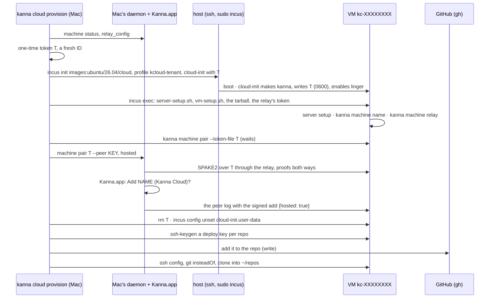

# Kanna Cloud: A User's VM

**Status:** built in slice 9 (`kanna cloud`, `scripts/cloud/`), first stage: the operator is the only tenant · **Part of:** [Kanna Cloud §3–4](kanna-cloud.md#3-provisioning) · **After:** [installing a host](cloud-provisioning.md) · **Model:** [cloud-tenant-vms](../../references/prototypes/cloud-tenant-vms/README.md)

How a host becomes Kanna machines: Incus on the host, then `kanna cloud provision`, which makes one user's VM, sets it up with [server setup](machine-setup.md), enrolls it into that user's machines by token, marked `hosted`, and gives it git credentials of its own. `kanna cloud release` takes it all back. Both run on the Mac, which is the operator's and, in this first stage, also the user's.

```sh
kanna cloud setup-host jeremyhale@172.16.0.11
kanna cloud provision jeremyhale@172.16.0.11 --repo tampopogk/kanna
kanna cloud list
kanna cloud release cloud-3f9a
```

## Contents

1. [The host](#1-the-host)
2. [Provisioning](#2-provisioning)
3. [Enrollment](#3-enrollment)
4. [Git credentials and agent accounts](#4-git-credentials-and-agent-accounts)
5. [Releasing](#5-releasing)
6. [Choices and why](#6-choices-and-why)
7. [Interfaces](#7-interfaces)
8. [Tested](#8-tested)

## 1. The host

`kanna cloud setup-host HOST` runs [`scripts/cloud/host-setup.sh`](../../scripts/cloud/host-setup.sh) on HOST as root (HOST is an ssh destination whose user has passwordless sudo, as the [host install](cloud-provisioning.md) leaves it). It is safe to run again: each object is made only when missing, and nothing else on the host is touched, other VMs, bridges and pools included.

| Object | Is |
|---|---|
| packages | `incus`, `conntrack`, `dnsmasq-utils` (for the release), `lvm2` and `thin-provisioning-tools` |
| `br_netfilter` | loaded, and at boot (`/etc/modules-load.d/kanna-cloud.conf`): Incus refuses IPv6 filtering without it |
| pool `kcloud` | LVM thin, loop-backed, 400 GiB sparse (`KCLOUD_POOL_SIZE`); thin LVs zero new blocks, so a new VM never reads a released one's |
| ACL `kcloud-tenant` | egress dropped to private, link-local, multicast and reserved ranges, IPv4 and IPv6; the rest allowed |
| bridge `kcloud0` | 10.232.0.1/24 and fd5a:1c3e:7a10:2::1/64, NAT44 and NAT66, DHCPv4 and stateful DHCPv6, `dns.mode=none`; the ACL, with default egress `reject` and ingress `drop` |
| profile `kcloud-tenant` | 4 CPUs, 8 GiB, a 40 GiB root disk on `kcloud`; `eth0` on `kcloud0` with MAC, IPv4 and IPv6 filtering and port isolation |

So a tenant VM reaches the internet and relays over IPv4, and not another VM, the host, the iDRAC or the LAN: the network the [tenant VM model](../../references/prototypes/cloud-tenant-vms/README.md#design) showed, enforced on the host. Its `check_net.py` is the host's acceptance test before a second tenant ([build order C3](machines-build-order.md#kanna-cloud)).

**IPv6:** isolation is enforced for IPv6 as for IPv4 (filtering, the ACL, NAT66), as the model showed. Internet over IPv6 is **untested**: the LAN has none (the ISP gives the router one address and no prefix), and it was decided to go on without it.

## 2. Provisioning



1. **Checks first:** the Mac's Kanna is running and has a relay (the VM reaches your machines only through one); `--tarball` speaks the Mac's protocol; `gh` is signed in when `--repo` is given; the host has been set up. A name already among your machines or in the records is refused.
2. **The VM:** named `kc-` and eight random hex digits, never a user's name and never reused ([model §5](../../references/prototypes/cloud-tenant-vms/README.md#what-cloud-9-must-do)); the machine's name is `--name` or `cloud-` and four of them. Ubuntu 26.04's stock cloud image, made with `--no-profiles --profile kcloud-tenant` and its config on stdin (limits, the root disk's size, the cloud-init user data). Every `incus` call has stdin from `/dev/null` or the config, since the client otherwise waits on it.
3. **cloud-init** makes the user `kanna` (passwordless sudo, no password), writes the token to `/var/lib/kanna-cloud/token` (`0600`, kanna's), and enables linger. Nothing else: setup runs over `incus exec`, so its output streams to the operator.
4. **Server setup:** `server-setup.sh` and [`vm-setup.sh`](../../scripts/cloud/vm-setup.sh) are copied in from the Mac's own build, with the tarball (`--tarball`, or the latest release's, fetched in the VM) and the relay's token. `vm-setup.sh` runs server setup as `kanna`, names the machine and sets its relay to the Mac's, and waits until the daemon reaches it.
5. A failure leaves the VM as it got and its record, and says `kanna cloud release NAME` removes it.

## 3. Enrollment

[Cloud §4](kanna-cloud.md#4-enrollment-by-token)'s token pairing, on the existing PAKE ([identity §2](machine-identity.md#2-pairing)) with three changes:

- **An offer with a token:** `kanna machine pair --token-file FILE` offers the token instead of a six-digit code: 22 to 128 letters, digits, `-` and `_` (the provisioner's are 32 base-62 characters, about 190 bits), for 30 minutes, three tries, one use. Neither the offer's reply nor `machine list` ever shows it.
- **Pairing through the relay:** `kanna machine pair T --peer KEY` with no address dials KEY through this machine's own relay, which the provisioner made the VM's too.
- **`hosted: true`** goes in the add the Mac signs (the daemon's `machine pair {hosted}`; no CLI flag), and the confirmation sheet says it is a Kanna Cloud VM. The peer log's rule ([identity §3](machine-identity.md#3-the-peer-log)): an add signed by a hosted key never counts, a hosted key revokes only itself, and the mark sticks to its key.

The provisioner runs the offer in the VM over `ssh … incus exec`, reads its key from the first line, asks the Mac's daemon to pair, then reads the VM's `paired` line. It then deletes the token file and unsets `cloud-init.user-data`, which held the token.

## 4. Git credentials and agent accounts

- **A deploy key per repo, per VM** (`--repo OWNER/REPO`, several separated by commas): made in the VM (`ssh-keygen -t ed25519`, `~/.ssh/kanna-OWNER-REPO`), so its private half never leaves it, and added with write access by the Mac's `gh` (`POST repos/OWNER/REPO/keys`, titled `Kanna Cloud NAME (kc-…)`). GitHub lets a deploy key serve one repo, so each gets an ssh `Host` alias and git `url.….insteadOf` rules for both `git@github.com:OWNER/REPO` and `https://github.com/OWNER/REPO`: any clone or remote of that repo uses its key. github.com's host key is pinned from GitHub's published one, not learned on first use. The repo is cloned into `~/repos/REPO`.
- **Git identity:** the Mac's global `user.name` and `user.email` are set in the VM, so agents' commits are the user's.
- **Agent accounts:** nothing more. The VM joined, so the Mac supplies it the Claude setup token and API keys, and Codex's ChatGPT login stays on the Mac as its holder ([agent sign-in §2](agent-sign-in.md#2-how-a-machine-gets-them)). Signing in on the VM itself (`kanna accounts sign-in`) works as on any machine, and leaves a login there the operator can read ([Cloud §7](kanna-cloud.md#7-agent-sign-in-on-kanna-run-machines)).

## 5. Releasing

`kanna cloud release NAME` asks you to type the name (`--yes` skips it), then:

1. **Revokes** the VM from your machines through the Mac's daemon, which also withdraws the accounts it was given.
2. **Removes its deploy keys** from GitHub (one already gone counts as removed).
3. **Destroys it on the host** with [`scripts/cloud/release-vm.sh`](../../scripts/cloud/release-vm.sh), the release the model found `incus delete` alone isn't: the instance with its snapshots, every custom volume named after it, `/var/log/incus/VM` (its console log) and `/run/incus/VM`, its addresses' conntrack and neighbour entries, and a DHCPv6 lease still there released with `dhcp_release6`, never by editing dnsmasq's lease file. It then checks nothing is left.
4. **Asks you to rotate** the long-lived secrets it held: your Claude setup token and API keys (`kanna accounts add` again replaces them on every machine).

## 6. Choices and why

- **The CLI on the Mac, not a service:** in this first stage the operator is the user, and the Mac holds what enrollment needs: the app for the gesture, the daemon that signs the add, `gh` for deploy keys. With accounts and the directory (C1), the provisioner becomes Kanna's service and the token reaches the app through the directory; the VM's side doesn't change.
- **ssh and `incus exec`, not the Incus API:** the host's Incus listens only on its unix socket, and the operator already has ssh; `incus exec` reaches a VM whose network admits nothing from the host.
- **Only the relay, for now:** the tenant network drops traffic to the LAN, so the Mac and the VM meet through a relay, and iroh moves them to a direct path when one opens. Before C1 brings Kanna's relays, the VM uses the Mac's, token included; that token is then on a machine the operator can read, like everything else there.
- **The protocol went to 5:** a daemon without the hosted rule would count a hosted key's adds, and daemons of different protocols refuse each other ([versions §2](machine-versions.md#2-protocols)), so no older peer ever syncs a log with a hosted VM in it. A better rule than the model's: hosted keys are those marked by an add that counts, so a forged add by a hosted key can't mark your Mac hosted.
- **LVM thin on a loop file:** the R720s' one RAID volume is the root filesystem; a dedicated disk or volume group is better when a host has one. The model's release findings hold for LVM thin, so the pool keeps that driver.
- **A record per VM on the Mac** (`~/Library/Application Support/kanna-cloud/vms/NAME.json`, beside the host install's files): host, instance, the machine's key, deploy keys. It's what release needs; the peer log has no place for operator facts.

## 7. Interfaces

| CLI | Does |
|---|---|
| `kanna cloud [list]` | the VMs this Mac made: name, instance, host, repos |
| `kanna cloud setup-host HOST` | §1 |
| `kanna cloud provision HOST [--name NAME] [--tarball FILE] [--repo OWNER/REPO[,...]] [--agents LIST] [--cpus N] [--memory SIZE] [--disk SIZE]` | §2–4 |
| `kanna cloud release NAME [--yes]` | §5 |
| `kanna machine pair --token-file FILE` | on a VM: wait to be enrolled with that token |

The daemon's `machine` command gains `offer {token}`, `pair {hosted}` and `relay_config` (this machine's relay URL and token, refused to a remote caller as `local_only`). `machine status` marks each peer `hosted`. Refusals: `hosted_signer`, `hosted_downgrade`.

## 8. Tested

`cargo test -p kanna-net` (the hosted rule's scenarios from the model, all 120 delivery orders of two valid and three forged entries, and a VM enrolled by token through a relay, hosted, refused when it tries to pair or revoke), `cargo test -p kanna --lib cloud`.

On r720-1 (2026-11-03; Ubuntu 26.04.1, Incus 6.0.5, now wired at 172.16.0.11): `setup-host` made the pool, ACL, bridge and profile beside the host's three earlier VMs, which kept running. `provision` from this Mac, against a private daemon on a test socket whose relay was iroh's public `use1-1.relay.n0.iroh.link` and a stand-in app saying yes, with a tarball from `scripts/build-linux.sh`: about 5 minutes, most of it apt and npm. The VM was enrolled, listed as `(Kanna Cloud)` and asked about with `hosted: true`; `kanna --host cloud-try1 task list` answered and `machine ping` opened all six stream kinds, relayed (390 ms through that relay, which is in Virginia); the token file and the cloud-init user data were gone. An API key added on the Mac reached the VM (`kanna accounts` there: `from mbp-test`). `release` revoked it, destroyed the instance with its LVs and logs, said which key to rotate, and the host's other VMs were untouched.
