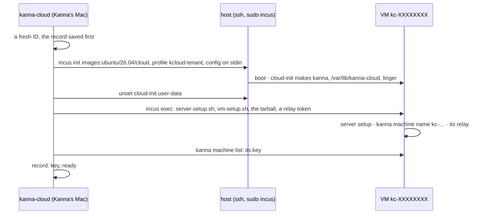

# Kanna Cloud: How Kanna Provisions

**Status:** built in slice 9 (`crates/kanna-cloud`, `scripts/cloud/`), the R720 backend · **Part of:** [Kanna Cloud §4](kanna-cloud.md#4-how-kanna-runs-it) · **After:** [installing a host](cloud-provisioning.md) · **Model:** [cloud-tenant-vms](../../references/prototypes/cloud-tenant-vms/README.md)

`kanna-cloud` is Kanna's internal operator tool. It turns a host into somewhere Cloud tasks can run, makes the VM a Cloud task runs on with Kanna set up in it, and destroys it afterwards leaving nothing. It is a binary of its own, built from this repo and never shipped in Kanna.app or the Linux tarball: customers never run it, and nothing in their `kanna` reaches a host ([Cloud §1](kanna-cloud.md#1-rules)). Until the provisioning service exists (C1), Kanna runs it by hand; the service then drives the same steps.

```sh
kanna-cloud setup-host jeremyhale@172.16.0.11
kanna-cloud provision jeremyhale@172.16.0.11 --for acme --tarball Kanna-4.1.0-linux-x86_64.tar.gz
kanna-cloud list
kanna-cloud release kc-3f9a1c2e
```

## Contents

1. [The host](#1-the-host)
2. [A VM](#2-a-vm)
3. [Releasing](#3-releasing)
4. [Choices and why](#4-choices-and-why)
5. [Interfaces](#5-interfaces)
6. [Tested](#6-tested)

## 1. The host

`kanna-cloud setup-host HOST` runs [`scripts/cloud/host-setup.sh`](../../scripts/cloud/host-setup.sh) on HOST as root (HOST is an ssh destination whose user has passwordless sudo, as the [host install](cloud-provisioning.md) leaves it). It is safe to run again: each object is made only when missing, and nothing else on the host is touched, other VMs, bridges and pools included.

| Object | Is |
|---|---|
| packages | `incus`, `conntrack`, `dnsmasq-utils` (for the release), `lvm2` and `thin-provisioning-tools` |
| `br_netfilter` | loaded, and at boot (`/etc/modules-load.d/kanna-cloud.conf`): Incus refuses IPv6 filtering without it |
| pool `kcloud` | LVM thin, loop-backed, 400 GiB sparse (`KCLOUD_POOL_SIZE`); thin LVs zero new blocks, so a new VM never reads a released one's |
| ACL `kcloud-tenant` | egress dropped to private, link-local, multicast and reserved ranges, IPv4 and IPv6; the rest allowed |
| bridge `kcloud0` | 10.232.0.1/24 and fd5a:1c3e:7a10:2::1/64, NAT44 and NAT66, DHCPv4 and stateful DHCPv6, `dns.mode=none`; the ACL, with default egress `reject` and ingress `drop` |
| profile `kcloud-tenant` | 4 CPUs, 8 GiB, a 40 GiB root disk on `kcloud`; `eth0` on `kcloud0` with MAC, IPv4 and IPv6 filtering and port isolation |

So a task's VM reaches the internet and relays over IPv4, and not another VM, the host, the iDRAC or the LAN: the network the [tenant VM model](../../references/prototypes/cloud-tenant-vms/README.md#design) showed, enforced on the host. Its `check_net.py` is the host's acceptance test before a second tenant ([build order C3](machines-build-order.md#kanna-cloud)).

**IPv6:** isolation is enforced for IPv6 as for IPv4 (filtering, the ACL, NAT66), as the model showed. Internet over IPv6 is **untested**: the LAN has none (the ISP gives the router one address and no prefix), and it was decided to go on without it. When a host gets an IPv6 uplink, its own and the LAN's global prefixes must join the ACL's drop list, and `check_net.py` must run again.

## 2. A VM



1. **Checks first:** the host is set up; `--tarball` is a Kanna Linux tarball; options are well formed.
2. **A fresh name:** `kc-` and eight random hex digits, never a customer's name and never reused ([model §5](../../references/prototypes/cloud-tenant-vms/README.md#what-cloud-9-must-do)). `--for LABEL` (a customer, a task) is kept in the record and in the instance's `user.kanna-cloud.for`, never in its name.
3. **The record is saved before anything is made** (`~/Library/Application Support/kanna-cloud/vms/kc-….json`: host, label, times, the VM's key), so a run cut short is still listed and released.
4. **The VM:** Ubuntu 26.04's stock cloud image, made with `--no-profiles --profile kcloud-tenant` and its config on stdin (limits, the root disk's size, the cloud-init user data). Every `incus` call has stdin from `/dev/null` or the config, since the client otherwise waits on it.
5. **cloud-init** makes the user `kanna` (passwordless sudo, no password), the folder `/var/lib/kanna-cloud` (kanna's, `0700`), and enables linger. It holds no secret; the user data is unset once it has run.
6. **Server setup:** `server-setup.sh` and [`vm-setup.sh`](../../scripts/cloud/vm-setup.sh) are copied in from this build, with the tarball (`--tarball`, or the latest release's, fetched in the VM) and, with `--relay`, the relay's token (`--relay-token-file`). `vm-setup.sh` runs server setup as `kanna`, names the machine after the instance, sets its relay and waits until the daemon reaches it, then deletes the token file. Setup's output goes to stderr, so `--json` prints only the record.
7. **Ready:** the VM's daemon answers with its key, which goes in the record. What reaches the VM next, a customer's task through Kanna Cloud's link and voucher, is C1 and C5's ([Cloud §6](kanna-cloud.md#6-the-link-to-kanna-cloud)). A VM gets no git credential and no agent account from `kanna-cloud`.

A failure leaves the VM as it got, with its record, and says `kanna-cloud release kc-…` removes it.

## 3. Releasing

`kanna-cloud release kc-…` asks for the instance's name to be typed (`--yes` skips it), then runs [`scripts/cloud/release-vm.sh`](../../scripts/cloud/release-vm.sh) on its host: the release the model found `incus delete` alone isn't.

- **Running, stopped, or half gone:** it works on a VM in any state, and again after a release that stopped half-way.
- **Its addresses** come from the instance's state, its static entry in dnsmasq's hosts (a stopped VM has already released its leases), and the leases.
- **It removes** the instance with its snapshots, every custom volume named after it, `/var/log/incus/VM` (its console log) and `/run/incus/VM`, its addresses' conntrack and neighbour entries, and a DHCPv6 lease still there, released with `dhcp_release6`, never by editing dnsmasq's lease file.
- **It checks** no instance, volume, folder, flow or neighbour is left. Any Incus call that fails fails the release, and the record is kept for another try; the record goes only once the host says the VM is gone.

## 4. Choices and why

- **A separate binary, not a `kanna` command:** customers ask; Kanna provisions ([Cloud §1](kanna-cloud.md#1-rules)). The first version lived in `kanna` and ran on the customer's Mac with their `gh` and relay; the review of 2026-11-03 moved it here.
- **Nothing in the customer's peer log:** a Cloud task's VM is Kanna's and is reached through Kanna Cloud with a voucher per task ([Cloud §6](kanna-cloud.md#6-the-link-to-kanna-cloud)). The first version enrolled it by token and marked it `hosted`; that was dropped with the move, and the protocol stayed at 4.
- **ssh and `incus exec`, not the Incus API:** the host's Incus listens only on its unix socket, Kanna already has ssh to it, and `incus exec` reaches a VM whose network admits nothing from the host. The R720s dial out and take no inbound traffic but ssh on Kanna's LAN ([Cloud §4](kanna-cloud.md#4-how-kanna-runs-it)).
- **One backend so far:** Incus on R720s. A provider backend (AWS, GCP) makes and destroys a VM with the provider's API instead, behind the same three commands.
- **LVM thin on a loop file:** the R720s' one RAID volume is the root filesystem; a dedicated disk or volume group is better when a host has one. The model's release findings hold for LVM thin, so the pool keeps that driver.

## 5. Interfaces

| Command | Does |
|---|---|
| `kanna-cloud [list] [--json]` | the VMs made from here: instance, host, ready or not, label |
| `kanna-cloud setup-host HOST` | §1 |
| `kanna-cloud provision HOST [--for LABEL] [--tarball FILE] [--relay URL [--relay-token-file FILE]] [--agents LIST] [--cpus N] [--memory SIZE] [--disk SIZE] [--json]` | §2; prints the instance and its key |
| `kanna-cloud release kc-… [--yes] [--json]` | §3 |

`KANNA_CLOUD_RECORDS` puts the records elsewhere (tests). The scripts are compiled into the binary, so it runs from anywhere.

## 6. Tested

`cargo test -p kanna-cloud`: arguments refused before anything runs, instance names, a cloud-init without secrets, quoting for the remote shell.

On r720-1 (2026-11-03; Ubuntu 26.04.1, Incus 6.0.5, wired at 172.16.0.11), `kanna-cloud provision --for test --agents none --json` with this branch's tarball: under 3 minutes; stdout only the record; the VM's daemon active with its key recorded; `cloud-init.user-data` unset; nothing but the two setup scripts in `/var/lib/kanna-cloud`; the LAN's router unreachable from the VM. `release --yes` then destroyed it with its addresses' state, and `list` was empty. Earlier, with the first version inside `kanna`: `setup-host` made the pool, ACL, bridge and profile beside the host's three earlier VMs, which kept running. A VM provisioned with a tarball from `scripts/build-linux.sh` took about 5 minutes, most of it apt and npm; its daemon ran and reached a relay. Release destroyed running and stopped VMs with their LVs, logs and network state; a release of an instance already gone succeeded.

**Review.** Codex (gpt-6-astra, high) reviewed that version. Kept from its fixes: the release fails on any failed Incus call and finds a stopped VM's addresses; the record is saved before the VM is made; setup output stays off stdout. Its findings on the peer log, enrollment and deploy keys went with those features.
