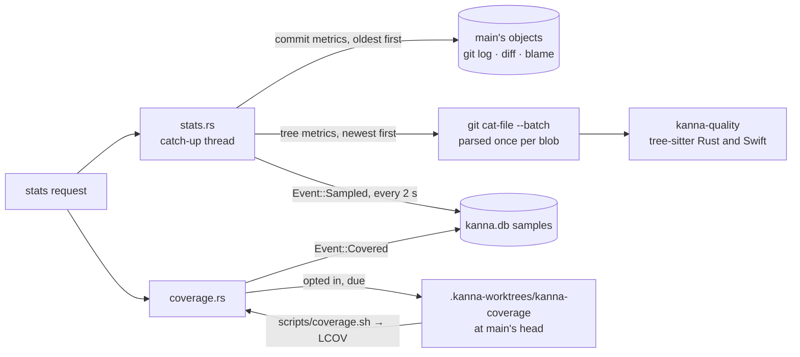

# Code quality metrics

**Status:** built · **Tests:** `kanna-quality`, `quality.rs`, `stats.rs`, `StatsFormatTests`, e2e `stats_tab` · **Mockup:** [`references/mockups/code-quality.html`](../../references/mockups/code-quality.html) · **Research:** [code quality](../research/code-quality.md) · **Builds on:** [Stats](stats.md)

The Stats tab's Code quality section shows how good the code on main is and which way it's heading, as agents write most of it. It has four groups. **Shape** measures complexity, copies and dead code at every commit on main. **Coverage** is what the tests run. **Fixes** traces which landings later needed a fix. **Worst** lists the offenders, and each row opens the code. The measures come from [SlopCodeBench](../research/code-quality.md#1-slopcodebench), so this repo's numbers compare with the benchmark's agents and humans.

| Dark | Light |
|---|---|
|  |  |

*(From the mockup: `#picture`, `#picture,light`.)*

## Contents

1. [The measures](#1-the-measures)
2. [The worst](#2-the-worst)
3. [Sampling](#3-sampling)
4. [Coverage runs](#4-coverage-runs)
5. [Fixes](#5-fixes)
6. [Interfaces](#6-interfaces)
7. [Tests](#7-tests)
8. [Glossary](#8-glossary)

## 1. The measures

Each measure shows its value at main's last commit over a line of its value at each day's last commit. Each line ends on today, and its note says how much it moved in 30 days.

| Tile | Measures | Computed | A bad trend |
|---|---|---|---|
| Erosion | complexity concentrated in big functions | SlopCodeBench's: Σ CC×√lines over functions with CC > 10, ÷ Σ over all functions | rising: new work piles into functions that are already complex |
| Verbosity | code that is copied or only passes calls on | SlopCodeBench's clone and wrapper lines (§[glossary](#8-glossary)) ÷ code lines | rising: agents copy instead of reusing |
| Functions over CC 10 | how many god-function candidates there are | count of functions with cyclomatic complexity > 10 | growing faster than code lines |
| Dead functions | code only tests reach, or nothing reaches | functions whose name appears nowhere else outside tests | rising: replaced code left behind |
| Pass-through wrappers | layers that add nothing | functions whose body is one call passing on exactly their parameters | rising |
| Code lines | context, the denominator of the shares | Rust and Swift lines with code, outside tests | not judged alone |
| Lines covered, Branches covered | what the tests run | from the last [coverage run](#4-coverage-runs) | falling |
| Changed lines covered | how well each landing was tested | lines landed in the 30 days, still there, run by a test ÷ all of them (Google's delta coverage); a column per landing day | low columns on recent days |
| Landings fixed later | how often a landing needed a fix | of the 30 days' landings, the share a later fix [traced back](#5-fixes) to; the line is each week's | rising (recent days read low: their fixes haven't come yet) |
| Fixes | fixes landed per day | landings found to be [fixes](#5-fixes) | a run of them |
| Landing to fix | how long a bug lived on main | per fix, from the landing it traced to; dots and a 7-day median | rising: bugs found later |

- **Counted code:** `.rs` and `.swift` files outside folders named `tests`, `Tests`, `test`, `benches`, `examples`, `vendor`, `third_party`, `references`, `fixtures`, `target` and `build`, and outside hidden folders. In Rust, `#[cfg(test)]` modules and `#[test]` functions are left out.
- **Functions:** Rust `fn` items, and Swift functions, `init`, `deinit`, subscripts and computed properties. Closures count toward the function they're in.
- **Cost and stability:** Shape and Fixes are deterministic. The same commit always gives the same numbers, so any change is the code's. Coverage moves a little between runs when tests take different paths (timeouts, races).

## 2. The worst

Six lists, from main's last sampled commit. Each row with a file opens a code tab at its line in the Desk view's window. A landing's row opens its diff.

| List | Rows, ranked by | Row shows |
|---|---|---|
| Worst functions | complexity mass (CC×√lines) | name, file:line, CC, lines, cognitive, distinct calls (fan-out) |
| Most duplicated code | lines in copies beyond the first | lines × copies, the first place and two others |
| Hotspots | landings that changed the file in 30 days × its cognitive complexity | file, changes × complexity |
| Least covered changed files | changed lines no test ran | file, % of its changed lines covered |
| Landings that needed the most fixes | fixes traced back to it | landing (branch or subject), the fixes |
| Fixes by area | fixes whose blamed lines are in the area (two folders, as [Stats](stats.md#2-the-numbers)) | area, count |

## 3. Sampling



- **Rows in `samples`:** each measure is a metric in [`METRICS`](stats.md#4-adding-a-metric). Commit metrics are `churn` and `fixes`. Tree metrics are `erosion`, `verbosity`, `high`, `dead`, `wrappers` and `lines`.
- **Order:** the catch-up samples the commit metrics first, then the tree metrics newest first, so today's numbers arrive within seconds.
- **No checkout:** a tree metric reads the commit's files from git's object store (`ls-tree`, then `cat-file --batch`). Each blob is parsed once and kept while later commits still use it.
- **Cost:** this repo's 556 commits take 14 s the first time, and a new commit takes under a second.
- **Answers early:** the first reply comes once the commit metrics are in. Later requests during a catch-up get what's sampled so far, and the section's note says `sampling N of M commits`.
- **Offenders:** each tree row's `doc` holds the top ten offenders and the 40 most complex files, so the lists need no tree at read time.

## 4. Coverage runs

- **Opt-in, yours:** a project is measured only if your own `~/.kanna-v4/config.json` names it. Coverage runs the project's tests, which is its code, so a repo can't switch this on for itself by naming a command in its `.kanna/config.json`.

  ```json
  { "stats": { "coverage": { "~/work/kanna-v4": "\"$KANNA_REPO/scripts/coverage.sh\"" }, "coverageEvery": 6, "coverageTimeout": 7200 } }
  ```

- **When:** a stats request starts a run when main's head has no coverage row, no run is going, and the last run started `coverageEvery` hours ago or more (6 by default). One run per project at a time. A run longer than `coverageTimeout` seconds (7200) is killed with its process group.
- **Where:** in `.kanna-worktrees/kanna-coverage`, a detached worktree the daemon owns, reset to the commit. Its `target/` goes wherever [build targets](build-targets.md) put a worktree's, never in your checkout.
- **The command** runs in `sh` in that worktree, with `KANNA_REPO` (the main checkout) and `KANNA_COVERAGE` (the LCOV file to write) set. Its log is `coverage/HASH/coverage.log` in the daemon's state folder.
- **`scripts/coverage.sh`** (this repo's):
  - Rust: `cargo llvm-cov --workspace --branch`, with `RUSTC_BOOTSTRAP=1` for the branch flag on stable.
  - Swift: `scripts/build.sh`, then `swift test --enable-code-coverage`, exported with `xcrun llvm-cov`.
  - E2E, with `--e2e [SCENARIO…]`: the scenarios run against `kanna`, `kanna-daemon` and `kanna-keeper` built with `-C instrument-coverage`, writing profiles in continuous mode. The app's Swift isn't measured there: one binary can't link two LLVM profile runtimes.
  - Failing tests still count what they ran.
- **The row:** metric `coverage` at the commit, with line and branch totals, each file's lines and changed lines, and each landing's changed lines. A line counts for the landing that `git blame --first-parent` gives it, if that landing is within the 30 days.
- **Status:** the Lines covered tile's note says `running at abc123 since 14:02`, the last failure, or how to set it up.

## 5. Fixes

The `fixes` metric runs at each landing: a first-parent commit on main other than `Merge main into …`.

- **A fix:** a landing is one if any of these hold:
  - It carries a `Fixes: COMMIT` trailer in any of its commits.
  - Its branch starts with `fix-`, `bug-` or `hotfix-`.
  - The first clause of its subject has fix, bug, regression, crash, broken, wrong or revert.
  - Its task's name and the first sentence of its first message have one of those words, or a problem word: fails, stuck, hangs, leaks, loses, race, flaky, doesn't, isn't, nothing.
  The task is found by the branch in the merge subject, through the task's `done` event.
- **Traced to (R-SZZ):**
  - With a trailer: the landing that brought the named commit.
  - Otherwise: the lines the fix deleted or changed in counted files, ignoring whitespace and lines with only punctuation or comments, blamed with `git blame -w --first-parent` on the fix's parent. The most recent landing blamed is the one traced to.
  - A fix that only adds lines traces to nothing.
- **Precision:** expect about half the traces to be right ([§5 of the research](../research/code-quality.md#5-bug-introducing-commits-szz)). A `Fixes:` trailer makes one exact, which is why [AGENTS.md](../../AGENTS.md) asks for it.

## 6. Interfaces

- **`kanna-quality`** (a crate):
  - `code::analyze(lang, text)` gives a file's functions (CC, cognitive, nesting, lines, calls, wrapper, exempt), its blocks (normalized subtree hashes) and its identifier counts.
  - `tree::Cache::tree(repo, blobs, commit)` and `Tree` give `erosion`, `verbosity`, `high`, `dead`, `wrappers`, `worst`, `clones` and `gini`.
  - `szz` gives `fix_reason`, `introduced`, `named_fixes` and `landing_of`.
  - `coverage` gives `parse` (LCOV), `totals` and `changed`.
- **The `list` chart:** a new kind in the reply, drawn by the app's `StatsList` and printed by `kanna stats`.

```json
{"id": "worst", "label": "Worst functions", "span": 3, "chart": {"kind": "list", "what": "complexity mass: CC × √lines", "empty": "No functions yet.",
  "rows": [{"label": "run", "detail": "crates/kanna-daemon/src/main.rs:215", "value": 4007, "figure": "CC 154",
            "note": "677 lines · cognitive 216 · calls 242", "open": {"path": "crates/kanna-daemon/src/main.rs", "line": 215}}]}}
```

- **`open`:** `{path, line}` opens `kanna open code` at the repo's file in the window's new tab. `{commit}` opens `kanna open diff COMMIT^1 COMMIT`.
- **The section** has no `placeholder` now. With no Rust or Swift code it has `empty` and no tiles.

## 7. Tests

- **`kanna-quality`:**
  - Cognitive complexity follows the white paper's own example (7).
  - `else if` and `else` count flat, and logical sequences count once per change of operator.
  - Swift guards, closures and computed properties are measured.
  - Wrappers, and tests counted apart.
  - Renamed copies hash alike and a different variable doesn't; copies are found whole.
  - Erosion, dead code and concentration over a tree.
  - LCOV merging.
  - SZZ on a fixture: a `fix-` landing blames the landing that wrote the line, and a branch's commit lands with its merge.
  - Changed lines by landing.
- **`quality.rs`:**
  - A fixture repo with a god function, a copied function, a wrapper and dead code, then a `fix-` landing: every tile and list as expected.
  - A coverage run in the daemon's own worktree from a stub command, leaving the checkout untouched. A failing command says so.
  - The opt-in comes only from your own settings.
- **`stats.rs`:** a row per metric per commit, and filling only what's missing.
- **The CLI:** list tiles print a row each, and an empty list prints its words.
- **e2e `stats_tab`:** the fixture repo gets a Rust file. Every code tile's label and note match the reply, and clicking a Worst functions row opens a code tab at its line.

## 8. Glossary

| Term | Meaning |
|---|---|
| **CC** | Cyclomatic complexity: 1 + the function's `if`, `else if`, loops (not `loop`), `match` arms other than `_`, `guard`, `catch`, ternaries, `let … else`, and each `&&` and `\|\|` |
| **Cognitive complexity** | SonarSource's measure of how hard a function is to follow: breaks in flow, weighted by nesting |
| **Mass** | CC × √(the function's code lines): SlopCodeBench's weight for a function's share of complexity |
| **Erosion** | The share of all mass in functions with CC > 10 |
| **Clone lines** | Lines of a function, `if`, loop, `match`/`switch`, `guard` or `do` of 3 or more code lines whose normalized form (identifiers numbered in order, literals by type) matches another's |
| **Verbosity** | (clone lines ∪ wrapper lines) ÷ code lines |
| **Landing** | A first-parent commit on main: a task's merge, or a commit made on main |
| **SZZ** | Finding the commits that introduced a bug by blaming the lines its fix changed |
| **Delta coverage** | Coverage of only the lines a change added or modified |
