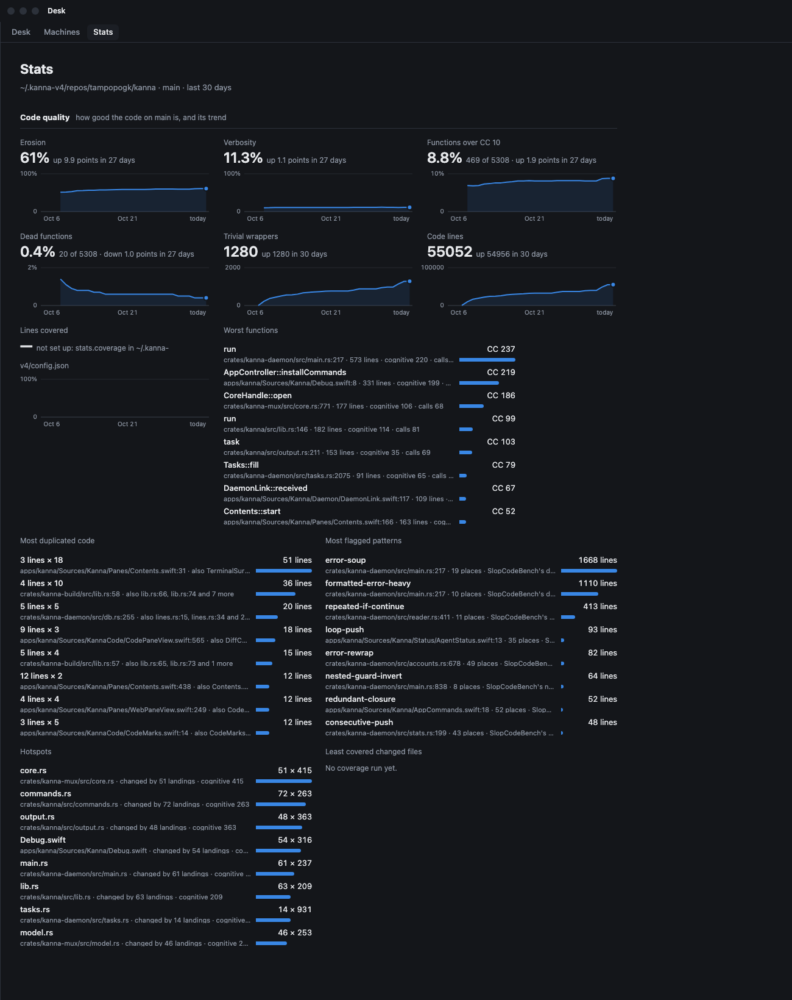
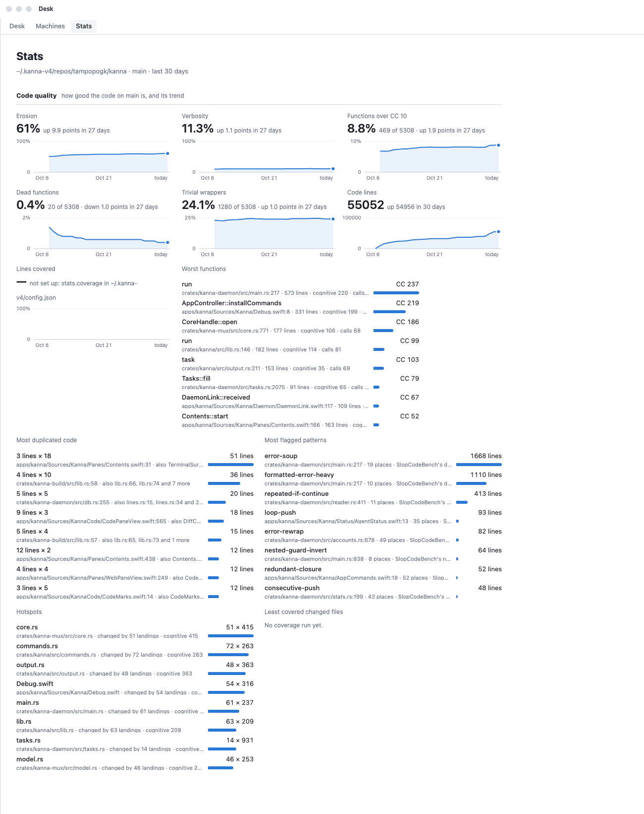
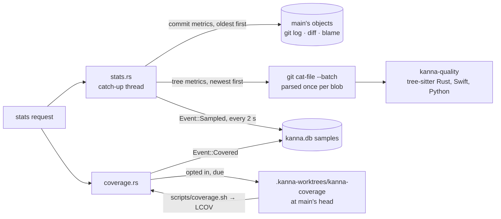

# Code quality metrics

**Status:** built · **Tests:** `kanna-quality`, `quality.rs`, `stats.rs`, `StatsFormatTests`, e2e `stats_tab` · **Mockup:** [`references/mockups/code-quality.html`](../../references/mockups/code-quality.html) · **Research:** [code quality](../research/code-quality.md) · **Builds on:** [Stats](stats.md)

The Stats tab's Code quality section shows how good the code on main is and which way it's heading, as agents write most of it. It has three groups. **Shape** measures complexity, copies and dead code at every commit on main. **Coverage** is what the tests run. **Worst** lists the offenders, and each row opens the code. Which landings later needed a fix is [sampled too](#5-fixes) but not shown here: how often and how soon bugs are caught says more about the process that makes the code than about the code, and belongs with that process's stats. The measures come from [SlopCodeBench](../research/code-quality.md#1-slopcodebench), so this repo's numbers compare with the benchmark's agents and humans.

| Dark | Light |
|---|---|
|  |  |

*(From the mockup: `#picture`, `#picture,light`.)*

## Contents

1. [The measures](#1-the-measures)
   - [Matching SlopCodeBench](#matching-slopcodebench)
   - [The rules](#the-rules)
2. [The worst](#2-the-worst)
3. [Sampling](#3-sampling)
4. [Coverage runs](#4-coverage-runs)
5. [Fixes](#5-fixes)
6. [Interfaces](#6-interfaces)
7. [Tests](#7-tests)
8. [Glossary](#8-glossary)

## 1. The measures

Each measure shows its value at main's last commit over a line of its value at each day's last commit. Each line ends on today, and its note says how much it moved in 30 days. Shares are the measures to read: a count grows with the code, so it says little while the code grows this fast. A share of a whole, like erosion, runs on a 0–100 axis; Functions over CC 10, Dead functions and Trivial wrappers are small shares, and get an axis that fits them.

A share of almost no code means nothing: on main's first day here, 2 of 5 functions were over CC 10. So a share's line and note start on the first day main had a tenth of today's code lines, and the note says how many days that is, as in `up 1.9 points in 27 days`.

**CC** is a function's cyclomatic complexity (McCabe): 1 plus each place its path can branch, so each `if`, loop, `match` arm, `&&` and `||` (full list in the [glossary](#8-glossary)). It counts the independent paths a test would need to cover. **CC 10** is the line SlopCodeBench draws, from radon's grades: up to 10 is simple, and a function over it is a god-function candidate. A 50-line function with an `if` per field might be CC 12; this repo's worst, the daemon's `run`, is CC 237.

| Tile | Measures | Computed | A bad trend |
|---|---|---|---|
| Erosion | complexity concentrated in big functions | SlopCodeBench's: Σ CC×√lines over functions with CC > 10, ÷ Σ over all functions | rising: new work piles into functions that are already complex |
| Verbosity | code a reviewer would rewrite shorter | SlopCodeBench's: lines [a rule flags](#the-rules) ∪ clone lines ∪ trivial-wrapper lines, ÷ code lines | rising: agents copy and spell out instead of reusing |
| Functions over CC 10 | how common god-function candidates are | the share of functions with cyclomatic complexity > 10; the note gives the count | rising: more of the code is over the line, whatever its size |
| Dead functions | code only tests reach, or nothing reaches | the share of functions whose name appears nowhere else outside tests; the note gives the count | rising: replaced code left behind |
| Trivial wrappers | layers that add nothing | the share of functions whose body is a single returned expression (SlopCodeBench's; in Rust and Swift, also a lone expression in a function with a return type); the note gives the count | rising |
| Code lines | context, the denominator of the shares | Rust and Swift lines with code, outside tests | not judged alone |
| Lines covered, Branches covered | what the tests run | from the last [coverage run](#4-coverage-runs) | falling |
| Changed lines covered | how well each landing was tested | lines landed in the 30 days, still there, run by a test ÷ all of them (Google's delta coverage); a column per landing day | low columns on recent days |

- **Counted code:** `.rs`, `.swift` and `.py` files outside folders named `tests`, `Tests`, `test`, `benches`, `examples`, `vendor`, `third_party`, `references`, `fixtures`, `target` and `build`, and outside hidden folders. In Rust, `#[cfg(test)]` modules and `#[test]` functions are left out.
- **Functions:** Rust `fn` items, Swift functions, `init`, `deinit`, subscripts and computed properties, and Python `def`s that SlopCodeBench reaches (module, class and function bodies). Closures count toward the function they're in.
- **Code lines:** lines where a token starts, other than comments and, in Rust and Swift, a lone `}`, `;` or `,` (Python has no such lines, and SlopCodeBench counts Python by its tokens). A multi-line string counts on its first line, and a Python docstring not at all.
- **Cost and stability:** Shape and fixes are deterministic. The same commit always gives the same numbers, so any change is the code's. Coverage moves a little between runs when tests take different paths (timeouts, races).

### Matching SlopCodeBench

`kanna-quality` also parses Python, so it can be checked against SlopCodeBench's own engine, [`scb-check`](https://github.com/gabeorlanski/scb-check) 0.1.3, on the same code. On five human-written packages it matches everywhere but the rule set:

| Package | Code lines | Functions | CC > 10 | Erosion | Cognitive erosion | Clone lines | Trivial wrappers |
|---|---|---|---|---|---|---|---|
| `click` 8.5 | 6,847 | 567 | 37 | 0.472 | 0.762 | 452 | 107 (111) |
| `email` (stdlib 3.13) | 6,096 (6,095) | 534 | 40 | 0.572 | 0.849 | 654 | 141 (145) |
| `http` (stdlib 3.13) | 3,326 | 240 | 26 | 0.597 | 0.832 | 171 | 39 |
| `rich` 15 | 31,394 (31,397) | 891 | 57 | 0.592 | 0.887 | 472 | 179 (180) |
| `typer` 0.24 | 4,696 | 170 | 17 | 0.620 | 0.866 | 309 | 34 |

*(`scb-check`'s figure in brackets where it differs. Its extra wrappers are module-level aliases, `name = function`, which Rust and Swift don't have. `cargo run -p kanna-quality --example calibrate -- DIR…` prints these.)*

- **CC:** Python counts SlopCodeBench's node kinds over the whole function, nested functions included. Rust and Swift count their equivalents (§[glossary](#8-glossary)), with a closure passed as an argument counting as a comprehension does.
- **The rules aren't the same rules.** SlopCodeBench's 197 ast-grep rules are written for Python; on these packages they flag 12–19% of lines, the largest part of verbosity. Kanna runs [36 rules](#the-rules) of its own for Rust and Swift, each a port of one or more of SlopCodeBench's to the same shape in those languages, and none for Python. So erosion, clones and wrappers compare with the benchmark directly, and verbosity reads low against it by however much of the rule set has no port.

### The rules

Each rule matches a shape SlopCodeBench flags in Python, in its Rust or Swift form, mostly ones clippy also rewrites. A hit's lines are the code lines of the node it matched: a statement, an `if` chain, a loop or, for the function-wide rules, the whole function. Code in tests isn't checked.

| Rule | Ports | Matches |
|---|---|---|
| `unnecessary-else` | unnecessary-elif, unnecessary-else-raise | an `if` chain with `else if` whose first branch returns, or with `else` whose first branch throws (`return Err`, `throw`) |
| `collapsible-if` | nested-if-no-else | an `if` with no `else` whose body is only another such `if` (not `if let` in Rust) |
| `nested-guard-invert` | nested-guard-invert | an `if` with no `else`, last in its block, holding an early-exit `if` beside other code |
| `needless-bool` | boolean-return-if-else, redundant-bool-ternary | `if c { true } else { false }`, `c ? true : false` |
| `same-branches`, `same-condition` | ternary-same-value, duplicated-if-condition | both branches alike; a condition repeated in one chain |
| `needless-continue`, `needless-return` | redundant-continue, redundant-return-none | `continue` ending a loop; `return` ending a function |
| `redundant-closure`, `identity-map` | unnecessary-lambda, redundant-list-comprehension | `\|x\| f(x)`, `{ f($0) }`; `.map(\|x\| x.clone())`, `.map { $0 }` |
| `len-zero`, `bool-comparison` | len-comparison, bool-comparison | `.len() == 0`, `.count > 0`; `== true` (not on an indexed value, such as JSON) |
| `loop-push`, `loop-accumulate` | verbose-list-append-loop, manual-sum-loop, … | a `for` whose only statement pushes, inserts or `+=`s |
| `consecutive-push`, `repeated-key-assignment` | consecutive-append-calls, repeated-dict-key-assignment | a push after a push; `d[k] = f(…)` after `d[j] = f(…)` |
| `repeated-if-continue`, `manual-find` | repeated-if-continue, manual-find-return-none | two `if … { continue }` in a row; a loop returning the first match, then `None`/`nil` |
| `manual-min-max`, `manual-default`, `manual-entry` | manual-min-max, verbose-none-default, manual-dict-setdefault | `if a > b { a } else { b }`; `if x.is_none() { x = … }`; `if !m.contains_key(k) { m.insert(k, …) }` |
| `check-then-unwrap`, `none-guard` | verbose-dict-key-access, guard-return-none, defensive-none-return-heavy | `if x.is_some() { x.unwrap() }`, `if x != nil { x! }`; `let Some(x) = … else { return None }` (Rust's `?`), three `guard … else { return nil }` in a Swift function |
| `error-rethrow`, `error-swallowed`, `error-to-sentinel`, `error-rewrap` | except-bare-reraise, except-pass-silence, except-return-static-sentinel, wrap-raise-fstring | `Err(e) => return Err(e)`; `Err(_) => {}`, `catch {}`; `Err(_) => None`; `.map_err(\|e\| format!("…{e}"))` |
| `error-soup`, `formatted-error-heavy` | defensive-try-soup-function, defensive-fstring-raise-heavy | a function with 3 or more `Err` matches, `if let Err` or `do`/`catch`; or 3 or more `Err(format!(…))`, `bail!`, `throw E("…\(x)")` |
| `string-dispatch` | dispatch-by-string-equality | three or more `x == "…"` branches in one chain |
| `needless-collect`, `long-tuple`, `index-unpack` | unnecessary-list-call, long-tuple-unpacking, manual-index-unpack | `.collect::<Vec<_>>().len()`, `for x in v.clone()`; a 5-tuple pattern; `let a = p.0; let b = p.1;` |
| `banner-comment`, `empty-init` | section-banner-comment, empty-init | `// ==========`; an empty Swift `init()` |

## 2. The worst

Five lists, from main's last sampled commit. Each row opens a code tab at its line in the Desk view's window.

| List | Rows, ranked by | Row shows |
|---|---|---|
| Worst functions | complexity mass (CC×√lines) | name, file:line, CC, lines, cognitive, distinct calls (fan-out) |
| Most duplicated code | lines in copies beyond the first | lines × copies, the first place and two others |
| Most flagged patterns | lines a [rule](#the-rules) flags | rule, its biggest hit, places, the SlopCodeBench rules it ports |
| Hotspots | landings that changed the file in 30 days × its cognitive complexity | file, changes × complexity |
| Least covered changed files | changed lines no test ran | file, % of its changed lines covered |

## 3. Sampling



- **Rows in `samples`:** each measure is a metric in [`METRICS`](stats.md#4-adding-a-metric). Commit metrics are `churn` and `fixes`. Tree metrics are `erosion`, `verbosity`, `high`, `dead`, `wrappers` and `lines`.
- **Revisions:** each metric has a definition revision, kept in its rows. A row from an older revision counts as missing, so changing how a measure is computed resamples the 30 days instead of joining two definitions in one line. Tree metrics are at revision 1, the definitions above with the rules; `high`, `dead` and `wrappers` at 2, once they became shares of all functions.
- **Main's order is time's order:** a commit's time on main is never earlier than the commit before it on main, plus a millisecond. A commit dated in the same second as its parent, or before it, can't then stand in for main's head as the day's last commit.
- **Order:** the catch-up samples the commit metrics first, then the tree metrics newest first, so today's numbers arrive within seconds.
- **No checkout:** a tree metric reads the commit's files from git's object store (`ls-tree`, then `cat-file --batch`). Each blob is parsed once and kept while later commits still use it.
- **Cost:** a commit's tree takes about a second to read, parse and check the first time; later commits reparse only the files they changed. A new commit takes under a second.
- **Answers at once:** a request gets what's stored and the catch-up carries on behind it, with each step in the reply's [`status`](stats.md#3-where-they-come-from), under the page's title. The section with no samples yet says `Measuring the code on main.`
- **Offenders:** each tree row's `doc` holds the top ten offenders and the 40 most complex files, so the lists need no tree at read time.

## 4. Coverage runs

- **Opt-in, yours:** a project is measured only if your own `~/.kanna-v4/config.json` names it. Coverage runs the project's tests, which is its code, so a repo can't switch this on for itself by naming a command in its `.kanna/config.json`.

  ```json
  { "stats": { "coverage": { "~/work/kanna-v4": "\"$KANNA_REPO/scripts/coverage.sh\"" }, "coverageEvery": 6, "coverageTimeout": 7200 } }
  ```

- **When:** a stats request starts a run when main's head has no coverage row, no run is going, and the last run started `coverageEvery` hours ago or more (6 by default). One run per project at a time. A run longer than `coverageTimeout` seconds (7200) is killed with its process group.
- **Where:** in `.kanna-worktrees/kanna-coverage`, a detached worktree the daemon owns, reset to the commit. Its `target/` goes wherever [build targets](build-targets.md) put a worktree's, never in your checkout.
- **The command** runs in `sh` in that worktree, with `KANNA_REPO` (the main checkout) and `KANNA_COVERAGE` (the LCOV file to write) set. Its log is `coverage/HASH/coverage.log` in the daemon's state folder.
- **`scripts/coverage.sh`** (this repo's):
  - Rust: `cargo llvm-cov --workspace --branch`, with `RUSTC_BOOTSTRAP=1` for the branch flag on stable.
  - Swift: `scripts/build.sh`, then `swift test --enable-code-coverage`, exported with `xcrun llvm-cov`.
  - E2E, with `--e2e [SCENARIO…]`: the scenarios run against `kanna`, `kanna-daemon` and `kanna-keeper` built with `-C instrument-coverage`, writing profiles in continuous mode. The app's Swift isn't measured there: one binary can't link two LLVM profile runtimes.
  - Failing tests still count what they ran.
- **The row:** metric `coverage` at the commit, with line and branch totals, each file's lines and changed lines, and each landing's changed lines. A line counts for the landing that `git blame --first-parent` gives it, if that landing is within the 30 days.
- **Status:** the Lines covered tile's note says `running at abc123 since 14:02`, the last failure, or how to set it up. While a run goes, the page's status line says `Updating: running coverage`, with no percentage: a run reports no progress.

## 5. Fixes

The `fixes` metric runs at each landing: a first-parent commit on main other than `Merge main into …`. It is sampled with the rest, so the stats of the process that makes the code (how many landings needed a fix, how long bugs lived, where they were) start with 30 days of history, but Code quality doesn't show it.

- **A fix:** a landing is one if any of these hold:
  - It carries a `Fixes: COMMIT` trailer in any of its commits.
  - Its branch starts with `fix-`, `bug-` or `hotfix-`.
  - The first clause of its subject has fix, bug, regression, crash, broken, wrong or revert.
  - Its task's name and the first sentence of its first message have one of those words, or a problem word: fails, stuck, hangs, leaks, loses, race, flaky, doesn't, isn't, nothing.
  The task is found by the branch in the merge subject, through the task's `done` event.
- **Traced to (R-SZZ):**
  - With a trailer: the landing that brought the named commit.
  - Otherwise: the lines the fix deleted or changed in counted files, ignoring whitespace and lines with only punctuation or comments, blamed with `git blame -w --first-parent` on the fix's parent. The most recent landing blamed is the one traced to.
  - A fix that only adds lines traces to nothing.
- **Precision:** expect about half the traces to be right ([§5 of the research](../research/code-quality.md#5-bug-introducing-commits-szz)). A `Fixes:` trailer makes one exact, which is why [AGENTS.md](../../AGENTS.md) asks for it.

## 6. Interfaces

- **`kanna-quality`** (a crate):
  - `code::analyze(lang, text)` gives a file's functions (CC, cognitive, nesting, lines, calls, wrapper, exempt), its blocks (normalized subtree hashes), its identifier counts, its rule hits, and the code lines flagged and in wrappers.
  - `rules::check(lang, root, text)` gives the hits, and `rules::RULES` each rule with the SlopCodeBench rules it ports.
  - `tree::Cache::tree(repo, blobs, commit)` and `Tree` give `erosion`, `verbosity`, `high`, `dead`, `wrappers`, `worst`, `clones` and `gini`.
  - `szz` gives `fix_reason`, `introduced`, `named_fixes` and `landing_of`.
  - `coverage` gives `parse` (LCOV), `totals` and `changed`.
- **The `list` chart:** a new kind in the reply, drawn by the app's `StatsList` and printed by `kanna stats`.

```json
{"id": "worst", "label": "Worst functions", "span": 3, "chart": {"kind": "list", "what": "complexity mass: CC × √lines", "empty": "No functions yet.",
  "rows": [{"label": "run", "detail": "crates/kanna-daemon/src/main.rs:217", "value": 5673.2, "figure": "CC 237",
            "note": "573 lines · cognitive 220 · calls 246", "open": {"path": "crates/kanna-daemon/src/main.rs", "line": 217}}]}}
```

- **`tip`:** a tile may carry one, shown on hovering its title and figure. Erosion, Functions over CC 10 and Worst functions explain CC and the line at 10.
- **`open`:** `{path, line}` opens `kanna open code` at the repo's file in the window's new tab. `{commit}` opens `kanna open diff COMMIT^1 COMMIT`; no Code quality list uses it now.
- **The section** has no `placeholder` now. With no Rust or Swift code it has `empty` and no tiles.

## 7. Tests

- **`kanna-quality`:**
  - Cognitive complexity follows the white paper's own example (7).
  - `else if` and `else` count flat, and logical sequences count once per change of operator.
  - Swift guards, closures and computed properties are measured.
  - Wrappers are single-return functions, in Rust, Swift and Python, and tests are counted apart.
  - Each rule matches its shape in Rust and in Swift, and look-alikes don't (`if let` nesting, `json["ok"] == true`, an `if` that isn't last).
  - Renamed copies hash alike and a different variable doesn't; copies are found whole.
  - Erosion, dead code and concentration over a tree.
  - LCOV merging.
  - SZZ on a fixture: a `fix-` landing blames the landing that wrote the line, and a branch's commit lands with its merge.
  - Changed lines by landing.
- **`quality.rs`:**
  - A fixture repo with a god function, a copied function, a wrapper and dead code, then a `fix-` landing: every tile and list as expected, the fix sampled and traced to its landing, and no fix tile shown.
  - A coverage run in the daemon's own worktree from a stub command, leaving the checkout untouched. A failing command says so.
  - The opt-in comes only from your own settings.
- **`stats.rs`:** a row per metric per commit, filling only what's missing, resampling a row from an older revision, and main's order kept when commit times tie or go back.
- **The CLI:** list tiles print a row each, and an empty list prints its words.
- **e2e `stats_tab`:** the fixture repo gets a Rust file. Every code tile's label and note match the reply, and clicking a Worst functions row opens a code tab at its line.

## 8. Glossary

| Term | Meaning |
|---|---|
| **CC** | Cyclomatic complexity: 1 + the function's `if`, `else if`, loops (not `loop`), `match` arms other than `_`, `guard`, `catch`, ternaries, `let … else`, closures passed as arguments, and each `&&` and `\|\|`. In Python, SlopCodeBench's: `if`, `elif`, loops, `except`, `assert`, comprehensions, `and`/`or`, conditional expressions and comprehension `if`s |
| **Cognitive complexity** | SonarSource's measure of how hard a function is to follow: breaks in flow, weighted by nesting |
| **Mass** | CC × √(the function's code lines): SlopCodeBench's weight for a function's share of complexity |
| **Erosion** | The share of all mass in functions with CC > 10 |
| **Clone lines** | Lines of a function, `if`, loop, `match`/`switch`, `guard` or `do` (Python: `with`, `try`, `match`) of 3 or more code lines whose normalized form matches another's: identifiers numbered in order of appearance, literals by type, other tokens by their kind, comments dropped |
| **Trivial wrapper** | A function whose body is one returned expression |
| **Verbosity** | (flagged lines ∪ clone lines ∪ trivial-wrapper lines) ÷ code lines |
| **Landing** | A first-parent commit on main: a task's merge, or a commit made on main |
| **SZZ** | Finding the commits that introduced a bug by blaming the lines its fix changed |
| **Delta coverage** | Coverage of only the lines a change added or modified |
