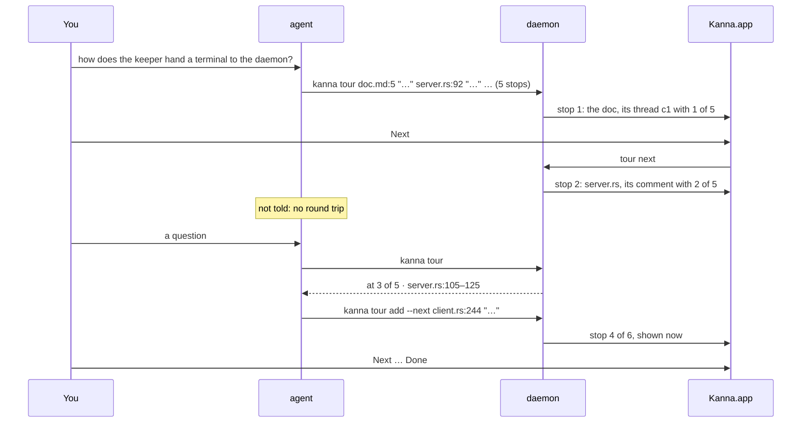

# Code Tour Steps

**Status:** built · **Tested:** e2e `code_tour_steps`, `cargo test -p kanna-daemon --test panes` (tours), `-p kanna-threads` · **Mockup:** [`references/mockups/code-tour-steps.html`](../../references/mockups/code-tour-steps.html) · **Builds on:** the [code tour](code-tour.md)

The agent queues a whole tour at once, over code and markdown, and you step through it at your own pace: each comment has **Back**, where you are (**2 of 5**) and **Next**. The agent fills the pipeline and stepping doesn't involve it, so there's no round trip between stops. Only a question brings it back: it looks up where you are and answers with a stop of its own, right after the one you're on.

## Contents

1. [The loop](#1-the-loop)
2. [Rules](#2-rules)
3. [CLI](#3-cli)
4. [The skill](#4-the-skill)
5. [How it's built](#5-how-its-built)

## 1. The loop

## 2. Rules

- **A tour is a list of stops,** each a comment as `kanna comment` makes it: on a source file, lines snapped to their scope; on a markdown file, a thread by the agent on the block at the line. Every stop is checked when it's queued (a missing file, a line past the end), and nothing is queued if one fails.
- **One tour per agent.** A new `kanna tour` replaces the agent's last one. The tour belongs to the agent's pane: it comes back after a relaunch and goes when that pane closes.
- **Only the current stop shows.** Showing a stop does what `kanna comment` does: it opens the file's tab or selects the one that shows it, and scrolls to the comment. A tab opens when the tour reaches it, not when it's queued.

- **Back, N of M, Next** sit along the bottom of the comment box, or of the thread's card on a markdown stop. Back is off on the first stop; on the last, Next says **Done**.
- **Stepping doesn't involve the agent.** Next, Back and Done go to the daemon only; the agent isn't sent anything, so a step costs no turn and no wait. The agent can keep adding stops with `kanna tour add` while you read.
- **A question in the middle** is typed in the agent's terminal as usual (or replied in a markdown stop's thread, which reaches the agent as any thread reply does). The agent runs `kanna tour` to see which stop you're on, and answers with a stop after it (`kanna tour add --next`), shown at once; the count grows (4 of 6), Next carries on with the tour, and Back returns to where you were.

- **Done ends the tour,** without telling the agent. The last stop's comment stays, without its Back and Next; the tabs stay until closed, as any comment's.
- **A closed tab comes back.** If you close a stop's tab, Back or Next to that stop opens it again.
- **A markdown stop's thread is written when it's reached,** and stays in the doc's thread list afterwards, like any thread. Going back to it selects the same thread.
- **Light and dark** follow the system.

## 3. CLI

| Command | Does |
|---|---|
| `kanna tour FILE:LINE[-LAST] TEXT [FILE:LINE TEXT …]` | a new tour, replacing yours; shows stop 1. Answers `tour of 5 · 1 of 5 · opened file-3 · keeper-fds.md:5 · c1` (a doc's stop names its thread) |
| `kanna tour add [--next] FILE:LINE TEXT …` | adds stops at the end (`added 1 · at 3 of 6`), or with `--next` right after the current one and shows the first of them (`added 1 · 4 of 6 · file-2 · client.rs:242–259`) |
| `kanna tour go next\|back\|N` | shows that stop, as Next and Back do (the app's buttons call it) |
| `kanna tour` | lists the stops, marking the current one: `at 3 of 5 · server.rs:105–125`, or `no tour` |
| `kanna tour end` | ends the tour, as Done does |

Each TEXT is one argument (quote it). Placement options are `comment`'s, for files that aren't open yet. `kanna workspace list --all --json` shows the pane on the current stop with `tour: {owner, at, of}` (and `thread` on a doc), and the agent's pane with `tour: {at, of}`. `debug.code` and `debug.md` report the footer (`tour`) and press its buttons (`"tour": "next"` or `"back"`).

## 4. The skill

`kanna-explain` queues the tour instead of commenting one part at a time:

- **Plan the route, then queue it in one `kanna tour`:** the big-picture doc first, then the code, small parts each.
- **In the chat, a line:** how many stops, and "Next on the comment; ask here any time". Then stop: the user steps through without you.
- **Fill it while they read:** if more stops come to mind, `kanna tour add` them to the end.
- **On a question during a tour,** run `kanna tour` to see where the user is, then answer with `kanna tour add --next` on the code that answers it, and a line.
- **When the user says they're done,** offer to leave the tabs or close them.

## 5. How it's built

| Piece | Where | What's new |
|---|---|---|
| CLI | `crates/kanna` | `tour`, its pairs of `FILE:LINE TEXT`; markdown stops go to the daemon too |
| Thread files | `crates/kanna-threads` (new) | the doc thread file (where it lives, reading and writing it safely, `block_at`, adding the agent's thread), moved out of the CLI's `threads.rs` so the daemon writes a markdown stop's thread with the same code |
| Tour | `crates/kanna-mux` (`tour.rs`) | `tour` keeps `{stops, at}` on the agent's pane record; showing a stop reuses `comment` for code and `markup` plus a written thread for markdown |
| Code pane | `apps/kanna/Sources/KannaCode` | `CodeComment.swift`: the comment box's footer (Back, N of M, Next or Done), calling `tour go` |
| Markdown pane | `apps/kanna/Sources/KannaDocs`, `KannaMarkdown` | `DocComments.swift`: the same footer on the card of the thread the pane's record names; the pane selects that thread when its stop shows |
| Contents | `apps/kanna/Sources/Kanna/Panes` | passes each pane its stop's `tour: {owner, at, of}` and sends `tour go` for the buttons |

- **The stop's place is on the record of the pane that shows it,** `tour: {owner, at, of}` (and `thread` on a markdown pane), beside the code pane's `comment`. Only the current stop has it: moving on clears the last one's and restarts that pane, as a new comment does.
- **The tour is on the agent's pane record,** `tour: {stops, at}`. Term panes come back from the keeper on a daemon restart, so the daemon takes the tour from the saved layout's record of the same pane.
- **Checks:** `crates/kanna-daemon/tests/panes.rs` for `tour` (queueing, a bad stop refusing the lot, next, back, add --next, done, nothing sent to the agent, a relaunch, the agent's pane closing); `crates/kanna` unit tests for parsing the pairs; e2e `code_tour_steps`: a tour of a doc and two code files, Next and Back pressed through `debug.code`/`debug.md`, which tab is selected and the footer's N of M, the agent's terminal left untouched by stepping, `kanna tour` reporting the current stop, `add --next`, Done.
