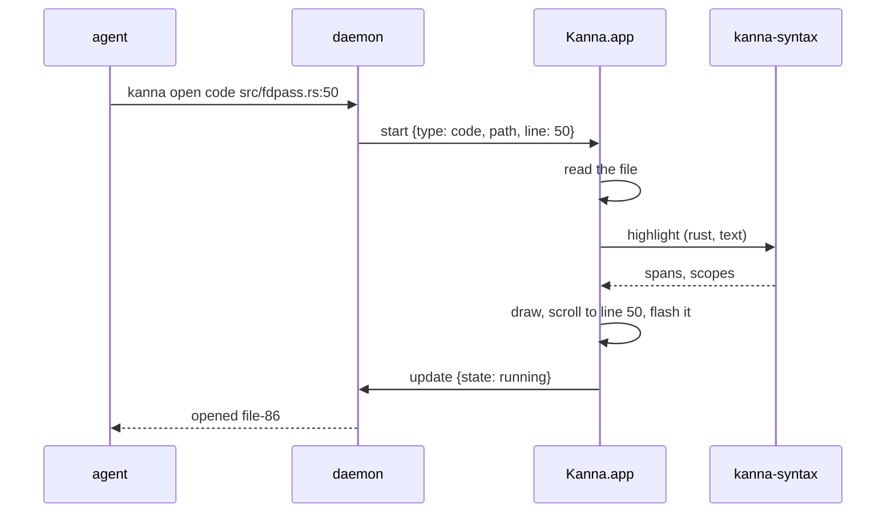
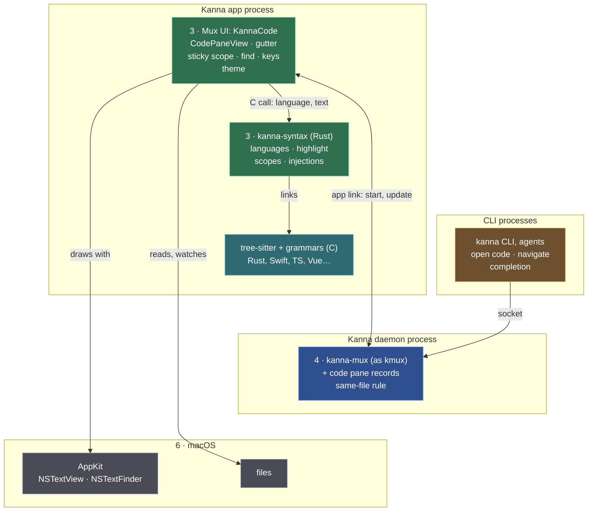

# Code Viewer

**Status:** built · **Mockup:** [`references/mockups/code-viewer.html`](../../references/mockups/code-viewer.html) · **Next:** the [code tour](code-tour.md) builds on it

A **code pane** shows a source file, highlighted, beside the agent. The agent opens one to show you the code it's talking about; you read, select and copy. It's read-only: the agent edits, the pane follows the file. It's the first step towards the code tour, where the agent walks you through code to keep your mental model of it.

## Contents

1. [Opening a file](#1-opening-a-file)
2. [Rules](#2-rules)
3. [Keys and mouse](#3-keys-and-mouse)
4. [CLI](#4-cli)
5. [How it's built](#5-how-its-built)
6. [Glossary](#6-glossary)

## 1. Opening a file

- `kanna open code FILE[:LINE]` takes `open`'s placement options. With none, from a task's terminal it opens a tab on the task's Desk, as `open md` does.
- `LINE` puts that line a third of the way down and flashes it. Without it the file opens at the top; past the end, at the last line.
- **A file that's already open isn't opened twice.** Without a placement or a name, `open code` on a file a code pane in that window (the task's Desk) already shows selects that pane's tab and goes to the line instead, answering with its ID. The daemon's core decides, since it has every pane's record. With a placement, it always opens a new pane.
- `kanna navigate PANE FILE[:LINE]` shows another file, or another line, in the same pane, with back and forward history as a markdown pane's.

## 2. Rules

- **Read-only.** You select and copy (⌘A, ⌘C); nothing types into it.
- **It follows the file.** When the file changes on disk the pane reloads at the same scroll position and marks the lines that changed in the gutter, until the next change.

- **Sticky scope.** The lines that open the scopes the top line is in (function, `impl`, loop, `if`…) stay pinned at the top, outermost first, five at most. Clicking one scrolls to it. Scopes come from the syntax tree, so they work the same for braces (Rust, C) and indentation (Python, YAML).
- **A pinned line looks as it does in the text**: its selection, find matches, current line, comment tint (or dimming) and changed mark stay on it, and follow as they change.

- **Indent guides** mark each indent level; blank lines take the next line's level.
- **Scrolling past the end**, so the last lines can reach the top.
- **Long lines don't wrap.** The pane scrolls sideways; the line numbers stay.
- **Light and dark** follow the system, as every pane does.

- **Languages**, by file extension (and a `#!` line for scripts): Rust, Swift, TypeScript and JavaScript (React's `.tsx` and `.jsx` too), Python, Go, C, C++, Shell, JSON, TOML, YAML, HTML, CSS, and Vue and Svelte components (their markup, script and style each highlighted as its own language). Any other text file shows plain, with line numbers and indent guides but no sticky scope.
- **Find** (⌘F) opens a find bar over the code: every match is highlighted, the current one scrolled into view; ⌘G and ⇧⌘G go to the next and previous match, Esc closes it. It searches the text as written, case-insensitive unless the search has a capital.
- **Zoom** (⌘= ⌘− ⌘0) changes the font size, as in a terminal, from 9 to 32 pt, kept with the pane.
- **Files it won't show:** a missing file fails with "No such file: …", a folder with "… is a folder, not a file", a binary file (a NUL byte in its first 8 KB) with "… isn't a text file". **[Assumption]** A file over 5 MB shows plain, without highlighting or scopes.

## 3. Keys and mouse

| You | Does |
|---|---|
| Scroll, trackpad | moves through the file, sideways too |
| Click a line | marks it as the current line |
| Click a pinned scope | scrolls to that line |
| Drag, ⌘A, ⌘C | selects and copies text |
| The markdown pane's reading keys ([markdown-keys.md](markdown-keys.md)): `less`'s `j` `k`, `d` `u`, `f` `b`, `space`, `g` `G`, `/` `n`, with Vim's ⌃ forms too | the same, with a line of code as "a line", `}` `{` to the next or previous blank line, and `]]` `[[` to the next or previous scope's first line (a function, a type), counted from the current line while it's on screen; `/` `?` `n` `N` use the find bar's matches |
| ⌘F, ⌘G, ⇧⌘G, Esc | find, next match, previous match, close the find bar |
| ⌘= ⌘− ⌘0 | font size bigger, smaller, back |
| Back / Forward (Pane menu, mouse buttons 4 and 5) | the file and line shown before / after |

## 4. CLI

| Command | Does |
|---|---|
| `kanna open code FILE[:LINE] [placement]` | opens a code pane at that line |
| `kanna navigate PANE FILE[:LINE]` | shows that file and line in the pane; `back`, `forward` as for markdown |
| `kanna workspace list --all --json` | shows a code pane's file and line |
| `kanna raw '{"cmd":"debug.code","args":{"pane":"file-86"}}'` | for tests: the text, the top line, the pinned scopes with each one's marks (selection, find matches, current, comment, dimmed, changed, flashing), and each line's highlight spans by capture name; `select: [line, column, length]` selects text |

The pane's record in the saved layout is `{type: "code", path, line}` (its text size is the app's, [windows](windows.md#2-what-the-app-keeps)), so it comes back after a relaunch where it was.

## 5. How it's built

Read top to bottom: each layer uses the ones below it; the outer boxes are processes, numbered as the [Kanna stack](architecture.md#1-the-stack) (layers 1, 2 and 5 take no part).

**Colours:** green is Kanna's own, blue is Kanna's code that follows kmux (with the code pane added), teal is a library Kanna uses, grey is macOS, orange the CLIs.

| Piece | Where | What's new |
|---|---|---|
| CLI | `crates/kanna` | the `code` kind of `open`, `FILE:LINE`, completion of source files |
| Pane records | `crates/kanna-mux` (daemon) | `PaneType::Code` with `path`, `line`, `zoom`; the same-file rule; `debug.code` passed to the app |
| Code pane | `apps/kanna/Sources/KannaCode` (new target) | the view, gutter, sticky scope, find, keys and theme |
| Highlighter | `crates/kanna-syntax` (new crate, `include/kanna_syntax.h`, linked through `kanna-ffi`) | grammars, queries, injections; one call: language and text in, spans and scopes out |
| Grammars | tree-sitter and each language's grammar crate; Vue's source vendored | — |

- **All native, no web view or JavaScript.** The pane is an AppKit `NSTextView`, as the markdown pane is, with the gutter, indent guides and pinned scopes drawn by its own views; tree-sitter is a C library compiled into `kanna-syntax`. The HTML mockup is only the reference model.
- **Kanna's own, not kmux's.** kmux is the reference for the mux's pane types ([kmux is the reference model](kmux-reference.md)), but the code pane is built in Kanna only: kmux gets no code pane, and `open code` is a Kanna command its protocol cases don't cover. The code tour it leads to is Kanna's agent layer, which has no kmux counterpart.
- **The pane is one more of the app's panes** ([app panes](app-panes.md)): the daemon's core gives it its ID, checks and answers its commands and lends its record to the app, which shows it.
- **Highlighting is tree-sitter, in a new Rust crate, `kanna-syntax`**, linked into the app with a C header, as `kanna-layout` is, through the app's one Rust static library, `kanna-ffi`. One call takes a language and the text and returns the spans (byte range and capture name, such as `keyword`, `function`, `type`, `string`) and the scopes (start and end lines). Why tree-sitter rather than TextMate grammars (syntect): it parses the code into a tree, which sticky scope needs now and the code tour needs next (stops that are whole functions and blocks); the same grammars and queries are used by Zed, Neovim and Helix.
- **Why tree-sitter**, against the other ways to highlight:

| | tree-sitter | TextMate grammars (syntect) | highlight.js |
|---|---|---|---|
| How | parses the file into a syntax tree | regular expressions, line by line | regular expressions, in JavaScript |
| Knows functions and blocks | yes: sticky scope, `]]` `[[`, tour stops | no | no |
| On a file change | reparses, in milliseconds | re-runs the lines | re-runs the file |
| Broken code mid-edit | still parses the rest | can colour the rest of the file wrong | the same |
| Native | C, compiled into the app | Rust | needs a JavaScript engine |
| Used by | Zed, Neovim, Helix, GitHub's code view | Sublime Text, bat | websites |
| Cost | each grammar is compiled in: about 18 MB for these languages (Kanna.app's binary went from 30.5 to 48.2 MB) | grammars are data files | — |

- **Grammars** come from each language's tree-sitter crate with its own highlight query. **Scopes** come from a small query per language naming the nodes that open one (functions, types, `impl`, loops, conditionals, blocks), after Neovim's treesitter-context.
- **Languages inside languages** (a Vue or Svelte component's `<script>` and `<style>`, an HTML page's) are tree-sitter's injections: the outer grammar's injection query names the parts and the language of each, and `kanna-syntax` highlights them with that grammar. Vue's grammar crates on crates.io are young forks, so its grammar source is vendored into the crate at a pinned commit, as Helix and Zed do.
- **Find is AppKit's** find bar: the pane owns an `NSTextFinder` on its text view and draws the incremental matches itself (`incrementalMatchRanges`, drawn with `drawIncrementalMatchHighlight`), so the text and the pinned lines draw the same matches.
- **One source for a line's marks.** The text view answers each line's marks (selection, find matches, current, comment, changed, flash); the text view, the gutter and the pinned lines all draw from it with the same drawing code, and the pinned lines are redrawn whenever a mark changes, not only on scroll.
- **The theme is Swift's**, a table from capture name to colour for light and dark beside `MarkdownTheme`; the Rust side never knows colours.
- **A reload reparses the whole file** off the main thread, then swaps in the new text and spans at the same scroll position. Changed lines come from a line diff with the previous text.
- **Checks:** `kanna-syntax` tests per language (a fixture file, its expected captures and scopes); `crates/kanna-daemon/tests/panes.rs` for the record, `open code` and `navigate`; an e2e scenario that opens a file at a line, reads `debug.code`, changes the file and sees it reload with the line marked, and relaunches; `code_pinned_line` marks a scope's opening line changed, finds and selects text on it, pins it and checks the pinned line keeps all three.

## 6. Glossary

| Term | Meaning |
|---|---|
| **tree-sitter** | A parser library: with a grammar per language, it turns source code into a syntax tree, fast enough to redo on every change |
| **grammar** | tree-sitter's description of one language, shipped as a crate |
| **query** | A pattern file run over the syntax tree: the highlight query names what each node is, the scope query which nodes open a scope |
| **capture name** | What a query calls a piece of code (`keyword`, `function`, `string`…); the theme gives each one a colour |
| **scope** | A part of the code that opens on one line and closes on a later one: a function, a loop, a block |
| **sticky scope** | The opening lines of the scopes the top line is in, pinned at the top of the pane |
| **indent guide** | A thin vertical line at each indent level |
